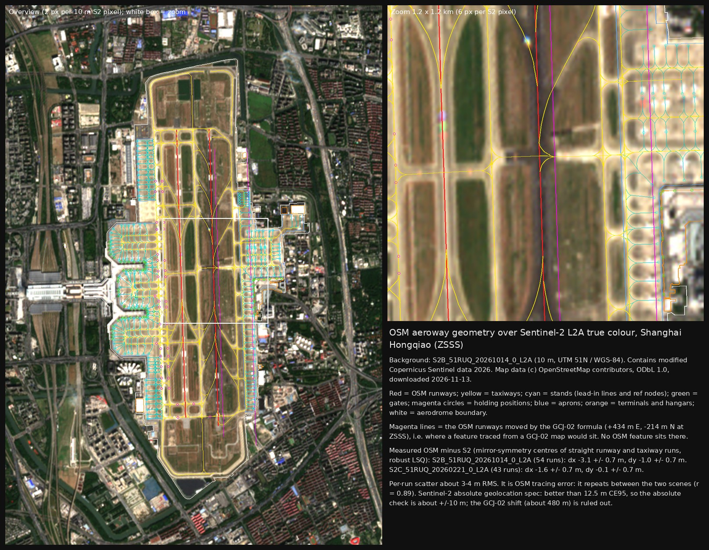

# Phase 0 / geo: OpenStreetMap at ZSSS and the GCJ-02 check

Date checked: 2026-11-13 (all downloads that day, UTC times in the SOURCES.json files).
Scope: OSM content at Shanghai Hongqiao (SHA / ZSSS); whether the OSM geometry is WGS-84 or
GCJ-02-shifted, measured against Sentinel-2; how complete and how recent the OSM airport mapping is.

## Verdict (short)

* **OSM at ZSSS is WGS-84. It is not GCJ-02.** The GCJ-02 formula predicts a shift of **+433.7 m E,
  -214.2 m N** (483.7 m) at the ARP. The measured offset of the OSM runway and taxiway centrelines against
  two Sentinel-2 L2A scenes is about **2 m**:
  * **S2B 2026-10-14:** OSM minus S2 = dx **-3.1 +/- 0.7 m**, dy **-1.0 +/- 0.7 m** (54 straight runs).
  * **S2C 2026-02-21:** dx **-1.6 +/- 0.7 m**, dy **-0.1 +/- 0.7 m** (43 runs).
  * **Two-scene mean:** dx **-2.4 m**, dy **-0.6 m**, with about +/-1 m relative uncertainty.

  That is far below the Sentinel-2 absolute geolocation specification of 12.5 m CE95. So the honest
  statement is: **OSM agrees with Sentinel-2 to within about 3 m, and its absolute WGS-84 position is
  confirmed to about +/-10 m (95 %)**, the limit of what Sentinel-2 can tell. A ~480 m GCJ-02 shift is
  excluded beyond any doubt.
* **No sign of GCJ-02 tracing.**
  * Every changeset that shaped the aeroway geometry names Bing, Maxar, Esri or Mapbox imagery. None
    names Baidu, Amap or Tencent.
  * No OSM object in the area carries a source tag naming a GCJ-02 map provider.
  * The surrounding motorways and primary roads also line up with Sentinel-2 at (0,0).
* **The OSM airport mapping is rich but uneven in age.**
  * **Runways:** 2, with ref and width.
  * **Taxiways:** 304 ways, 81 with ref.
  * **Stands:** 164 stand nodes with ref (101-608, three-digit apron-series numbering) plus 461 stand
    lead-in lines.
  * **Gates:** 58 gate nodes.
  * **Holding positions:** 37, without designators.
  * **Control tower:** 1 node.
  * **Other:** 4 aprons, 4 terminal objects, 4 hangars, 3 helipads.
  * **Missing:** no jet bridges, no navaids, and no runway or taxiway surface polygons.
  * **Edit dates:** the runway and taxiway geometry nodes mostly date from 2020-2021 (Maxar-traced). The
    aerodrome and Terminal 2 relations were re-made on 2026-11-06.
* **Published threshold coordinates: none obtained.**
  * The official CAAC eAIP needs a (free) registered login for the AIP itself.
  * Playwright got a proxy 502 on https://www.eaipchina.cn/ from this sandbox. curl reached the static shell.
  * The only comparison available is secondary: X-Plane Scenery Gateway and OurAirports. X-Plane runway ends
    agree with OSM to within 0.5 m across-track. Along-track they lie 0.2-15.8 m beyond the OSM ends.

`geo_overlay.jpg` shows the OSM aeroway features over the Sentinel-2 true-colour image (S2B 2026-10-14). The
magenta lines show where the runways would sit if the OSM data had been traced from a GCJ-02 map.

## Facts table

Status legend: verified = primary/official source read; secondary = secondary source only;
unverified = claimed but not checked; contradicted = sources disagree; **observed** = my own
measurement from the downloaded data; **inferred** = my interpretation.

| # | Topic | Value | Source URL | Date checked | Quote (verbatim, short) | Status |
|---|---|---|---|---|---|---|
| 1 | OSM licence | ODbL 1.0, attribution "(c) OpenStreetMap contributors" | https://api.openstreetmap.org/api/0.6/map?bbox=121.320,31.190,121.345,31.215 | 2026-11-13 | `copyright="OpenStreetMap and contributors" attribution="http://www.openstreetmap.org/copyright" license="http://opendatacommons.org/licenses/odbl/1-0/"` | verified |
| 2 | OSM aerodrome object | relation 21913346, aeroway=aerodrome, iata=SHA, icao=ZSSS, ele=3, v1 created 2026-11-06 by XD346 (changeset 191555152) | https://api.openstreetmap.org/api/0.6/relation/21913346/full | 2026-11-13 | `<tag k="iata" v="SHA"/> <tag k="icao" v="ZSSS"/> <tag k="ele" v="3"/>` | secondary (OSM) |
| 3 | OSM aerodrome extent | bbox 121.320793-121.347644 E, 31.175001-31.220299 N; area about 6.7 km^2 (2 outer ways, v23 / v21) | same | 2026-11-13 | Nominatim: `"boundingbox":["31.1750010","31.2202990","121.3207930","121.3476440"]` | secondary (OSM); area observed |
| 4 | Expected GCJ-02 shift at ZSSS | GCJ minus WGS = dlat -0.001931 deg, dlon +0.004554 deg = **+433.7 m E, -214.2 m N** (483.7 m) | formula in `sha3d/tools/geo/gcj02.py` (widely published "eviltransform" forward transform) | 2026-11-13 | n/a (computed) | inferred (formula is unofficial; the true GCJ-02 algorithm is not public) |
| 5 | OSM vs S2, scene S2B 2026-10-14 | OSM minus S2: dx -3.1 +/- 0.7 m, dy -1.0 +/- 0.7 m, 54 runs, residual RMS 4.3 m | https://earth-search.aws.element84.com/v1/collections/sentinel-2-l2a/items/S2B_51RUQ_20261014_0_L2A | 2026-11-13 | n/a (measured) | **observed** |
| 6 | OSM vs S2, scene S2C 2026-02-21 | OSM minus S2: dx -1.6 +/- 0.7 m, dy -0.1 +/- 0.7 m, 43 runs, residual RMS 3.6 m | https://earth-search.aws.element84.com/v1/collections/sentinel-2-l2a/items/S2C_51RUQ_20260221_0_L2A | 2026-11-13 | n/a (measured) | **observed** |
| 7 | Coarse GCJ test | mean NDVI along OSM runway and taxiway lines: 0.074 at zero shift (the minimum of a +/-900 m search), 0.189 at the GCJ-02 shift, 0.254 median over all shifts (S2B). Same picture in S2C: 0.056 / 0.133 / 0.160. | as 5, 6 | 2026-11-13 | n/a | **observed** |
| 8 | Scene-to-scene registration | S2B shifted +1.2 m E, 0.0 m N relative to S2C (phase correlation of gradient images, airport window). This matches the 1.5 m dx difference in rows 5-6. | as 5, 6 | 2026-11-13 | n/a | **observed** |
| 9 | S2 geolocation specification | absolute better than 12.5 m CE95; multi-temporal better than 0.3 px CE99 | https://isprs-archives.copernicus.org/articles/XLII-1-W1/447/2017/isprs-archives-XLII-1-W1-447-2017.pdf | 2026-11-13 | "The geolocation of L1C products refined with the GRI is better than 12.5 m CE95 (~2σ)." / "...better than 0.3 pixels CE99 (~3σ)." | secondary (peer-reviewed paper by the S2 geometry team, not the ESA spec document itself; ESA pages were unreachable: proxy 502) |
| 10 | S2 data licence | free, full, open; attribution "Contains modified Copernicus Sentinel data [Year]" | https://sentinel.esa.int/documents/247904/690755/Sentinel_Data_Legal_Notice (copy read from `refs/cache/licences/sentinel_legal_notice/`, saved by another phase-0 task) | 2026-11-13 | "users shall have a free, full and open access to Copernicus Sentinel Data" ... "'Contains modified Copernicus Sentinel data [Year]' for Sentinel data" | verified (document read) |
| 11 | Earth Search licence field | collection `license: proprietary`, link to the Sentinel Data Legal Notice | https://earth-search.aws.element84.com/v1/collections/sentinel-2-l2a | 2026-11-13 | `"license": "proprietary"` ... `"href": "https://sentinel.esa.int/documents/247904/690755/Sentinel_Data_Legal_Notice"` | verified |
| 12 | OSM runway 18L/36R | way 16714125 v14; N end 31.2131135, 121.3354641; S end 31.1825842, 121.3371157; 3388.5 m; true azimuth 177.34 deg / 357.34 deg; width=57.6 | https://api.openstreetmap.org/api/0.6/way/16714125/history | 2026-11-13 | `ref="18L/36R" width="57.6"` | secondary (OSM); length and azimuth observed (WGS-84 geodesic) |
| 13 | OSM runway 18R/36L | way 1477848219 v1 (2026-02-13); N end 31.2129628, 121.3316265; S end 31.1833933, 121.3332449; 3282.1 m; 177.31 deg / 357.31 deg; width=60 | https://api.openstreetmap.org/api/0.6/way/1477848219/history | 2026-11-13 | `ref="18R/36L" width="60"` | secondary (OSM); observed |
| 14 | Runway lengths and surfaces (published) | 18L/36R 3,400 m asphalt; 18R/36L 3,300 m concrete | https://en.wikipedia.org/wiki/Shanghai_Hongqiao_International_Airport | 2026-11-13 | infobox "18L/36R 3,400 11,155 Asphalt"; "18R/36L 3,300 10,827 Concrete" | secondary |
| 15 | Surfaces in imagery | 18L/36R appears dark (asphalt-like); 18R/36L bright (concrete-like), with a bright concrete section at the N end of 18L/36R | S2 scenes rows 5-6 | 2026-11-13 | n/a | **observed** (consistent with row 14) |
| 16 | X-Plane runway ends | 18L 31.21321265, 121.33545700 / 36R 31.18258666, 121.33712091; 18R 31.21310505, 121.33162445 / 36L 31.18328987, 121.33324654 (lengths 3399.3 / 3309.3 m) | https://gateway.x-plane.com/apiv1/scenery/107152 | 2026-11-13 | apt.dat `100 45.00 ... 18L  31.21321265  121.33545700 ... 36R  31.18258666  121.33712091` | secondary (imagery-traced sim scenery, uploaded 2025-06-24) |
| 17 | X-Plane minus OSM runway ends | across-track -0.4 to +0.5 m. Along-track: 18L end +11.0 m N, 36R end +0.2 m, 18R end +15.8 m N, 36L end 11.5 m S. OSM is shorter at three of four ends. | rows 12, 13, 16 | 2026-11-13 | n/a | **observed** |
| 18 | OurAirports runway ends | 18L 31.2132, 121.3350 (45 m from OSM); 18R/36L given to 3 decimals only (31.21, 121.332 / 31.186, 121.333), 290-330 m off | https://davidmegginson.github.io/ourairports-data/runways.csv | 2026-11-13 | `"ZSSS",10826,197,"CON",1,0,"18R",31.21,121.332,10,176,,"36L",31.186,121.333` | secondary; precision too low to use |
| 19 | ARP (working hypothesis) | OurAirports 31.198104 N, 121.33426 E; elevation 10 ft. It lies 14 m from the centroid of the two OSM runway midpoints. | https://davidmegginson.github.io/ourairports-data/airports.csv | 2026-11-13 | `27225,"ZSSS","large_airport","Shanghai Hongqiao International Airport",31.198104,121.33426,10` | secondary; the hypothesis value is confirmed as what OurAirports publishes |
| 20 | ARP (other secondaries) | Wikipedia 31°11′53″N 121°20′11″E (31.19806, 121.33639): same latitude as OurAirports, but **~200 m east**. X-Plane gateway datum 31.196666667, 121.335: 161 m from the runway-midpoint centroid. | https://en.wikipedia.org/wiki/Shanghai_Hongqiao_International_Airport ; https://gateway.x-plane.com/apiv1/scenery/107152 | 2026-11-13 | "31°11′53″N 121°20′11″E"; `"datum_lat": "31.196666667", "datum_lon": "121.335"` | **contradicted** (secondaries disagree by 160-200 m; official AD 2.2 ARP not obtained) |
| 21 | Stand numbering | 164 OSM stand nodes with ref 101-608 (series 1xx 13, 2xx 70, 3xx 42, 4xx 13, 5xx 16, 6xx 10; suffixes 238A, 240A, 259A, 604A/B). A 2024 changeset says the refs were revised from chart "ZSSS-2B". | https://api.openstreetmap.org/api/0.6/changesets?changesets=...156103366... | 2026-11-13 | changeset 156103366 comment: "根据ZSSS-2B修订停机位编号" ("revised stand numbers according to ZSSS-2B") | refs: secondary; link to the AIP chart: **unverified** (chart not seen) |
| 22 | Stand cross-check | 159 of 164 OSM stand refs also in X-Plane gateway (169 stands). Median position difference 5.8 m, p90 14.3 m, max 22 m. | rows 16, 21 | 2026-11-13 | X-Plane `1300  31.19832282  121.34422306 177.7 tie_down jets\|turboprops 101` | **observed** |
| 23 | Gates | 58 aeroway=gate nodes. Refs 2-16 (13, east/T1 side, PPilate 2024-09-04); refs 21-75 (45, west/T2 side, layer=2, fdulezi 2015-05-31). | OSM tiles | 2026-11-13 | changeset 156166968 comment "add gate refs" | secondary (OSM) |
| 24 | Control tower | node 3342630333, man_made=tower, tower:type=aircraft_control, 31.1966742 N, 121.3415341 E (east side). It is 2 m from X-Plane's tower viewpoint. Two more untyped man_made=tower buildings sit at 31.1879, 121.3264 and 31.1873, 121.3258 (SW, added 2026-11-06). | OSM tiles | 2026-11-13 | `tower:type=aircraft_control` | secondary; whether one of the SW buildings is the west tower is **inferred/unverified** |
| 25 | Imagery used by OSM mappers | Bing (2015, 2017), Maxar Premium (2020-2022), Esri / Mapbox (2024-2026); no Chinese GCJ-02 map named | https://api.openstreetmap.org/api/0.6/changesets?changesets=... (53 ids, saved in `refs/cache/osm_changesets/`) | 2026-11-13 | e.g. 92754374: "Improved the geometry of taxiways in Shanghai Hongqiao International Airport #adt", `source=Maxar Premium Imagery` | verified (changeset metadata read) |
| 26 | Official eAIP access | The AIP needs free registration; downloads carry a session token. Playwright got a 502 from this sandbox. | https://www.eaipchina.cn/ (JS bundle js/index.7f3eba16.js) | 2026-11-13 | "The China Aeronautical Information Publication (AIP) can be registered and accessed free of charge via this website." | verified (site text); content not retrieved |

## 1. OSM download

* **Aerodrome found first.** Nominatim returned relation 21913346 (aeroway=aerodrome, ZSSS) with bbox
  31.1750-31.2203 N, 121.3208-121.3476 E. `relation/21913346/full` was then saved.
* **Map tiles.** `/api/0.6/map` was fetched as 3 x 3 tiles of 0.025 deg covering 121.295-121.370 E,
  31.165-31.235 N. That is the aerodrome plus about 1.5 km for the Hongqiao hub and the expressways.
  * Each tile is about 0.0006 sq deg and holds 3.7k-10.2k nodes, well below the 0.25 sq deg and 50,000-node limits.
  * Merged: 53,742 nodes, 8,352 ways, 816 relations. Downloaded 2026-11-13 19:13:51Z-19:14:17Z.
* **Files:** `sha3d/refs/cache/osm/api_map_tiles_geo/`, with its `SOURCES.json` (URLs, per-tile timestamps,
  sha256, ODbL quote).
  * Other phase-0 tasks keep their own OSM extracts in sibling subdirectories (`api_map_zsss`,
    `api_map_north`, `derived_zsss`). I did not touch those.
* **Metadata:**
  * Changeset metadata for the 53 changesets that last touched aeroway objects: `refs/cache/osm_changesets/`.
  * Runway way histories and changeset 178515471: `refs/cache/osm_history/`.

## 2. Inventory (observed in the 2026-11-13 download)

| Class | Count | Tags / remarks | Last-edit range (median) | Main mappers |
|---|---|---|---|---|
| aerodrome | 1 relation (multipolygon) | iata, icao, ele=3, name:* in 30 languages, operator, wikidata Q421811 | 2026-11-06 | XD346 |
| runway | 2 ways | ref 18L/36R (width 57.6), 18R/36L (width 60). No surface, length or threshold nodes, no runway area polygons. Both ways are straight to <0.1 m. | 2026-02-13 (way objects); geometry nodes mostly 2021-03-30 | Nkhk_KMG (way touch), XD346 (nodes, Maxar) |
| taxiway | 304 ways (about 49 km) | 81 with ref: A, A1-A4, B, B1-B8, BN, BS, C, C1-C4, D, D3-D5, H1-H7, L01, L10, L13, L15-L17, M1-M6, N, S, T1, T6, Y1-Y3. 223 have no ref (taxilanes and connectors). oneway on 39. No width tags. Plus 1 aeroway=construction (taxiway, 2025). | 2011..2026-10-23 (2017-09) | aighes 122, ObRiver 62, blblfdl 33, XD346 26 |
| apron | 4 ways | 1 large untagged (east, T1). ref 2 (west/T2 centre), ref 4 (NW), ref 6 (SW). The refs are 2015 tags; whether they are official apron names is unverified. | 2015-02-07..2024-05-31 | aighes, Yueng |
| terminal | 3 ways + 1 relation | T1 (way 93184730, building=hall, **source=estimation**). T2 (relation 21913345, created 2026-11-06, shares an outer way with the aerodrome). Business-aviation terminal 虹桥公务机楼. "虹桥东区 VVIP". No building heights or levels. | 2022-04-04..2026-11-06 | PinkBluWht, XD346 |
| parking_position (nodes) | 164 | all with ref, 101-608 (see fact 21); no other tags | 2017..2026-11-06 (2020-10-20) | ObRiver 92, Austin Zhu 38, Aaron_ZSAM 29 |
| parking_position (ways) | 461 | stand lead-in lines, none with ref | 2015..2025-06-22 (2020-10-19) | ObRiver 221, aighes 115, Austin Zhu 88 |
| gate | 58 nodes | ref 2-16 (T1) and 21-75 (T2, layer=2) | 2015-05-31 / 2024-09-04 | fdulezi, PPilate |
| jet bridge | **0** | no aeroway=jet_bridge, no man_made=* bridge-like tags, nothing tagged "jet" | n/a | n/a |
| holding_position | 37 nodes | no ref or designation; all west of runway 18R/36L, in two rows (about 121.3292-121.3298 E and 121.3300-121.3311 E) on the connectors to the T2 side; none at 18L/36R | all 2021-04-12 | 小哥哥 (one iD edit, Maxar) |
| control tower | 1 node + 2 buildings | see fact 24 | 2021-04-09; 2026-11-06 | lizzyd710; XD346 |
| hangar | 4 ways | incl. 中国东方航空公司机库 (China Eastern hangar) | 2021-10-26..2026-11-06 | h4ic8bn3kstr, XD346 |
| helipad | 3 areas | converted from nodes by a MapRoulette task (2024) | 2024-01-18 | Ropino |
| navaids | **0** | no ILS/VOR/DME/NDB, no windsock, no airmark | n/a | n/a |
| buildings inside the aerodrome polygon | 11 | 7 yes, 3 hangar, 1 hall; none with height | 2017..2026 | mixed |

**Surroundings (the Hongqiao transport hub), all in the downloaded tiles:**

* **Expressways:**
  * S20 Outer Ring Expressway (外环高速, motorway, about 17 km in the window).
  * G50 Huyu Expressway (沪渝高速).
  * S228 Jiamin Elevated (嘉闵高架路, trunk).
  * Yan'an Elevated (延安高架路), Beidi Elevated (北翟高架路), Hongyu, Jianhong and Songze Elevated.
  * G318 Huqingping Highway.
  * T2 and railway-station departure ramps (2号航站楼出发, 虹桥火车站出发, trunk).
  * Yingbin San Lu tunnel (迎宾三路地道).
  * Totals: 52 motorway, 140 trunk, 367 primary and 561 secondary ways.
* **Rail:**
  * Shanghai Hongqiao railway station (上海虹桥, 31.1960 N, 121.3162 E).
  * Lines: 京沪高铁 (Beijing-Shanghai HSR), 沪昆线 / 沪昆高速线, 沪宁城际虹桥联络线, 沪苏湖高速线,
    市域铁机场联络线 (airport link line), 嘉闵线 (part built, part under construction), EMU depot spurs.
* **Metro:**
  * Lines 2, 10 and 17.
  * Stations: Hongqiao Railway Station, Hongqiao Airport Terminal 2 (31.1961, 121.3198), Hongqiao Airport
    Terminal 1 (31.1933, 121.3427), National Exhibition and Convention Center.
  * Hongqiao long-distance bus terminal.

## 3. How complete and how recent (observed + inferred)

* **Recency.**
  * The most recent airport edits are 2026-11-06 (XD346: aerodrome and T2 relations, China Eastern
    maintenance base, hotels) and 2026-10-23 (Maps Man: taxiways BN and H1, waterways).
  * The runway way objects were last touched on 2026-02-13 (Nkhk_KMG, Go Map!!, Esri). That changeset was
    mostly about Kunming (its other runway way is ZPPP 04R/22L).
  * In practice the runway and taxiway geometry is 2020-2021 work. By last-edit year, the 3,217 runway and
    taxiway node references split as: 2017: 245, 2020: 1,584, 2021: 1,281, 2022-2026: 107.
* **History.**
  * **2007-2011:** first runway sketches (`source=estimation`), yangfl.
  * **2015-02:** aighes (`source=bing aerial image`) added most of the airport, including taxiways, stand
    lines and aprons.
  * **2017-01:** Austin Zhu, Bing ("SHA taxiway fix", "ZSSS Refined").
  * **2020-10:** ObRiver re-aligned the taxiways, service roads, stand polygons and aerodrome polygon from
    Maxar Premium Imagery. The comments carry the hashtag `#adt`, which looks like an organised-editing team.
    I did not identify the team.
  * **2021-03/04:** XD346 ("SHA滑行道", Maxar) rebuilt the runways and taxiways. 小哥哥 added the holding positions.
  * **2024-09:** Aaron_ZSAM renumbered the stands from chart ZSSS-2B; PPilate added the T1 gate refs.
  * **2025-2026:** small fixes. No bulk imports were found: every editor is JOSM, iD or Go Map!!.
* **Gaps for sha3d.**
  * No jet bridges.
  * No runway or taxiway surface polygons. Only centrelines and widths for the 2 runways; apron outlines exist.
  * No navaids. No threshold or touchdown nodes.
  * Holding positions have no designators.
  * Only 27 % of taxiway ways have a ref.
  * Taxiway refs and stand refs are **not yet checked against the AIP** (needs eAIP AD 2 / ZSSS-2x charts).
  * Terminal 1's outline is tagged `source=estimation`.
  * No building heights anywhere on the airport.
* **GCJ-02 tracing.** Nothing suggests it:
  * Changeset imagery is all WGS-84 aerial imagery (Bing, Maxar, Esri, Mapbox), as listed in the facts table.
  * None of the `source*=*` tags in the downloaded area names Baidu, Gaode/Amap/AutoNavi, Tencent or Google. The
    commonest values are GPS 206, maxar 51, Bing 51, digitalglobe 13 and estimation 5.
  * The one Chinese-map reference is a `boundary=metropole` relation (上海中心城区) citing a Tianditu Shanghai
    schematic. It is not airport geometry. Tianditu uses CGCS2000, not GCJ-02.
  * The geometric tests in section 4 find no shift.

## 4. GCJ-02 check against Sentinel-2

**Imagery (WGS-84, UTM 51N, EPSG:32651).** Two Earth Search STAC items of tile 51RUQ, relative orbit R089:

* `S2B_MSIL2A_20261014T023639_N0513_R089_T51RUQ_20261014T044615`: tile cloud 1.98 %, the most recent
  clear scene.
* `S2C_MSIL2A_20260221T023731_N0512_R089_T51RUQ_20260221T060315`: tile cloud 0.03 %.
* Over the aerodrome bbox, the SCL scene-classification band (20 m) has no cloud pixels (classes 8/9/10) in either scene.
* B02, B03, B04, B08, TCI and SCL were read as COG windows with HTTP range requests (rasterio 1.5.2 /
  GDAL /vsicurl). Window: 121.300-121.370 E, 31.165-31.235 N, 679 x 786 px.
* Saved in `sha3d/refs/cache/s2/<scene>/` with the STAC item and `s2/SOURCES.json`.
* Attribution: "Contains modified Copernicus Sentinel data 2026".

**Method** (`sha3d/tools/geo/s2_osm_align.py`):

1. **Coarse test (is there a shift of hundreds of metres?).**
   * All OSM runway and taxiway centrelines were sampled every 5 m, shifted over a +/-900 m grid (10 m
     steps), and scored by the mean NDVI along the lines. Pavement has low NDVI.
   * Result, both scenes: the minimum sits exactly at (0,0).
     * S2B: 0.074 at (0,0) against 0.189 at the GCJ-02 position and a 0.254 median.
     * S2C: 0.056 / 0.133 / 0.160.
   * The same test on the off-airport roads (motorway/trunk and primary/secondary at ground level, about
     4k and 29k sample points) also gives (0,0), with one exception: the winter motorway/trunk run had a
     false minimum at (+40, -120). There NDVI was 0.128 against 0.141 at (0,0), because winter vegetation
     gives weak contrast.
   * A fine +/-30 m search puts all four road minima within 2 m of zero. **The surrounding road network is WGS-84 as well.**
2. **Fine offset (edge/symmetry fitting).**
   * Every runway and taxiway way was split into straight runs: nodes within 1 m of the chord, run length
     >= 120 m. That gave 78 runs, including both full runways (3388 m and 3282 m).
   * Along each run, cross-profiles of B04 (red) and B08 (NIR) were sampled every 2.5 m at 0.25 m spacing,
     bilinear. The runways sit 1.8 deg off grid north, so the sub-pixel phase sweeps through all values
     along a run (super-resolution by stacking).
   * The **median** profile was taken (robust against intersections). Its **mirror-symmetry centre** was
     found by minimising the SSD of m(c+t) against m(c-t), with parabolic sub-sample refinement. This is
     robust to symmetric shoulders, markings and blur.
   * Uncertainty per run: bootstrap over stations.
   * Runs were rejected when asymmetric (SSD/var > 0.08), low-contrast, bootstrap SD > 2 m, or when B04 and
     B08 disagree by > 3 m.
   * The kept runs' normal offsets were combined in a Huber-weighted least-squares fit for (dx, dy).

| | S2B 2026-10-14 | S2C 2026-02-21 |
|---|---|---|
| runs used | 54 of 78 | 43 of 78 |
| OSM minus S2, dx (E) | **-3.09 +/- 0.72 m** | **-1.61 +/- 0.75 m** |
| OSM minus S2, dy (N) | **-1.00 +/- 0.69 m** | **-0.14 +/- 0.72 m** |
| residual RMS / MAD | 4.3 / 3.2 m | 3.6 / 3.3 m |
| runway 18L/36R across-track (B04 / B08) | -1.1 / -1.8 m (B04 asymmetric, not used) | -0.3 / -0.3 m |
| runway 18R/36L across-track (B04 / B08) | -1.2 / -2.9 m (B04 asymmetric, not used) | -2.3 / -1.8 m |
| E-W taxiway runs, dy median | -0.4 m | -0.2 m |
| N-S runs, dx median | -2.9 m | -1.8 m |

**What the numbers mean.**

* **Relative precision.** The formal SE is about 0.7 m. The two scenes differ by 1.5 m in dx and 0.9 m in dy.
  Direct phase correlation of the two scenes gives 1.2 m E, 0.0 m N, so the difference is S2-to-S2
  registration, not OSM. **Best estimate: OSM minus S2 = (-2.4, -0.6) m +/- about 1 m (relative to Sentinel-2).**
* **Absolute.** Sentinel-2's own absolute geolocation is specified to 12.5 m CE95 (fact 9). A ~2 m offset is
  therefore not evidence that OSM is wrong. OSM's absolute WGS-84 accuracy is confirmed only to about
  +/-10 m (95 %) by this check. A sub-metre absolute check needs surveyed AIP threshold coordinates (see section 5).
* **Per-feature error.**
  * Taxiway runs scatter about 3-4 m RMS around the common offset.
  * The residuals repeat between the scenes (correlation 0.89, RMS difference 1.8 m), so they are OSM
    tracing errors, not image noise.
  * Worst runs (both scenes): C4 (way 128706533, +12.6 / +6.8 m), D (way 1408578284, -7.7 / -9.7 m),
    H5 (way 520931651, +7.6 / +6.6 m), B4 (+6.4 / +5.5 m), A2 (-5.1 / -5.9 m).
  * Inferred: OSM centrelines are good to about 5 m, with a few 10 m outliers. sha3d should snap or
    re-derive taxiway centrelines from imagery if it needs metre-level accuracy.
* **GCJ-02.** The predicted shift (483.7 m) is about 200x the measured offset. Excluded.

**Overlay:** `sha3d/docs/phase0/geo_overlay.jpg` (1614 x 1254). Left: the overview at 2 px per S2 pixel.
Right: a 1.2 km zoom at 6 px per pixel. Drawn: OSM runways, taxiways, stands, gates, holding positions,
aprons, terminals and the aerodrome boundary, plus the runways moved by the GCJ-02 formula in magenta.
Per-run results: `sha3d/docs/phase0/geo_align_S2B_51RUQ_20261014.json` and `geo_align_S2C_51RUQ_20260221.json`.

## 5. Runway ends against "published" coordinates

**Official THR coordinates (eAIP ZSSS AD 2.12) were not obtained.**

* https://www.eaipchina.cn/ answers curl with the SPA shell. Headless Chromium got a proxy
  `502 upstream request failed`, twice.
* The JSON API returns `"login has expired"` for `/eaip/package/listPage`.
* The site states the AIP "can be registered and accessed free of charge via this website", and downloads
  append a session `token`.
* A public endpoint `/eaip/airportChart/listPublish` does list a ZSSS chart file (`ZSSS上海虹桥.pdf`,
  2025-02-14). It belongs to a set of 20 airports' "进场提示图"-type files and is probably not AD 2.12.
  I did not download it: the download path also takes a token.
* Getting the AIP needs an owner decision on registering an account.

**Secondary comparison (observed).**

| End | OSM (lat, lon) | X-Plane minus OSM along-track (+N) / across (+E) | S2 along-track pavement edge beyond the OSM end |
|---|---|---|---|
| 18L (N end of 18L/36R) | 31.2131135, 121.3354641 | +11.0 m / -0.2 m | bright concrete section ends about 9 m beyond the OSM end (half-level crossing, B04), then dark pavement |
| 36R (S end) | 31.1825842, 121.3371157 | +0.2 m / +0.5 m | no clean edge (pavement continues) |
| 18R (N end of 18R/36L) | 31.2129628, 121.3316265 | +15.8 m / +0.5 m | pavement edge about 13 m beyond the OSM end |
| 36L (S end) | 31.1833933, 121.3332449 | -11.5 m / -0.4 m | pavement continues about 120 m beyond the OSM end (inferred: stopway, blast pad or turn pad) |

* **Inferred:**
  * Across-track, OSM and X-Plane agree to 0.5 m.
  * At the north ends, OSM stops about 10-15 m short of the imaged pavement end (X-Plane matches the imaged end).
  * Neither source marks thresholds as such.
  * OSM lengths are 3388.5 / 3282.1 m, X-Plane 3399.3 / 3309.3 m, Wikipedia 3,400 / 3,300 m.
* **OurAirports:**
  * runway ends are low-precision (18R/36L to 3 decimals; 290-330 m off), so not usable;
  * the ARP (31.198104, 121.33426) is consistent with OSM: it lies 14 m from the midpoint centroid of the
    two OSM runways, between the runways.

## 6. Observed vs inferred (summary)

* **Observed:**
  * all counts, tags, dates and mappers;
  * the offsets in section 4 and their scene-to-scene consistency;
  * runway lengths and azimuths computed from OSM nodes;
  * the X-Plane/OSM end differences;
  * the S2 along-track pavement transitions;
  * runway surface tone in imagery;
  * stand-ref agreement with X-Plane.
* **Inferred:**
  * that the residual 2 m is S2 geolocation rather than OSM error;
  * that the OSM runway ends are the physical pavement ends minus about 10-15 m at the north;
  * that stand refs follow the AIP numbering (claimed in a changeset comment; X-Plane uses the same numbers);
  * which SW building is the west tower;
  * that `#adt` is an organised-editing team.
* **Not checked:**
  * AIP THR coordinates, taxiway designators, stand list (eAIP login);
  * buildings off-airport;
  * OSM feature alignment outside the 7 x 8 km window.

## 7. Risks and open questions

* **Risk: the absolute position is only confirmed to about +/-10 m by Sentinel-2.** Fine for a 3-D scene.
  ADS-B positions (WGS-84) will be compared with OSM centrelines, so a 2-5 m offset is negligible next to
  ADS-B NACp. Still, sub-metre work needs surveyed AIP THR/ARP coordinates.
* **Risk: OSM taxiway centreline errors** of 5-13 m on some runs (C4, D, H5). Ground traffic snapped to OSM
  could look off-centre. Consider re-fitting centrelines to imagery.
* **Risk: missing jet bridges, navaids and surface polygons.** These must be modelled from imagery or AIP
  charts, never traced from Google/Baidu/Amap.
* **Risk: OSM changes.** The aerodrome and T2 relations were re-created a week ago (2026-11-06). Pin the
  download date and IDs, and re-download before any build.
* **Risk: the X-Plane and OurAirports licences are unverified.** Use them only as cross-checks. ourairports.com
  failed TLS verification (expired certificate) from this sandbox.
* **Open:** the official ARP. Secondary sources disagree by 160-200 m (OurAirports, Wikipedia, X-Plane).

## 8. Files and tools

* **Downloads** (gitignored `refs/cache`; each directory has a `SOURCES.json`):
  * `sha3d/refs/cache/osm/api_map_tiles_geo/`: OSM API tiles and aerodrome relation (ODbL, redistributable
    with attribution).
  * `sha3d/refs/cache/osm_changesets/`, `sha3d/refs/cache/osm_history/`: OSM metadata (ODbL).
  * `sha3d/refs/cache/s2/`: two Sentinel-2 L2A window crops plus STAC items and collection (free, with
    attribution "Contains modified Copernicus Sentinel data 2026").
  * `sha3d/refs/cache/xplane_gateway/`: ZSSS airport and scenery 107152 (licence unverified; reference only).
  * `sha3d/refs/cache/ourairports_runways/`: runways.csv and airports.csv (licence unverified).
  * `sha3d/refs/cache/s2_geoloc_isprs2017/`: ISPRS 2017 GRI paper (CC BY 3.0).
* **Tools** (run with `python3 -I`, data paths as arguments):
  * `sha3d/tools/geo/osm_load.py`: merges OSM tiles.
  * `sha3d/tools/geo/s2_crop.py`: COG window reader.
  * `sha3d/tools/geo/s2_osm_align.py`: coarse NDVI test and fine mirror-symmetry offset fit.
  * `sha3d/tools/geo/gcj02.py`: predicts the GCJ-02 shift; used only to predict, never to convert data.
  * `sha3d/tools/geo/geo_overlay.py`: overlay image.
* **Reproduce:**
  `python3 -I sha3d/tools/geo/s2_osm_align.py sha3d/refs/cache/osm/api_map_tiles_geo sha3d/refs/cache/s2/S2C_51RUQ_20260221_0_L2A out.json`
