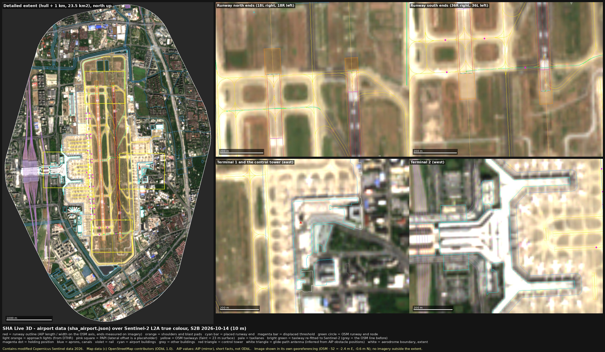
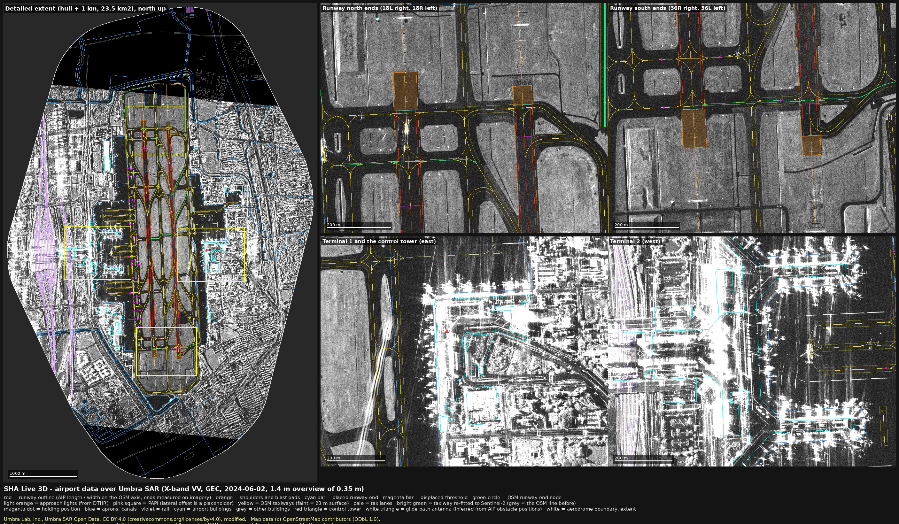

# Phase 1 / A1: airport geometry (frame, pinned OSM, `sha_airport.json`)

Date: 2026-11-14. Task A1 of Phase 1 (docs/PLAN.md §7), under owner decisions OD0-OD3 and the §6b working defaults.
Nothing in `sfo3d/`, `pc12/` or `hwd3d/` was touched; nothing was committed. **Updated after fix round 1 of the QA
(`qa_data.md`, findings H1, M1, M2, M7, M8, L2, L3, L5)**: the numbers below are the rebuilt ones.

Labels: **obs** = mapped in OSM, measured by me on Sentinel-2 / Umbra, or read in a source; **inf** = inferred by a
stated rule; **AIP (mirror)** = value read in the unofficial mirror of AIP China EFF 2026-07-08 (OD3, short facts only).

## 0. Summary

| Item | Result |
|---|---|
| Frame | `tools/common/frame.py`: exact ENU tangent plane on WGS 84 at the OD0 origin 31.19784885 N 121.3362899 E. Same as PROJ `+proj=topocentric` to 1e-12 m; plane vs geodesic distance **0.52 mm at 5 km**; curvature drop not drawn (1.97 m at 5 km). Height chain y = AIP datum; `ground_y` 2.5 m; K_DEM = +1.30 m (obs); EGM2008 N = +11.267 m (11.16-11.35 m over the extent); h_WGS84 = y + 9.97 m at the origin. |
| Pinned OSM | 16 API requests 2026-11-14 04:52:29-04:55:48Z; 34,550 nodes / 5,206 ways / 593 relations downloaded; **27 sensitive elements dropped by the tag rule, plus 5 features by the area rules and, since fix round 2, 25 features by the line rules; since fix round 3, 13 vertices removed from kept ways (rule g)** (counts only); clipped to the hull + 1 km extent (**23.55 km²**); 5,651 features, 2.4 MB GeoJSON in `refs/cache/osm_pinned/` (meant to be committed). |
| Runways | OSM centrelines; ends **measured** on Sentinel-2 (2 scenes) and Umbra: 18L/36R 3396.9 m (AIP 3400, −3.1 m), 18R/36L 3302.6 m (AIP 3300, +2.6 m). North ends aligned to 0.5 m (AIP: "north ends aligned"). Placed ends lie 8.9 / 2.5 / 8.6 / 9.4 m beyond the OSM end nodes (18L / 36R / 18R / 36L). The AIP (mirror) values the simulator and renderer use (dimensions, shoulders, blast pads, surface sections, displaced thresholds, declared distances, THR / DTHR elevations, PAPI, approach lights) sit in **one `aip_facts` block per runway with its own notice** (not covered by ODbL). 49 AIP probe strings, checked against the local mirror into a local log only. |
| Taxiways | 247 taxiways + 58 taxilanes (OSM; 81 with ref, 51 designators). 84 straight runs ≥ 100 m tested against S2 (2 scenes) + Umbra, with the Umbra registration measured on the runway bands (+3.07 m E): 22 measured, **8 runs re-fitted on 7 ways** (A1 +7.7 m, N +7.0, A2 +6.7 / +3.8, H7 −4.8, H4 +4.7, an unnamed taxiway −3.8, H2 +3.5); BN (S2 −3.7, Umbra −0.6) is left at OSM by the Umbra veto (fix round 2). Of the five phase-0 flags A2 is confirmed and moved; D was a measurement artefact (shown in `airport_twy_checks.jpg`); B4, C4 and H5 are not measurable with grass on both sides. |
| Other airfield | 37 holding positions, 4 aprons, 3 helipads, derived surface polygons (runway, shoulders + blast pads, taxiway 23 m, taxiway shoulders 44 m), control tower (OSM node 6.7 m from the AIP obstacle position; 44.5 m high, inf), **4 glide-path antennas inferred** from AIP obstacle rows. |
| Buildings | 35 airport buildings (T1, T2, FBO, VVIP, China Eastern hangar and office, 3 more hangars, 2 SW towers, ...) and 401 context buildings. No OSM height tags exist at the airport: every airport height is **inf** (AIP obstacle or a rule by kind). 3 context buildings get heights from AIP obstacles. |
| Context | Hongqiao hub (12 station features incl. Shanghai Hongqiao Station, the bus terminal, the T2 suburban station and metro stations), 1,002 road ways, 275 rail ways, 126 waterways (canals, rivers, ditches), 18 water areas, aerodrome boundary, extent ring. |
| Images | `airport_overlay.jpg` (S2), `airport_overlay_umbra.jpg` (SAR), `airport_rwy_ends.png`, `airport_twy_refit.png`, `airport_twy_checks.jpg`, all with attribution on the image and no imagery outside the extent; listed with sha256 in `SOURCES_airport.json`. |



## 1. Frame: `tools/common/frame.py`

**Origin (OD0).** The midpoint of the end nodes of OSM way 16714125 (RWY 18L/36R): node 3336195147 (v3, 31.2131135 N
121.3354641 E) and node 13556389849 (v1, 31.1825842 N 121.3371157 E). Their arithmetic mean is exactly 31.19784885 N,
121.3362899 E. The geodesic midpoint lies 12.8 mm away. `test_frame.py` checks that the pinned extract still has these
two nodes with these coordinates. All geometry stays WGS 84; the origin only defines the metre grid.

**Axes** as sfo3d: x = east, z = south, y = up, metres; heading h -> world vector (sin h, −cos h).

**Method.** An exact local tangent plane (ENU) on the WGS 84 ellipsoid at the origin, h = 0: lat/lon -> ECEF ->
east/north. The inverse is a fixed-Jacobian Newton iteration. The world is flat (y is height above the ground point).
This is the sfo3d / hwd3d design with a WGS 84 ellipsoid and no datum shift. All inputs are WGS 84: OSM, Sentinel-2
(UTM 51N / WGS 84), Umbra and ADS-B. The module is stdlib-only, so a JS twin can copy it constant for constant.

| Check (`python3 -I tools/common/test_frame.py refs/cache/osm_pinned/pin_summary.json`) | Measured |
|---|---|
| vs PROJ `+proj=cart` + `+proj=topocentric` (400 points within 6 km) | max 9e-13 m |
| round trip en -> ll -> en | max 3.4e-9 m (float64 floor at ECEF scale) |
| plane distance − geodesic distance (pyproj Geod, 24 azimuths) | 1 km: 4e-6 m; 2 km: 3e-5 m; **5 km: 0.52 mm**; 10 km: 4.1 mm; 50 km: 0.52 m |
| curvature drop (not drawn) | 0.08 m at 1 km, 0.31 m at 2 km, **1.97 m at 5 km**, 7.9 m at 10 km |
| "111320 m/deg" shortcut vs exact, at the runway ends | 6.8 m north-south (0.40 % long), 0.3 m east-west (0.09 % short): never use it |
| CGCS2000 vs WGS 84 for a fixed point (plate motion 2000.0 -> 2026.87, PROJ ITRF2014:EURA) | 0.72 m E, −0.29 m N (0.78 m) [inf, not modelled; only matters if surveyed CGCS2000 coordinates are mixed in; the AIP has none for ZSSS] |

**Height chain** (all constants in `frame.py` and in the JSON `frame` block):

| Quantity | Value | Status |
|---|---|---|
| y | height in the AIP datum (numerically the AIP elevations) | AIP (mirror); datum not stated. Wusong (H_Wusong = H_1985 + 1.680 m) is inferred. |
| AD ELEV | 3.0 m (`field_elev_y`) | AIP (mirror) AD 2.2 |
| THR / DTHR | 18L 2.1 / 2.0; 36R 2.7 / 2.6; 18R 2.6 / 2.6; 36L 2.6 / 2.7 m (TDZ elevations are not kept) | AIP (mirror) AD 2.12 |
| `ground_y_nominal` | **2.5 m** = mean of the 8 THR/DTHR values (2.49), for code without terrain | inf |
| Copernicus GLO-30 -> y | y = H_EGM2008 + **K_DEM**, K_DEM = **+1.30 m** (sd 0.27, n = 8 AIP runway points; all 8 DEM samples lie on WorldDEM airport-edited planes of 1.0 / 1.5 m; tile LE90 1.92 m, so ±2 m) | obs |
| EGM2008 N | **+11.267 m** at the origin (bilinear in NGA `us_nga_egm08_25.tif`; phase 0 gave 11.24 at the nearest node). Over the extent N = 11.16-11.35 m (bilinear in the node-registered grid, on the extent ring; corrected in fix round 1, QA L3); plane fit N = 11.267 + 4.184e-5·x + 8.77e-6·z, good to 4 mm within ±4 km | obs |
| y -> WGS 84 ellipsoidal | h = y − K_DEM + N(x, z) ≈ **y + 9.97 m** at the origin; the field (3.0 m) is at about 12.97 m HAE | inf (if the AIP is Wusong and EGM2008 equalled the 1985 datum, h = y − 1.68 + N = y + 9.59 m: 0.38 m apart, inside the DEM's ±2 m) |
| barometric | an altitude on QNH ≈ y; ADS-B `alt_baro` (pressure altitude) -> y with `y_from_pressure_alt(ft, qnh)` (ISA) | inf |

Read the other way: if the AIP is Wusong, EGM2008 heights ≈ H_1985 + 0.4 m here (1.68 − 1.30). That is not verified.

The geoid window (31.0-31.4 N, 121.0-121.7 E, public domain NGA) is in `refs/cache/geoid_egm2008/` with a SOURCES.json.

## 2. Pinned OSM extract: `refs/cache/osm_pinned/` (meant to be committed)

- **Extent.** Fresh `relation/21913346/full` (v1, 2026-11-06T12:00:40Z, outer ways 428121878 and 70364442). Convex hull
  in the world frame 8.49 km², buffered by 1000 m (round joins, 64 segments per quarter) = **23.545 km²** (PLAN: 23.5).
  bbox 121.3103-121.3581 E, 31.1660-31.2293 N.
- **Download** (`tools/osm/fetch_osm.py`, sequential, 1.5 s apart, generic User-Agent): 12 `/map` tiles of
  0.0163 × 0.0161°, plus `relation/<id>/full` for the aerodrome and for 3 multipolygons the tiles left incomplete (a
  school, a river and an industrial site). 16 requests, 2026-11-14 04:52:29Z-04:55:48Z, all HTTP 200, no version
  conflicts between tiles. The newest element is dated 2026-11-12T14:49:04Z. Raw tiles: `refs/cache/osm_pinned_raw/20261114/`.
  **Local only**: they still contain the sensitive features.
- **Sensitive filter** (`tools/law/osm_sensitive.py`, extended from the phase-0 version into a library rule; PLAN §6b
  classes): it matches on tags, and on names for non-linear features. Dropped: **27 elements** (police class 22, of
  which 19 are `man_made=surveillance` cameras dropped conservatively; military 3; armed police 1; prison 1). It also
  drops untagged members used only by dropped elements and, since fix round 1 (QA H1), every feature **on or within
  10 m** of a dropped area (rule b: 1) and every feature running **≥ 25 m along** a dropped outline within 10 m
  (rule c: 4). Named or public-class roads, railways, waterways and the aerodrome boundary are exempt from rule (c)
  only. Fire stations are kept (civil since 2018). Ids, names, positions, sizes and distances of dropped elements are
  in no output file; the counts per class and per rule are in `pin_summary.json`.
- **Dropped lines** (fix round 2, re-verify N1): the 3 dropped military-usage railway lines are sensitive geometry
  too. Dropped in addition, per rule: on a dropped line 1 and along one 3 (rule d); railway points near a dropped
  feature 14 and of dropped railway track 3 (rule e); non-passenger railway near a dropped feature 2 and connected to
  it 2 (rule f). Public roads are not exempt from rule (d); waterways, passenger railways and the aerodrome boundary
  are. Passenger lines and station tracks are kept (rule f). `osm_elements.json` lists no node that belongs only to
  dropped features.
- **Crossing vertices** (fix round 3, re-verify 2 R2 / R3): rule (g) removes from the kept geometry every vertex a kept
  way shared with a dropped line, a dropped railway way or a dropped tagged node, except way ends: 13 vertices, each
  from a different way; the ways are kept. Their node ids are not listed in `osm_elements.json`.
- **Clip and format** (`tools/osm/pin_extract.py`): tagged nodes -> Point; ways -> LineString, or Polygon for area
  ways; multipolygons -> (Multi)Polygon; route and other relations -> null geometry with their member lists filtered to
  kept elements; admin boundaries are skipped (22). Everything is clipped to the extent; `clipped: true` where cut;
  coordinates are rounded to 1e-7°. Each feature carries `@type`, `@id`, `@version`, `@timestamp` and its tags (no user
  names).
- **Files:** `zsss_osm_pinned.geojson` (5,651 features: 1,437 node, 3,775 way and 439 relation features; 2.34 MB),
  `osm_elements.json` (id + version of all 25,043 nodes, 3,796 ways and 439 relations kept; fix round 3), `extent_hull1km.geojson`,
  `pin_summary.json`, `SOURCES.json` (request log with sha256, ODbL 1.0 quote and notice, filter note).
- A re-run of the filter over the output finds 0 sensitive features. QA script `sens_qa3.py` finds 0 non-exempt kept
  features on, within or along a dropped area (rules b, c); the kept features there are all exempt.
  `tools/verify/qa_c1/fix2/sens_n1.py` (fix round 2) finds 0 railway points within 30 m of a dropped feature, 0
  non-passenger railway within 100 m, 0 non-exempt kept features along a dropped line, and 0 `context.rail` polylines
  near one.

## 3. `data/sha_airport.json` / `sha_airport.js`

Generator: `tools/airport/build_airport.py`. It is deterministic: two runs give the same md5, and a clean checkout
without the local AIP mirror gives the same bytes (fix round 1, QA L5). It reads only committed inputs: the pinned
extract, `data/meas/rwy_ends.json` and `data/meas/twy_refit.json`. The AIP short facts are a table in the generator.
When the local mirror text exists, each of the 49 probe strings is checked in it (49 of 49 found); the result goes to
`refs/cache/aip_checks/build_airport.json`, which is local only.

Top level follows hwd3d's file: `what, licence (ODbL 1.0), attribution, generator, built_utc, sources, src_legend,
frame, extent, aerodrome, runways, taxiways, taxilanes, holds, aprons, helipads, surfaces, control_tower, navaids,
buildings, context, not_yet_sourced, checks_at_build, counts`. Every feature has `id` (`osm:way/…` or a derived id),
`src`, `refs` and `evidence` (OSM id / version / timestamp / tags, or the measurement or rule); since fix round 1 this
includes every surface polygon and every context feature (QA M7). `licence` says that the AIP values are not covered by
ODbL; the Umbra attribution carries the CC BY 4.0 URL and "modified" (QA L2). 1.23 MB.

### 3.1 Runways

**AIP (mirror) short facts kept** (AD 2.12-2.14). Since fix round 1 (QA M2, lead decision under OD3) they sit in one
`runways[].aip_facts` block per runway, with the notice "AIP China AD 2 ZSSS (CAAC) via an unofficial mirror, EFF
2026-07-08; short cited facts; not covered by ODbL". Only the values the simulator or renderer uses are kept:

| | 18L/36R | 18R/36L |
|---|---|---|
| Dimensions, shoulders, blast pads (rendered) | 3400 × 45 m; shoulders 7.5 m; blast pads 60 × 60 m | 3300 × 60 m; shoulders 7.5 m; blast pads 120 × 75 m |
| Surface sections (rendered; also the measured CONC/ASPH edges) | CONC 0-100 m, ASPH 100-3300 m, CONC 3300-3400 m | CONC |
| Displaced THR / END | 100 m / 100 m at both ends | 300 m / 150 m at both ends |
| Declared (TORA/TODA/ASDA/LDA) | 3300/3300/3300/3200 both; from T1 (18L) and H7 (36R): 3188 | 3150/3210/3300/2850 both; from H2 (18R) and H6 (36L): 2988/3048/3138 |
| THR / DTHR elevations | 18L 2.1 / 2.0; 36R 2.7 / 2.6 | 18R 2.6 / 2.6; 36L 2.6 / 2.7 |
| PAPI | 18L left / 36R right, 474 m inward of DTHR, 3° | 18R left / 36L right, 393 m inward of DTHR, 3° |
| Approach lights | PALS CAT I, 900 m (both) | PALS CAT I, 840 m (18R), 900 m (36L) |

No longer in any committed file (fix round 1): strip, RESA, SWY / CWY, grooving, the slope chain, TDZ elevations,
MEHT, REL taxiways, light remarks, AIP bearings. Never transcribed: PCR values, RVR / wind / ceilometer positions, WDI
positions (AMDT 12 changes them on 26 Nov 2026), the stand / VDGS / frequency lists.

**Measured ends** (`tools/airport/rwy_ends.py`, `airport_rwy_ends.png`). Along-track profiles run on each OSM
centreline: S2 B02/B03/B04/B08 in both scenes, the median over ±10 m across the runway, sampled in each scene's own
registration; and the Umbra amplitude, median over ±15 m. Each edge is fitted with a blurred step. The physical
signatures are AIP facts: CONC/ASPH changes 100 m inside the 18L/36R ends, and the 120 m blast pads of 18R/36L.
s = metres south of the OSM north end node.

| Edge | S2B | S2C | Umbra | Implied runway end s |
|---|---|---|---|---|
| 18L end (blast pad -> CONC) | −6.2 | −8.7 | – | −7.5 |
| 18L CONC -> ASPH (end + 100 m) | 93.8 | 84.0 | 91.2 | −9.9 |
| 36R ASPH -> CONC (end − 100 m) | 3286.9 | 3283.8 | 3294.2 | 3389.8 |
| 36R end (CONC -> blast pad) | 3384.6 | 3375.6 | 3393.1 | 3386.6 |
| 18R blast pad outer edge (end − 120 m) | −122.2 | −126.1 | −128.6 | −6.3 |
| 18R end (blast pad -> runway) | −12.1 | −10.3 | – | −11.2 |
| 36L end (runway -> blast pad, SAR texture) | – | – | 3294.9 | 3294.9 |
| 36L blast pad outer edge (end + 120 m) | 3414.2 | 3413.5 | 3411.7 | 3292.8 |

- **18L/36R:** ends at −8.7 (spread 2.5) and 3388.2 (spread 3.2), so the measured length is 3396.9 m (AIP 3400).
  The 100 m CONC sections are confirmed within the spread.
- **18R/36L:** ends at −8.8 (spread 4.9) and 3293.8 (spread 2.1), so the measured length is 3302.6 m (AIP 3300).
- **North-end alignment:** measured −0.5 m (west end further north), OSM nodes −0.4 m. This agrees with the AIP "north
  ends aligned".
- **Placement rule (inf):** both north ends go to the mean of the measured north ends, on the mean axis; each south end
  = north end + AIP length. Residuals against the measured south ends: +2.9 m (36R) and −2.4 m (36L).
- **Comparison:** the placed ends lie 8.94 (18L), 2.53 (36R), 8.55 (18R) and 9.37 m (36L) beyond the OSM end nodes.
  Phase 0 (geo.md §5) had X-Plane 11.0 / 0.2 / 15.8 / 11.5 m and S2 "9-13 m" at the north ends. Only 18R differs from
  X-Plane by more than 3 m.

**Derived points** (`runways[].ends[]`, all inf from the rule above):

| End | heading (true) | runway end (lat, lon) | DTHR (lat, lon) | PAPI s | ALS outer end (x, z) |
|---|---|---|---|---|---|
| 18L | 177.337 | 31.21319406, 121.33545971 | 31.21229312, 121.33550851 (100 m) | 565.1 | (−116.3, −2500.5) |
| 36R | 357.337 | 31.18256141, 121.33711689 | 31.18346235, 121.33706822 (100 m) | 2817.1 | (116.0, 2494.1) |
| 18R | 177.308 | 31.21303984, 121.33162232 | 31.21033703, 121.33177031 (300 m) | 684.5 | (−470.1, −2223.7) |
| 36L | 357.308 | 31.18330890, 121.33324954 | 31.18601173, 121.33310164 (300 m) | 2598.5 | (−261.6, 2211.4) |

Each end record also has `end_of_tora` (the far end minus the displaced END) and `approach_lights.line`, drawn from
the DTHR outward [inf]; the declared distances, elevations and PAPI / ALS facts are in `aip_facts`. In the SAR zoom the
PALS structures are visible as bright dots on these lines. The PAPI lateral offset is a placeholder (edge + 15 m, inf).

The runway outline, shoulders (+7.5 m) and blast pads are rectangles on the OSM axis. The profile `profile_y` is now
linear between the THR and DTHR elevations of both ends [inf]; the AIP slope chain is no longer transcribed (it gave
up to about 0.3 m more crown in the middle of 18L/36R).

**Other checks:**
- OSM headings 177.337° / 177.308° vs AIP 177.34° / 177.33° (cited here only; the AIP bearings are not in the data).
- Centreline separation 366.07 m at the 18L end and 364.35 m at the 36R end (AIP 365): the OSM lines diverge by 0.03°.
- Across-track, phase 0 found OSM within 0.3-2.9 m of S2 (geo.md §4). The Umbra dark band lies about 3 m east (+3.07 m, runway bands), the
  projection-height effect.

### 3.2 Taxiways, taxilanes, holds, aprons, helipads, surfaces

- **Classification.** `taxiways` (247) are OSM `aeroway=taxiway` with a ref, or without a ref outside the aprons.
  `taxilanes` (58) are taxiways without a ref lying more than 50 % inside an OSM apron [inf]; OSM has no
  `aeroway=taxilane` here. 6 ways are under construction (`construction=*` or `aeroway=construction`).
- **Refs:** 51 designators: A, A1-A4, B, B1-B8, BN, BS, C, C1-C4, D, D3-D5, H1-H7, L01, L10, L13, L15-L17, M1-M6, N, S,
  T1, T6, Y1-Y3. Still only 81 of 305 ways have a ref.
- **Width:** 23 m rule [inf]. The AIP (mirror) gives 23 m for the main designators. The wider links (H crossings, A1-A4
  rapid exits, D and K links) are listed in the AIP but not transcribed. `width_s2_m` gives the S2 NDVI width where
  measured (31-63 m, incl. shoulders and blur).

**Re-fit** (`tools/airport/twy_refit.py`, `airport_twy_refit.png`, `airport_twy_checks.jpg`). This is the phase-0
symmetry method, re-run on the pinned data with two scenes plus Umbra, and corrected in fix round 1 (QA M1):

- Every taxiway way is cut into straight runs (≥ 100 m, vertices within 1 m of the chord).
- Per run: stacked cross profiles (B04/B08), the mirror-symmetry centre and a bootstrap SD.
- An S2 scene counts only if its NDVI profile reaches grass on both sides.
- Umbra counts if the grass on each side is more than 2× brighter than the pavement.
- **Umbra registration** (fix round 1): measured in the tool on the **runway bands**, not fitted on the taxiways. On the
  1.4 m overview the dark paved band (runway + shoulders) lies **+3.07 m E** of the OSM centrelines (median of 41
  stations: 18L/36R +3.86, n = 5; 18R/36L +2.85, n = 36). A2 measured +3.44 on full-resolution bands; the QA +2.99.
  The former taxiway fit (+6.1 E / −0.9 N; now +4.8 / −1.6) absorbed the taxiway errors and is kept only as a
  diagnostic. Since fix round 2 this is the **single Umbra registration** of every data tool (`tools/common/umbra_reg.py`:
  `twy_refit.py` measures it and stops if it leaves the constant by more than 0.05 m; `stand_sar.py`, `stands_plates.py`
  and `sar_registration.py` apply it). `rwy_ends.py` needs none (along-track steps on north-south runways) and the
  plates show each image in its own georeferencing.
- **Edge centre** (fix round 1): where the symmetry test fails because the grass levels differ left and right, the
  midpoint of the two half-level crossings (each side with its own level) is used: S2 on the NDVI profile, Umbra on the
  amplitude (grass > 3× pavement each side). A source whose two estimators differ by more than 4 m is not used.
- A run is measured when 2 of the 3 sources agree within 2 m, or (new, runs ≥ 150 m) when Umbra and one S2 scene agree
  within 2.5 m; for that rule the S2 value may be a single band centre with relaxed symmetry (q < 0.15). It is moved
  when |offset| ≥ 3.5 m, about 3× the median source spread.
- Moved vertices are keyed by coordinates, so every way sharing a vertex moves with it and connectivity is kept (lead-in
  lines that share a moved vertex move too, `stand_geom.py`). Vertices on runway centrelines are never moved.
- **Umbra veto** (fix round 2, re-verify N2): a run measured by the two S2 scenes alone is not moved when the usable
  Umbra centre dissents and the move would take the line further from it. This keeps BN at the OSM position.
- **Junction taper** (fix round 2): along every taxiway or taxilane that continues unmoved from a moved vertex, the move
  is tapered linearly to zero over 40 m. The taper stops at the next shared vertex (junction, lead-in, holding position),
  runway vertex or moved vertex. Tapers from two moved vertices add up. Before this, a moved junction vertex created
  20-39° kinks in 13 short fillet ways and a 0.3 m out-and-back spike on H1. `junction_check` in
  `data/meas/twy_refit.json` now gives: 33 ways touched, largest added turn 10.5° (median 2.8°), 0 reversed segments,
  0 segments under 0.5 m.

| Run | Length | Offset (pavement − OSM, along the normal) | Sources (spread) | Note |
|---|---|---|---|---|
| A1 (way 93184728) | 295 m | **+7.65 m** | S2B (B08, relaxed) + Umbra (1.6) | moved; was left unmeasured before |
| N (way 520931736, last run) | 118 m | **+7.01 m** | S2B + S2C (0.9) | moved; the next run (167 m) has only S2B (+6.7): flagged |
| A2 (way 16714128) | 118 m / 184 m | **+6.66 / +3.82 m** | all 3 (0.3) / S2B + S2C (0.9) | both runs moved; Umbra says +7.8 on the second (flagged) |
| H7 (way 128706539) | 498 m | **−4.79 m** | S2B + Umbra (2.5) | moved |
| H4 (way 469635785, east part) | 144 m | **+4.67 m** | S2C + Umbra (1.0) | moved (S2B +2.1: flagged) |
| unnamed taxiway east of 18L/36R (way 467403651) | 630 m | **−3.83 m** | S2B (B04, relaxed) + Umbra (1.2) | moved |
| BN (way 1018448354) | 366 m | −3.72 m | S2B + S2C (0.6) | **not moved** (fix round 2): Umbra −0.6, the move would leave the Umbra centre (`umbra_veto` flag) |
| H2 (way 128706558) | 412 m | **+3.54 m** | S2B + Umbra (0.6) | moved (S2C +0.3: flagged) |
| B (way 128706564) | 3199 m | +3.12 m | all 3 (0.8) | below threshold |
| H6, H1, A3, H4 (west), A, ... | 106-1084 m | −3.07 ... +2.44 m | 2-3 sources | kept |

- **Totals:** 84 runs, 22 measured, 8 re-fitted on 7 ways (35 run vertices, plus 109 taper vertices on the neighbouring
  ways). Median |offset| of the measured runs 2.75 m, p90 6.47 m, max 7.65 m. 26 neighbouring taxiways / taxilanes are
  touched at shared vertices or by a taper.
- **Flags** (`taxiways[].flag`): a run moved although a third source disagrees by more than 2.5 m carries `dissent`
  (A2 second run, where Umbra asks for a larger move in the same direction; H2 and H4, where one S2 scene disagrees);
  BN carries `umbra_veto` and is not moved; a run where only one source sees ≥ 3.5 m carries `single_source` and is not moved (T6,
  A4, S, N's middle run, H7's west run and three D runs at apron edges).
- **Check** with the QA's own Umbra edge method (`twy_offset.py`, +3.0 m E), fix round 2: 25 grass-bounded runs,
  |offset| median 1.25 m (QA before: 1.5), p90 3.75 m (4.15), 4 runs ≥ 3.5 m: T1 (an 82 m run, below the 100 m
  minimum), T6 (flagged), B (3.75 m east by that method, +3.12 m east by ours: the same sign, below our 3.5 m threshold,
  left as OSM) and an 87 m curved tail of A1 into taxiway A (6.25 m, the same direction as the moved A1 run; below the
  100 m run minimum, so not measured by `twy_refit.py`; the QA method picks it up now because the taper straightened
  its first vertices). BN is back within 1 m of the Umbra band centre.
- **What the looser rule did** (first A1 pass). Without the grass-on-both-sides rule, 23 runs were "measured" and D
  was moved by +9.3 m, which the close-up shows to be wrong: that section runs along the T2 apron edge beside a paved
  junction, and with no grass on the east side the symmetry centre is pulled into the paved expanse.
- **The phase-0 flags (geo.md):** A2 confirmed and moved (now both runs); D not moved (artefact); B4, C4, H5 not moved,
  each flagged in `taxiways[].flag` with its phase-0 numbers and the reason.
- **Imagery check** (`airport_twy_checks.jpg`): each moved line lies on the dark paved band in Umbra (allowing for the
  3 m image shift) and on the bright band in Sentinel-2.

**Holds.** 37 OSM `holding_position` nodes with no designator. Each record has its nearest runway, the distance from
that centreline (88.8 / 183.1 / 310.4 m min / median / max), the side, the taxiway and ref it sits on, and whether it
moved with a re-fit (1 does, after fix round 1). 35 lie west of 18R/36L, 1 east of it and 1 west of 18L/36R. None are at the east side
of 18L/36R, as in phase 0.

**Aprons / helipads.** 4 OSM aprons: refs 2, 4 and 6, and the unreferenced east apron. The refs probably match the
AIP's "Apron Nr. 4, 6" [inf]. 3 OSM helipads.

**Surfaces** (`surfaces`, inf):
- runway rectangles;
- shoulders + blast pads;
- taxiway surface: 23 m buffers of the re-fitted centrelines minus the runways (8 polygons);
- taxiway shoulders to 44 m total, minus runways, aprons and pavement (107 pieces). 44 m is the ICAO code E value from
  memory; the S2 median width of the measured runs is 42.3 m.

### 3.3 Buildings, tower, navaids

| Building | OSM | Area | Height (src) |
|---|---|---|---|
| T1 | way 93184730 (`building=hall`, source=estimation) | 54,361 m² | 25 m (inf rule) |
| T2 (incl. piers) | relation 21913345 (re-made 2026-11-06) | 143,377 m² | 25 m (inf rule) |
| Business aviation terminal (FBO) | way 469610770 "虹桥公务机楼" | 1,775 m² | 12 m (inf) |
| VVIP terminal (east) | way 1443258835 | 1,318 m² | 10 m (inf) |
| China Eastern hangar | way 327613444; AIP (mirror): "two B747-400 and two narrow body aircraft" | 13,503 m² | 32 m (inf, wide-body rule) |
| other hangars | ways 327473856 (14,358 m², big), 327473860 (4,228 m²) and 328013621 (2,469 m²): business-hangar size; matched to the AIP hangar list by size only [inf] | | 32 / 22 / 22 m (inf) |
| China Eastern office | relation 21913196 | 6,575 m² | 20 m (inf) |
| SW towers | ways 1576039982, 1576039987 (untyped `man_made=tower`, added 2026-11-06); role unknown, possibly a west tower (unverified) | 318 / 297 m² | 35 m (inf rule) |

- **Height rules.** Heights come from OSM `height` or `building:levels` × 3.5 m + 1 m, else from the nearest AIP
  obstacle within 25 m (elevation − ground_y), else from a rule by kind (`HEIGHT_RULES`). At the airport no OSM height
  or levels exist, so every airport height is inf.
- **AIP matches in the context.** 3 context buildings get heights from AIP (mirror) obstacles at 0-12 m from their
  footprints (BLDG 49 / 52 / 51 m elevation). 1 antenna on a roof is noted but not used.
- **Unmatched.** The AIP "TOWER" (48 m, about 1 km SE of the origin) has no OSM footprint within 25 m.

**Control tower.** OSM node 3342630333 (`tower:type=aircraft_control`):
- **Position check:** the AIP (mirror) obstacle "Control TWR", 111° MAG / 520 m from the RWY 18L/36R centre, is 105.23°
  true with VAR 5°46′W. That point lies **6.7 m** from the OSM node, inside the ±4.5 m (bearing) / ±0.5 m (distance)
  rounding.
- **Height:** 44.5 m = AIP elevation 47 m − ground_y [inf: the AIP gives elevation, not height].
- **Form (shaft, cab):** not sourced.
- **SAR height attempt.** I tried to measure the height from radar layover (the sensor is to the west at 38.1°
  incidence, so a 44 m tower should lean about 50 m west). I used 0.35 m full-resolution windows
  (`refs/cache/imagery/umbra_fullres_windows/`, CC BY 4.0). It was **inconclusive**: azimuth and range sidelobes of the
  terminal-side scatterers dominate, and no unambiguous layover streak could be measured. No SAR heights are used.

**Glide-path antennas (inf).** These are four AIP (mirror) obstacle rows ("Antenna", 17.0-17.8 m elevation). Placed in
the frame, they lie 303-307 m beyond the DTHR of 18L, 36R and 36L, and 415 m beyond that of 18R. All are 111-138 m east
of the centreline, as expected for glide-path antennas. Their positions are ±9-11 m across, from the 1° bearing
rounding. They are `navaids[]`, kind `ils_glide_path_antenna`.

### 3.4 Context and boundary

- `aerodrome`: relation 21913346 polygon (6.69 km²), AD ELEV, the AIP ARP text, MAG VAR.
- `extent`: the hull + 1 km ring.
- `context.hub`: 12 station features, among them Shanghai Hongqiao Station (way 70364443), the long-distance bus
  terminal, the T2 suburban-rail station and the metro stations Hongqiao Railway Station, T2 and T1.
- `context.roads`: motorway to tertiary and links (1,002, with name, ref, layer, bridge, tunnel).
- `context.rail`: rail, subway and under-construction lines (275; fix round 2 dropped 5 railway ways by the line rules, §2).
- `context.water_lines`: rivers, canals, ditches and drains (126), including the perimeter canals.
- `context.water_areas` (18) and `context.buildings` (401, with rule heights). Every context record carries `src` and
  `evidence` with its OSM id and version (fix round 1, QA M7).

## 4. Images

| File | Content |
|---|---|
| `airport_overlay.jpg` | Data over Sentinel-2 TCI (S2B 2026-10-14): the whole extent, plus zooms of both north ends, both south ends, T1 + tower, and T2. Legend and attribution on the image. |
| `airport_overlay_umbra.jpg` | The same over the Umbra GEC overview. It shows the taxiway edges, the blast pads and the PALS light structures sharply; buildings lean west. |
| `airport_rwy_ends.png` | Along-track profiles with fitted edges, OSM end nodes and placed ends. |
| `airport_twy_refit.png` | Offsets of the measured runs (S2B vs S2C or Umbra) and S2 widths. |
| `airport_twy_checks.jpg` | Close-ups: D (not moved, why), A2 and H4 (moved). |



The images are shown in their own georeferencing. OSM − S2 ≈ (−2.4, −0.6) m, and Umbra appears about 3 m east of OSM
(runway bands). At the zoom scale these are 2-5 px. Since fix round 1 the plates show no imagery outside the detailed
extent (QA M8), and the images are listed with sha256 in `SOURCES_airport.json`.

## 5. Observed vs inferred

- **obs:**
  - OSM geometry and tags (centrelines, taxiways, holds, aprons, buildings, boundary, context);
  - the runway-end edges measured on S2 and Umbra;
  - the taxiway offsets of measured runs and the two moved runs;
  - the AIP (mirror) facts (labelled as such);
  - K_DEM, N, the frame error figures, the tower position agreement.
- **inf:**
  - the placed runway ends (alignment rule + AIP length) and every point derived from them (DTHR, end of TORA, PAPI,
    ALS line, outline, shoulders, blast pads, profile);
  - the PAPI lateral offset;
  - taxilane vs taxiway classification;
  - taxiway widths (23 m) and shoulders (44 m);
  - all airport building heights, the tower height (AIP elevation − ground_y) and the tower form (unknown);
  - glide-path antenna identity and positions;
  - hangar roles beyond the named one;
  - the SW towers' role;
  - the height datum (Wusong) and ground_y.

## 6. Open issues and limits

1. **Official AIP still unread (OD3).** All AIP values are from a mirror EFF 2026-07-08. AMDT 12 (26 Nov 2026) changes
   the WDI positions; they are not used. Threshold coordinates are "Nil" in the AIP, so the ends rest on imagery: about
   ±3-5 m along-track per end.
2. **Building heights are rules.** There are no open sources yet; Umbra layover was inconclusive at the tower. Photos or
   official data would be needed.
3. **Taxiway re-fit coverage is thin.** Only 11 of 84 runs give two agreeing grass-bounded measurements. Centrelines
   along aprons and junctions (D, B4, C4, H5 and most links) stay as OSM, about 5 m good (phase 0), with some unknown
   errors.
4. **Hold designators and runway-holding distances** per taxiway: not sourced.
5. **Pier volumes, jet bridges, stands:** A2 / Phase 5.
6. **Imagery crops cut to the extent (fix round 1, QA M8).** `tools/geo/s2_cut_extent.py` cut every committed
   Sentinel-2 raster to the bounding box of the hull + 1 km extent on its own pixel grid (458 × 702 px at 10 m, 32.2
   km² instead of 53.4 km²) and set the pixels outside the polygon to nodata 0 (23.5 km² valid). Inside the polygon the
   values are unchanged. Re-running `rwy_ends.py`, `twy_refit.py` (before the M1 change) and `sar_registration.py` on
   the cut rasters gave byte-identical `data/meas` files. The pre-cut crops stay local in `refs/cache/s2_precut/`; they
   remain in git history (owner decision Q2).
7. **`osm_sensitive.py` was extended.** It now also catches police, prison, GNSS and name-based classes, and
   surveillance cameras. The phase-0 CLI (which prints ids) remains for local use only.

## 7. Files and reproduction

**Tools** (run with `python3 -I`, paths as arguments, from the repo root):
```
python3 -I sha3d/tools/osm/fetch_osm.py full sha3d/refs/cache/osm_pinned_raw/20261114 relation 21913346
python3 -I sha3d/tools/osm/fetch_osm.py map  sha3d/refs/cache/osm_pinned_raw/20261114 121.3098 31.1655 121.3586 31.2298 0.0165
python3 -I sha3d/tools/osm/pin_extract.py sha3d/refs/cache/osm_pinned_raw/20261114 sha3d/refs/cache/osm_pinned
python3 -I sha3d/tools/osm/write_sources.py sha3d
python3 -I sha3d/tools/common/test_frame.py sha3d/refs/cache/osm_pinned/pin_summary.json
python3 -I sha3d/tools/geo/s2_cut_extent.py sha3d                     # idempotent; keeps the pre-cut crops locally
python3 -I sha3d/tools/airport/rwy_ends.py sha3d sha3d/data/meas/rwy_ends.json sha3d/docs/phase1/airport_rwy_ends.png
python3 -I sha3d/tools/airport/twy_refit.py sha3d sha3d/data/meas/twy_refit.json sha3d/docs/phase1/airport_twy_refit.png
python3 -I sha3d/tools/airport/build_airport.py sha3d
python3 -I sha3d/tools/airport/overlay.py sha3d sha3d/docs/phase1/airport_overlay.jpg sha3d/docs/phase1/airport_overlay_umbra.jpg
python3 -I sha3d/tools/airport/twy_check_plate.py sha3d sha3d/docs/phase1/airport_twy_checks.jpg
python3 -I sha3d/tools/airport/write_sources_phase1.py sha3d          # after the stand plates (stands.md s.10)
```
Other tools: `tools/osm/extent.py`, `tools/airport/imgsample.py`, `tools/airport/umbra_window.py`,
`tools/law/osm_sensitive.py` (extended).

**Committable:**
- tools: `tools/common/frame.py`, `test_frame.py`; `tools/osm/*`; `tools/airport/*`; `tools/law/osm_sensitive.py`;
- data: `data/sha_airport.json`, `.js`, `data/meas/*.json`, `data/SOURCES_airport.json`;
- the OSM extract: `refs/cache/osm_pinned/*` (needs `git add -f`: `refs/cache/*` is ignored);
- the cut Sentinel-2 crops and their updated `refs/cache/s2/SOURCES.json` (already tracked; the cut replaces them);
- the report and images: `docs/phase1/airport*.{md,jpg,png}`, `docs/phase1/SOURCES_airport.json`.

The SOURCES files are named `*_airport.json` because other Phase 1 tasks write into the same directories.

**Local only:**
- `refs/cache/osm_pinned_raw/` (contains the sensitive features);
- `refs/cache/aip/` (AIP mirror, never) and `refs/cache/aip_checks/` (the local probe / agreement logs);
- `refs/cache/s2_precut/` (the Sentinel-2 crops before the cut);
- `refs/cache/geoid_egm2008/` and `refs/cache/imagery/umbra_fullres_windows/`: redistributable (public domain / CC BY
  4.0) but not needed by the build.
