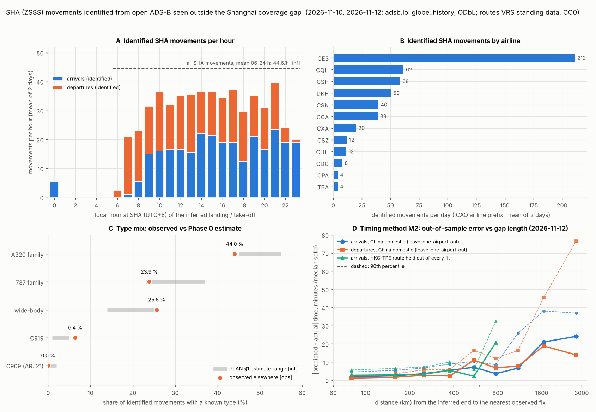

# Observed elsewhere: real Hongqiao flights seen outside the Shanghai coverage gap (OD2 tier 2)

Task B1, Phase 1. Written 2026-11-14 from the adsb.lol archives of 9–12 Nov 2026. Revised the same day in Fix round 1
after the C2 check (`docs/phase1/verify_research.md`). The changes are listed at the end of this report.

**Question.** How many of Hongqiao's 780–800 daily movements can be given a real identity (callsign, registration,
type, operator) and real timing from open ADS-B? The aircraft are seen outside the Shanghai coverage gap: at Beijing,
Hong Kong/Shenzhen, Taipei, Tokyo, Seoul, Xi'an, or en route over the Hefei/Nanjing cluster.

**Answer.** About **two thirds** of them:
- 542 of 783 movements on 10 Nov and 550 of 783 on 12 Nov (69.2 / 70.2 %) carry a real callsign, ICAO address,
  registration and type, and a far-end track segment that agrees with the route database [obs].
- **69–70 % is an upper figure.** The SHA-vs-Pudong label comes from a crowd-sourced route database. Official airport
  data confirm it only on the Hong Kong and Taipei Songshan routes (§1.6). For domestic routes the database
  contradicts observations or Wikipedia 3–6 % of the time. **About 65–70 % of movements get a correct real identity.**
- The time at SHA itself is always **inferred** [inf]. Its 1-σ uncertainty, from out-of-sample validation, has a median
  of 8.0–9.4 min. 1-σ is ≤ 10 min for 51–68 % of movements and ≤ 19 min for all. These are 1-σ values, not error bounds:
  roughly one movement in three will be further off than its σ.
- The other 30–31 % fly routes that no open receiver sees, such as Guangzhou, Qingdao, Changsha, Guiyang, Fuzhou and
  north-east China.

**Labels**

| Label | Meaning |
|---|---|
| **[obs]** | We measured it in this session: ADS-B as broadcast and archived, or a database read as is. |
| **[inf]** | Inferred by a rule or model of ours. |
| **[sec]** | Secondary public source (aggregator sites, Wikipedia). |
| **[unverified]** | Not established. |

**Rules we kept**
- We did not call api.adsb.lol (its quota is used by the recorder) or OpenSky.
- We did not use Google, Baidu or Amap.
- Nothing was collected or solicited inside the PRC.
- Downloads went into their own folders under `refs/cache/`, and every script that reads them ran with `python3 -I`.
- `sfo3d/`, `pc12/` and `hwd3d/` are untouched.
- **Per-flight data is local only:** `refs/cache/observed_elsewhere/` (working default Q3, PLAN §6b).
  - This report, the figure and `observed_elsewhere_stats.json` hold aggregates only.
  - They contain no callsign, flight number, registration, ICAO address or per-flight time.
  - The per-flight spot checks are in `refs/cache/observed_elsewhere/spot_checks_local.md`.
  - A 40-row sample for the owner's review is in `refs/cache/observed_elsewhere/sample_for_owner.csv`, local only.

---

## 0. Key numbers

| | 10 Nov 2026 | 12 Nov 2026 | Status |
|---|---|---|---|
| Operating day analysed (local 04:00 → 04:00 next day) | 9 Nov 20:00Z – 10 Nov 20:00Z | 11 Nov 20:00Z – 12 Nov 20:00Z | – |
| Flights on a VRS route with ZSSS, seen anywhere in Asia | 558 | 562 | obs |
| … whose track agrees with the database route (**identified**) | **542** | **550** | obs + inf |
| … of which arrivals / departures at SHA | 282 / 260 | 287 / 263 | inf (role from the route DB) |
| Share of 783.4 movements/day (CAAC Jan–Sep 2026 mean) | **69.2 %** | **70.2 %** | inf; upper figure (§1.6) |
| Share of 802/day (winter plan, secondary) | 67.6 % | 68.6 % | inf |
| Distinct aircraft (registration and type known for all) | 232 | 248 | obs |
| Far-end take-off or landing itself seen | 132 | 118 | obs |
| Database contradicted by an observed airport (far end or SHA end) | 4 of 136 checkable (2.9 %) | 6 of 124 (4.8 %) | obs |
| SHA-side time: 1-σ, median (P10–P90; max) | 9.4 min (4.1–12.2; 18.6) | 8.0 min (4.0–11.4; 16.2) | inf, out of sample (§4) |
| Identified in local hours 06–24, per hour | 29.8 (67 % of the 44.6/h mean) | 30.2 (68 %) | inf denominator |

Figure: `docs/phase1/observed_elsewhere.png` (below). Numbers: `docs/phase1/observed_elsewhere_stats.json`.



---

## 1. Route database: callsign → origin/destination

### 1.1 Source and licence

**VRS standing data**, `https://github.com/vradarserver/standing-data`. Read with `git clone`, commit
`24ce542` of 2026-11-12. [obs]

- **Licence:** `LICENSE` reads "CC0 1.0 Universal". It can be redistributed.
- **How the routes are made:** the README says "This repository holds CSV files built from the aviation data submitted
  by Virtual Radar Server users to the SDM site."
  - So the routes are **crowd-sourced**: one current route per callsign, with no validity dates and no days of
    operation.
  - `routes/schema-01/CREDITS.md` lists the submitting users. One of the large contributors has a Chinese-script name.
    That is public CC0 data, not data we solicited.
- **Maintenance:** a bot commits daily. The China Eastern file alone has 561 commits.
- **Size:** 628,956 callsigns. **1,376 touch ZSSS**: 1,298 two-airport routes and 78 three-airport routes. 5,075 touch
  ZSPD.
- **SHA callsigns by airline:** CES 471, CSH 209, CQH 191, DKH 122, CSN 94, CCA 74, CDG 50, CXA 46, CHH 20, CSZ 16,
  CUA 12, AMU 10, UEA 8, KAL 7, CPA 7, CRK 6, ANA 6, TBA 5, LKE 4, JAL 4, HBH 4, and 2 each for YZR, GCR, EVA, CAL
  and AAR.
- **Age of the entries** (git blame, 1,285 SHA lines of ten Chinese airlines; history begins 2022-08-26) [obs]:

  | Last changed | Share of lines |
  |---|---|
  | within 90 days | 8.6 % |
  | within 1 year | 23.3 % |
  | more than 2 years ago | 63.2 % |

  An old line is not necessarily wrong. The ADS-B tests below are what measure reliability.
- **Tools:** `tools/routes/vrs_routes.py` builds the local index `refs/cache/routes_vrs/vrs_index.json.gz`.
  `refs/cache/routes_vrs/blame_age.json` holds the ages.

**Other open route sets considered**

| Source | Why not used |
|---|---|
| OpenFlights `routes.dat` (ODbL) | Airline–airport pairs only, no flight numbers. The file was last changed in 2017. |
| adsb.lol `routeset` API | It is VRS plus a plausibility flag (sfo3d `realtime_feeds.md` #5). Not called because of the quota. |
| OpenSky routes and flight lists | Not used: we never call OpenSky. |
| adsbdb, hexdb | APIs with unread terms. |
| FlightAware, FR24, VariFlight, OAG/Cirium | Commercial. |

**VRS is the only usable open route set at callsign level.**

### 1.2 Reliability measured against ADS-B (Chinese callsigns: CES, CSH, CQH, DKH and the rest) [obs]

| Test | 10 Nov | 12 Nov | What it shows |
|---|---|---|---|
| **Observed airport.** The route's airports agree with an observed take-off or landing. | 132 match; 2 far-end and 2 SHA-end contradictions | 118 match; 4 far-end and 2 SHA-end contradictions | **95–97 % right** where checkable. Half the contradictions are at the SHA end: the flight was seen at a non-Shanghai airport where the DB puts SHA. |
| **Track.** The observed fixes lie within max(150 km, 20 % of the leg) of the route's great circle and move the right way. | 410 consistent, 9 not, 1 wrong heading | 432 consistent, 4 not | Most failures are airway detours or a callsign not updated on the return leg. They are excluded. |
| **Aircraft rotation.** The same aircraft has a Shanghai arrival followed 20–150 min later by a Shanghai departure: is it the same Shanghai airport in the DB? | 271 SHA→SHA, 344 PVG→PVG, **1 mixed** | 265 SHA→SHA, 331 PVG→PVG, **1 mixed** | SHA-vs-PVG labels are self-consistent (0.17 % mixed). |
| **Edge altitude.** Arrivals from the west where they leave coverage near Nanjing (118.6–119.7 E). | SHA: median 26,600 ft (P10–P90 25,750–27,950), n 96. PVG: median 29,390 ft (26,600–32,940), n 176. | SHA: 26,600 (26,300–27,850), n 101. PVG: 30,250 (26,990–32,875), n 183. | A **DB-free SHA/PVG signal** (see below). |

- **Rotation test, caveat:** it cannot catch correlated errors, such as an airline moving a route pair from PVG to SHA
  while the DB keeps both directions stale.
- **Edge-altitude test:** 70–72 % of DB-SHA arrivals lie in the 25,900–27,300 ft band, against 8–13 % of DB-PVG
  arrivals.
  - 26,600 ft is 8,100 m, a Chinese metric flight level. That SHA arrivals are held at a fixed level here is our
    inference [inf]; no STAR chart was read.
  - The two DB sets would not separate like this if the labels were mixed at random. The band test alone bounds the
    mislabel share only loosely; the C2 check found only 4.8 % of DB-SHA arrivals at the PVG median level or above.
- **What the contradictions were:** 10 over the two days, 6 at the far end and 4 at the SHA end. The identities are in
  the local table only.

### 1.3 Reliability measured against Wikipedia destination lists [sec]

We checked airline–destination pairs against the SHA list (rev 1385154959) and the PVG list (rev 1385155113). A
DB route counts if the airline is listed as serving that far end from that Shanghai airport.

| Set | Listed at the DB's airport | Listed only at the other Shanghai airport | Listed at neither |
|---|---|---|---|
| All 1,376 DB SHA routes | 1,238 (90.0 %) | 87 (6.3 %) | 51 (3.7 %) |
| Identified movements, 10 Nov | 161 SHA only + 367 at both SHA and PVG | 8 | 6 |
| Identified movements, 12 Nov | 164 SHA only + 373 at both | 7 | 6 |

**The SHA vs PVG ambiguity is real:**
- **two thirds** of identified movements are on airline–city pairs served from **both** Shanghai airports (Beijing,
  Shenzhen, Chengdu and others);
- ADS-B never shows which Shanghai airport, because the gap covers both, 45 km apart;
- for these, the airport rests on the route DB alone, supported by the rotation and edge-altitude tests above;
- the 7–8 "PVG only" movements per day are flagged in the local table (`wiki_pair`).

### 1.4 Spot checks against public schedule facts [sec]

Eight flight numbers or groups were checked against public schedule pages and Wikipedia. The flight-by-flight table is
in `refs/cache/observed_elsewhere/spot_checks_local.md` (local only). Of the 7 that reach the airport level:
- 4 agree;
- 1 agrees with the newer of two conflicting sources;
- 1 differs from a 2023 fact that may be out of date;
- 1 callsign is missing from the DB.

The eighth is consistent at city level only.

### 1.5 What the DB misses: inverse search without the DB [obs]

**Rule:**
- a flight's coverage **ends airborne** within 60–450 km of ZSSS, with the track within 15° of the bearing to ZSSS
  and no landing seen;
- or its coverage **begins airborne** heading away within the same limits.

We then asked what the DB says about each.

| DB says | 10 Nov | 12 Nov |
|---|---|---|
| ZSSS | 98 | 102 |
| ZSPD | 177 | 180 |
| another airport inside the gap (Hangzhou, Nanjing, Wuxi, Ningbo …) | 324 | 350 |
| an airport beyond Shanghai (overflight) | 2 | 3 |
| an airport off the ray (unexplained; mostly north-east China and Qingdao routes) | 27 | 32 |
| **callsign not in the DB** | **12** | **5** |
| total | 640 | 672 |

- **The miss rate is 1.9 % / 0.7 % of all gap-bound candidates.** If every missing callsign were bound for Shanghai,
  the miss rate among Shanghai-bound candidates (ZSSS + ZSPD + missing) would be 4.2 % / 1.7 %.
- **The 17 flights not in the DB** (two days):
  - 7 Chinese passenger flights: Sichuan Airlines 4, and 3 others;
  - 5 cargo (DHL, SF, Suparna and similar);
  - 3 foreign carriers;
  - 2 unknown operators.
- **The DB is not the bottleneck.** For callsigns that disappear into the gap near Shanghai it has 96–98 % even in the worst
  case.
- **Two ambiguities remain:**
  - Shanghai against the other Yangtze-delta airports: half the inverse candidates are bound for them;
  - SHA against PVG.

### 1.6 External check of the SHA-vs-PVG label (C2, `verify_research.md` §2.2) [obs]

Two lawful open datasets name the Shanghai airport at the far end. Both were cached by B2.

| Check | Result |
|---|---|
| VRS label vs Hong Kong International Airport flight information (DATA.GOV.HK, 13 Nov): every HKG↔Shanghai operating flight | 51 of 51 agree (13 SHA, 38 PVG) |
| VRS label vs Taipei Songshan real-time flights (Taiwan OGDL, 14 Nov): operated TSA↔Shanghai flights | 12 of 12 agree (8 SHA, 4 PVG) |
| Identified movements with far end Hong Kong (10 + 12 Nov) vs HKIA's SHA list | 23 on the SHA list, 1 not listed that day, 0 on the PVG list |

**What this settles:**
- On the Hong Kong and Taipei routes the label was right in every official case tested.
- It does **not** settle the domestic two thirds. No open official source names the Shanghai airport for domestic
  flights.
- The Wikipedia "PVG only" rate (6.3 % of DB SHA routes) and the observed contradiction rate (3–5 %) are the best
  estimates of the domestic error.

Hence the reading in the summary: 69–70 % is an upper figure, and about 65–70 % is defensible.

---

## 2. Registration, type and operator [obs]

**Where the identity comes from**
- The adsb.lol traces carry readsb database fields per aircraft: `r` (registration), `t` (ICAO type), `desc` and
  `dbFlags`.
- `ownOp` and `year` appear only for US-registered aircraft: 51 of 1,500 Asian traces in a sample, and on none of the
  SHA-route flights of 10 and 12 Nov.

**Mictronics aircraft database** (`https://github.com/Mictronics/aircraft-database`)
- Commit `479e4d0` of 2026-11-08, the same pin as hwd3d; `indexedDB_old.zip`, dbversion 530.
- Licence ODC-By 1.0. The README says "Aircraft database exports are made available under the Open Data Commons
  Attribution License".

**SHA aircraft compared** (240 on 10 Nov, 253 on 12 Nov, before the track check)

| Check | Result |
|---|---|
| Registration and type present in the trace | 228 / 240 and 239 / 253 (95 %) |
| Present in Mictronics | 100 % |
| Agreement where both have a value | **100 %** for both registration and type |
| Filled from Mictronics where the trace had none | 12 / 14 aircraft (marked `r_src` / `t_src = mictronics`) |
| B- registrations | 98 %; the rest are JA and HL |

- **The two sources are not independent, so the 100 % agreement is circular.** The readsb identity fields come from
  `wiedehopf/tar1090-db`. Its README calls it the database "using the database maintained by Mictronics", and its
  `update.sh` downloads Mictronics `indexedDB_old.zip` and the ADS-B Exchange `basic-ac-db.json.gz` (C2, re-read
  2026-11-14). The agreement shows consistency between two copies, not truth.
- **Operator:** from the ICAO callsign prefix, using the Mictronics `operators.json` name (e.g. CES → "China Eastern
  Airlines") or the VRS `airlines.csv`.
- **Military, PIA and LADD aircraft** (dbFlags 1, 4, 8) were dropped at scan time, before anything was stored: 248–303
  traces per day in the Asia box. The Mictronics database lists Chinese military types; none were kept or labelled.

---

## 3. The scan [obs]

### 3.1 Script and scale

`tools/adsb/scan_callsigns.py` reuses `globe_scan.py`'s streaming: curl of the split `.tar.a?` parts and `tarfile` in
stream mode. It reads one `prod` release per day and keeps three things:
- a **summary of every civil flight** in lat 0–60 N, lon 60–180 E: callsign, readsb identity, observed take-off and
  landing, and the entry and exit fix of every coverage segment (time, position, altitude, speed, track, vertical
  rate);
- **thinned tracks** (30 s at cruise, 8 s below 10,000 ft) of flights on an SHA or PVG route in the VRS DB, either
  direction;
- the same thinned tracks for every flight seen from take-off to landing (the calibration set, §4).

| Archive day (UTC) | Traces scanned | In the Asia box | Flights | On SHA routes | Run time |
|---|---|---|---|---|---|
| 2026-11-09 | 71,773 | 8,620 | 26,823 | 567 | 183 s |
| 2026-11-10 | 75,360 | 8,615 | 26,649 | 575 | 170 s |
| 2026-11-11 | 75,222 | 8,719 | 26,975 | 577 | 174 s |
| 2026-11-12 | 73,533 | 8,702 | 27,337 | 578 | 186 s |

About 3.5 GiB is streamed per day. Each local operating day uses two UTC archives. Flights cut at 00:00Z are joined
again (same aircraft and callsign, within 15 min). The scan was not re-run in Fix round 1; only the analysis was.

### 3.2 Segmentation rules (`tools/adsb/legs.py`, `observed_elsewhere.py`) [inf]

| Term | Rule |
|---|---|
| Segment | A run with no gap over 10 min: where the track enters or leaves coverage. |
| Flight | Consecutive segments with one callsign. A new flight starts at a readsb new-leg flag, a ground stop, a callsign change, or a gap over 4 h. |
| **Gap split (Fix round 1)** | A flight on an SHA or PVG route is also cut at any coverage gap longer than the air time of its longest DB leg (M1 line) + 30 min. A single leg cannot stay out of coverage longer than its whole air time. Applied to 24 / 28 flights (25 / 29 cuts). |
| Observed take-off / landing | A ground↔air transition within 6 km of an airport, or a first/last fix below 2,500 ft AGL within 15 km of an airport, climbing or descending. The time is extrapolated with the vertical rate. |
| Leg choice | Per flight, the DB leg (any leg of a multi-airport route) that best fits the fixes. |
| **Heading check (Fix round 1)** | The fix nearest SHA must head within 90° of the bearing to SHA (arrivals) or from SHA (departures). Otherwise the segment nearest SHA is dropped and the record re-tested; if nothing is left it is rejected. Not tested within 60 km of the far-end airport, where a track in the terminal pattern says nothing. Result: 1 record re-split, 1 rejected (93°), 3 / 5 left untested (Shenzhen approach pattern). |
| **Span check (Fix round 1)** | A record whose observed span exceeds the leg air time + 30 min is rejected. None was; the largest span is 0.96–0.99 of the leg air time. |

No through-SHA flight was seen. After these rules no identified record spans more than 4 h, and the C2 wrong-leg tests
find no record on the wrong leg (`verify_research.md`, Fix round 1).

### 3.3 Where the SHA flights enter and leave coverage (nearest observed fix to SHA)

| Region of the nearest fix | 10 Nov | 12 Nov |
|---|---|---|
| Hefei/Nanjing cluster (≈ 190–250 km west of SHA) | 205 | 206 |
| Fujian–Zhejiang coast | 127 | 116 |
| Beijing / North China | 112 | 106 |
| Pearl River Delta (HK, Shenzhen, Macau) | 79 | 101 |
| Japan / East China Sea | 11 | 11 |
| Korea / Yellow Sea | 5 | 5 |
| other | 3 | 5 |

- **Distance from SHA to the nearest fix:** P10 213 km, P25 245 km, median 588–625 km, P75 854–907 km, P90 1,110 km,
  maximum 1,238 km. 114 / 143 movements lie beyond 900 km; none beyond 1,300 km.
- **Far-end take-off or landing seen** (real far-end time): Xi'an 40–42, Shenzhen 30–46, Hong Kong 9–10, Songshan 8,
  Haneda 8, Gimpo 8, Shantou 6–8, Macau 5–6.
- **Beijing:** coverage there ends or begins at 5,000–9,000 ft. For SHA-carrier segment ends within 60 km of PEK or
  PKX, the 10th percentile is 5,400 ft and the median 9,300 ft (n 2,623). That is above the 2,500 ft runway-event
  threshold, so PEK and PKX runway times are not observed. M2 bridges the last 30–60 km.

---

## 4. SHA-side timing [inf], and how good it is

**Methods** (`tools/adsb/observed_elsewhere.py`)
- **M2 (gap extrapolation).**
  - Arrivals: SHA landing = time of the last observed fix + time-to-go(r), where r is the great-circle distance from
    that fix to ZSSS.
  - Departures: SHA take-off = first fix − time-since-take-off(r).
  - The model is a robust line per distance bin. It is fitted on every flight in the box with an observed landing
    (57–60k samples) or take-off (55–56k samples).
  - There is a separate "Chinese domestic airspace" class (2.5–3.5k samples), used when the fix lies on the mainland
    side.
- **M1 (far-end event + air time).** Used when the far-end take-off or landing was seen: air time = a + b·d over the
  route distance.
  - Fit on 6.9–7.3k flights seen at both ends: 1,182–1,207 s + 4.41–4.43 s/km, about 815 km/h.
  - A China-only fit uses just 71–72 flights, mostly Shenzhen–Xi'an.
- **Uncertainty (Fix round 1).** σ is 1.4826 × the median absolute **out-of-sample** error of the estimate actually
  used:
  - **M2:** leave-one-airport-out, per distance bin and class.
  - **M1, Chinese far end:** leave-one-route-out over the China fit: 20.7 / 19.5 min. The old in-sample value was
    16.3 / 19.1 min.
  - **M1, other far end:** the larger of two values. One is the held-out Hong Kong–Taoyuan route: 6.9 min. The other
    is a 10-fold-by-route test for the route's distance: 7.0–7.5 min below 800 km, 8.1–11.9 min at 800–1,500 km,
    17.7–18.8 min at 1,500–2,500 km. The old in-sample value was 9.6–11.6 min. The k-fold test is needed because
    the error grows with distance and Hong Kong–Taoyuan is one 800 km route.
- **Choice.** Each movement takes the method with the smaller σ. With the out-of-sample M1 values, M2 is used for
  537 / 534 movements and M1 for 5 / 16. The M1 picks are all Hong Kong, Macau and Songshan routes. No Chinese far
  end takes M1 any more.
- **Bias (Fix round 1).** The out-of-sample median error of each M2 bin is removed only where both hold:
  - removing it lowers the **nested** out-of-sample σ by at least 5 %. Each airport is corrected with the median of
    the other airports' errors, so the test stays out of sample;
  - the bias is at least 2 min.

  Elsewhere the bias differs between airports, and removing the pooled value made the error worse.

### 4.1 Validation on a route seen at both ends elsewhere: Hong Kong ↔ Taipei Taoyuan (held out of every fit)

| Method, gap length (distance from the inferred end to the nearest fix) | n (two days) | Bias, min | \|error\| median, min | \|error\| P90, min |
|---|---|---|---|---|
| M1 air time (VHHH↔RCTP, 800 km) | 114 / 122 | +4.6 / +3.2 | 4.7 / 4.6 | 13.1 / 9.4 |
| M2 arrival, 40–300 km | 252 / 265 | −1.7 to +2.8 | 2.7–4.3 | 5.6–9.9 |
| M2 arrival, 300–650 km | 94 / 101 | +0.9 to +5.4 | 2.2–5.4 | 5.9–10.0 |
| M2 arrival, 650–900 km (fix still in the climb out of HKG) | 114 / 122 | −18.2 / −18.5 | 18 | 30–36 |
| M2 departure, 40–450 km | 331 / 341 | −1.4 to +0.1 | 0.5–1.5 | 1.4–2.4 |
| M2 departure, 450–650 km | 80 / 82 | +1.9 / +2.8 | 2.2–2.8 | 4.3–4.5 |

The bias rule changes only one of these bins: the 650–900 km arrivals of the other class. That bin, a fix still in the
climb out of the far end, is not like the SHA arrivals in it, which are seen in cruise (3–4 a day).

### 4.2 Validation for Chinese domestic airspace (leave-one-airport-out: each airport predicted from a fit without it)

| Gap length | Arrivals: n, bias, \|error\| median / P90 (min) | Departures: n, bias, \|error\| median / P90 (min) |
|---|---|---|
| 40–300 km | 1,692–1,991; −1.7 to +0.1; 1.7–3.6 / 4.5–7.0 | 1,585–1,714; −0.4 to +0.4; 0.8–2.8 / 1.9–5.9 |
| 450–650 km | 274–341; +4.7 / +4.8; 6.3–7.1 / 9.8–10.3 | 112; +6.2 / +9.8; 6.9–11.0 / 11.4–16.4 |
| 650–900 km | 358–436; −1.3 / +1.0; 3.6–7.6 / 8.5–13.8 | 272–276; +11.5 / +5.7; 6.8–12.6 / 12.0–22.4 |
| 900–1,300 km, as fitted | 353–381; **−6.6 / −4.5**; 7.5–10.7 / 20.2–20.7 | 238–250; +4.8 / +5.3; 7.7–8.2 / 16.3–17.8 |
| 900–1,300 km, bias removed (used) | nested: −2.6 / +3.3; **6.6–8.0** / 24.6–25.9 | not removed |
| 1,300–2,000 km | 218–252; −10.3 / −16.6; 15–21 / 35–38 | 244–261; −1.2 / +2.2; 16–19 / 46–76 |
| M1, leave one route out | 71–72 flights; +8.7 / −5.6; 13–14 / 20–50 | – |

Negative bias means the model puts the SHA event too early.

**What the validation shows**
- **Within about 300 km of a gap** (the Hefei/Nanjing cluster, about 37 % of SHA movements), the out-of-sample
  |error| has a median of 2–4 min and a P90 of 5–7 min.
- **650–900 km:** median 4–8 min, P90 9–14 min for arrivals. Departures are worse (P90 up to 22 min).
- **900–1,300 km** (seen only near Beijing or the Pearl River Delta; 114–143 SHA movements a day):
  - The fitted model put Chinese-airspace arrivals 4.5–6.6 min early. That bias is now removed for these 56–71
    arrivals a day.
  - Removing it lowers the median out-of-sample |error| from 7.5–10.7 to 6.6–8.0 min and σ from 11.2–15.9 to
    9.8–11.8 min.
  - It raises the P90 from 20–21 to 25–26 min, because the bias differs between airports.
  - Departures in this bin have a +5 min bias that is not removed, because removing it made the nested error worse.
    It stays in their σ.
- **Beyond 1,300 km**, arrivals are biased late by 10–17 min. No identified SHA movement lies that far out.

**Per movement** (identified movements, 10 Nov / 12 Nov):

| | 10 Nov | 12 Nov |
|---|---|---|
| 1-σ median (P10–P90) | 9.4 min (4.1–12.2) | 8.0 min (4.0–11.4) |
| Largest 1-σ | 18.6 min | 16.2 min |
| Share with 1-σ ≤ 5 / 10 / 15 min | 26 / 51 / 92 % | 18 / 68 / 94 % |

- 1-σ is ≤ 19 min for all movements.
- These are 1-σ values, not error bounds. For normal errors about 32 % of movements are further off than their σ,
  and 5 % beyond 2σ. Across the bins the P90 of |error| is 1–3σ (1.64σ for normal errors).
- The two days differ, mostly in the China 650–900 km arrival bin (σ 11.3 against 5.4 min). This is itself a sign of
  the small China calibration set.

**Check against published schedules** [sec]
- 8 records of 4 flight numbers have a published schedule time. The per-flight table is local:
  `spot_checks_local.md` §2.
- Inferred take-off minus scheduled off-block: **+5 to +42 min**. Against one source's later departure time the
  range is +5 to +19.
- Inferred landing minus scheduled on-block: **−32 to +18 min**.
- All 8 are explained by taxi time, an alternative published time, a delay observed at the far end, or schedule
  padding on a long sector.
- The test is small and confounded by delays, so it does not calibrate σ.

**Inferred turnaround at SHA** (same aircraft, inferred landing to inferred take-off, pairs within 20–150 min): median
106–107 min (P10 77–81, P90 134–138). It includes the timing errors, and the 150 min window truncates the upper tail.

---

## 5. Results: what share of SHA movements gets a real identity

### 5.1 Per local hour (figure panel A; mean of the two days)

| Local hours | 07–09 | 09–12 | 12–15 | 15–18 | 18–21 | 21–24 |
|---|---|---|---|---|---|---|
| Identified per hour | 22.0 | 33.3 | 35.7 | 36.0 | 31.9 | 27.8 |
| Share of the flat 44.6/h mean [inf] | 49 % | 72–77 % | 77–83 % | 79–82 % | 71–72 % | 61–63 % |

**Shape of the day**
- 06–09 h is a departure bank: 20 departures per hour at 07 h against 1 arrival.
- After 22 h arrivals dominate: 18–20 per hour, with 1–6 departures.
- Five to six arrivals per day are inferred after midnight, i.e. delays.

**The hourly denominator is not published.** The flat mean hides the morning departure peak, so the 07–09 h share is
understated.

### 5.2 Per airline (identified movements per day, mean; panel B)

| Airline | Identified per day |
|---|---|
| China Eastern (CES) | 212 |
| Spring (CQH) | 62 |
| Shanghai Airlines (CSH) | 59 |
| Juneyao (DKH) | 51 |
| China Southern (CSN) | 40 |
| Air China (CCA) | 39 |
| XiamenAir (CXA) | 20 |
| Shenzhen (CSZ) | 12 |
| Hainan (CHH) | 12 |
| Shandong (CDG) | 8 |
| Cathay (CPA) | 4 |
| Tibet (TBA) | 4 |
| Air Macau (AMU) | 3 |
| China United (CUA) | 3 |
| ANA, JAL, Korean, Asiana, China Airlines, EVA, HK Airlines, Chengdu, Hebei, Tianjin, Suparna | 1–2 each |

- **Ratio of identified distinct callsigns to the DB's SHA callsigns:** CHH 55–60 %, CCA 51–54 %, CES 45 %, CSN
  40–44 %, DKH 41–42 %, CXA 37–50 %, CQH 32 %, CSH 27–29 %, CDG 14–18 %.
- That ratio mixes coverage with stale DB entries, so it is not a coverage rate.
- **No per-airline count of SHA movements is published**, so per-airline shares cannot be computed honestly.

### 5.3 Per far end: where the identified flights come from, and where the blind routes are

| Far end | Identified per day | DB SHA callsigns | | Far end | Identified per day | DB SHA callsigns |
|---|---|---|---|---|---|---|
| Shenzhen ZGSZ | 91–96 | 105 | | **Guangzhou ZGGG** | **4–12** | **116** |
| Beijing Capital ZBAA | 68–70 | 97 | | **Qingdao ZSQD** | **0** | **49** |
| Xi'an ZLXY | 40–42 | 54 | | **Changsha ZGHA** | **0** | **30** |
| Chongqing ZUCK | 31–32 | 53 | | **Guiyang ZUGY** | **0–1** | **27** |
| Chengdu ZUUU / ZUTF | 27–28 / 19 | 41 / 44 | | **Fuzhou ZSFZ** | **0** | **19** |
| Xiamen ZSAM | 23–30 | 59 | | **Yantai ZSYT** | **0** | **17** |
| Beijing Daxing ZBAD | 19–23 | 34 | | **Nanning ZGNN** | **0** | **16** |
| Hong Kong VHHH | 12 | 21 | | **Guilin ZGKL** | **0** | **13** |
| Haneda / Gimpo / Songshan | 8 / 8 / 8 | 14 / 13 / 10 | | **Jinan ZSJN** | **0** | **10** |
| Macau VMMC | 6–8 | 16 | | **North-east (ZYTX, ZYHB, ZYCC, ZYTL)** | **0** | **23** |

The unidentified 30–31 % are mainly these blind routes:
- southern and central China between the Pearl River Delta and Nanjing coverage;
- Shandong;
- north-east China over the Yellow Sea.

For those, the simulation stays at tier 3/4: published facts plus inferred traffic.

### 5.4 Type mix: observed share against the PLAN §1 estimate (panel C; 1,092 identified movements, two days)

| Family | Observed elsewhere [obs] | PLAN §1 estimate [inf] |
|---|---|---|
| A320 family (A321 16.7 %, A21N 14.9 %, A320 7.1 %, A20N 5.0 %, A319 0.4 %) | **44.0 %** | 45–55 % |
| 737 family (B738 21.7 %, B38M 1.7 %, B737 0.5 %) | **23.9 %** | 23–37 % |
| Wide-bodies (A333 10.6 %, A332 5.1 %, B789 3.7 %, A359 3.6 %, B77W 2.1 %, B78X 0.5 %) | **25.6 %** | 14–26 % |
| COMAC C919 | **6.4 %** | 1–5 % |
| COMAC C909 / ARJ21 (AJ27) | **0.0 %** | 0–2 % |
| E-Jets, business jets | 0 % | < 1 %, about 1 % |

**Selection bias** [inf]
- The identified share over-represents trunk routes: the Beijing and Shenzhen shuttles, Chengdu, Chongqing and Xi'an.
  These use wide-bodies and C919s.
- The blind 30 % (Guangzhou, Qingdao, Changsha, Fuzhou and others) is probably more narrow-body.
- The **whole-airport** wide-body and C919 shares are therefore likely lower than observed, nearer the top of the
  estimate. The A320 and 737 shares are likely higher.
- Business jets cannot appear, because the selection is by airline route.
- **Recommendation for Phase 4 model priorities:**
  - confirm the C919 as a high priority: 6.4 % of the observed set, about 35 movements per day;
  - keep the C909 low: none seen in 1,092 movements.

---

## 6. What this gives the simulation (OD2 order of preference)

- **Tier 2 records.** For about 540–550 SHA movements per day the app can show a real flight: callsign, operator,
  registration, ICAO type and the observed far-end segment.
  - Every local record carries `src` per field (`obs` for callsign, address, registration, type, operator, far-end
    segment and event and the DB route; `inf` for the role, the Shanghai airport, the SHA time and σ) and an
    `evidence` block in words.
  - Shown as "observed elsewhere" (Q10 f), with the SHA-side time marked inferred and its σ.
  - Until the SHA-vs-PVG label is checked more widely, the app should note that about 1 in 20 domestic identities may
    belong to a Pudong flight.
- **Stands, taxi routes, runway use and pushback** remain tier 4 inference (AIP rules, airline terminal lists).
- **The other 30–31 %** (blind routes) remain tier 3/4, with no invented registrations.
- **Latency.** The archive is released the next day, so this is a **replay of a past day**, not live.
  - A live variant would need the adsb.lol API, which is outside the quota and so not done.
  - It could still be built from a recorder that sees Beijing, HK/SZ and Nanjing, within that recorder's terms.
- **Rotations give real aircraft continuity at SHA.** 265–271 arrival→departure pairs per day on the same aircraft
  provide turnaround timing for stand-occupancy inference.

## 7. Limits and open issues

1. **SHA vs PVG is decided by the route DB** for two thirds of identified movements. Official far-end data confirm it
   only on the Hong Kong and Taipei Songshan routes (63 of 63 labels). Supporting evidence for domestic routes:
   - rotation consistency 99.8 %;
   - the edge-altitude signal: 70–72 % in-band for SHA against 8–13 % for PVG.

   The rotation test cannot catch correlated errors (a route pair moved between the airports). An official or licensed
   domestic schedule would settle it (Q9). Until then, 69–70 % is an upper figure and about 65–70 % is defensible.
2. **The DB contradicts observations 3–5 %** of the time where an airport is seen; half of these are at the SHA end.
   Unseen far ends cannot be checked. There, about 4 % of identities may belong to another route (still real flights,
   possibly not SHA).
3. **Timing beyond about 900 km of gap** is weak in Chinese airspace. At 900–1,300 km the median error is 7–8 min
   after the bias is removed, but the P90 is 25–26 min. Beyond 1,300 km arrivals are 10–17 min late (no SHA movement
   is there). The China calibration set seen at both ends is small (71–72 flights, mostly Shenzhen–Xi'an).
4. **σ is a 1-σ value from out-of-sample validation**, not a bound. About one movement in three is further off.
5. **The denominators are not observed.** 783.4/day is a Jan–Sep 2026 mean (CAAC); 802/day is a secondary winter plan
   figure. There is no hourly profile.
6. **Two days only** (10 and 12 Nov, a Tuesday and a Thursday). Weekend and seasonal variation are not measured. 9 and
   11 Nov were scanned only as the preceding UTC days.
7. **The readsb identity fields and Mictronics are not independent** (tar1090-db is built from Mictronics plus the
   ADS-B Exchange basic aircraft database). No independent registry check exists here.
8. **Legal and terms:**
   - All ADS-B is ODbL from adsb.lol archives (no API calls). Committing the aggregates needs the ODbL attribution
     (below).
   - The per-flight tables could legally be shared under ODbL, but stay local until the owner reviews the sample
     (PLAN §6b).
   - PRC traffic is shown only as aggregates here. There are no route maps or borders in the figure (R11).

## 8. Files

| Path | What | Committable? |
|---|---|---|
| `tools/adsb/scan_callsigns.py` | Archive scan (streams one day) | yes |
| `tools/adsb/legs.py` | Segments, flights, observed take-off/landing | yes |
| `tools/adsb/observed_elsewhere.py` | Route matching, gap split and heading check, DB checks, inverse search, timing models, validation, bias rule | yes |
| `tools/adsb/report_observed_elsewhere.py` | Aggregates, figure, local table with `src` and `evidence`, owner sample | yes |
| `tools/adsb/write_sources_observed.py` | SOURCES.json writer for the B1 cache folders | yes |
| `tools/routes/vrs_routes.py` | VRS route index | yes |
| `docs/phase1/observed_elsewhere.md`, `observed_elsewhere.png`, `observed_elsewhere_stats.json` | This report, the figure, the aggregate numbers | yes |
| `refs/cache/observed_elsewhere/` (`scan/cs_*.json.gz`, `sha_observed_<day>.json/.csv`, `spot_checks_local.md`, `sample_for_owner.csv`, `README_sample_for_owner.md`, SOURCES.json) | Per-flight data and the owner sample | **no, local only** |
| `refs/cache/routes_vrs/`, `registry_mictronics/`, `routes_wiki/`, `readsb_src/` | Clones and downloads, each with SOURCES.json | local (redistributable, but not needed in the repo) |

**Reproduce**
```
python3 -I tools/routes/vrs_routes.py build refs/cache/routes_vrs/standing-data refs/cache/routes_vrs/vrs_index.json.gz
python3 -I tools/adsb/scan_callsigns.py 2026.11.12 refs/cache/observed_elsewhere/scan refs/cache/routes_vrs/vrs_index.json.gz   # also 11, 10, 09
python3 -I tools/adsb/observed_elsewhere.py 2026-11-10 2026-11-12      # about 3.5 min; also writes the owner sample
```

**Attribution.** Contains information from ADSB.lol (https://adsb.lol), made available under the ODbL 1.0. Routes:
Virtual Radar Server standing data (CC0 1.0). Aircraft data: Mictronics aircraft database
(https://www.mictronics.de/aircraft-database/), Open Data Commons Attribution License 1.0. Destination lists: Wikipedia
(CC BY-SA 4.0), revisions as cited. Far-end checks: Airport Authority Hong Kong via DATA.GOV.HK; Taipei Songshan
Airport, Taiwan OGDL v1.0.

## Changes in Fix round 1 (2026-11-14)

- Records are cut at gaps longer than the leg air time + 30 min (was 4 h). A heading check and a span check were
  added. The wrong-leg records found by C2 are gone.
- M1 σ now comes from out-of-sample validation. China: 20.7 / 19.5 min, was 16.3 / 19.1 in-sample. Other far ends:
  distance-dependent, 7–19 min, was 9.6–11.6 in-sample. Method choice re-run: M1 5 / 16 movements, was 16 a day.
- The 900–1,300 km China arrival bias (−6.6 / −4.5 min) is removed under a nested out-of-sample rule, and the P90
  cost is stated.
- σ statements reworded as 1-σ shares. The identified share is stated as an upper figure, with about 65–70 %
  defensible. The registry agreement is stated as circular. The DB miss rate and contradictions are re-based.
  228 / 239 is corrected to 228 / 240.
- Every per-flight statement was removed (old §1.4 table, old §4 schedule sentences) and moved to the local
  `spot_checks_local.md`.
- Re-run on the same scan files: identified 542 / 550, was 542 / 549.
