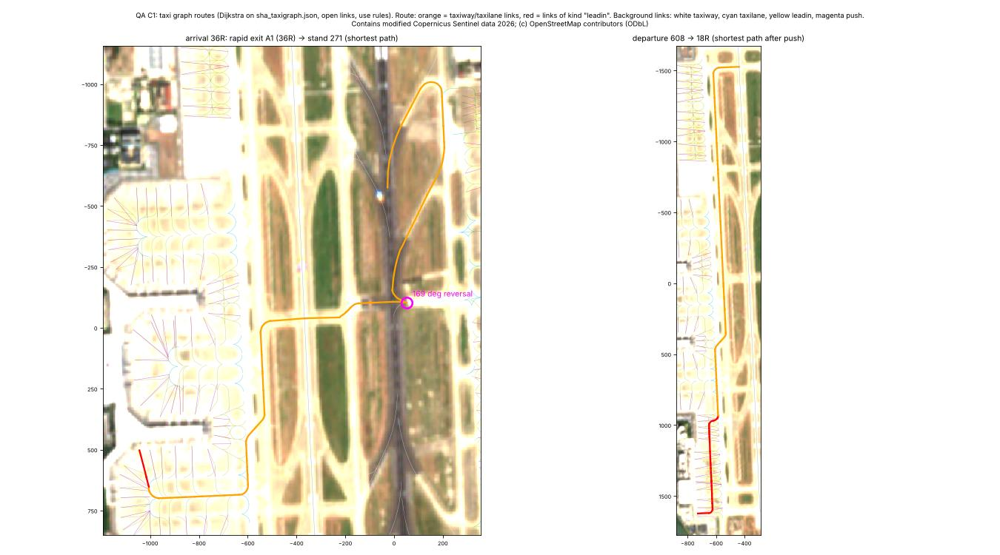
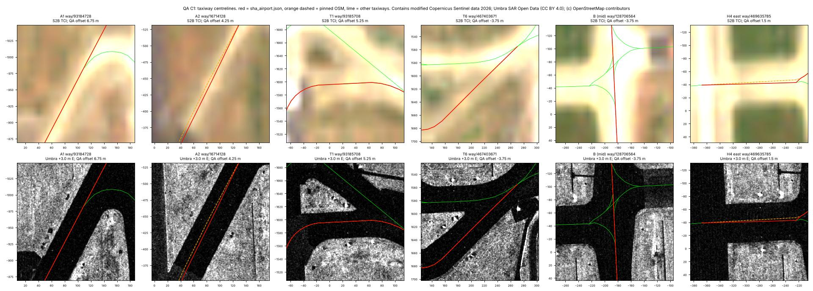
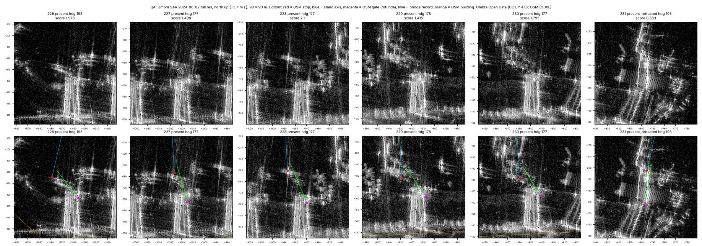
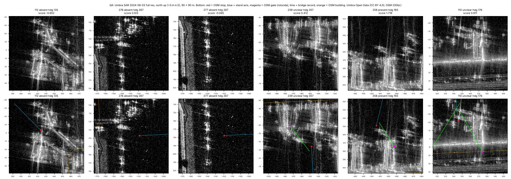
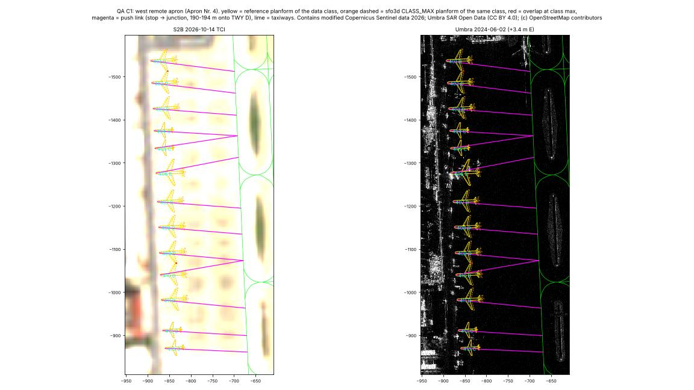
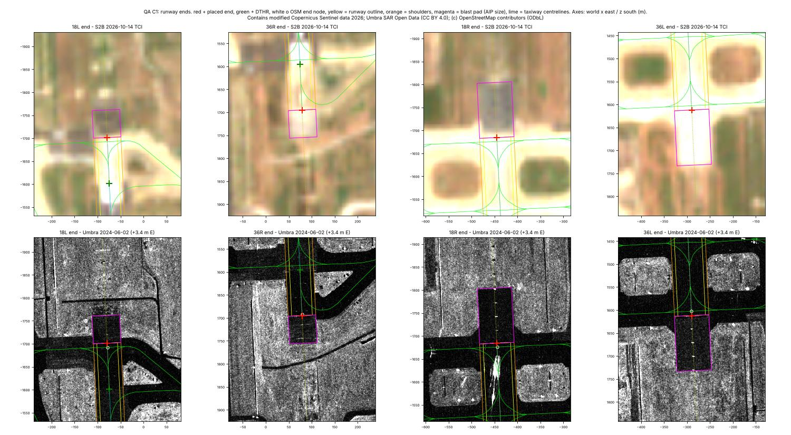
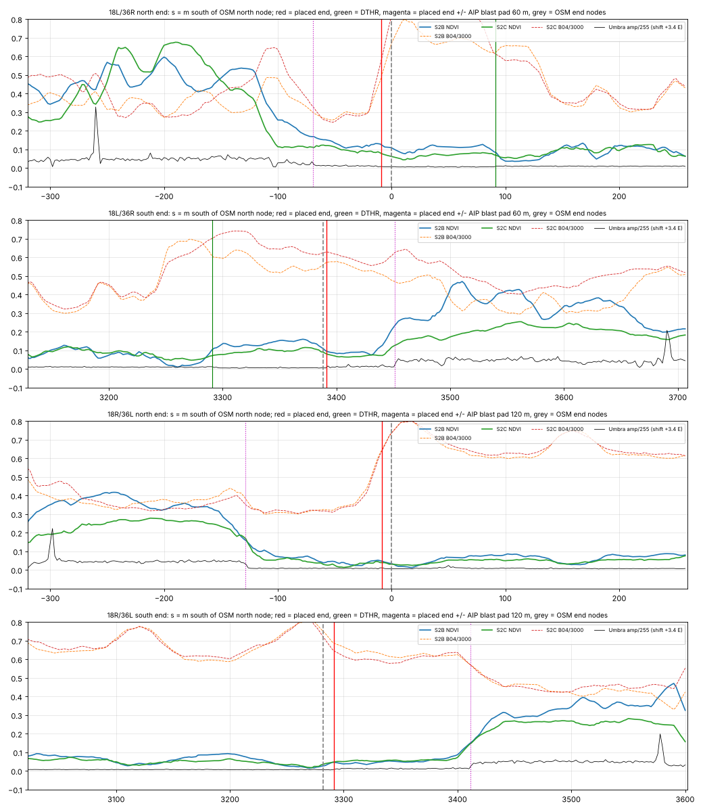

# Phase 1 / C1: adversarial QA of the airport, stand and taxi-graph data

Date: 2026-11-14. Task C1 (adversarial data QA) under owner decisions OD0-OD3 and the PLAN §6b defaults. I did not build
this data. I checked it with my own scripts (`tools/verify/qa_c1/`, independent of `tools/airport/`) and my own plates
(`docs/phase1/qa/`). I changed no data, committed nothing, called neither api.adsb.lol nor OpenSky, and downloaded nothing.

Inputs checked: `data/sha_airport.json`, `data/sha_stands.json`, `data/sha_taxigraph.json` (+ `.js`), `data/meas/*`, the
generators in `tools/airport/`, `tools/common/frame.py`, the pinned OSM (`refs/cache/osm_pinned/`, raw tiles in
`osm_pinned_raw/` read locally), Sentinel-2 (`refs/cache/s2/`, both scenes) and Umbra (`umbra_opendata` overview,
`umbra_fullres_*` windows).

Labels for my own results: **obs** = measured by me on the imagery or the data; **inf** = my inference. Where I compare with
the AIP (mirror) I give counts or single short facts, never per-stand values.

## 0. Findings, ranked

| # | Sev. | Finding (short) | Where |
|---|---|---|---|
| H1 | **high** | A kept, non-exempt feature lies on a dropped (sensitive) area outline in the committable pinned OSM | `tools/osm/pin_extract.py`, `refs/cache/osm_pinned/zsss_osm_pinned.geojson` |
| H2 | **high** | Taxi graph lets routes taxi along runways (72-78 % of shortest routes) and reverse > 120° (10-21 %): runway links and rapid exits are bidirectional `all`, and no turn rule is encoded | `tools/airport/build_taxigraph.py`, `sha_taxigraph.json` |
| M1 | medium | The A1 taxiway re-fit used a wrong Umbra registration (+6.14 m E vs +3.0 to 3.4 m measured on the runways). TWY A1 is 5-9.5 m off and not moved, A2 is under-corrected, H2 is above the threshold after correction | `tools/airport/twy_refit.py`, `data/meas/twy_refit.json` |
| M2 | medium | AIP content: an almost complete AD 2.12-2.14 copy (~150 values) sits under an ODbL licence line, and the full 161-designator AIP stand list can be rebuilt from `sha_stands.json` | `build_airport.py`, `build_stands.py` |
| M3 | medium | Jet bridges: 7 are > 50 m long (T1 rotunda = facade), 5 second bridges share bridge 1's rotunda point and are marked `obs`, 112 is probably a missed bridge, and the SAR null set does not represent the terminal areas | `build_stands.py`, `stand_sar.py` |
| M4 | medium | Stand classes: the 50 m spacing prior and corner stands over-class (west remote apron 9/13 above the AIP, 101 +4, 517 +3); D/D pairs overlap at the sfo3d class-max size; the S2 evidence is blind at T1 and partly built into the method | `build_stands.py`, `stand_s2.py` |
| M5 | medium | Push-back: median 117 m, 30 stands > 150 m; 401-413 and 601-608 push 174-194 m straight onto TWY D, against the AIP fact stored in the same file | `build_stands.py` |
| M6 | medium | All 897 lead-in links are untyped bidirectional `all`; 491 are really apron lanes; 58 % of departure routes use them (up to 813 m) | `build_taxigraph.py` |
| M7 | medium | Provenance gaps: most taxi-graph records have no `src`/`evidence`; surfaces, context, unplaced and spare gates also have gaps | all three builders |
| M8 | medium | Committed Sentinel-2 crops cover 53.4 km², outside the 23.5 km² extent (all data coordinates are inside) | `refs/cache/s2/` (already in git) |
| L1 | low | The 10 A2 images are not listed in any SOURCES file | `docs/phase1/` |
| L2 | low | Taxi-graph licence lacks the ODbL notice and the Copernicus/Umbra/AIP notices; the Umbra attribution lacks the licence URL and a "modified" note | builders |
| L3 | low | The frame doc's geoid range over the extent is wrong (11.07-11.47 m stated; 11.16-11.35 m measured) | `frame.py`, `airport.md` |
| L4 | low | The stand pavement check is partly circular (12 m lead-in buffers count as pavement); 608 is 11.5 % outside OSM pavement without them (on S2 no stand touches vegetation) | `build_stands.py` |
| L5 | low | A clean checkout (no local AIP mirror) does not reproduce the files byte for byte; only `checks_at_build` differs | builders |
| L6 | low | `nose` = OSM stop node; at VDGS stands the stop usually refers to the nose wheel / pilot, a few metres behind the nose tip [inf] | `build_stands.py` |

Checks that **passed** are in §9: the frame, the extent of every data coordinate, the sensitive tags (apart from H1),
runway ends against imagery, taxiways on pavement, stand position and heading, planform overlaps at the reference size,
graph integrity and reachability, and generator reproducibility.

---

## H1 (high). A sensitive area outline survives in the pinned OSM extract

**What.** `pin_extract.py` drops features inside a dropped area only when their representative point is strictly inside
**and** the whole geometry is inside the dropped union buffered by 1e-7° (about 1 cm) (`contained()`, lines 163-165). A
feature drawn on or along the boundary fails both tests and is kept.

**Evidence** (obs; local scan of the raw tiles against the kept features, `sens_qa3.py`/`sens_qa4.py`, counts only):
- In the raw tiles, `osm_sensitive` matches 27 elements, as A1 reported: 22 police nodes (19 surveillance cameras),
  3 military-usage railway lines, 1 armed-police area and 1 prison area. None of them is in any output file.
- **1 kept feature that the tag rule does not match lies on the outline of a dropped area; it is not exempt.** The
  extract that is "meant to be committed" therefore draws part of that outline (details local only:
  refs/cache/osm_pinned_raw/, via `sens_qa3.py` / `sens_qa4.py`).
- The other kept features that touch dropped areas: 3 (2 exempt, 1 not exempt); the QA accepted them.

**Fix.** In `pin_extract.py` replace `contained()` with a metric rule: drop any `barrier=*`, `building=*`, `man_made=*`,
`landuse=*` or untagged way/node whose geometry lies within the dropped union buffered by **10 m** (about 1e-4°). Drop
the representative-point condition for these classes. Count the drops under `*:inside_sensitive_area`. Then re-run
`pin_extract.py`, `write_sources.py`, `build_airport.py`, `build_stands.py` and `build_taxigraph.py` (the feature is not
used downstream, so expect no geometry change). Re-run `tools/verify/qa_c1/sens_qa3.py`; it should report 0 kept
features within 5 m of a dropped outline except exempt ones.

## H2 (high). Taxi graph routes run along runways and reverse sharply

**What.** All 38 `runway` links are `dir: both, use: all, status: open`. All 36 rapid-exit links are `both/all`. The AIP
rule "no turns > 90°" sits in `rules` but is not encoded: there is no per-node transition table and no edge direction.
The builder's check ("all 164 stands reach both runways") cannot catch this, because it only tests node reachability.

**Evidence** (obs; my own Dijkstra over `links` with the `use`/`dir` rules, `graph_qa2-3.py`, `rwy_use.py`):

| Route set | With runway links allowed (generic router) | Runway links excluded |
|---|---|---|
| Departures (164 stands × 4 take-off ends = 656) | **471 (72 %) taxi along a runway**, up to 1,909 m | 68 (10 %) contain a reversal > 120° at a node |
| Arrivals (36 rapid-exit nodes × 164 stands = 4,428) | **3,436 (78 %) taxi along a runway**, up to 2,028 m | 942 (21 %) contain a reversal > 120° |

- The reversals cluster at H4 (229 arrival routes) and H1 (71).
- Example in `qa_taxigraph_routes.jpg` (left): a 36R arrival vacating via A1 to stand 271. It takes A north, comes back
  down **rapid exit A2 the wrong way (towards the runway)**, then turns 169° onto H4.

**Fix** (`build_taxigraph.py`):
1. Set `use: 'runway'` on runway links and exclude them from taxi routing. Allow them only for an explicit backtrack.
2. Make rapid exits `dir: ab` (runway → taxiway) and `use: arrival`, with `for_landing: '36R'` etc.
3. Emit allowed transitions per node, `turns: {node: [[link_in, link_out], ...]}`, with turn angle ≤ 90° (AIP AD 2.20
   2.3.1). Alternatively, document that the Phase 3 router must be edge-based with that limit.
4. Re-run the reachability check edge-based, with runway links excluded, and report the result in `checks_at_build`.

## M1 (medium). The Umbra registration in the taxiway re-fit is wrong by about 3 m

**What.** `twy_refit.py` fits its own Umbra − OSM offset on 13 taxiway runs: **+6.14 m E, −0.89 N** (rms 3.35). That
offset absorbs the OSM taxiway errors. A2 measured +3.44 E / 0 N on runway bands. I measured **+2.99 m E** (median of 43
stations: 18L/36R +3.87, n = 6; 18R/36L +2.76, n = 37; `umb_reg.py`). With A1's value, the Umbra term in the re-fit is
biased by about −3 m × n_east.

**Evidence** (obs):
- **Replay of A1's own per-run values with the corrected registration** (+3.0 or +3.44 E, 0 N, same 2-of-3 / 2 m /
  3.5 m rules; `twy_refit.json`):
  - A2: offset **5.5-5.8 m** (moved by only 4.08 m);
  - H4: 4.7 m;
  - **H2: 3.53 m, which crosses the 3.5 m threshold.** A2's report independently found the OSM H2 line about 4 m north
    of the pavement.
  - main TWY B: 3.1-3.35 m.
- **TWY A1 (way 93184728, 295 m, not moved):** Umbra +6.75 m, S2B +9.5, S2C +5.0. A1's own `UMB_raw` is 9.82, which is
  +7.2 m with the corrected registration. All sources say the pavement lies ESE of the centreline, so a 23 m surface drawn
  on it leaves about 7 m of real pavement out and puts about 7 m on grass. A1 left it unmeasured because neither S2
  scene passed its band tests.
- **A2 after the move:** an Umbra residual of +4.25 m on the 226 m run. The 184 m second run of way 16714128
  (A1 `UMB_raw` 10.56) was not moved, so the way now has a kink at the shared vertex.
- **T6 (way 467403671):** −3.6 (A1 S2B), −3.75 (my Umbra), −8.75 / −10.5 (my S2C / S2B). The sign agrees everywhere.
- None of the 305 centrelines runs on grass or through a building (§9). These are lateral offsets within the paved band.

**Fix.** In `twy_refit.py`, take the Umbra registration from runway bands (fixed +3.4 E, 0 N, or measured in the tool
with the method in `umb_reg.py`) instead of the Huber fit on taxiways. Accept a run as measured when Umbra and one S2
scene agree within 2.5 m on runs ≥ 150 m. Then re-run `twy_refit.py`, `build_airport.py`, `build_stands.py`,
`build_taxigraph.py` and `overlay.py`. Expect A1, A2 (both runs), H2, probably T6, and possibly B to move.

## M2 (medium). AIP content beyond "short cited facts"

**Evidence** (obs; `aip_leak.py`, local comparison):
- **(a) Runways.** `runways[]` carries roughly 150 AIP (mirror) values: THR/DTHR/TDZ elevations; full declared distances
  for all four directions, including the intersection TORA/TODA/ASDA; slope chains; PAPI side, distance, angle and MEHT;
  ALS type and length; strip, RESA, SWY, CWY and blast-pad dimensions; shoulders; REL taxiways; light remarks. That is
  close to a complete AD 2.12 + 2.13 + 2.14. The file's `licence` says it is an ODbL Derivative Database, while PLAN §2
  classes AIP content as "treat as all rights reserved; redistribute: no; short cited facts only". `airport.md` §3.1
  repeats the same table.
- **(b) Stands.** The **complete AIP stand designator list (161) can be rebuilt** from `sha_stands.json`: the 149
  records with `aip_status: 'aip+osm'` plus the 12 `unplaced` names, which give exactly the 161 designators of the local
  mirror table. The incremental exposure is small, because PLAN.md §1 and `stands.md` already publish the 15 OSM-only and 12
  AIP-only designators.
- **Not leaked:**
  - the VDGS list: our `contact` set has 57 stands, 4 of them non-VDGS, and 1 VDGS stand is remote;
  - per-stand span limits: 12 `span_max` values, none equal to an AIP limit;
  - frequencies: none in any file;
  - obstacles: 8 of the 114 AIP obstacle rows are used (tower, 4 antennas, 3 buildings).

**Fix.** Owner decision under OD3. Mechanical minimum:
- move the AIP-derived runway values into one `aip_facts` block per runway with its own notice ("AIP China AD 2 ZSSS
  (CAAC) via unofficial mirror, EFF 2026-07-08; not covered by the ODbL licence of this file"), and keep only the values
  the simulator uses;
- if OD3 is read strictly, replace the per-stand `aip_status` with a count.

## M3 (medium). Jet bridges: geometry and evidence

**Evidence** (obs; `bridge_view.py`, `bridge_zoom.py`; plates `qa_bridges_t1.jpg`, `qa_bridges_t2_northface.jpg`,
`qa_bridges_absent_check.jpg`):
1. **Over-long bridges at T1.** In 15 of the 62 bridge records the rotunda equals the attach point (zero-length `walk`),
   all at T1, where the OSM gate nodes sit on the facade.
   - Rotunda → cab spans: 101 48/59 m, 102 52/62 m, 109 62 m, 110 54/72 m, 111 49 m, 113 47 m; also 240 53 m, 250 45 m,
     266 48 m. **7 bridges exceed 50 m.**
   - That is longer than common apron-drive bridges at full extension (roughly 40-50 m, from memory: inf).
   - On SAR, the T1 north face shows structures reaching about 30 m out from the facade, so the rotunda is not at the
     facade (`qa_bridges_t1.jpg`).
2. **Two bridges from one point.** The door-2 bridges of 101, 102, 113, 246 and 260 have **exactly the same rotunda
   coordinates as bridge 1**. Their `rotunda_src` text says "median OSM gate offset", which the coordinates contradict.
   They carry `src: 'obs'`, although the report calls the L2-corridor evidence weak and not validated beyond its null.
3. **110's second bridge** (from spare gate 6) is **72 m** long and crosses the apron diagonally.
4. **Stand 112 is probably a missed bridge.** The AIP (mirror) lists a VDGS at 112, and the full-resolution crop shows a
   double-walled linear structure from the T1 corner towards the stand. The test used the median gate offset (ahead and
   to the left), which does not fit a corner stand. Current value: `absent`, remote, bus.
5. **The SAR null does not represent the terminals.**
   - The null comes from 99 remote stands more than 150 m from any terminal. They have none of the fixed links,
     rotundas, facade layover and sidelobe streaks that every contact stand has.
   - Scene geometry: sensor azimuth 275.5°, incidence 38.1°. A 25 m facade therefore lays over about 32 m towards the
     west and shadows about 20 m to the east.
   - p95 = 0.97 is therefore not a false-positive bound near terminals.
   - Locally, 30 of 31 `present` and 21 of 22 `unclear` stands are AIP VDGS stands. `unclear` is mostly bridges hidden
     by layover or shadow, not "end-on" geometry alone. Downstream harm is limited, because unclear stands keep `inf`
     bridges.

**Fix.**
- In `build_stands.py`, at T1, place the rotunda on the facade normal so that the cab reach is ≤ 40 m (`rotunda_src`
  inf, "facade gate node + fixed link").
- Give door-2 bridges their own rotunda, at least 8 m along the facade from bridge 1, with `src: 'inf'`, and fix the
  `rotunda_src` text. Reject spare-gate bridges with a reach > 45 m.
- Set 112 to `unclear` with an `inf` contact bridge, or record why not.
- In `stand_sar.py`, build the null from terminal-adjacent positions without bridges (facade segments between gates,
  same face orientation), and record each face's layover/shadow zone in `stand_sar.json`.

## M4 (medium). Stand class plausibility

**Evidence** (obs; `stand_qa2.py`, `stand_pave.py`, local AIP comparison in counts):
- **Over-classing by rule.**
  - Against the AIP (mirror) limits, the west remote apron has 9 of 13 stands above the AIP class, 7 of them by two
    classes. They are spaced 51-60 m, so the 50 m prior admits wide-bodies.
  - The corner stands 101 (+4 classes) and 517 (+3) get EL/D because no neighbour bounds them on one side.
  - Overall, 11 stands are wide-body in our data but narrow-only in the AIP, and 5 the reverse (89 % wide/narrow
    agreement, as A2 reported).
- **Class-max overlaps.** With the sfo3d `CLASS_MAX` span and length (the limit the app assigns), the D/D pairs
  **401/402, 409/410 and 601/602 overlap** (1.4, 2.3 and 0.6 m²), and 220/221, 287/288 and 311/312 come within 2.5 m.
  With the reference planforms (`CLS_REF`) there are 0 overlaps, as built (`qa_apron4_classes_push.jpg`).
- **The S2 evidence is weak where it matters.**
  - Occupancy at the 10:30 local overpass is median 4-6 % at the T1 contact stands, against 38 % at T2. T1 is busy at
    that hour, so the method is blind there.
  - The fit domain is |v| ≤ half the neighbour spacing, so the result "wide fits only at stands spaced ≥ 50 m" is partly
    built in. It is not independent of the geometry.
  - 371 of 1,898 calls (20 %) sit on the du search bound (−8 or +6 m) and 529 (28 %) on the dv bound (±3 m).
  - 1,230 of 1,898 best fits are the B (C909) template, although the C909 is 0-2 % of the type mix.

**Fix.**
- In `build_stands.py`, cap stands with one open side at the class of their bounded neighbour unless S2 shows a
  wide-body on ≥ 2 dates. Raise `WIDE_SPACING` to about 60 m, or require obs for D+ below 60 m.
- Run the overlap check with `CLASS_MAX` planforms, or write `span_max` = the feasible span for every stand, so the app
  cannot place a 52 m aircraft where only 47.6 m fits.
- In `stand_s2.py`, widen the search to du −12..+10 m and dv ±5 m, discard calls on the bounds, and use a fixed domain
  width with neighbour masking.

## M5 (medium). Push-back geometry contradicts the AIP facts stored in the same file

**Evidence** (obs; `graph_qa4.py`):
- **Push length.** `push` runs straight from the stop to the junction where the primary lead-in leaves a taxiway:
  median **117 m**, 118 stands > 100 m, **30 stands > 150 m**.
- **401-413 and 601-608** push **174-194 m** straight back onto **TWY D**. 404/405 and 409/410 converge on the same
  junction. Yet `aip_facts.push_4xx` says 401-416 push back to the holding point on **L11**.
- **232-235 and 286-290** push 127-145 m onto D, while the AIP fact says L12 and L14. L11, L12 and L14 have no OSM ref.
- **Chord vs lead-in.** The push chord leaves the stand's own lead-in by median 13 m (92 stands > 10 m, max 33 m at
  112). It is off the reversed stand axis by median 9.7° (max 34.8°). No push path crosses another stand's planform.

**Fix.** In `build_stands.py`:
- end the push at the first apron lane, once the lead-in links are reclassified (M6);
- follow the reversed lead-in polyline instead of a chord, and cap the push at 1.5 × the class length;
- encode the L11/L12/L13/L14 rule where the lane geometry exists, else write a `flag`.

## M6 (medium). Lead-in links are untyped and serve as apron lanes

**Evidence** (obs; `graph_qa4-5.py`, `route_conf.py`):
- All 897 `leadin` links are `dir: both, use: all, ref: null`. Only 406 lie on some stand's primary lead-in; the other
  491 are apron lanes mapped in OSM as `parking_position` lines.
- 382 of 656 shortest departure routes (58 %, runway links excluded) run on lead-in links after the push: 373 by more
  than 20 m, up to **813 m** (608 → 18R; `qa_taxigraph_routes.jpg`, right).
- Without other stands' lead-in lines, 7 stands (262-265, 274-276) cannot depart and 32 cannot arrive.
- The routes do not cut through parked-aircraft planforms (2 routes, 7 m), so this is a labelling problem, not a
  geometry problem. Even so, a router cannot tell a lane from a stand entry, and span or one-way limits cannot be
  attached to lanes.

**Fix.** In `build_taxigraph.py`:
- tag primary lead-in links with `stand: '<name>'`;
- reclassify the lead-in links that are on no primary lead-in as `taxilane` (`src: 'inf'`, "OSM parking_position line
  used as an apron lane");
- allow a lead-in only as the first or last leg of its own stand.

## M7 (medium). Provenance gaps (OD1/OD2: every record carries src + evidence)

**Evidence** (obs; `prov_qa.py`):

| File | Record type | Gap |
|---|---|---|
| taxi graph | nodes | 1,209 of 1,246 have no `src` |
| taxi graph | links | 1,891 of 2,055 have no `src` |
| taxi graph | links, `ways`, `leadins` | none has `evidence` |
| airport | `surfaces` polygons (117) | only block-level `src`/`evidence` |
| airport | context features (1,840) | `src: obs` but no `evidence` or OSM id/version |
| stands | stand records | no `evidence` key (they have `cls_evidence`/`osm`) |
| stands | `unplaced` | `src: 'AIP (mirror)'`, outside the obs/inf vocabulary |
| stands | `spare_gates` | no `src` |
| stands | door-2 bridges | `src: 'obs'` on unvalidated evidence (M3) |

**Fix.**
- Taxi graph: write `src`/`evidence` per node and link, inheriting from the source way (`obs` + OSM way id/version) or
  the rule (`inf` + rule text for `push`, `hold_inf`, runway extensions, inferred directions).
- Airport: copy the block `src`/`evidence` into each surface polygon, and add `evidence: {osm: {id, version}}` to
  context features.
- Stands: use `src: 'obs', refs: ['aip_mirror']` for `unplaced`, add `src` to `spare_gates`, and set door-2 bridges to
  `inf`.

## M8 (medium). Committed imagery extends beyond the detailed extent

**Evidence** (obs; `extent_qa.py`):
- Every coordinate in the data files lies inside the extent (§9).
- The Sentinel-2 crops already in git (`refs/cache/s2/*/B0x|TCI|SCL.tif`) cover **6.79 × 7.86 km = 53.4 km²**, against
  the 23.5 km² hull + 1 km default (PLAN §6b, R3).
- PLAN §7 Phase 1 lists "cut the imagery and DEM crops to the Q3 extent". A1 §6.6 says this is not done.

**Fix.** Cut every `refs/cache/s2/*` raster to the extent's bounding box and set nodata outside the polygon. Re-run
`rwy_ends.py`, `twy_refit.py` and `overlay.py`, and confirm the `data/meas` changes. History keeps the old crops; that is
the owner's call (Q2).

## Low

- **L1.** `bridges_sar_*.jpg` (7), `stands_overlay.jpg`, `stands_s2_evidence.png` and `taxigraph.png` appear in no
  SOURCES file; A1's images are listed with sha256. Fix: add `docs/phase1/SOURCES_stands.json` with generator,
  attribution, licence and sha256 for each.
- **L2.** The `sha_taxigraph.json` `licence` is just "ODbL 1.0", and its `attribution` names only OSM, although it
  carries A1 re-fit geometry (Sentinel-2/Umbra measurements) and AIP rules. The Umbra attribution in all files reads
  "Umbra SAR Open Data, Umbra Lab Inc (CC BY 4.0)", without the licence URL or the "modified" indication that CC BY 4.0
  §3(a) asks for. Fix: reuse `sha_airport.json`'s licence and attribution blocks, and write "Umbra Lab, Inc., Umbra SAR
  Open Data, CC BY 4.0 (https://creativecommons.org/licenses/by/4.0/), modified".
- **L3.** `frame.py` says "Over the detailed extent N varies 11.07-11.47 m". Bilinear on the node-registered NGA grid,
  I measure **11.16-11.35 m** on the extent ring. The plane fit is good to 0.8 mm on the ring, and the constants are
  right (§9). Fix: correct the sentence in `frame.py` and in `airport.md`.
- **L4.** `checks_at_build.pavement` counts 12 m lead-in buffers as pavement, which a stand always passes. Without them,
  608 has 11.5 % of its planform outside the OSM aprons + taxiway/runway surfaces (the data says 5.4 %). On Sentinel-2,
  0 stands have more than 0 % of the planform on vegetation in both scenes. Fix: also report the non-circular metric.
- **L5.** Re-running the builders without the local AIP mirror changes only `checks_at_build.aip_probes` and
  `aip_agreement`, and therefore `sha_stands.inputs_sha256_16['data/sha_airport.json']`. Geometry is identical. Fix:
  write the probes to a local log, or state in each file that it was built with the mirror present.
- **L6.** `nose` is the OSM stop node, used as the nose tip. At VDGS stands the stop position refers to the nose wheel
  or pilot, a few metres behind the tip [inf, from memory]. The S2 test (median 1 m behind, 10 m pixels) cannot settle
  it. Fix: keep `inf`, and add a per-type nose offset when the models are placed (Phase 2/4).

## 9. Checks that passed (my numbers)

| Check | Result (obs) |
|---|---|
| Origin | Exactly the mean of the end nodes of way 16714125 (v14) in the pinned extract; geodesic midpoint 12.8 mm away; the way's geodesic azimuth is 177.337° |
| Frame vs PROJ | `+proj=cart +proj=topocentric`: max 9.1e-13 m over 2,000 random points within ±6.7 km; en → ll → en round trip 3.4e-9 m; ll round trip 4e-15° |
| Axes and headings | East point (953.07, −0.04) at hdg 89.997°; north point z = −1108.7 at hdg 0.000°; `hdg_vec(90)` = (1, 0) |
| m per degree | MLAT 110,872.871 vs geodesic 110,872.872; MLON 95,306.513 vs 95,306.513 |
| Geoid | N(origin) = 11.2667 m (pixel-centre bilinear; the grid is `AREA_OR_POINT=Point`, node-registered); my plane fit 11.26708 / 4.1838e-5 / 8.740e-6 vs 11.267 / 4.184e-5 / 8.77e-6 |
| JSON frame block | Identical to `frame.frame_block()` |
| Extent | Independent hull (pyproj AEQD at the origin) 8.490 km², + 1 km = 23.545 km²; symmetric difference with the committed ring 0.0001 km² |
| Data coordinates in the extent | 0 outside: 45,758 coordinate pairs and 1,326 x/z records in the three data files, the 54 lat/lon points and all 5,254 pinned GeoJSON geometries |
| Sensitive filter | 0 rule matches in the pinned GeoJSON, `sha_airport/stands/taxigraph.json`, `data/meas/*` and the SOURCES files; 0 dropped ids in `osm_elements.json`; 0 orphan nodes of dropped ways listed; 0 kept features with a representative point inside a dropped area; a broad keyword scan (军/警/边检/radar/security/...) finds nothing; docs give counts only. Exception: H1 |
| Runway ends | Table below |
| Taxiways on pavement | 0 of 305 centrelines run more than 20 m on vegetation in all of S2B, S2C and Umbra, and 0 more than 30 m on vegetation in both S2 scenes; 0 cross a building; 23 Umbra-measurable runs: median offset 1.5 m, p90 4.15 m (see M1) |
| Stand position and heading | `nose` = OSM node to 7 mm (164/164); `hdg` = the final lead-in segment to 0.000° (164/164); every stand node ends a lead-in way |
| Planforms | Reference size: 0 overlaps outside `excl`/alt groups; 0 within 3 m of OSM airport buildings |
| Stands on pavement (S2) | 0 stands with more than 5 % of the planform on vegetation in both scenes (max 0.0 %) |
| Graph integrity | Unique node ids; 0 links whose `pts` miss their nodes; 0 `len` mismatches; 0 links < 0.5 m; 0 duplicate nodes within 0.5 m; 10 junction dead ends |
| Graph reachability (runway links excluded) | All 164 stands depart to and arrive from both runways; all reach an entry within 450 m of each take-off end (last links: H1, T1, H7, H2, H6) |
| Graph geometry | 0 links with more than 10 m on vegetation (all 3 sources); 0 inside buildings; 0 push paths and 0 primary lead-ins cross another stand's planform |
| Reproducibility | In a scratch copy with the local mirror, `build_airport`, `build_stands` and `build_taxigraph` give **md5-identical** `.json`/`.js` (6 files). `rwy_ends`, `twy_refit` and `sar_registration` give byte-identical JSON; `stand_sar` and `stand_s2` give identical JSON (only the sheet output paths differ) |
| Bridges vs VDGS (local counts) | 30 of 31 `present`, 2 of 2 `present_retracted` and 21 of 22 `unclear` are VDGS stands; 1 of 5 `absent` is (112, M3) |

**Runway ends** (obs; `rwy_step.py`). s = metres south of the OSM north end node. Each value is an erf step fit on the
across-runway median of the band (S2: B02/B04 for material changes, B04/B08 for paved edges; Umbra: the overview,
+3.4 m E).

| End | Edge | S2B | S2C | Umbra | Implied end | Placed end |
|---|---|---|---|---|---|---|
| 18L | blast pad → CONC | −8.2 / −8.4 | −9.9 / −9.7 | −13.0 | −8 … −13 | **−8.94** |
| 36R | CONC → blast pad | 3385.7 (B02) | 3387.0 (B02) | 3397.4 | 3386-3397 | **3391.06** |
| 36R | blast-pad outer edge (end + 60 m) | 3455.0 (B08) | 3446.2 (B08) | 3452.3 | 3386-3395 | |
| 18R | blast pad → runway | −14.8 / −15.2 | −13.4 / −14.2 | −7.4 | −7 … −15 | **−8.55** |
| 18R | blast-pad outer edge (end − 120 m) | −123.7 / −130.2 | −123.3 / −126.3 | −128.3 | −3 … −10 | |
| 36L | runway → blast pad | 3279.1 / 3289.9 | 3281.5 / 3287.3 | 3292.1 | 3279-3292 | **3291.45** |
| 36L | blast-pad outer edge (end + 120 m) | 3416.9 / 3410.4 | 3419.1 / 3397.9 | 3412.2 | 3278-3299 | |

- All four placed ends agree with my fits to within about 5 m. The blast-pad rectangles match the dark pads on Umbra.
- At 18L the paved area runs about 95 m beyond the end, but the crop shows that the extra 35 m is the perimeter road,
  not a longer pad.
- Thresholds cannot be seen at 10 m (S2), and paint does not show on SAR. The DTHRs remain AIP displacement from the
  placed ends (inf), as declared.

## 10. Files

- **Plates** (`docs/phase1/qa/`), each with attribution on the image:

  | File | Content |
  |---|---|
  | `qa_rwy_profiles.png` | Along-track profiles at the four runway ends |
  | `qa_rwy_ends.jpg` | S2 and Umbra crops of the four ends with the placed ends, DTHRs and blast pads |
  | `qa_twy_offsets.jpg` | Data vs pinned OSM centrelines on S2 and Umbra: A1, A2, T1, T6, B, H4 |
  | `qa_bridges_t1.jpg` | T1 north-up full-resolution SAR with the bridge records |
  | `qa_bridges_t2_northface.jpg` | Stands 226-231 |
  | `qa_bridges_absent_check.jpg` | Stands 112, 276, 277, 239, 258, 110 |
  | `qa_apron4_classes_push.jpg` | West remote apron: class-max overlaps and pushes |
  | `qa_taxigraph_routes.jpg` | The reversal example and the 608 lead-in route |

- **Scripts:** `tools/verify/qa_c1/` (36 scripts + README). Copy the folder to a scratch directory and run with
  `python3 -I`. They print counts only. No dropped-element ids and no AIP values are written anywhere.
- **Not written:** no data, generator or OSM file was changed. Scratch re-runs went to the session scratchpad only.

---

## Fix round 1 (2026-11-14)

Done by the data builders' fixer, on the lead's decisions for the owner-level items. Every generator was fixed and the
whole chain was re-run in order: `pin_extract` → `osm/write_sources` → `geo/s2_cut_extent` (new) → `rwy_ends` →
`twy_refit` → `build_airport` → `sar_registration` → `stand_s2` → `stand_sar` → `build_stands` → `build_taxigraph` →
`overlay`, `twy_check_plate`, `stands_plates` → `write_sources_phase1` (new). The QA scripts were re-run from a scratch
copy. Where the schema changed, the scratch copies were adapted and two checks were added
(`tools/verify/qa_c1/fix1/`, README there). Nothing was committed, no OSM edits, no downloads, no api.adsb.lol /
OpenSky. `airport.md` and `stands.md` carry the new numbers.

| # | What was done | Result (re-run) |
|---|---|---|
| H1 | `pin_extract.py`: metric rule in world metres. A feature is dropped when its whole geometry lies within **10 m** of a dropped area ("on / within"), or when **≥ 25 m** of its line or outline runs within 10 m of a dropped outline ("along"). Named or public-class roads, railways, waterways and the aerodrome boundary are exempt from "along" only. Drops are counted as `inside_sensitive_area` / `along_sensitive_area`; the rules are in `pin_summary.json`. No ids anywhere. | 5 features dropped by the new rules (inside: 1, along: 4); 5,681 → 5,676 features; 0 listed nodes belong only to dropped features. `sens_qa3.py`: 0 kept features inside a dropped area or crossing its outline *[corrected in fix round 2, N5: this holds for features inside or crossing an outline; the exempt features along outlines were not counted here]*; the kept features along dropped outlines are all exempt. `sens_qa.py`: 0 rule matches, 0 dropped ids, 0 representative points inside. |
| H2 | `build_taxigraph.py`: runway links `use: runway` (not for taxi routing; explicit backtrack only). Rapid exits (acute, > 400 m from the runway ends) and their named chains: one-way runway → taxiway, `use: arrival`, `for_landing`. New `turns` table: allowed `[link_in, link_out]` per node, turn ≤ 90° + 10° digitising tolerance, crossings only on the AIP crossing taxiways. Edge-based reachability in `checks_at_build`. | `route_edge.py` with the QA's route sets, runway links excluded: departures 656 routes, **0 along a runway, 0 reversals > 120°**, 0 using another stand's lead-in; arrivals 2,952 (18 rapid exits × 164 stands), **0 along a runway, 0 reversals, 0 no route**. With runway links allowed (explicit backtrack) 152 departure and 804 arrival routes would use them: only the `use` flag keeps them off, as decided. Build check: 164 / 164 stands arrive from all four landing directions, **150 / 164 depart to all four take-off ends**; the 14 others (T2: 218, 219, 225-227, 238A, 239, 240, 240A, 271, 272, 278-280) need OSM `oneway=yes` apron lanes against their direction *[corrected in fix round 2, N5: 12 need one lane segment of 5.9-10.8 m; 227 and 238A need two, 5.9 + 24.4 m and 8.1 + 39.1 m]*. The tag is kept (obs) and the stands are listed; Phase 3 decides. |
| M1 | `twy_refit.py`: Umbra registration measured in the tool on the runway bands (umb_reg method): **+3.07 m E**, 0 N (41 stations; QA +2.99, A2 +3.44). The taxiway Huber fit is kept only as a diagnostic (+4.8 / −1.6 now). New rule: runs ≥ 150 m are measured when Umbra and one S2 scene agree within 2.5 m. Added beyond the QA recipe: an edge centre (half-level crossings with each side's own level) where the symmetry test fails on different grass levels; for the Umbra + S2 rule a single S2 band with relaxed symmetry (q < 0.15); `dissent` and `single_source` flags. Lead-ins sharing a moved vertex move too. | 11 → **22 runs measured, 2 → 9 runs re-fitted on 8 ways**: **A1 +7.65 m** (S2B + Umbra), **A2 both runs** (+6.66, +3.82), **H2 +3.54**, H4 +4.67, H7 −4.79, N +7.01, BN −3.72, an unnamed taxiway −3.83. T6 is not moved (only S2B −3.6; flagged `single_source`); B is measured at +3.12 (below 3.5). `twy_offset.py` (QA Umbra method, +3.0 E): |offset| median 1.5 → **1.25 m**, p90 4.15 → **3.42 m**; left ≥ 3.5 m: T1 (an 82 m run, below the 100 m minimum), T6 (flagged), B (left as OSM; *[corrected in fix round 2, N5: the sign is the same in both methods, about 3.1-3.5 m east; ours +3.12 m is below the 3.5 m threshold]*). BN moved by S2B + S2C while Umbra says −0.6 m: flagged `dissent`. Plate `airport_twy_checks.jpg` shows each moved run. |
| M2 | `build_airport.py`: one `aip_facts` block per runway, notice "AIP China AD 2 ZSSS (CAAC) via an unofficial mirror, EFF 2026-07-08; short cited facts; not covered by ODbL". Kept: length, width, shoulders, blast pads, surface sections, displaced THR / END, declared distances (with intersection take-offs), THR / DTHR elevations, PAPI side / distance / angle, ALS type and length (the ALS line is drawn). Removed from data and generator: strip, RESA, SWY, CWY, grooving, slope chain (profile now linear between THR and DTHR), TDZ (also from `frame.py`), MEHT, RELs, light remarks, AIP bearings, PCR-bearing probe strings. `build_stands.py`: `aip_status` and the OSM-only `flag` removed; the OSM-only list left the generator; `unplaced` keeps the 12 AIP-only / combined names as "AIP (mirror)". Stand and taxi-graph AIP rules got the same notice. | `aip_check.py`: 0 stands with an AIP field; the runway blocks hold 39 + 35 numeric AIP values (was about 150 spread over the record); none of the removed values remains in `sha_airport.json` or `build_airport.py` (the number hits are coordinates). Note: PLAN.md §1 (committed earlier) still names the 15 OSM-only refs; with the 164 OSM names and the 12 unplaced names the AIP list can be rebuilt from that page. Removing the names there is the lead's / owner's call (not changed here). |
| M3 | `stand_sar.py`: null from **314 terminal-adjacent pseudo-stands** (facade points between gates, same face orientation, away from real stops and corridors); per-face layover / shadow zones from the Umbra metadata (azimuth 275.5°, incidence 38.08°, 25 m terminal height) in `faces`; a facade-point score for corner stands. `build_stands.py`: T1 rotundas at the end of a fixed link along the facade normal so that the reach is ≤ 40 m (`rotunda_src` says so); door-2 bridges need their own rotunda ≥ 8 m along the facade (src inf, text fixed) and a reach ≤ 45 m; 112 → `unclear` with an inferred bridge, reason recorded. | Null p95 0.97 → **1.89** (remote null kept as `null_remote`). Present 31 → **13**, retracted 2 → 1, unclear 22 → 42, absent 5 → 4. Bridges > 50 m: 7 → **1** (240, 52.5 m, flagged with 266); T1 reaches all ≤ 40 m. Second bridges: the three candidates (102 L2 53.6 m, 110 spare gate 72 m, 250 spare gate 45.2 m) are rejected: **0 doubled** (was 7). VDGS (local count): 54 / 54 are contact stands. |
| M4 | `build_stands.py`: `WIDE_SPACING` 50 → **60 m**; one-open-side cap at the bounded neighbour's class unless S2 shows a wide-body on ≥ 2 dates (44 stands); `span_max` for every stand from class-max planforms. `stand_s2.py`: search du −12..+10, dv ±5; calls on a bound discarded (395); fixed domain \|v\| ≤ 36 m with neighbour masking. | Classes C 101, B 27, EL 23, E 11, D 2 (25 obs). `stand_qa2.py`: class-max overlaps **3 → 0**, close pairs 3 → 1 (220/221 at 2.49 m, after `span_max`); reference planforms 0 overlaps. Local AIP counts: west remote apron above the AIP 7 → **0 of 13**; 2+ classes above 10 → 1 (101: its one neighbour is EL, so the cap cannot bind); exact 105 → 107, wide/narrow agreement 133 → 134; but 14 stands are now narrow where the AIP allows wide-bodies (was 5). Wide-body S2 fits 181 → 108, B still the most frequent template (1,091 of 1,614). |
| M5 | `build_stands.py`: push along the **own lead-in, reversed**, to its first apron lane / junction (`pts`, `end_kind`, `tail_headings`); 1.5 × class length cap; L11 / L12 / L13 / L14 rule checked per stand and flagged where OSM lacks the lane. | Push median 117 → **81 m**, > 150 m 30 → **3**, max 188 m; the push follows the lead-in (`graph_qa4.py`: chord-to-lead-in deviation 0 m, axis deviation 0°). 401-413 and 601-608 end after about 80 m at an apron lane, not on TWY D. Lane rule: 22 stands flagged (L11, L12, L14 not in OSM), 4 flagged (262-265 end on another lane than L13). **Deviation:** the cap is a flag (87 pushes), not a cut: cutting at 1.5 × L leaves the aircraft on its lead-in facing the stand, and then 34 stands cannot depart under the turn rule (measured; `PUSH_CAP_GEOMETRIC`). |
| M6 | `build_taxigraph.py`: own lead-in links `stand = <name>`, `use: stand`, allowed only as the first / last leg of that stand; the other parking_position lines reclassified as `taxilane`, `osm_kind: leadin`, `src: inf`. L13 / L15-L17 (no OSM oneway) stay two-way, departures only, one aircraft at a time; A2's per-link "towards D" inference had zig-zagged. | 165 own lead-in links, 732 apron-lane links (QA count: 406 / 491 of 897 overlapping primaries). `route_edge.py`: 0 departure routes use another stand's lead-in (QA: 382 of 656 used lead-ins, up to 813 m); `graph_qa4.py`: 0 arrival routes use other stands' lead-ins. |
| M7 | Provenance per record: taxi-graph nodes, links, ways, runways, leadins, hold_inf; airport surface polygons (block keys moved into each polygon) and context features (OSM id / version); stand records (`evidence`), `remote`, `unplaced` (`src: obs`, `refs: ['aip_mirror']`), `spare_gates`; door-2 bridges `inf`. | `prov_qa.py`: no gaps in any record list. The only exception is `sha_taxigraph.aprons` (bare rings for sfo3d TaxiNet), described by a new `aprons_src` block. |
| M8 | `tools/geo/s2_cut_extent.py` (new): every committed S2 raster cut to the bounding box of the hull + 1 km extent on its own pixel grid, pixels outside the polygon set to nodata 0; values inside unchanged (asserted); pre-cut crops moved to local `refs/cache/s2_precut/`; `refs/cache/s2/SOURCES.json` updated (new sha256, the pre-cut sha256, the cut note). Plates mask imagery outside the extent. | 53.4 km² → 32.2 km² bounding box, 23.5 km² valid pixels (458 × 702 px at 10 m). `rwy_ends`, `twy_refit` (old code) and `sar_registration` on the cut rasters: **byte-identical `data/meas`** (0 samples hit nodata). The old crops remain in git history (owner decision Q2). No other raster is marked committable. |
| L1 | `docs/phase1/SOURCES_stands.json` (new, via `write_sources_phase1.py`): generator, attribution, licence, bytes and sha256 for the 7 `bridges_sar_*.jpg`, `stands_overlay.jpg`, `stands_s2_evidence.png`, `taxigraph.png`; `SOURCES_airport.json` regenerated the same way. | 10 + 5 images listed. |
| L2 | `sha_taxigraph.json` takes the licence and attribution blocks of `sha_airport.json`; Umbra attribution everywhere (data, JS headers, `stand_sar.json`, `data/SOURCES_*.json`, plates): "Umbra Lab, Inc., Umbra SAR Open Data, CC BY 4.0 (https://creativecommons.org/licenses/by/4.0/), modified"; the licences say the AIP blocks are not covered by ODbL. | `prov_qa.py` prints the new licence and attribution. |
| L3 | `frame.py` docstring and `frame_block()` (`extent_range_m`), `airport.md`: N over the extent **11.16-11.35 m**. | `geoid_qa.py`: 11.163-11.350 m on the ring, plane fit within 0.8 mm there. |
| L4 | `build_stands.py`: `pavement_outside_frac_no_leadin` per stand and `checks_at_build.pavement.no_leadin_buffers`. | Max 11.5 % (608), every other stand < 5 %; with the buffers 5.4 %. |
| L5 | AIP probes and the stand-table / VDGS agreement counts go to `refs/cache/aip_checks/*.json` (local only); the committed files carry only the probe count and that note. | In a scratch copy without the mirror, all six `.json` / `.js` outputs are **byte-identical**; repeated runs are md5-identical (a set-ordering issue in the taxi-graph routing text was found and fixed on the way). Local log: 49 / 49, 12 / 12, 9 / 9 probes found. |
| L6 | `sha_stands.json` `nose_note`: nose = OSM stop (inf); at VDGS stands it refers to the nose wheel / pilot; a per-type nose offset at model placement (Phase 2/4). | — |

**Left open or changed from the QA proposal** (for the lead):
- 14 stands without a departure that keeps every OSM one-way tag (H2, above). Options: a push that continues along the
  lane, or a soft one-way rule for apron lanes in Phase 3.
- The push cap is a flag, not a cut (M5, above), and the turn rule carries a 10° digitising tolerance (OSM junctions
  have no fillets; at 90° exactly, 29 stands could not depart, at 100° 14).
- The M1 re-fit goes beyond the QA recipe (edge centre, relaxed S2 band for the Umbra + S2 rule). Without those
  additions only A2 (first run), H2 and H4 would move; A1 needs them. BN, H2, H4 and A2's second run are flagged
  `dissent`.
- Classes now err on the narrow side at 14 stands (M4). The AIP limits are not copied in (OD3).
- Bridges: with the terminal null most contact stands rest on the OSM gate node (inf); 240 and 266 keep reaches of
  52.5 / 48.4 m from their T2 gate nodes (flagged).
- `tools/standards/umbra_layover.py` (task B3, outside the data builders) still uses the former +6.1 E / −0.9 N Umbra
  offset for `data/meas/b3_umbra_layover.json`. Not changed in this round.
- `extent_qa.py`'s generic pair scanner reads the new `turns` pairs (link ids) as coordinates and reports them
  "outside"; every real coordinate pair is inside (taxi-graph nodes, links, edges, leadins: 0 outside).
- PLAN.md §1 still names the 15 OSM-only refs (M2, above).

---

## Fix round 2 (2026-11-14)

Done by the data builders' fixer on the re-verify reports (`reverify_data.md` N1-N5, `reverify_research.md` §6). Nothing
was committed, no OSM edits, no downloads, no api.adsb.lol / OpenSky; every script ran with `python3 -I`. This section
gives counts only: no dropped-element ids, names or positions, and no AIP values. New checks: `tools/verify/qa_c1/fix2/`
(README there).

**Chain re-run** (in order, as in fix round 1): `pin_extract` → `osm/write_sources` → `test_frame` → `s2_cut_extent` →
`rwy_ends` → `twy_refit` → `build_airport` → `sar_registration` → `stand_s2` → `stand_sar` → `build_stands` →
`build_taxigraph` → `overlay`, `twy_check_plate`, `stands_plates` → `write_sources_phase1`.
- Two full runs: **88 / 88 outputs md5-identical** (the 85 of the re-verify plus `SOURCES_qa.json`,
  `SOURCES_research.json` and the local AIP pattern file).
- Clean checkout without `refs/cache/aip` and `aip_checks`: the 6 data `.json` / `.js` files are **byte-identical**, and
  no `aip_checks` folder is created.

| # | What was done | Result (re-run) |
|---|---|---|
| N1 (high) | `pin_extract.py`: dropped **lines** are sensitive geometry too. New rules, all counted in `pin_summary.json` `dropped_rules`: (d) a feature lying within 10 m of a dropped line, or with ≥ 25 m of line or outline within 10 m of it **and within 30° of its direction**. Crossings do not count. Public roads are **not** exempt; waterways, passenger railways and the aerodrome boundary are, as for areas. (e) every `railway=*` node within **30 m** of any dropped feature, every railway node on dropped railway track only, and any tagged node within 2 m of a dropped line. (f) non-passenger railway (`service=*`, non-passenger usage, disused, ...) within **100 m** of a dropped line or area, plus the spur / yard track connected to it. Station sidings and crossovers, main, high-speed and metro lines are kept. `osm_elements.json`: an assert that every listed node belongs to a kept feature. | **25 more features dropped**, per rule: (d) 1 on and 3 along a dropped line; (e) 14 railway points near a dropped feature and 3 of dropped railway track; (f) 2 non-passenger railway ways near a dropped feature and 2 connected to one. 5,676 → **5,651** features. `fix2/sens_n1.py`: - 0 railway points within 30 m of a dropped feature (was 14), 0 tagged points within 2 m of a line; - 0 non-passenger railway within 100 m (was 3), 0 railway ways sharing a node with dropped railway (was 2); - 0 non-exempt features ≥ 25 m along a line; - 0 non-exempt features on a line (rule d); - `osm_elements.json`: 0 nodes without a kept owner, 0 nodes that belong only to dropped features, 0 dropped ids; - `sha_airport.json` `context.rail` 280 → **275**, 0 polylines within 10 m of a dropped line. `rv_sens.py`: fewer kept vertices shared with a dropped line (fix round 3, rule g, removes the rest). `rv_kw.py`: 0 pinned features match the tag rule. |
| N2 | `twy_refit.py`: - **Umbra veto:** a run measured by S2 alone is not moved when the usable Umbra centre dissents (> 2.5 m) and the move would take the line away from it (\|UMB − c\| > \|UMB\|). Umbra asking for a larger move in the same direction does not block it (A2's second run: Umbra +7.8, S2 +3.8, moved). - **Junction taper:** a moved vertex keeps one move in every way that shares it. In every taxiway / taxilane that continues from it unmoved, the move tapers linearly to zero over 40 m of arc. The taper stops at the next shared vertex (junction, lead-in, holding position, apron outline), a runway vertex or a moved vertex, and tapers add up between two moved vertices. Taper vertices carry `kind: taper` in `vertex_moves`. - `junction_check` in the summary; `build_airport.py` flags `umbra_veto`. | **BN is not moved** (S2B + S2C −3.72 m, Umbra −0.57 m). QA method (`twy_offset.py`, +3.0 E): BN 3.25 → **0.25 m** from the Umbra band centre. 8 runs re-fitted on 7 ways: 35 run vertices + 109 taper vertices. `junction_check`: 33 ways touched, largest added turn **10.5°** (median 2.8°), **0** ways over 15°, 0 reversed segments, 0 segments under 0.5 m (was 13 ways with 20-39° kinks). **H1 spike gone:** H1 has no moved vertex any more. `rv_route_dbg.py`: 0 links with a first / last segment > 60° off the 15 m chord (was 1, link 706 at 169.5°). `rv_route.py`: largest raw-segment turn 95.8° on departures, 91.0° on arrivals, 0 over 120°. Routing unchanged: arrivals 164 / 164; departures 150 / 164 at 100° (29 stands fail at 90°); 0 runway links used, 0 crossings off the AIP list. QA method, all runs: 25 runs, \|offset\| median 1.25 m, p90 3.75 m. 4 runs ≥ 3.5 m: - T1 (82 m); - T6 (flagged); - B, now measured over its full 3,199 m at 3.75 m east (its first vertex is no longer dragged by BN), against our +3.12 m; - a curved 87 m tail of A1 into taxiway A at 6.25 m, the same direction as the moved A1 run. It is below the 100 m run minimum, so not measured; the QA method finds it now because the taper straightened its first vertices. All other runs are unchanged. |
| N3 | `tools/verify/qa_c1/fix1/aip_check.py` holds no AIP value. It reads its search patterns from the local, git-ignored `refs/cache/aip_checks/patterns/fix1_removed.json`. Numeric patterns match whole tokens only, so coordinates are no longer hits. It takes an optional `SHA3D_DIR`. | 0 removed values in `sha_airport.json` and `build_airport.py`; the only label hit is the word "PCR" in a `build_airport.py` comment that lists what was removed. `rv_aip_tokens.py`: `aip_check.py` is no longer listed. |
| N4 | **Images:** `write_sources_phase1.py` now also writes `docs/phase1/SOURCES_qa.json` (the 8 QA plates; generator script in `tools/verify/qa_c1/`, attribution, licence, bytes, sha256, a note that they record the pre-fix state) and `SOURCES_research.json` (7 B1 / B3 / C2 images: `observed_elsewhere.png`, `photos_contact_sheet.jpg`, `heights_dsm.png`, `heights_sar_layover.png`, `heights_umbra_crops.jpg`, `standards_markings.png`, `verify_research.png`). It asserts that every image in `docs/phase1/` and `qa/` (34) is in exactly one `docs/phase1/SOURCES_*.json`. **Attribution blocks** (`attribution` + `licence`) in all 8 `data/meas/*.json`: new in `rwy_ends`, `twy_refit`, `b3_dem_building_samples` and `b3_umbra_layover`; added to `b3_building_heights`, `stand_s2`, `stand_sar` and `sar_registration`. The Umbra text is the full CC BY 4.0 form everywhere. The B3 generators were re-run for the JSON only: apart from the new keys the files are identical. **One Umbra registration:** `tools/common/umbra_reg.py` holds **+3.07 m E, 0 m N**, the median of 41 runway-band stations on the overview. `twy_refit.py` measures it and stops if it leaves the constant by more than 0.05 m. `stand_sar.py`, `stands_plates.py` and `sar_registration.py` (applied shift) use it instead of +3.4 m. | All images listed (34 / 34). 8 / 8 meas files carry attribution and licence. Effect of +3.4 → +3.07 m on the stands: terminal null p95 1.887 → 1.917, and **stand 272 goes from `present` to `unclear`** (score 1.87 < 1.92). Bridge statuses: present 12, retracted 1, unclear 43, shared 2, absent 4. Nothing else in `sha_stands.json` changes except the scores in the bridge records. **Where tools differ, and why:** - `rwy_ends.py` applies no shift: it fits along-track steps on north-south runways, which an east shift does not move. - `overlay.py` and `twy_check_plate.py` show each image in its own georeferencing. - `umbra_layover.py` and `umbra_crops.py` (task B3, outside the data builders) still use the former taxiway fit (+6.1 E / −0.9 N). `b3_umbra_layover.json` now says so in `registration_note`, and `standards_refs.md` §3.3 has a note. A scratch re-run with +3.07 / 0 changes the layover heights by a median of 0.6 m, but 5 of 25 walls by more than 5 m. Left for B3 to re-run; these heights feed no data file. - QA scripts keep their own +3.0 m (independent checks). |
| N5 | Fix-round-1 table above, corrected in place and marked *[corrected in fix round 2, N5]*: - B has the **same** sign in both methods, about 3.1-3.5 m east; - the "0 kept features" result of H1 holds for features inside or crossing a dropped outline; the exempt features along it were not counted there; - 12 of the 14 stands need one lane segment (5.9-10.8 m); 227 and 238A need two. Research items (`reverify_research.md` §6): - `README_sample_for_owner.md` (local) now says the sample is a **spread, not random** sample, with the numbers: 14 of 40 rows use M1 against 1.9 % of 1,092 movements; the 3 largest airlines give 10 of 40 rows against 61 %. The template in `report_observed_elsewhere.py` produces the same paragraph. - The stale comment in `tools/adsb/observed_elsewhere.py` now says the k-fold feeds the non-Chinese M1 σ. - `observed_elsewhere.md`: "4 of the 10 contradictions" (was "half"); the estimator sensitivity of the China M1 σ (16-23 min; one route holds 74 %); the route-level M1 − M2 offsets (Shenzhen departures −9.7 / −9.2 min, Xi'an arrivals +19.0 / +18.0 min); the unused > 2,500 km band beside "7–19 min". | The `verify_research.md` remnants (§6 items 1-2) had already been replaced before this round; checked, not changed. |
| H2 side effect | OSM one-way tags kept; the 14 T2 stands stay flagged for Phase 3. `stands.md` §6 gives the two options with numbers from `fix2/dep14_options.py` (independent router, 100°). | **Option A, the push continues along the lane:** 7 lane segments (107.9 m in total) are involved. Pushes grow from 93-133 m to **100-143 m**, all below 150 m (227: +30.3 m, 238A: +47.2 m, the others +5.9 to +10.8 m), and all 14 reach all four take-off ends. **Option B, a soft one-way rule** (at most D m against `oneway=yes` on apron lanes per route): D = 15 or 30 m frees 12 of 14; **D = 50 m frees all 14**. |

**Left open** (for the lead):
- The aerodrome boundary is exempt from the new "along a dropped line" rule, as it is for areas (it is the charted
  aerodrome outline).
- B3's layover heights use the former Umbra offset and are registration-sensitive (N4 above).
- The A1 tail (87 m, 6.25 m by the QA method) is an unmeasured OSM offset below the run minimum. It is not moved.
- The contact-sheet title clipping (`reverify_research.md` §6 item 7, cosmetic) is not changed. The full titles are in
  `photos_credits.md`.
- Unchanged from fix round 1: the AIP content outside the `aip_facts` blocks (labelled AIP (mirror)), PLAN.md §1 and the
  stand list, and classes that err on the narrow side at 14 stands.

---

## Fix round 3 (2026-11-14)

Done on the adversarial re-verify `reverify_data2.md` (R1-R5). Nothing was committed, no OSM edits, no downloads, no
network calls; every script ran with `python3 -I`. This section gives counts only.

| # | What was done | Result (re-run) |
|---|---|---|
| R1 | **Documents:** every passage about a dropped feature is cut to counts per class and per rule and "exempt / not exempt". Removed: radial distances, lengths, percentages, perimeters, node counts tied to a feature, the kept classes along a dropped feature, test radii and names. Files: `docs/phase0/law.md` (4 places) and `verify_licences_law.md` (2); `docs/phase1/airport.md` (5), `qa_data.md` (7), `reverify_data.md` (7) and `reverify_data2.md` (§0-§7). **Generators** (a re-run writes counts only): `pin_extract.py` (`osm_elements_check` note, rule docstring), `osm/write_sources.py` (`filter_note`: totals by tag rule, second-order rules and rule g), `build_airport.py` (`checks_at_build.sensitive_filter`: integer counts per class and rule, `vertices_removed`). **Scripts and READMEs:** finding-specific labels made generic in `reverify_data/rv_sens2.py`, `rv_sens4.py` and `qa_c1/fix2/sens_n1.py`; `fix2/README.md`, `reverify_data2/README.md` updated. | `rv2_fingerprint.py`: 0 radial distances parsed from the phase-0 document; **0 candidate clusters** for areas and lines (was 4 / 2 and 3 / 3). The pushed history (commit `bc21d7e`) still holds the phase-0 radial distances: the owner's call (PLAN §6b, no history rewrite). |
| R2 / R3 | `pin_extract.py` **rule (g)**: a kept way keeps no vertex it shares with a dropped line, a dropped railway way or a dropped tagged node, except its end points; the vertex leaves the kept geometry and its node id leaves `osm_elements.json`. The way is kept. Counted in `pin_summary.json` `vertices_removed` and `dropped_rules`, and in `checks_at_build.sensitive_filter`. An assert checks that no listed node is a rule (g) vertex. | **13 vertices removed**, 1 from each of 13 kept ways (0 junctions, 0 way ends); 0 features dropped or added (5,651); 13 node ids no longer listed. `tools/verify/reverify_data2/` re-run (adapted to read each kept way's committed vertices, `rv2_common.committed_nodes()`; on the pre-fix extract it reproduces the original T6, T7, T9, U1, U6 and fingerprint output): - T9 kept-way mid-vertices on a dropped line **10 → 0**; T6 line vertices kept as way vertices / listed **10 → 0**; - U6: no line bin at any window (was first, alone, at one window); - `rv2_names.py`: second-order ids in `osm_elements.json` **13 → 0**. `fix2/sens_n1.py` item 4 (adapted the same way) 10 → 0; `rv_sens.py`: listed vertex nodes of the dropped lines 10 → 0. |
| R5 | `write_sources_phase1.py` adds bytes and sha256 to every image entry of `SOURCES_sim.json`; task B2's other fields are unchanged. | 4 / 4 `sources_sim_*.png` entries carry bytes and sha256; 34 / 34 images of `docs/phase1/` carry a matching sha256. |

**Chain re-run** (in order): `pin_extract` → `osm/write_sources` → `test_frame` → `s2_cut_extent` → `rwy_ends` →
`twy_refit` → `build_airport` → `sar_registration` → `stand_s2` → `stand_sar` → `build_stands` → `build_taxigraph` →
`overlay`, `twy_check_plate`, `stands_plates` → `write_sources_phase1`.
- 16 steps, 0 failures. Two scratch runs and the working tree: **88 / 88 outputs md5-identical**.
- 14 of the 88 outputs change against fix round 2: the 4 pinned files and the pinned `SOURCES.json`;
  `sha_airport.json` / `.js` (context records that lost a rule (g) vertex, and the new count fields); `sha_stands.json`
  / `.js` (input sha256 only); `data/SOURCES_airport.json` and `SOURCES_stands.json` (sha256, the fix-round note);
  `docs/phase1/SOURCES_airport.json` and `SOURCES_sim.json`; the two `airport_overlay*.jpg` plates.
  `sha_taxigraph.json` / `.js` and every `data/meas` file are unchanged.

**Nothing else regressed** (the other verifier outputs, against the pre-fix run):
- `rv2_inventory.py`: 27 tag-rule and 30 second-order drops, equal to `pin_summary.json`.
- `rv2_geom.py`, `rv2_geom2.py`: every test other than T6 (lines), T9 and U6 prints the same as before.
- `rv2_data.py`: the per-group results of `reverify_data2.md` §4 are unchanged. Its point / polyline totals differ from
  the report only by the taxi-graph turn table, which the current script skips (2,124 lists, 20 single pairs).
- `rv2_n2.py`: unchanged (33 ways touched, largest added turn 10.5°, 0 ways over 15°, BN not moved).
- `rv2_names.py`: 0 dropped ids, 0 vertex-only node ids, 1 name-part hit in a kept tag value (judged not a leak, as
  before).

**Final scan** of every file under `sha3d/` that is tracked or untracked-but-not-ignored, plus the 5 pinned files (290
files, 237 of them text), against the local logs in `refs/cache/reverify_data2/` (counts only):
- dropped-element ids, second-order ids and ids of the kept features next to a dropped feature: 0;
- names or distinctive name parts of dropped features: 0 (besides the kept tag value above);
- sizes of dropped features: 0; radial distances of dropped features: 0 (the fingerprint regexes match 0 files);
- lines that put a dropped class next to a number, a kept class or a direction: all reviewed. They are filter rules,
  exemption statements, test definitions, legal text or unrelated values. 0 describe a dropped feature's surroundings.

**Left open** (for the lead / owner):
- The phase-0 radial distances remain in the pushed git history of `law.md` and `verify_licences_law.md`.
- Exempt kept ways keep the vertices they share with a dropped area outline: they are exempt by rule.
