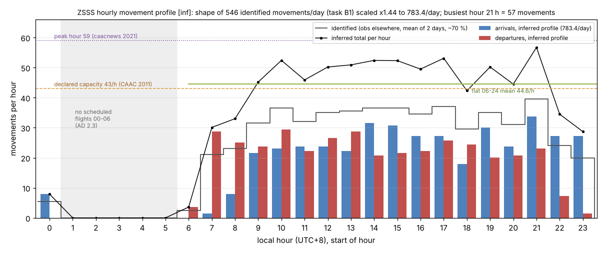
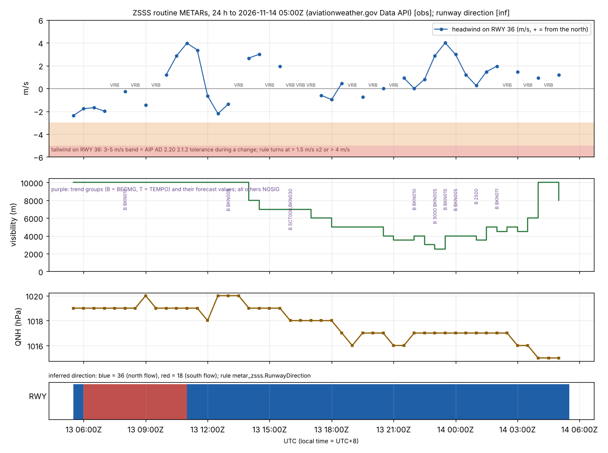
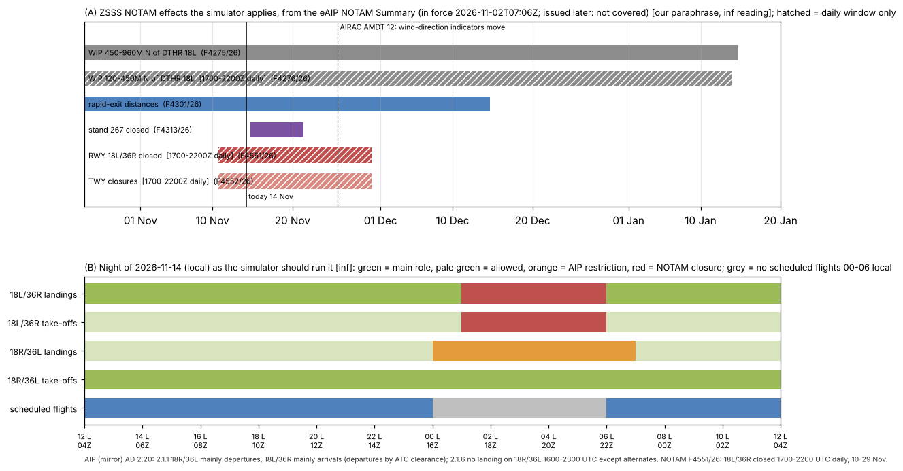
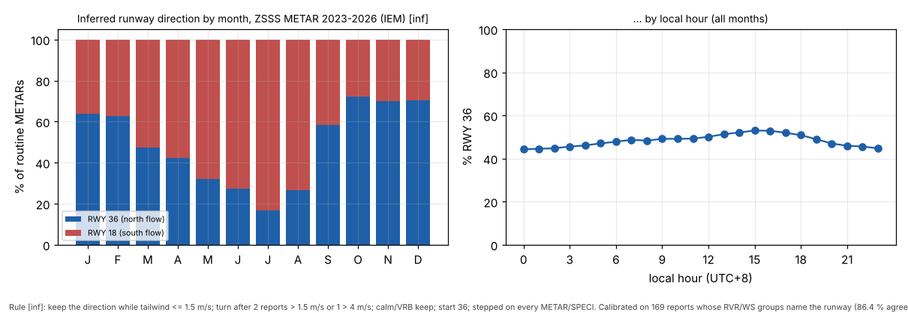

# Published facts for the simulator: schedules, weather, NOTAMs, runway use

Task B2, Phase 1. Written 2026-11-14 and revised the same day in Fix round 1 after the C2 check
(`docs/phase1/verify_research.md`). Owner decisions OD0-OD3 and the working defaults of `docs/PLAN.md` §6a/§6b apply.
OD2 asks for "as much real information as can legitimately be obtained". This report covers OD2 tier 3, published
facts.

**Labels**

| Label | Meaning |
|---|---|
| **[obs]** | We measured or read it in this session: a report, a published record, a file as delivered. |
| **[inf]** | Inferred by a rule or model of ours. |
| **[sec]** | Secondary source: news, Wikipedia, a search-result summary. |
| **AIP (mirror)** | AIP China AD 2 ZSSS, read in the unofficial mirror copy (EFF 2026-07-08). OD3 applies: short cited facts only. |
| **[unverified]** | Not established. |

**Rules we kept**
- We did not call api.adsb.lol or OpenSky, and did not use Google, Baidu or Amap.
- We registered no accounts. Nothing was collected or solicited inside the PRC.
  - The weather data come from US hosts (NOAA/NWS, Iowa State University).
  - The schedule data come from the Hong Kong and Taiwan open-data portals.
  - Hong Kong is a Special Administrative Region of the PRC with its own legal system. Downloading its published open
    government data under the DATA.GOV.HK terms is not "data collection inside the PRC" in the §6b sense, just as
    reading published pages on caac.gov.cn is not.
- Every download went into its own `refs/cache/<topic>/` folder with a `SOURCES.json` (URL, UTC time, SHA-256,
  licence quote). Every script that reads a download ran with `python3 -I`.
- No whole AIP list or NOTAM checklist is copied into this report. The NOTAM table lists only the NOTAMs the simulator
  applies, in our own words (§4.2).
- `sfo3d/`, `pc12/` and `hwd3d/` were read but not changed.

---

## 0. Answers in brief

| Question | Answer |
|---|---|
| **Schedules** | **No open source publishes a full SHA schedule.** The legitimate real information is: (1) the ADS-B "observed elsewhere" flights of task B1 (ODbL; 69-70 % of movements, an upper figure, about 65-70 % defensible, with real identity and inferred SHA times); (2) **open-government flight data at Hong Kong (DATA.GOV.HK) and Taipei Songshan (Taiwan OGDL)**, which give the published times of the 13 HKG and 8 TSA movements per day [obs]; (3) route facts from VRS (CC0), Wikipedia (CC BY-SA) and the eAIP. The free tiers of aviationstack, FlightLabs, AeroDataBox and AirLabs all need an account, and their terms forbid public display or redistribution. Airline sites have no SHA timetable files, only booking engines. CAAC publishes no flight-level schedule or slot list. Recommended combination: §1.4. |
| **Hourly profile** | None published. The only published points are a declared capacity of 43/h (CAAC 2011), a coordinated window of 06:00-02:00 and a peak of 59/h (caacnews 2021). We derived a profile [inf] from the B1 hourly counts, scaled to 783.4 movements/day. It has a departure bank at 07-08 h, 45-53/h from 09 to 17 h, and a busiest hour at 21 h of about 57 (§2). |
| **Weather** | **Yes.** `aviationweather.gov/api/data/metar?ids=ZSSS` works (HTTP 200) [obs]. The data are NOAA/NWS data; the NWS states its web pages are public domain "unless specifically noted otherwise", and the reports originate with the CAAC aviation met service (§3.1). ZSSS reports **every 30 minutes, at :00 and :30** (67,817 routine reports in 3.9 years, 48.0/day), plus about 0.9 SPECI/day. Every report ends in a trend: **NOSIG 93.7 %, BECMG 6.3 %, TEMPO 7 reports**. Wind is in **MPS**, QNH in **hPa** (Q group) and visibility in **metres** (9999, CAVOK). The TAF is issued at about 03, 09, 15 and 21 UTC and is valid for 30 h. 24 h and 30 d samples and a 2023-2026 archive (Iowa Environmental Mesonet: "public domain", attribution "would be appreciated") are kept (§3). |
| **NOTAMs** | The only open official source is the eAIP's **monthly NOTAM Summary**. It has no terms published, and the newest is "in force 2026-11-02 07:06Z". FAA NOTAM Search returned 403 (Akamai), FAA DINS was unreachable and FAA's API needs a key: there is no open feed. In force at ZSSS: **RWY 18L/36R closed 1700-2200 UTC daily, 10-29 Nov (F4551/26)**, with taxiway closures (F4552/26); **stand 267 closed 14 Nov 1700Z - 21 Nov 1000Z (F4313/26)**; WIP north of DTHR 18L (F4275/26, F4276/26); rapid-exit distances (F4301/26); and AIRAC AMDT 12 from 26 Nov. How the simulator applies them: §4. |
| **Runway use** | AIP (mirror) AD 2.20: **18R/36L mainly departures, 18L/36R mainly arrivals**. A tail wind of 3-5 m/s is tolerated "for short time" during a change of direction. **No landings on 18R/36L 1600-2300 UTC** except alternates. The AIP has **no preferred direction** and no north/south-flow rule. A wind rule [inf] was calibrated on the 169 METARs whose RVR or wind-shear groups name the runway. It turns the runway after two reports with a tail wind above 1.5 m/s, or one above 4 m/s. It agrees in **86.4 % in sample but 78.1 % out of sample** (thresholds chosen leave-one-day-out). The parameter-free **"into the wind"** rule agrees in 80.5 % and is the **fallback**. A literal 3/5 m/s reading agrees in only 65.1 %. Climatology 2023-2026: **north flow (36) 48 % of the time**, 63-72 % in Oct-Feb, 17-32 % in May-Aug (§5). |

---

## 1. Schedules

### 1.1 What the simulator needs, and what "allowed" means here

**What it needs.** For each movement: flight number or callsign, airline, aircraft type, arrival or departure, and the
SHA time. Days of operation are a bonus.

**What "allowed" means.** Our use must be lawful under the source's terms in two places:
- a **public, non-commercial web simulation** (display);
- a **public git repository** (redistribution of the data or anything derived from it).

Where the terms allow only one of these, the data stay local and only aggregates are published.

### 1.2 Sources checked

Fetch results are from this sandbox on 2026-11-14. Status codes are HTTP. `000` means the connection failed or timed
out.

| Source | SHA coverage | Fields | Freshness | Licence / terms (quoted where read) | Our use allowed? | Fetchable here? |
|---|---|---|---|---|---|---|
| **China Eastern / Shanghai Airlines** (ceair.com) | MU/FM ≈ 270 movements/day [inf from B1] | booking-engine query per route and date | live | Only a privacy policy (updated 2025-10-28) was found at `ceair.com/global/static/ceairRules/LegalAndPrivacyTerms/`. No site-use or data terms were found. | **No** for automated queries: it is a booking engine. Not attempted. | ceair.com 302; shanghai-air.com 000 |
| **Spring** (ch.com) | about 61 identified movements/day (B1) | booking engine | live | not read | **No** (booking engine) | 200 (6.8 s); flights.ch.com 000 |
| **Juneyao** (juneyaoair.com) | about 50/day (B1) | booking engine | live | not found by search | **No** | 302 |
| **Air China** | about 39/day (B1) | A monthly PDF timetable existed in 2010 [sec]; none found now | – | – | – | airchina.com.cn 000; airchina.us 200 |
| **China Southern** timetable PDFs | **none** | flight, days, times, validity | en: summer 2026 (89 pages, created 2026-05-26); two linked PDFs from 2018 and 2020 | "This flight timetable is for reference only." No licence found (legal pages 404). | Not needed: **no SHA flight** in any of the three (international routes only) [obs] | 200 (kept in `refs/cache/schedules_airlines/csair/`) |
| **Hainan, XiamenAir** | 12 and 20/day (B1) | booking engine | – | not read | **No** | hainanairlines.com 302; xiamenair.com 000 |
| **Foreign carriers** (JAL, ANA, Korean, Asiana, China Airlines, EVA, Cathay, HK Airlines, Air Macau) | 1-7 movements/day each | booking engines. ANA's route page says the latest schedule is in seat availability; its last PDF is from 2019 [sec] | – | not read | **No** (booking engines) | JAL, KAL, CAL, EVA 403 (CDN); ANA, Asiana 200; Cathay, HKA 301; Air Macau 000 |
| **CAAC** seasonal schedule approvals / slots (www.caac.gov.cn) | national totals only | Winter 2026/27: 216 airlines, about 116,000 flights a week [sec] | per season | site footer "版权所有：中国民用航空局" | facts only | HTTP works, HTTPS resets (proxy log). **No airport- or flight-level schedule or slot-allocation list was found** (four searches). The only airport-level coordination parameter is the 2011 capacity notice (43/h, field.md). |
| **SAA flight board** (FIDS) | full | flight, time, stand | live | forbids redistribution without written authorisation; WAF blocks scripts (field.md) | **No** | blocked |
| **aviationstack** (apilayer) | unknown | real-time flights on the free plan; schedules, future flights and routes only from "Basic" ($49.99/month) | – | Free plan: "100 Requests … Non-Commercial Use". Terms: Materials are "for informational and noncommercial or personal use only and will not be copied or posted on any network computer or broadcast in any media". No scrapers. | **No** (public page and repo excluded; account needed) | site 200; API not called |
| **AeroDataBox** | unknown (claims FIDS and schedules up to 365 days ahead) | FIDS, schedules | – | Free plan: 400 API units/month, 1 request/s, sign-up. "Derived Work Licensing" from $187.50/month. Terms: a use "does not qualify as an Application to the extent it makes Contents available as a data feed, dataset …"; End Users acquire "no right to extract, copy, redistribute". | **No** for the repo; public display only on a paid plan | site 200; API not called |
| **AirLabs** | unknown | schedules, routes | – | Pricing is rendered by JS and was not read. Secondary listings: a free tier "for personal use, limited queries" [sec]. ToS grants no redistribution right. | **No** (account; terms unverified) | site 200; /terms-of-service 200 |
| **FlightLabs** | unknown | schedules, FIDS, "future flights prediction" | – | 7-day trial or 50 requests. "The Free plan cannot be used for any commercial or public use or redistribution under any circumstances." | **No** | site 200 |
| **OpenFlights** routes.dat (git clone of jpatokal/openflights) | 411 airline-route rows with SHA, 69 far ends (MU 110, FM 80, HO 48, 9C 41, CZ 34, CA 28), equipment codes | airline, pair, equipment | **stale**: routes.dat last changed 2017-02-02; the route data date from 2014. It still lists defunct carriers (TransAsia). | ODbL 1.0 (`data/LICENSE`) | yes, but too old to drive anything; historical type hints at most | yes (git clone) |
| **Wikipedia** SHA destination list (rev 1385154959) | 205 airline-destination pairs, 25 airlines | pairs only, no times | edited continuously | CC BY-SA 4.0 | yes, pairs only, with attribution (already used by B1 as a pair check) | yes (`refs/cache/routes_wiki/`) |
| **VRS standing data** (callsign → route; B1) | 1,376 SHA callsigns | callsign, route | daily bot commits; entries median 2.6-4 years old | CC0 1.0 | yes | yes (git clone, B1) |
| **adsb.lol "observed elsewhere"** (B1) | **542-550 of 783 movements/day (69-70 %, an upper figure; about 65-70 % defensible)** | real callsign, registration, type; SHA time inferred (1-σ median 8-9 min, out of sample) | daily archive | ODbL 1.0 | yes (ODbL). Per-flight data stay local until the owner sees a sample (Q3 default). | yes (B1) |
| **Hong Kong International Airport** flight information (Airport Authority, DATA.GOV.HK dataset `aahk-team1-flight-info`) | **HKG-SHA: 6 departures and 7 arrivals on 13 Nov 2026** (CX, MU/FM, HX) [obs] | scheduled time, flight numbers incl. codeshares, origin/destination, status with actual time. No aircraft type. | The spec says the previous day. The endpoint also answered for 86 days back and 6 days ahead (schedule) [obs]. | "You are allowed to browse, download, distribute, reproduce … for both commercial and non-commercial purposes on a free-of-charge basis" with source identification, acknowledgement and attribution (DATA.GOV.HK Terms) | **yes**, with attribution "Airport Authority Hong Kong, via DATA.GOV.HK" | yes, 200 (`refs/cache/schedules_open/hkia/`) |
| **Taipei Songshan** real-time international departures and arrivals (data.gov.tw 37242 / 37248) | **TSA-SHA: 4 operated flights each way on 14 Nov** (10 rows each way with codeshares; CI, BR, MU/FM, CA) [obs] | flight, expected and real time, aircraft type on some rows (e.g. "A330-300", "333/73K") | real-time snapshot, daily files | Open Government Data License v1.0: "不限目的、時間及地域 … 重製、散布、公開傳輸"; compatible with CC BY 4.0 | **yes**, with attribution | yes, 200 (one reset, retried; `refs/cache/schedules_open/tsa/`) |
| **eAIP "Flight Routes Infomation" Nr.2611** (public, no login) | 15 + 13 international and 19 regional route codes touch ZSSS | routings: route code, permitted aerodromes, airway string | AIRAC (EFF 2026-10-28) | no licence published | reference only (OD3): ZSSS departures leave via POMOK, NXD, BOLEX; arrivals enter via PK, JTN | yes (`refs/cache/eaip_flight_routes/`, local) |
| Not used: Ctrip, Kayak, Flightradar24, FlightAware, VariFlight, OAG, Cirium | full | full | live | scraping forbidden, or contract only (PLAN §2) | **No** | not attempted |

Not tested, because each needs a registered key: Tokyo Haneda flight data via ODPT, Korea Airports Corporation (Gimpo)
via data.go.kr, and FAA SWIM.

### 1.3 What this means

- **The domestic schedule is not published in any form we may use.** 94 % of SHA movements are domestic. No airline
  timetable file exists for them, and CAAC publishes only national totals.
- **The real information we can lawfully get is**:
  - real flights, seen by ADS-B away from Shanghai (B1: 69-70 %, an upper figure);
  - the published schedules of two foreign-side airports (HKG, TSA): 21 movements/day, about 70 % of SHA's 29.9
    HK/Macau/Taiwan movements per day (CAAC 2025: 10,905 a year);
  - route facts.
- **Free commercial APIs add nothing we may publish.** Each needs an account, and the free tiers forbid public or
  networked use.

### 1.4 Recommended combination

Each record carries `src` and `evidence`, as OD1/OD2 require.

| Layer | Source | What it gives | Label |
|---|---|---|---|
| A. Backbone | B1 observed elsewhere, run over a **rolling 7-14 days** (not 2), to get days of operation and a median time per callsign | callsign → flight number (CES→MU, CSH→FM, CQH→9C, DKH→HO, …), registration, type, arrival/departure, SHA time | identity **obs** (elsewhere); SHA time **inf** |
| B. Published far-end schedules | HKIA (DATA.GOV.HK) and TSA (Taiwan OGDL) | exact published far-end times, codeshares, actual times; SHA time = far-end time ∓ block time (from the ADS-B-identified flights on the same route) | far-end schedule **obs**; SHA time **inf** |
| C. Route facts | VRS (CC0), Wikipedia (CC BY-SA), eAIP route codes (local reference) | callsigns that serve SHA but were not seen; destinations; exit and entry fixes | route **obs** (crowd-sourced / secondary); timing **inf** |
| D. Fill | inferred | the remaining ≈ 30 % placed in the residual of the hourly profile (§2), airline and type drawn from the per-airline mix | **inf** |
| Totals | CAAC monthly (verified) and the SAA winter plan of 802/day [sec] | daily target per date | – |

**Not used:** airline booking engines, OTAs, Flightradar24/FlightAware/VariFlight, the SAA FIDS, and the free API
tiers.

**Sketch of a record:**
```
{"callsign": "CESnnnn", "flight": "MUnnnn", "airline": "CES", "type": "<ICAO type>", "role": "dep",
 "sha_time_local": "hh:mm", "sigma_min": 9.4,
 "src_identity": "obs", "src_time": "inf",
 "evidence": ["adsb.lol trace (far end ZBAA)", "VRS route ZSSS-ZBAA"]}
```
Placeholders only, not a flight.

---

## 2. Hourly profile

### 2.1 Published or derivable

| Item | Value | Source | Status |
|---|---|---|---|
| Declared hourly capacity | **43/h**; coordinated window 06:00-02:00 | CAAC 局发明电〔2011〕3401号, `https://www.caac.gov.cn/XXGK/XXGK/ZFGW/201602/t20160224_29138.html` | verified (2011; may be outdated) |
| Later capacity (48 → 50/h, 2023) | – | search summaries only | unverified |
| Peak hour seen | **59** movements | caacnews 2021-10-09 | sec |
| Night | no scheduled flights 00:00-06:00 local; delays and diversions allowed | field.md (Sina 2010, shhqcbd 2012, caacnews 2023) | sec |
| Daily totals | 783.4/day (CAAC Jan-Sep 2026); 802/day planned for winter 2026/27 | field.md | verified / sec |
| Slot-coordination parameters, academic hourly profile | **none found** (six searches in Chinese and English, including caac.gov.cn) | – | – |
| **Derivable:** B1 hourly counts by arrival/departure (10 and 12 Nov 2026, mean 546.0 identified movements/day, re-run in Fix round 1) | see the figure | `observed_elsewhere_stats.json` (aggregates) | obs identity, inf time |

### 2.2 Inferred profile

**Basis [inf].**
- Take the identified hourly shape of B1 (arrivals and departures separately, mean of two days).
- Scale it uniformly by 783.4 / 546.0 = **×1.435**. The ~30 % not identified are assumed to share the same shape.
- Hours 01-05 stay at zero (no scheduled flights). The 5-6 arrivals per day inferred after midnight are delays and are
  kept.

The numbers are in `docs/phase1/sources_sim_hourly.json`.



| Local hour | 06 | 07 | 08 | 09-13 | 14-17 | 18 | 19-20 | 21 | 22 | 23 | 00 |
|---|---|---|---|---|---|---|---|---|---|---|---|
| Arrivals /h | 0 | 1.4 | 7.9 | 21.5-23.7 | 27.3-31.6 | 17.9 | 23.7-30.1 | 33.7 | 27.3 | 27.3 | 7.9 |
| Departures /h | 3.6 | 28.7 | 25.1 | 22.2-29.4 | 20.8-25.8 | 24.4 | 20.1-20.8 | 23.0 | 7.2 | 1.4 | 0 |
| Total /h | 3.6 | 30.1 | 33.0 | 45.2-52.4 | 49.5-53.1 | 42.3 | 44.5-50.2 | **56.7** | 34.5 | 28.7 | 7.9 |

**Day totals.** 408.3 arrivals and 375.1 departures.
- The surplus of arrivals is the evening return of based aircraft.
- The morning bank (07 h: 29 departures, 1 arrival) shows that the first wave leaves from night-stopping aircraft.

**Checks.**
- The busiest hour (56.7) lies below the 59/h peak reported in 2021.
- The 09-17 h plateau (45-53/h) lies above the 2011 declared 43/h, which is consistent with the reported rise of
  capacity.
- 07-08 h (30-33/h) may be under-counted: B1 identifies only 49 % of the flat mean then. A 7-14 day B1 run, and the
  HKIA/TSA flights, will show whether that is real or a coverage bias.

**For the simulator.**
- Use this profile as the hourly target, scaled to the date's daily total.
- Cap arrivals on 18L/36R and departures on 18R/36L at the runway's own rate (Phase 3).
- Keep 01-05 h empty, apart from delayed arrivals that land before the night closure (§4).

---

## 3. Weather: METAR and TAF

### 3.1 aviationweather.gov Data API (NOAA/NWS)

**Test** (2026-11-14 05:26Z, custom User-Agent) [obs]:
- `https://aviationweather.gov/api/data/metar?ids=ZSSS&format=json&hours=24` → **HTTP 200**, 50 reports (22,456 B).
- `format=raw` → 200.
- `…/taf?ids=ZSSS&format=json` → 200.
- The TAF endpoint has **no `hours` parameter**: it returns HTTP 400 "Unexpected query parameter". Past TAFs come with
  `time=issue&date=yyyymmdd_hhmm`.
- `metar?…&hours=168&date=…` returns past weeks. The database reaches back **30 days**: the earliest report we got was
  15 Oct 01:00Z.

**Terms (quoted).**
- "Please keep requests limited in scope and frequency … All requests are rate limited to 100 requests per minute.
  Most endpoints return a maximum of 400 entries … The weather database currently allows access to up to the previous
  30 days of data … Set a custom user agent." (`https://aviationweather.gov/data/api/`)
- **Status of the data (Fix round 1 wording).** The METARs and TAFs we use are NOAA/NWS data, served by the AWC.
  - The AWC Data API page states no licence.
  - The NWS disclaimer covers NWS web pages: "The information on National Weather Service (NWS) Web pages are in the
    public domain, unless specifically noted otherwise, and may be used without charge for any lawful purpose so long
    as you do not: 1) claim it is your own …, 2) use it in a manner that implies an endorsement or affiliation with
    NOAA/NWS, or 3) modify its content and then present it as official government material."
    (`https://www.weather.gov/disclaimer`)
  - The archive host says: "The materials found on this website are in the public domain and may be used freely by
    anyone for any lawful purpose. Attributing the Iowa Environmental Mesonet of Iowa State University would be
    appreciated." (`https://mesonet.agron.iastate.edu/disclaimer.php`)
- **The originator is not the host.** The reports are issued by the CAAC aviation meteorological service and
  exchanged under ICAO Annex 3 / WMO. We read them only from US hosts.
  - "Public domain" is the US hosts' statement about what they serve, not a statement by the originator.
  - We therefore describe the reports as "NOAA/NWS (AWC) data" and "IEM archive", always credit both, and do not
    label the reports themselves public domain.

**Requests used.** 1 + 1 (24 h), 5 (30 d), 3 + 5 (TAF), and one tgftp request. All are well inside the limits.

### 3.2 What the ZSSS reports look like (measured)

`tools/wx/metar_stats.py`; numbers in `docs/phase1/sources_sim_wx_stats.json`.

| | AWC 24 h (13 Nov 05:30Z - 14 Nov 05:25Z) | AWC 30 d (15 Oct 01:00Z - 14 Nov 05:25Z) | IEM 2023-01-01 - 2026-11-13 |
|---|---|---|---|
| Routine METAR | 48 (all at :00 or :30; 47 of 47 gaps = 30 min) | 1,449 = 48.0/day; all 1,448 gaps = 30 min | 67,817 = 48.0/day; 30 min gaps except 4 × 60 and 1 × 120 min |
| SPECI | 2 | 21 (0.7/day) | 1,287 (0.91/day; off-minute reports taken as SPECI [inf], because IEM drops the word) |
| Trend part | NOSIG 41, BECMG 9 | NOSIG 1,294 (88 %), BECMG 176 (12 %), TEMPO 0 | **NOSIG 64,770 (93.7 %), BECMG 4,326 (6.3 %), TEMPO 7**, none 1 |
| Wind unit | MPS (all) | MPS (all) | MPS (all 69,104); VRB 6.9 %, calm 592, gust groups 1,307 |
| QNH | Q group, hPa: 1015-1020 | 1011-1035 | **980-1044 hPa**; never A (inHg) |
| Visibility | metres: 2,500 - 9999 | 2,500 - CAVOK | CAVOK 53.2 %, 9999 31.1 %, 5,000-9,000 12.7 %, 1,500-4,999 2.8 %, < 1,500 84 reports; minimum **200 m**; RVR in 124 reports; WS groups 46; RMK once |
| Completeness | – | AWC 1,470 vs IEM 1,457 reports in the same window | – |

**Examples** (raw text from the AWC Data API, NOAA/NWS; 13-14 Nov 2026):
```
METAR ZSSS 140500Z 05002MPS 010V080 8000 -RA BKN020 19/17 Q1015 NOSIG
METAR ZSSS 140200Z 01002MPS 340V040 4500 -RA BR BKN006 18/17 Q1017 BECMG TL0340 BKN011
METAR ZSSS 132300Z 34003MPS 2500 -RA BR BKN004 18/17 Q1017 BECMG TL0010 3000 BKN005
TAF ZSSS 130908Z 1312/1418 17004MPS 6000 BKN015 TX20/1406Z TN17/1321Z TN16/1418Z TEMPO 1320/1324 RA BKN013 BECMG 1323/1324 33004MPS
```

**TAF** (5 issues, 13-14 Nov) [obs]:
- issued at 0311Z, 0908Z, 1513Z, 2103Z and 0306Z, i.e. **every 6 h, about 03/09/15/21Z**;
- valid **30 h** (e.g. `1406/1512`);
- MPS winds, TX/TN groups, BECMG and TEMPO change groups.



### 3.3 Decoder consequences

| Finding | Status |
|---|---|
| **The sfo3d decoder must not be reused unchanged for ZSSS.** `sfo3d/js/env/wx/metar.js` ends the report only at RMK, so a trend's cloud groups become observed layers. `… BKN006 18/17 Q1017 BECMG TL0340 BKN011` decodes as two layers, BKN006 and BKN011. Run with node on three ZSSS reports. | obs |
| `tools/wx/metar_zsss.py` (stdlib) ends the body at the first NOSIG/BECMG/TEMPO/RMK. It decodes the trend separately (FM/TL/AT plus elements) and keeps the report units (m/s, m, hPa). Over the 30-day file it leaves no group unparsed. | obs |
| **Use the AWC JSON fields only with care.** `wspd` is knots rounded from MPS (1 MPS → 2 kt), `visib` is statute miles with **"6+" for 9999**, and `wdir` is the string "VRB". Decode `rawOb` instead. | obs |
| Wind directions in METAR are true. The runway headings used are true too: 177.34° and 357.34°. | AIP (mirror) / OSM |

### 3.4 Other open sources

| Source | Test | Terms | Use |
|---|---|---|---|
| **Iowa Environmental Mesonet** ASOS/METAR archive (`mesonet.agron.iastate.edu/cgi-bin/request/asos.py?station=ZSSS…`) | 200. Four yearly CSVs 2023-2026 (5.2 MB). One HTTP 429 on the third request; retried once after 2 min. | "The materials found on this website are in the public domain and may be used freely by anyone for any lawful purpose. Attributing the Iowa Environmental Mesonet of Iowa State University would be appreciated." | history, snapshots, climatology (sfo3d does the same) |
| NOAA tgftp `tgftp.nws.noaa.gov/data/observations/metar/stations/ZSSS.TXT` | 200, latest report | NWS disclaimer, as quoted in §3.1 | fallback for the latest report |
| AWC cache files (`/data/cache/metars.cache.csv.gz`, every minute) | directory listing 403; files not fetched | as AWC | relay option for many stations |
| NCEI ISD global-hourly (58367) | 301 to `noaa-global-hourly-pds.s3.amazonaws.com` | not read | not needed |
| CMA / Chinese hosts | not attempted | – | not needed |

Kept in `refs/cache/metar/` with `SOURCES.json`: the 24 h JSON and raw sample, the 30-day raw files, the TAFs and the
IEM archive. On the hosts' statements quoted in §3.1 they **may be committed** (`git add -f`), with the attribution
"Weather: NOAA/NWS Aviation Weather Center; Iowa Environmental Mesonet, Iowa State University. Not official NOAA
material."


**For the simulator.**
- Live mode: the relay polls AWC METAR + TAF at most every 5-10 min (the reports change every 30 min) and decodes the
  raw text.
- Snapshot/replay mode: IEM.
- The METAR body drives wind, visibility, cloud and QNH. The trend drives the "expected" state.

---

## 4. NOTAMs

### 4.1 Sources

| Source | Result | Terms |
|---|---|---|
| **eAIP NOTAM Summary** (public endpoint `POST https://www.eaipchina.cn/eaip/homeFile/listPublish`, then the zip) | **Newest: "NOTAM Summary In Nov.2026"** (created 2026-11-04, checklist "in force on 2026-11-02 07:06"). Older ones: Aug and Apr 2026, Nov/Dec 2025. Re-checked 2026-11-14: nothing newer. **Series F holds 17 ZSSS NOTAMs**; series A holds the AIRAC triggers. NOTAMs issued after 2 Nov are not in it. | **None published.** The site shell carries only "Trial Phase: Data Unavailable for Formal Operation. Verify Before Use" and an ICP number. No licence, terms or copyright notice is on the public pages. We treat it as all rights reserved and publish short cited facts only (OD3). |
| FAA NOTAM Search (`notams.aim.faa.gov/notamSearch`) | **403 "Access Denied"** (Akamai edge, the site itself) for the page and the search POST | – (not circumvented) |
| FAA DINS (`www.notams.faa.gov/dinsQueryWeb`) | unreachable (proxy: "gateway could not connect") | – |
| FAA NOTAM API (`external-api.faa.gov/notamapi/v1/notams`) | 401: needs client id and secret (registration) | – |
| ICAO API Data Service | 302 to a login | account |
| aischina.com, atmb.net.cn (CAAC AIS / ATMB) | connection closed (000) | – |

**Conclusion.** There is **no open, machine-readable NOTAM feed for ZSSS** we can use. The monthly eAIP summary is the
only official public source. Refresh it each month: the next one is expected in early December 2026. Treat closures
announced later as unknown.

### 4.2 In force at ZSSS: what the simulator applies

`tools/notam/notam_summary.py` parses the series PDF (`pdftotext`) into fields and derived effects. The output,
`refs/cache/notam/zsss_notams_2026-11.json`, stays **local**.

Only the NOTAMs the simulator applies are listed, in our own words (Fix round 1). The other 11 ZSSS NOTAMs of the
summary are not applied and appear only in the local JSON. All times UTC. Local = UTC+8.

| NOTAM | Effect (our paraphrase) [inf reading] | Window | Simulator action |
|---|---|---|---|
| **F4551/26** | Runway 18L/36R closed; aircraft cross it only at H4 and H7. With AIP AD 2.20 2.1.6 (no landing on 18R/36L 1600-2300 except alternates), no landings at all in the window except alternates. | **1700-2200 daily, 10 Nov 1700 - 29 Nov 2200** (01:00-06:00 local) | close the runway; crossings only at H4 and H7; departures only on 18R/36L (none scheduled) |
| **F4552/26** | Taxiway closures in the same window: 17 short links off runway 18L/36R plus sections of TWY A, B and H between H4 and H7 (names in the local JSON) | same window | remove these taxi-graph edges in the window |
| **F4313/26** | Stand 267 closed | **14 Nov 1700 - 21 Nov 1000** | the stand allocator skips 267 |
| **F4301/26** | Vacate within 50 s. First rapid exits from the displaced threshold: 18L at 1,850 m (B4) and 1,890 m (A3); 36R at 1,715 m (A2) and 1,950 m (B3) | to 14 Dec 1559 | landing-roll and exit-choice model |
| **F4275/26, F4276/26** | Works areas north of the RWY 18L displaced threshold, 75 m either side of the centreline: 450-960 m (H24) and 120-450 m (1700-2200 daily) | to 14 Jan 2027 | works-area props beyond the north end (visual only) |
| **AIRAC AMDT 12/2026** (A-series trigger) | The positions of the wind-direction indicators change | from 1600 25 Nov | flag the indicators as "position changed, new position unknown" until the amendment can be read |



**How the simulator applies them.** Proposed, [inf].
- Keep a NOTAM layer of records:
  `{effect: rwy_closed | rwy_no_landing | twy_closed | stand_closed | wip_area | rapid_exit_distances, target,
  from_utc, to_utc, daily_utc: [start, end] | null, notam, src: "obs"}`.
- At each simulation time `t` the layer answers three questions:
  - Is runway R open for arrivals or departures? This uses the AIP night rule plus the active NOTAMs.
  - Which taxi edges are closed?
  - Which stands are closed?
- **Arrivals.** For a flight whose ETA falls in 1700-2200 UTC while F4551 is active:
  - land it before 1700 if it is within about 15 min [inf];
  - otherwise hold it to 2200 or divert it to PVG (`inf`, shown as such).
- **Departures.** They use 18R/36L as usual. A departure delayed past 01:00 local still uses 18R/36L.
- **About panel.** Show the active NOTAM ids with "source: CAAC eAIP NOTAM Summary, in force 2026-11-02 07:06Z;
  later NOTAMs not known".
- **Committed form.** Commit only the derived effect records (ids, dates, targets), not the NOTAM text.

---

## 5. Runway-use rules

### 5.1 AIP (mirror) AD 2.20 / 2.21 / 2.22: short cited facts

| Rule | Quote (AIP China AD 2 ZSSS, EFF 2026-07-08, mirror) | Section |
|---|---|---|
| Segregated mode | "RWY18R/36L mainly used for departure; RWY18L/36R mainly used for arrival, and could be used for departure by ATC clearance." | AD 2.20 2.1.1 |
| Tail-wind tolerance during a change | "During changing the direction of RWY in use, if downwind speed is more than 3m/s and not exceeding 5m/s, ATC may instruct aircraft downwind take-off or downwind landing for short time." | AD 2.20 2.1.2 |
| Night | "Aircraft is forbidden to land on RWY18R/36L from UTC 1600 to 2300 daily(except alternate)." | AD 2.20 2.1.6 |
| Runway occupancy | vacate "within 50s after touchdown via the first or second rapid exit TWY"; line up "within 60s from holding position" | AD 2.20 2.1.4.2, 2.1.5 |
| Crossings | cross 18R/36L via H1-H7 and 18L/36R via H1, H4, H7. Landing aircraft must not vacate via H3, H4 or H5. Towing across runways is forbidden 2200-1600 UTC. | AD 2.20 2.2.5, 2.3.2, 2.2.6 |
| End-around taxiways | ROUTE-NORTH/SOUTH "normally H24" for arrivals to the west apron, span < 36 m normal; "When all departure flight finish take-off at night, RWY crossing mode can be implemented"; with LVP in force, crossing mode | AD 2.20 2.3.3 |
| Entry points | "ATC may instruct aircraft to enter RWY18R via H2, or enter RWY36L via H6 for take-off" | AD 2.20 2.1.7 |
| Departures | "strictly turn at 200m in SID of RWY36L/36R" (airspace restriction); noise abatement NADP1 | AD 2.20 1.5; AD 2.21 1.2 |
| Arrivals | within 10 NM, radar separation may be reduced to 5 km if the leader vacates within 50 s (dry runway); RNAV-1 primary; SASAN point merge | AD 2.22 4.1, 1.1, 1.3 |
| Circuits | to the west of the runways | AD 2.22 2 |

These quotes are short and verified (C2), but together they cover most of AD 2.20. They are flagged for the owner's
OD3 check.

**Not in the AIP:**
- a preferred or noise-preferential direction;
- a north/south-flow selection rule, a wind or crosswind limit for choosing the direction, or a time-of-day direction
  rule.

The only night rules are 2.1.6 and the crossing/towing rules. "East landings, west take-offs" (东落西起) is the
same segregated mode in press wording [sec].

### 5.2 How the wind decides 18 vs 36

**General ICAO practice.** Doc 4444 §7.2 says aircraft "normally" land and take off into the wind unless other factors
make another direction preferable [sec; quoted from memory, not re-read].

**At ZSSS.**
- Both runways always run the same way: they are close parallels 365 m apart.
- The METAR wind is in m/s and the runway headings are 177.3° / 357.3° true.
- The headwind on RWY 36 is `ws·cos(wd − 357.34°)`.

**Rule [inf], `tools/wx/metar_zsss.py: RunwayDirection`.**
- Keep the current direction while its tail wind, gusts included, is ≤ 1.5 m/s.
- Turn round after two consecutive reports above 1.5 m/s, or one report above 4 m/s.
- Calm or VRB keeps the current direction.
- The rule is stepped on every report, METAR and SPECI, as a live simulator would see them.

**Calibration.** The only observed hint of the runway in use is the runway designator in **RVR groups** (`R36R/1300D`)
and **wind-shear groups** (`WS R18L`). These name the runway the report is for, normally the runway in use [inf about
observer practice]. ZSSS METARs 2023-2026 hold **169** such reports on **60** days: 99 for 36, 70 for 18
(`tools/wx/rule_check_rvr.py`).

**In sample and out of sample (Fix round 1).** The thresholds were chosen on the same 169 hints they are scored on, so
the scores in the first column are in-sample. The second column is out of sample: for each of the 60 hint days, the
best threshold pair of a 6 × 5 grid is chosen on the other 59 days and scored on the held-out day.

| Rule variant | In sample | Out of sample |
|---|---|---|
| **tail wind > 1.5 m/s twice, or > 4 m/s once (chosen)** | **146/169 = 86.4 %** (RVR 101/124, WS 45/45); all hints agree on 52 of 60 days; day-bootstrap 95 % CI 78.3-94.7 % | – |
| hysteresis family, thresholds chosen leave-one-day-out (grid: keep 0.5-3.0 m/s × turn 2-6 m/s) | – | **132/169 = 78.1 %** (C2's independent re-derivation on 168 hints: 78.0 %) |
| **always into the wind** (\|headwind\| < 0.5 m/s keeps; no parameter fitted) | 136/169 = **80.5 %** | 80.5 % (nothing is fitted) |
| > 1.5 twice or > 5.0 once | 87.0 % | – |
| > 1.0 twice or > 3.0 once | 83.4 % | – |
| > 2.0 twice or > 4.0 once | 82.8 % | – |
| > 0.5 twice or > 2.0 once | 82.2 % | – |
| > 2.5 twice or > 5.0 once | 81.7 % | – |
| prefer 36 unless any tail wind; prefer 18 unless any tail wind | 79.9 %; 78.7 % | (one choice each) |
| **literal AIP 3/5 m/s (> 3 m/s twice or > 5 m/s once)** | **65.1 %** | (no fitting) |
| always the majority direction (36) | 58.6 % | – |

- **The chosen rule's advantage is not established.** Chosen minus "into the wind" has a day-bootstrap 95 % interval of
  −0.7 to +13.1 percentage points.
- **What the simulator does.**
  - Default: the chosen rule (`metar_zsss.RunwayDirection`).
  - **Fallback: the parameter-free "into the wind" rule** (`metar_zsss.RunwayDirectionIntoWind`), selectable by a
    switch. Both are shown as inferred.

**Reading.**
- ATC turns the runway at small tail winds. The AIP's 3-5 m/s is a tolerance while a change is under way, not the
  trigger for one. This holds in and out of sample: every rule that turns at small tail winds beats the literal 3 m/s
  reading by 13-22 points.
- In sample, every threshold of 2.5 m/s or less scores 82-87 %. Out of sample the family is at 78 %, level with "into
  the wind".
- The hints come from low-visibility and wind-shear situations, so the calibration is weakest in fair weather with
  light winds. 8 of the 60 days have some disagreement, all of it in RVR (low-visibility) reports, where winds are
  light.



**Climatology with the chosen rule** (IEM 2023-01-01 to 2026-11-13, 67,817 routine METARs) [inf]:
- north flow (36) **48.3 %** of the time;
- **0.55 direction changes per day**;
- by month: Jan 64 %, Feb 63 %, Mar 48 %, Apr 42 %, May 32 %, Jun 27 %, Jul 17 %, Aug 27 %, Sep 58 %, Oct 72 %,
  Nov 70 %, Dec 70 %. This is the winter north-westerly / summer south-easterly monsoon;
- by local hour: 44-53 %.

Raw wind statistics:
- the wind favours 36 (headwind > 0) in 47.0 % of the reports that have a direction;
- the along-runway component exceeds 3 m/s in 42.6 % of reports, and 5 m/s in 13.3 %;
- mean speed 3.9 m/s.

**Sensitivity of the north-flow share:**

| Thresholds | North flow | Changes per day |
|---|---|---|
| 1.0/3.0 m/s | 47.7 % | 0.65 |
| 2.0/4.0 m/s | 51.2 % | 0.43 |
| 3.0/5.0 m/s | 53.9 % | 0.31 |

**Now** (14 Nov 05:00Z): wind 050°/2 m/s, TAF 350°/4 m/s → **north flow, RWY 36R arrivals / 36L departures** [inf].
The 24 h plate shows the rule's south flow on 13 Nov 06-11Z (southerly 2-2.4 m/s tail wind on 36) and north flow
since.

**For the simulator.**
- Run the rule on each new METAR (default: the chosen rule; fallback: "into the wind"). Optionally pre-announce a
  change from a TAF or trend BECMG wind.
- Show the direction as **inferred** with the triggering METAR.
- Apply §4 on top of the rule.
- Low visibility: all four ends have CAT I PALS only (AIP AD 2.14). Below about 550 m RVR, arrivals should hold or
  divert [inf: CAT I minima assumed, the AD 2.24 minima not read]. 84 reports in 3.9 years had a visibility below
  1,500 m.

---

## 6. Files

**Written (tools, committable):**
- `tools/wx/metar_zsss.py`: decoder, runway rule and the "into the wind" fallback.
- `tools/wx/metar_stats.py`: stream statistics and the two weather plates.
- `tools/wx/rule_check_rvr.py`: RVR/WS check, in sample and leave-one-day-out.
- `tools/notam/notam_summary.py`: eAIP summary parser.
- `tools/notam/notam_plate.py`: NOTAM plate (applied NOTAMs only).
- `tools/sim/hourly_profile.py`: hourly profile.

**Docs and images (committable):**
- `docs/phase1/sources_sim.md` (this report).
- The plates: `sources_sim_metar24h.png`, `sources_sim_flow.png`, `sources_sim_notam.png`, `sources_sim_hourly.png`.
- `sources_sim_wx_stats.json`, `sources_sim_hourly.json`, `SOURCES_sim.json` (attributions).

**Cache, committable with `git add -f` (redistributable):**
- `refs/cache/metar/` (NOAA/NWS AWC and IEM data; redistributable on the hosts' statements quoted in §3.1, with
  attribution; 5.2 MB);
- `refs/cache/schedules_open/hkia/` (DATA.GOV.HK terms, attribution);
- `refs/cache/schedules_open/tsa/` (Taiwan OGDL v1.0, attribution);
- `refs/cache/openflights/` (ODbL; only if wanted: stale).

**Cache, local only:**
- `refs/cache/notam/` (derived from the eAIP; no licence);
- `refs/cache/eaip_flight_routes/` (eAIP; no licence);
- `refs/cache/schedules_airlines/csair/` (airline PDFs; no licence; no SHA content).

## 7. Open issues and questions

1. **Domestic schedule.** No lawful published source exists. The plan relies on B1 over 7-14 days. Should B1's rolling
   run be scheduled? Each archive day is ~3.5 GiB, streamed.
2. **NOTAM freshness.** The eAIP summary is monthly and dated 2 Nov. Closures announced since then are unknown. The SUP
   21/26 details (TWY A/K1) and the AMDT 12 wind-indicator positions (26 Nov) are behind the eAIP login (OD3: no
   account).
3. **Runway rule.** It is calibrated on 169 low-visibility or wind-shear reports only, so fair-weather behaviour is
   inferred. Out of sample it scores 78 %, no better than the parameter-free "into the wind" rule (80.5 %), which is
   the fallback. No open observation of the runway in use exists (there is no ADS-B at ZSSS).
4. **Hourly profile.** It is uniformly scaled from two days. Possible coverage bias at 07-08 h.
5. **HKIA endpoint.** It answers beyond its documented "previous day" (86 days back, 6 days ahead). Rely only on the
   documented range for automated use.
6. **AirLabs terms** were not read (the pricing is JS-rendered). This is irrelevant unless the owner wants a paid API.
7. **AIP.** These values come from the mirror (EFF 2026-07-08), four AIRAC cycles old. Rules may have changed in
   AMDT 09-12.

## Changes in Fix round 1 (2026-11-14)

- Runway rule: the in-sample (86.4 %) and out-of-sample (78.1 %) agreement are shown side by side. The parameter-free
  "into the wind" rule (80.5 %) is added as the simulator's fallback (`RunwayDirectionIntoWind`).
- NOTAMs: the table and the plate now list only the NOTAMs the simulator applies (F4551, F4552, F4313, F4301,
  F4275/76 and the AMDT 12 trigger), in our own words. No NOTAM text is copied.
- Wording:
  - Hong Kong is described as a PRC Special Administrative Region with its own legal system.
  - The METAR data are described as NOAA/NWS (AWC) and IEM data, with the hosts' statements quoted, not as "public
    domain" in our own voice.
  - The record sketch uses placeholders.
- Hourly profile re-run on the B1 Fix round 1 aggregates: scale ×1.435, busiest hour 56.7.
