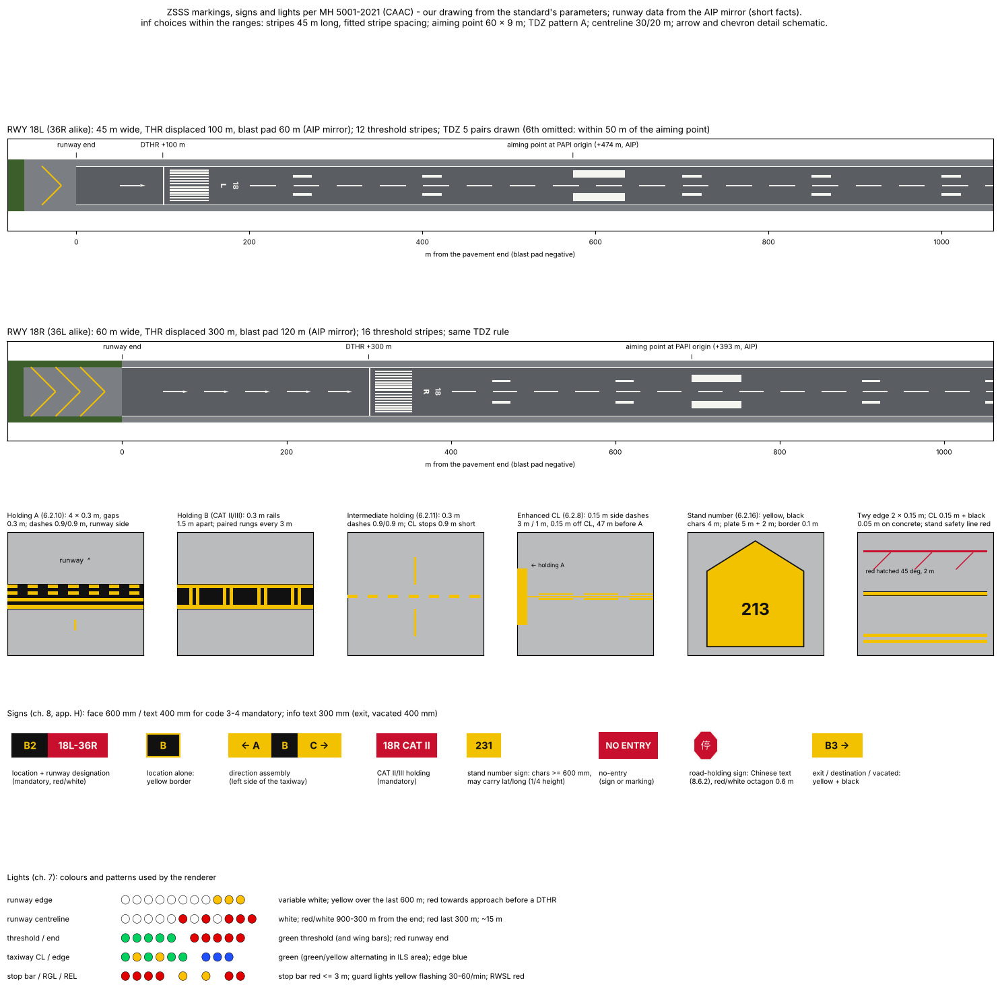
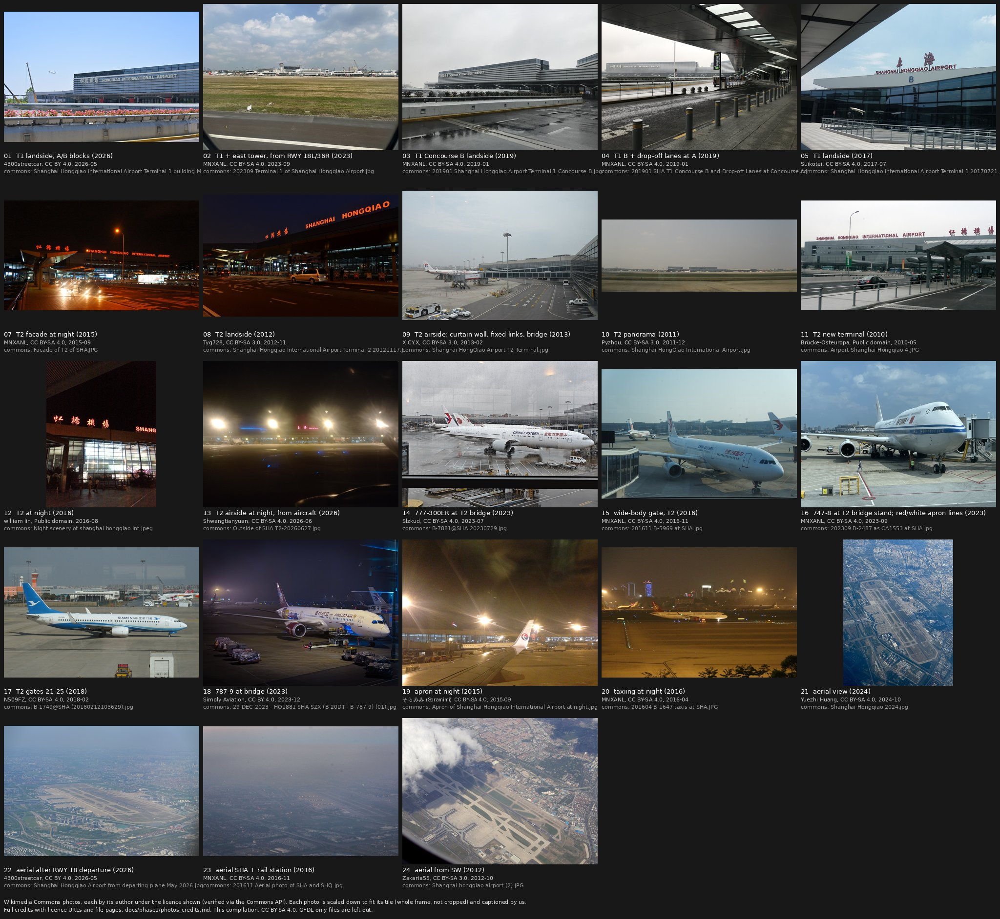
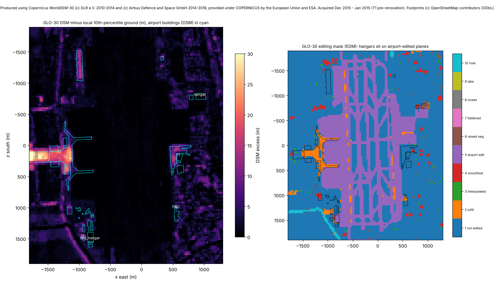
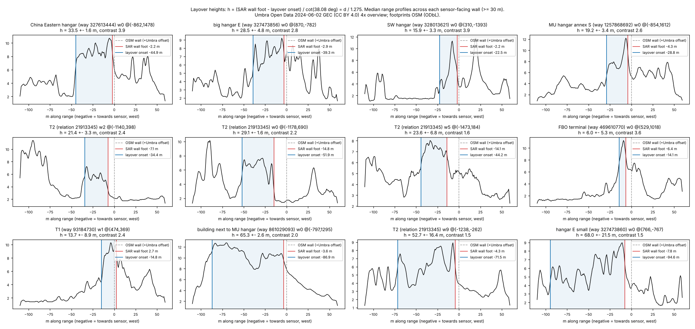
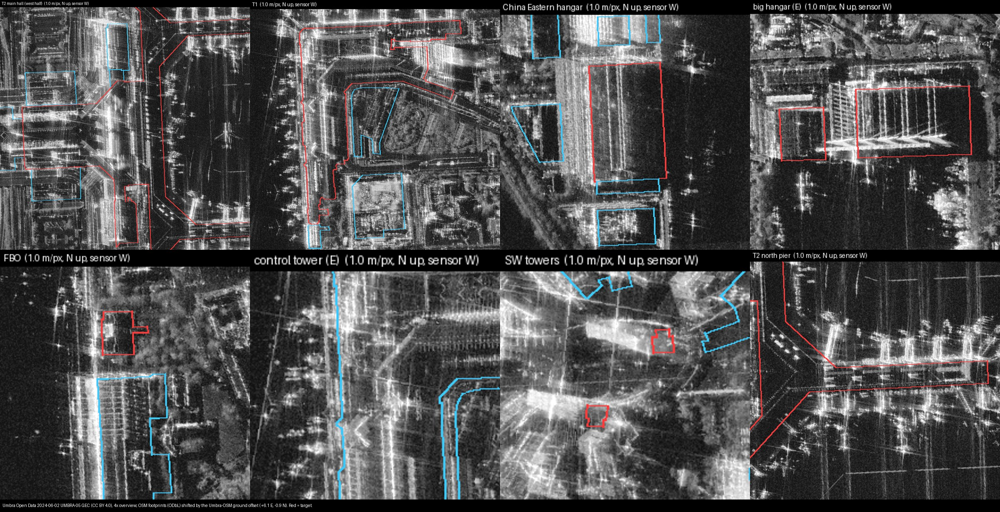

# Phase 1 / B3: marking, sign and lighting standards; appearance references; building heights

Date: 2026-11-14. Task B3 of Phase 1 (docs/PLAN.md §7), under owner decisions OD0-OD3 and the §6b working defaults.
Nothing in `sfo3d/`, `pc12/` or `hwd3d/` was touched (sfo3d was only read, for the FAA column); nothing was committed.

Labels: **obs** = read in a primary source or measured by me; **inf** = inferred by a stated rule; **AIP (mirror)** =
short fact from the unofficial mirror of AIP China EFF 2026-07-08 (OD3); **unverified** = not established.

## 0. Summary

| Item | Result |
|---|---|
| CAAC aerodrome standard | **Free on www.caac.gov.cn.** MH 5001-2021 《民用机场飞行区技术标准》 (Aerodrome technical standards), issued 2021-09-18, in force 2021-12-01, replaces MH 5001-2013; 288-page PDF (3rd printing, Nov 2023) plus amendments 1-4 (2024-01-03, 2024-01-23, 2024-08-09, 2025-06-21). It covers markings (ch. 6), lights (ch. 7), signs (ch. 8), apron aids (ch. 9) and colours (app. I). Its preface says it implements Annex 14 Vol I, 8th edition. All downloaded (obs). |
| Other CAAC texts | MH/T 5083-2024 民用机场助航灯光系统维护规程 (lighting maintenance, in force 2025-02-01) and 民航综机发〔2025〕1号 (visual-aids design and review points), both free. ICAO Annex 14 was not needed and not obtained. |
| Terms | No licence published; footer "版权所有：中国民用航空局"; the standard is also sold by 中国民航出版社 (98 CNY). Treated as **not redistributable**: PDFs local, short cited parameters only, no figure crops committed. |
| Parameters | About 60 renderer parameters extracted with clause numbers (§1.3), compared with FAA AC 150/5340-1M (read) and sfo3d's code. Largest differences: designation numerals 9 m tall (FAA 60 ft = 18.3 m), aiming point at the PAPI origin / 400 m (FAA 1,020 ft), TDZ pairs 6 by LDA (FAA 3-2-2-1-1 groups), centreline 30 m / 20 m and 0.45 m for CAT I (FAA 120 ft / 80 ft, 36 in), CAAC pentagon stand-number plates, red stand safety lines and Chinese text in apron and road markings. Holding position pattern A matches FAA dimensions (4 × 0.3 m). |
| ZSSS layout | Both runway ends drawn from the standard + AIP (mirror) facts: `standards_markings.png`. 18L/36R: 12 stripes, aiming point at the PAPI origin 474 m; 18R/36L: 16 stripes, aiming point 393 m; 5 TDZ pairs each (the 450 m pair falls within 50 m of the aiming point). TDZ pattern A vs B and enhanced centrelines are **unknown** at ZSSS. |
| Photos | Commons category walk (50 categories, 2,417 files) plus 8 searches; **25 photos** fetched with licences verified per file through the API; **23** reusable ones on `photos_contact_sheet.jpg` (CC BY 4.0 ×3, CC BY-SA 4.0 ×14, CC BY-SA 3.0 ×4, public domain ×2). One GFDL-only tower photo and one photo with identifiable people stay local. No Commons photo of the FBO or the China Eastern hangars exists (aerials only). |
| Observed in photos | The T2 aprons show MH 5001 apron markings: red stand safety lines with 45° hatching, red hydrant-pit circles, red-hatched bridge areas, white equipment areas, stand-number signs (yellow board, black numerals: "213", "247", "256"), Chinese service-road text. The east tower's form is clear in a 2023 photo. |
| Heights | No OSM height tags. Measured: China Eastern hangar **33.5 ± 3 m** (SAR layover, clean), big east hangar 28.5 ± 5 m, T2 main hall **22 ± 4 m** (SAR 21.4 m, DSM p90 22.2 m), T1 central hall **26 ± 4 m** and airside concourse 9 ± 2 m (photo ratio to the 44.5 m tower). The GLO-30 DSM predates the T1 rebuild and has airport-edited planes over the hangars. All heights **inf**. |



## 1. Standards

### 1.1 What CAAC publishes (checked 2026-11-14)

Found through the CAAC information-disclosure search (`/was5/web/search`, channel 211383) on www.caac.gov.cn, which
answers from here (intermittent connection resets; retries worked).

| Document | Designation, dates | URL (page → PDF) | Status |
|---|---|---|---|
| 民用机场飞行区技术标准 (Aerodrome technical standards) | **MH 5001-2021**, CAAC announcement 2021 No. 8; issued 2021-09-18, in force 2021-12-01; replaces MH 5001-2013; "有效" (valid) | `https://www.caac.gov.cn/XXGK/XXGK/BZGF/HYBZ/202112/t20211201_210343.html` → `…/P020240124587371852795.pdf` (288 pp., 7.2 MB) | obs |
| Errata | 2024-01-16: 7.5.5-1 and 12.2.3-1 corrected in the text ("第三次印刷", the PDF we hold) | same page | obs |
| Amendment 1 | 2024-01-03, in force 2024-11-28: ACR/PCR replaces ACN/PCN (3.6) | `…/HYBZ/202401/t20240108_222597.html` → `P020240108510340905586.pdf` | obs |
| Amendment 2 | 2024-01-23, immediate: SMGCS required (1.0.4) | `…/HYBZ/202401/t20240129_222809.html` → `P020240129578936812258.pdf` | obs |
| Amendment 3 | 2024-08-09, in force 2024-11-28: ACR/PCR text revised | `…/TZTG/202408/t20240816_225067.html` → `P020240816358433769553.pdf` | obs |
| Amendment 4 | 2025-06-21: **holding positions, enhanced centreline, mandatory markings, runway-vacated sign** (4.12.2, 6.2.8, 6.2.10, 6.2.12, 6.2.14, 6.2.15, 8.4.7) | `…/TZTG/202506/t20250623_227783.html` → `P020250701401698137311.pdf` | obs |
| 民用机场助航灯光系统维护规程 | **MH/T 5083-2024**, in force 2025-02-01; replaces AP-140-CA-2009-1 | `…/TZTG/202412/t20241223_226214.html` → `P020241224355399816301.pdf` (68 pp.) | obs (not needed for appearance) |
| 机场目视助航设施规划设计和审查管理工作要点 | 民航综机发〔2025〕1号, 2025-03-11 | `…/ZFGW/202503/t20250311_226915.html` | obs; names two guides not obtained (降低运输机场飞行区运行风险设计指南; SMGCS 建设和运行指南) |
| MH 5012-2010 (visual-aids construction and acceptance) | from a commercial standards list | not on CAAC pages searched | unverified, not needed |
| ICAO Annex 14 Vol I | sold by ICAO | not obtained | not needed: MH 5001 is the national implementation |

The earlier guesses "MH/T 5001" (task text) and "MH 5001-2021?" (arch.md) are settled: the designation is **MH 5001-2021**
(a mandatory industry standard per its preface, "强制性工程建设标准" since 2000).

### 1.2 Terms and how we use the text

- No licence or terms of use are published on the pages; the footer reads "版权所有：中国民用航空局". The cover shows
  中国民航出版社 as publisher with a price (成本价 98.00 元).
- PRC Copyright Law Art. 5(1) excludes "法律、法规，国家机关的决议、决定、命令和其他具有立法、行政、司法性质的文件"
  (cached `refs/cache/china_law/law_copyright_mofcom/`). Whether an industry standard falls under it is not settled
  (not legal advice).
- **Default:** PDFs and page renders stay local in `refs/cache/standards/` (SOURCES.json says redistributable: no). This
  report and the code cite **short numeric parameters with clause numbers**. `standards_markings.png` is our own drawing
  from those numbers; no figure from the standard is reproduced.
- The FAA AC 150/5340-1M (Change 1, 12/23/2020) was downloaded from faa.gov for the comparison (US Government work).

### 1.3 Renderer parameters: CAAC MH 5001-2021 vs FAA (sfo3d)

Colours: runway markings white; taxiway and turn-pad markings yellow; black borders on light (concrete) pavement
(6.2.1). The FAA column is from AC 150/5340-1M (read: §2.3-2.7, 4.2-4.3) or, where marked [code], from sfo3d's
`js/shaders/ground.js` / `js/live/markings.js`.

| Item | MH 5001-2021 (clause) | FAA / sfo3d | Change for sha3d |
|---|---|---|---|
| Designation | 2 digits (+ L/C/R), nearest tenth of MAG; single digit gets a leading 0 (6.1.1) | no leading zero (2.3) | "18L/36R", "18R/36L" (MAG 183/003, AIP mirror) |
| Numeral size | **≥ 9 m tall, may scale to 2×**; forms per Fig. 6.2.2-2 (most digits 3.0 m wide, "4" 3.9, "7" 3.5; clear gap ≥ 2.2 m, 3.8 m in "11") (6.2.2-4) | 60 ft (18.3 m); 6 and 9 63 ft (2.3) | new glyph set; 9 m default (inf: ZSSS paint size unknown) |
| Layout at threshold | stripes from 6 m; 12 m gap; letter 9 m; 6 m gap; number 9 m; 12 m gap; centreline (Fig. 6.2.2-1 b) | stripes from 20 ft (6 m) (2.5) | letter nearer the threshold in both |
| Threshold stripes | count by width: 18 m 4, 23 m 6, 30 m 8, **45 m 12, 60 m 16**; ≥ 30 m long (preferably 45 m), ~1.8 m wide, ~1.8 m apart, double centre gap; out to ≤ 3 m from the edge or 27 m from the CL (6.2.4) | 12 for 150 ft, 16 for 200 ft; 150 ft long, 5.75 ft wide and apart (2.5) | 45 m stripes; spacing fitted to the 3 m rule: 1.45 m (45 m rwy), 1.575 m (60 m) (inf) |
| Displaced threshold | transverse bar ≥ 1.8 m; permanent: centreline arrows before it, first arrow 30 m long starting 20 m before the bar (Fig. 6.2.4 b); temporary: row of arrows (3/3/4/5/7 for 18/23/30/45/60 m) | 10 ft bar; arrowheads + arrows [code] | permanent case at all four ends (100 m / 300 m, AIP mirror) |
| Pre-threshold pavement ≥ 60 m unfit for use | yellow ">" chevrons, line ≥ 0.9 m, 45°, 30 m pitch, apex towards the runway (6.2.25) | yellow, 3 ft, 100 ft pitch [code] | blast pads 60 m (18L/36R) and 120 m (18R/36L) (AIP mirror) |
| Centreline | stripe + gap 50-75 m, stripe ≥ max(gap, 30 m) (6.2.3); width **≥ 0.9 m CAT II/III, ≥ 0.45 m CAT I**, 0.3 m small | 120 ft / 80 ft; 36 in precision (2.4) | 30/20 m, 0.45 m (ZSSS CAT I, AIP mirror) (inf) |
| Runway edge | white, ≥ 0.9 m (runway ≥ 30 m), outer edge at the pavement edge (≤ 30 m from CL) (6.2.7) | 3 ft [code] | |
| Aiming point | start ≥ 150/250/300/**400 m** by LDA (<800/<1200/<2400/≥2400); **with a PAPI it starts at the visual approach slope origin**; length 45-60 m, width 6-10 m, inner gap 18-22.5 m (LDA ≥ 2400) (6.2.5) | 1,020 ft (311 m), 150 ft × 30 ft, gap 72 ft (2.6) | 474 m (18L/36R), 393 m (18R/36L) = AIP PAPI positions (inf: PAPI ≈ origin); 60 × 9 m (inf) |
| TDZ | instrument runways; pairs by LDA (or distance between thresholds): <900 1, <1200 2, <1500 3, <2400 4, **≥2400 6**; every 150 m from 150 m; pairs within 50 m of the aiming point omitted; pattern A bars ≥ 22.5 × 3 m, pattern B ≥ 22.5 × 1.8 m with 1.5 m gaps (the figure shows 3-3-[AP]-2-1-1) (6.2.6) | 75 × 6 ft bars, 5 ft gaps, 3-2-2-1-1 at 500 ft [code] | 5 pairs at 150/300/600/750/900 m at both runways; **pattern A or B unknown** |
| Centre circle | optional, diameter = half the width (6.2.3-5) | — | not at ZSSS (unknown; not drawn) |
| Taxiway centreline | yellow, **≥ 0.15 m**, black edges ≥ 0.05 m on light pavement; stops 0.9 m from holding / intermediate markings; continuous across threshold stripes; exits curve onto the runway CL, parallel 0.9 m off for ≥ 60 m (6.2.8) | 6 in (12 in on LVO routes) (4.2.5) | same width; black edges on concrete aprons (inf) |
| Enhanced centreline | where needed; side dashes 0.15 m, **3 m long, 1 m gap**, 0.15 m from the CL, over **47 m** from holding A; at every runway entry except exit-only taxiways (6.2.8-6, amd. 4) | 9 ft / 3 ft dashes over 150 ft (4.3) | present at ZSSS: unknown (inf: draw at runway entries) |
| Runway-holding pattern A | **4 lines 0.3 m, gaps 0.3 m (2.1 m)**; dashes 0.9 m / 0.9 m on the runway side; 0.1 m black surround on light pavement; across pavement **plus shoulders** (6.2.10, amd. 4) | 4 × 12 in, 12 in apart, dashes 3 ft / 3 ft (same) | FAA geometry already right |
| Pattern B (CAT II/III) | two 0.3 m lines 1.5 m apart (2.1 m) with paired 0.3 m rungs every 3 m; "CATII/CATIII" text ≥ 1.8 m if wider than 60 m (6.2.10) | ladder 12 in lines 2 ft apart, rungs every 10 ft [code] | new geometry |
| Holding distance from CL | CAT I precision, code 3-4: **90 m**; code F: 100 m; more where ILS areas need it (4.12.6) | — | checks for A1's 37 holds (min 88.8 m) |
| Intermediate holding | single dashed line 0.3 m, dashes 0.9 / 0.9 m (Fig. 6.2.11-1); one marking if two holds < 60 m apart (6.2.11) | single dashed line [code] | |
| Mandatory instruction marking | red background, white characters **4 m** (code C-F); background ≥ 0.5 m beyond characters; ≥ 1 m from CL and holding marking; one each side of the CL on taxiways ≥ 23 m (6.2.12) | surface painted holding sign [code] | runway designators painted at entries (inf) |
| Information marking | location: black background, yellow characters; direction/destination: yellow background, black characters; 4 m characters, 2 m arrows; "HP n" points (6.2.13) | — | |
| Taxiway edge | two yellow lines 0.15 m, 0.15 m apart (6.2.14); interrupted 0.9 m before holding markings (amd. 4) | two 6 in lines 6 in apart [code] | same |
| Taxiway shoulder | yellow bars 0.9 m × 7.5 m (or to 1.5 m from the outer edge), ≤ 15 m apart, at curves (6.2.15) | — | |
| Stand markings | stand number on a **yellow pentagon/arrow plate, black characters 4 m, plate 5 m + 2 m point, 0.1 m black border** (6.2.16-4); lead-in, turn and lead-out lines yellow ≥ 0.15 m (+0.05 m black); turn bar ≥ 6 m with arrow; alignment bar ≥ 0.15 m; **stop line ≥ 2 m × 0.15 m** with type code 0.15-0.3 m text; combined stands: main line solid, secondary dashed, "L"/"R" suffixes; pushback line white dashed 0.15 m, 1 m / 1 m (6.2.16) | lead-ins 6 in yellow; sfo3d draws no stop bars [code] | new plate glyph; Chinese/English type codes |
| Apron safety lines | stand safety lines, bridge area and pit markings **red**; wingtip clearance and other lines **white** (6.2.17); stand safety line ≥ 0.1 m, overlaps dashed with 45° hatching 0.1 m lines 2 m apart (6.2.18); wingtip line double white 0.15 m, 0.1 m apart (6.2.19) | red equipment boxes measured on NAIP [code] | new layer |
| Apron areas | equipment text white, 黑体 font (6.2.20-1); chock box ≥ 1 m with "轮挡" 0.5 m; bridge area red outline 0.1-0.15 m, 45° hatching 2 m apart, 3 m wheel circle; "设备区" boxes; vehicle bays e.g. tug 4.5 × 10 m, bus 4.5 × 14 m (6.2.20) | — | Chinese text on aprons |
| Pits | fire hydrant: red square (pit + 0.4 m); others: red ring 0.2 m wide, outer = pit + 0.4 m (6.2.22) | — | |
| Service roads | white; road rules apply; holding "停" 2.5 × 1 m (red background optional); crossing edges staggered 0.5-1 m × 0.15 m; speed limit circle ≥ 1.5 m, white with black 1 m digits, red 0.15 m ring (6.2.23) | white lines, dashed centre [code] | Chinese text |
| Closed | X: white on runways, yellow on taxiways; ≤ 300 m apart (6.2.24) | — | NOTAM closures (B2) |

### 1.4 Applied to ZSSS

| | 18L / 36R | 18R / 36L |
|---|---|---|
| Width, threshold stripes | 45 m → **12** | 60 m → **16** |
| Displaced threshold (AIP mirror) | 100 m both ends → arrows, transverse bar | 300 m both ends → arrows, transverse bar |
| Distance between thresholds | 3,200 m → 6 TDZ positions | 2,700 m → 6 TDZ positions |
| Aiming point start | 474 m (PAPI, AIP mirror) | 393 m (PAPI, AIP mirror) |
| TDZ pairs painted | 150, 300, 600, 750, 900 m (450 m omitted) | same |
| Centreline width (CAT I) | ≥ 0.45 m | ≥ 0.45 m |
| Blast pad chevrons | 60 m pad | 120 m pad |
| Holding distance (CAT I, code 4 / F) | ≥ 90 / 100 m | ≥ 90 / 100 m |

All of these are **inf** (standard + AIP facts); no imagery here resolves paint.

### 1.5 Signs (ch. 8, app. H)

- **Types and colours.** Mandatory (runway designation, CAT I/II/III holding, runway-holding "B2"-style, no entry, "HP n"
  points, road holding): red background, white characters; optional black outline 10/20 mm (8.3.2). Location: black
  background, yellow characters; yellow border when alone (8.4.2). Direction, destination, runway exit, runway vacated
  (A-pattern symbol), intersection take-off: yellow background, black characters (8.4.3-8.4.8). Taxiway ending: yellow and
  black diagonal stripes (8.4.5). Stand number signs: yellow background, black characters, internally lit; numerals
  ≥ 600 mm; may show latitude and longitude at 1/4 height; bridge-mounted ones are triangular prisms (8.5).
- **Language.** Taxi-guidance signs use Latin letters and digits only (words: APRON, CARGO, RUNUP, INTL, MIL, CIVIL,
  DEICING; 8.4.1). **Road-holding signs are in Chinese** (8.6.2), e.g. "未经塔台许可不得进入", on a red octagon 0.6 m (8.6.1).
  Apron and road markings use Chinese words (§1.3). So: English on airside signs, Chinese on roads and aprons (obs, the
  standard; the ZSSS photos agree for service roads).
- **Sizes (code 3-4).** Mandatory text ≥ 400 mm on a 600 mm face; information text 300 mm (exit and vacated 400 mm) on
  450 mm; strokes 64/48/32 mm for 400/300/200 mm text; mounting height ≤ 1,100 mm (600 mm faces) or ≤ 900 mm; setback
  11-21 m from a taxiway edge, 8-15 m from a runway edge (table 8.2.6, H.0.1-H.0.3, H.0.10). One-side mandatory signs
  ≥ 1.94 m wide (8.3.11). Divider line between direction signs ≈ 0.7 × stroke; location border ≈ 0.5 × stroke (H.0.12).
- **Placement.** Runway designation sign each side at holding A, location sign outboard (8.3.3, 8.3.5); direction
  assemblies on the **left** side, ≥ 60 m before the intersecting centreline (code 3-4), or on the intermediate holding
  line (8.4.3); exit signs ≥ 60 m before the tangent point (8.4.6). Same logic as FAA, but the faces and letter spacing
  follow table H.0.9 (letter widths, e.g. "A" 340 mm at 400 mm height).

### 1.6 Lights (ch. 7) used by the renderer

| Light | MH 5001-2021 | ZSSS (AIP mirror) |
|---|---|---|
| Approach CAT I | centreline to 900 m (≥ 720 m), 30 m spacing, crossbar 30 m long at 300 m; type B = barrettes ≥ 4 m with sequenced flashers 2/s from the outer end (7.2.2) | PALS CAT I: 900 m (18L, 36R, 36L), 840 m (18R) |
| Runway edge | variable white, ≤ 60 m apart (instrument); red towards the approach between the pavement end and a displaced threshold; **yellow over the last 600 m** (7.4.1) | REDL |
| Threshold / wing bars | green, unidirectional; CAT I at ≤ 3 m spacing between edge rows; inset at a displaced threshold; wing bars ≥ 5 lights, ≥ 10 m out (7.4.2-7.4.3) | |
| Runway end | red, ≥ 6 lights (7.4.4) | red RENL; stopway lights red over 150 m (18R/36L) |
| Runway centreline | ~15 m; white to 900 m from the end, **red/white alternating 900-300 m, red last 300 m** (7.4.5); between end and displaced threshold: approach lights or white barrettes | RCLL; approach lights in the displaced portion (A1) |
| TDZ | white barrettes CAT II/III only (7.4.6) | none |
| PAPI | 4 units, 3° (7.3) | 3°, left 18L/18R, right 36R/36L |
| Taxiway centreline | green; **green/yellow alternating** from the runway CL to the ILS critical/sensitive boundary on exits and entries; ≤ 30 m straight (≤ 15 m below RVR 350 m), curves 7.5/15/30 m by radius (7.5.1) | |
| Taxiway edge | blue omnidirectional, ≤ 60 m (7.5.2) | |
| Runway guard lights | A: two pairs of elevated yellow lights alternating 30-60/min; B: inset yellow across the taxiway at 3 m (7.5.3) | unknown |
| Stop bar | inset red ≤ 3 m apart, elevated pair beyond the edges where needed; CL lights 90 m beyond switch with it (7.5.5) | stop bars on rapid exits (A1) |
| Intermediate holding lights | 3 yellow at 1.5 m, 0.3 m before the marking (7.5.4) | unknown |
| RWSL | REL: red inset, 0.6 m off the taxiway CL from 0.6 m before the holding position to the runway edge, ≥ 5 lights 3.8-15.2 m apart; THL: red pairs 1.8 m either side of the CL lights from 115 m, every 30 m for ≥ 450 m (7.6.9) | RWSL (THL and REL) at listed intersections |
| Rapid exit indicator lights | 6 yellow lights 2 m apart, first 2 m from the CL, where RVR < 350 m or **high traffic density** (7.5.7) | unknown (inf: likely) |
| Stand guidance | yellow omnidirectional on lead-in/turn/lead-out lines, red stop light, ≥ 60 cd (7.5.10) | unknown |

### 1.7 What the photos confirm

These are single photos of single places (obs for that place and date only):
- **Stand area at T2, 2023** (photo 16, a B747-8 at a bridge stand): red stand safety lines with 45° hatched zones, a red
  pit circle, red-hatched bridge area, white equipment rectangles, yellow lead-in. All as in 6.2.17-6.2.22.
- **Stand number signs** on poles and bridge heads: yellow boards with black digits ("213" in photo 17, 2018; "247",
  "248", "249" in photo 14, 2023; "256" in photo 9, 2013), as in 8.5.4.
- **Service roads at T2** (photo 9, 2013): white edge and stop lines, yellow centre dashes, zebra crossing, Chinese
  words painted on the road, as in 6.2.23.
- **Runway 18L/36R edge** (photo 2, 2023): white edge stripe at the pavement edge, darker shoulder.

### 1.8 Unknowns (not invented)

TDZ pattern A or B; whether the aiming point uses the PAPI origin or 400 m; numeral scale (9 m or larger); stripe
length (30-45 m); enhanced centrelines, runway guard lights, rapid exit indicator lights and stand guidance lights at
ZSSS; sign positions and texts (no hold designators in OSM, A1); which stands use which lead-in type (A-D).

## 2. Appearance references (Wikimedia Commons)

### 2.1 Method

- Commons API with a generic User-Agent, ≥ 2 s between calls (several HTTP 429s, retried): `list=categorymembers` over
  `Category:Shanghai Hongqiao International Airport` to depth 2 (50 categories, **2,417 files**, mostly aircraft), and
  `imageinfo` with `extmetadata` for every file. Eight full-text searches (hangar, business aviation, control tower,
  jet bridge, Terminal 2 apron, aerial, 虹桥机场 塔台, 虹桥 机库).
- 25 files chosen for buildings, aprons and aerials; 1280 px renditions saved (`refs/cache/photos/commons/`). The
  licence, author, date and URLs in `SOURCES.json` come from the API's `LicenseShortName`, `LicenseUrl` and `Artist`.
- **Contact sheet** (`photos_contact_sheet.jpg`, CC BY-SA 4.0): 23 files. Left out: no. 25 (GFDL 1.2 only, not
  compatible with CC BY-SA) and no. 06 (identifiable passengers; privacy).
  - **Credits** beside it: `photos_credits.md`. It gives each photo's title, author, licence with its URL, Commons
    file page and the modification. The tiles are scaled down with the whole frame kept (not cropped), and a caption
    strip is added.
  - Fix round 1 also corrected tile 09's caption (it shows the T2 airside, not the landside facade) and the author
    lines of tiles 15 and 18, which had printed a free-text date ("Taken o…"). The Commons Artist and date fields
    are now cleaned (`tools/photos/commons_meta.py`). Rights-reserved sources (ArchDaily /
  Archiposition, "Image © Zhe Zhuang") were not used. Google, Baidu and Amap were never used; nothing was solicited.



### 2.2 Files

| No. | Subject | Author | Licence | Date |
|---|---|---|---|---|
| 01 | T1 landside, A/B blocks | 4300streetcar | CC BY 4.0 | 2026-05 |
| 02 | T1 and east tower from RWY 18L/36R | MNXANL | CC BY-SA 4.0 | 2023-09 |
| 03, 04 | T1 Concourse B, drop-off at A | MNXANL | CC BY-SA 4.0 | 2019-01 |
| 05 | T1 landside | Suikotei | CC BY-SA 4.0 | 2017-07 |
| 06 | T1 gate T15 (local only: people) | Shwangtianyuan | CC BY-SA 4.0 | 2026-06 |
| 07 | T2 facade at night | MNXANL | CC BY-SA 4.0 | 2015-09 |
| 08 | T2 landside | Tyg728 | CC BY-SA 3.0 | 2012-11 |
| 09 | T2 airside: curtain wall, fixed links, bridge, stand sign 256 | X.CY.X | CC BY-SA 3.0 | 2013-02 |
| 10 | T2 panorama | Pyzhou | CC BY-SA 3.0 | 2011-12 |
| 11 | T2 new terminal | Brücke-Osteuropa | public domain | 2010-05 |
| 12 | T2 at night | william lin | public domain | 2016-08 |
| 13 | T2 airside at night, from aircraft | Shwangtianyuan | CC BY-SA 4.0 | 2026-06 |
| 14 | 777-300ER at T2 bridge, stand signs 247-249 | Slzkud | CC BY-SA 4.0 | 2023-07 |
| 15 | wide-body gate, T2 | MNXANL | CC BY-SA 4.0 | 2016-11 |
| 16 | 747-8 at T2 bridge stand; apron lines | MNXANL | CC BY-SA 4.0 | 2023-09 |
| 17 | T2 gates 21-25, stand sign 213, orange tower | N509FZ | CC BY-SA 4.0 | 2018-02 |
| 18 | 787-9 at a bridge, night | Simply Aviation | CC BY 4.0 | 2023-12 |
| 19, 20 | apron at night; taxiing at night | Soramimi; MNXANL | CC BY-SA 4.0 | 2015-09; 2016-04 |
| 21-24 | aerials (2024; after RWY 18 departure 2026; with the rail station 2016; from the SW 2012) | Yuezhi Huang; 4300streetcar; MNXANL; Zakaria55 | CC BY-SA 4.0; CC BY 4.0; CC BY-SA 4.0; CC BY-SA 3.0 | |
| 25 | orange-and-white tower building (local only) | shimin | GFDL 1.2 | 2010 |

### 2.3 What they show (obs from the photos; dates as listed)

- **T1 (renovated 2014-2018).** Landside: long low hall with stacked horizontal silver-grey louvre bands, a glazed
  clerestory band under a flat roof, a deep cantilevered canopy over the elevated departure kerb, and the sign
  "虹桥机场 HONGQIAO INTERNATIONAL AIRPORT" (01-05). Airside: a long white two-level concourse with bridge connectors, a
  higher central hall carrying red "上海 SHANGHAI" letters, offices and a beige high-rise behind (02).
- **T2 (2010).** Landside: very long horizontal facade, glazing under a deep flat roof edge, red "虹桥机场 SHANGHAI
  HONGQIAO" letters (07, 08, 10-12). Airside: grey-framed glass curtain wall, two-level glazed fixed links over the
  service road to the bridges, glazed bridge tunnels (some with ICBC advertising), tall floodlight masts (09, 14-17).
- **East control tower** (02): pale concrete shaft with a dark vertical slot; flared two-level head with small windows;
  cab with dark inclined glazing and a flat roof. Height 47 m elevation (AIP mirror, A1).
- **Second tower:** an orange-and-white building with a cab-topped tower and antenna masts (25, GFDL, 2010) also appears
  behind the T2 north apron in photo 17 (2018), next to a white tower with a radome. Its location is **not
  established**: photo 17 was taken at gates 21-25 (T2 north end), which suggests north or north-west of T2, while the
  OSM untyped towers are in the south-west (ways 1576039982 / 1576039987). The AIP (mirror) lists separate east and west
  tower frequencies (A1). Role and position: unverified.
- **Jet bridges:** apron-drive bridges with grey glazed tunnels and rotundas at T2 (09, 14, 16) and T1 (02). Bridge
  counts are in §2.4.
- **FBO and China Eastern hangars:** no Commons photo; they appear only as roof blocks in the aerials (21, 22, 24).

### 2.4 Dimensions from open sources

| Fact | Value | Source | Status |
|---|---|---|---|
| East tower | 47 m elevation (44.5 m above ground_y 2.5 m) | AIP (mirror) obstacle (A1) | AIP (mirror) |
| T2 bridges | 43 (CAAC 2010) vs 45 + 8 MARS (Shanghai government 2010); 41 VDGS stands at T2, 13 at T1 | PLAN §1; zh Wikipedia citing CAAC | contradicted (as PLAN) |
| T1 renovation | 2014-11 to 2018-10; ArchDaily lists 53,227 m² (ECADI), Archiposition 203,746 m² building area (with the GTC) | ArchDaily 905765; search snippets | secondary, contradicted scope |
| T2 floor area | 362,600 m² | PLAN §1 | verified |
| T2 "21米贵宾厅" | a lounge named after a 21 m level | Commons file titles (2024) | secondary, suggestive only |
| Building heights | no published height for T1, T2, hangars, FBO or the west tower found | searches (CN/EN) | unverified → §3 |

## 3. Building heights

### 3.1 OSM and AIP

No `height` or `building:levels` tag exists on any airport building in the pinned extract (A1). Among airport buildings
only the east tower matches an AIP (mirror) obstacle. The other in-airport obstacle rows (BLDG 52/51/49 m, TOWER 48 m)
lie east and south-east of T1 on context buildings (A1 matched three of them).

### 3.2 Copernicus GLO-30 DSM (`tools/standards/dem_building_heights.py`)

DSM inside each footprint minus the median of a 30-90 m ring, with the editing (EDM) and filling (FLM) masks
(`data/meas/b3_dem_building_samples.json`, `heights_dsm.png`):

| Building | px | excess median / p90 / max (m) | masks | Usable? |
|---|---|---|---|---|
| T2 | 168 | 17.6 / 22.2 / 28.9 | 126 px infill (FLM: 91 SRTM30, 35 ASTER) | low confidence |
| T1 | 70 | 7.2 / 12.9 / 16.1 | not edited | **no**: TanDEM-X Dec 2010 - Jan 2015 shows the pre-renovation T1 |
| China Eastern hangar | 17 | −1.4 | airport editing (EDM 5/6) | no |
| big east hangar | 16 | −2.2 | EDM 6/5 | no |
| FBO | 2 | 3.8 / 5.7 / 6.2 | not edited | too few pixels |
| China Eastern office | 11 | 3.0 / 6.3 / 7.7 | partly smoothed | weak |



### 3.3 Umbra SAR layover (`tools/standards/umbra_layover.py`)

Umbra GEC 2024-06-02 (CC BY 4.0): incidence 38.08°, sensor azimuth 275.5° (looking east). A point at height h shifts
towards the sensor by h·cot 38.08° = **1.2763 h** (exact cotangent; the code always used it, the earlier text said 1.2748). For every sensor-facing wall ≥ 30 m, range profiles at 2 m spacing
(4× overview, 1.4 m) were aligned on the OSM wall (+ the Umbra − OSM ground offset +6.1 E / −0.9 N from A1) and medianed.
The wall foot is the steepest drop near the wall (the end of the facade layover); the onset is the steepest rise west of
it whose plateau stays above half the step. h = (foot − onset) / 1.2763; ± from 200 bootstrap resamples of the lines
and the pixel size. 30 walls were measured; each was accepted or rejected by eye:

| Building (wall) | Layover | h (m) | Verdict |
|---|---|---|---|
| China Eastern hangar (west wall, 149 m) | 42.7 m | **33.5 ± 1.6** | accepted: textbook box profile, foot 2.2 m from the OSM wall |
| big east hangar (94 m) | 36.4 m | 28.5 ± 4.8 | accepted, moderate |
| building south of the MU hangar (46 m) | 24.5 m | 19.2 ± 3.4 | accepted, moderate |
| hangar north-east, near the 18L end (59 m) | 20.3 m | 15.9 ± 3.3 | accepted, moderate |
| T2 west wall at x −1140, z 307-490 (184 m) | 27.3 m | **21.4 ± 3.3** | accepted (main hall) |
| T2 south block / west end | 37.1 / 30.1 m | 29.1 / 23.6 | low confidence (foot 14-15 m off OSM) |
| T1 (5 walls), FBO, small east hangar, MU office, a T2 south wall | – | – | rejected: canopies, roads, neighbours |
| 17 m wide block next to the MU hangar | 83 m | (65) | rejected: implausible, neighbours merge |

A1's tower attempt on 0.35 m windows was inconclusive; towers are not measurable this way here.





### 3.4 Photo ratio (`tools/photos/t1_photo_ratio.py`)

Photo 02 (MNXANL, CC BY-SA 4.0), 1920 px, taken from an aircraft on RWY 18L/36R: rows at the building bases 704, tower
cab roof 579, T1 central hall roof 639, airside concourse roof 677 (±2 px). Angular height = H/d, so
H = 44.5 m × (px / 125) × (d / 500 m), with distances from the frame (hall front ≈ 570 m, concourse ≈ 465 m). The tower
alone gives d = 494 m with a 1× phone lens (f = 1,386 px), close to the expected 500 m. Results: **T1 central hall roof
26.4 m (23.0-30.1)**, **airside concourse roof 8.9 m (7.3-10.8)**.

### 3.5 Proposed heights (`data/meas/b3_building_heights.json`, all inf)

| Building | A1 rule | Proposed | ± | Basis |
|---|---|---|---|---|
| China Eastern hangar | 32 | **33.5** | 3 | SAR (clean) |
| big east hangar | 32 | 28.5 | 5 | SAR (moderate) |
| small east hangar | 22 | 22 | 6 | rule |
| hangar north-east | 22 | 16 | 4 | SAR (moderate) |
| building south of the MU hangar | 12 | 19 | 4 | SAR (moderate) |
| T1 central hall / airside concourse | 25 | **26 / 9** | 4 / 2 | photo ratio |
| T2 main hall | 25 | **22** | 4 | SAR 21.4 + DSM p90 22.2; piers: rule |
| FBO terminal | 12 | 12 | 4 | rule (DSM and SAR weak) |
| east tower | 44.5 | 44.5 | 1.5 | AIP (mirror) elevation |
| SW towers | 35 | 35 | 10 | rule |

`build_airport.py` (A1) does not read this file yet; adopting it is a later step.

## 4. Observed vs inferred

- **obs:** the CAAC documents, their designations, dates and texts; every parameter in §1.3-1.6 as printed; FAA values
  read in the AC; sfo3d code values; photo licences and metadata from the API; what the photos show at their places and
  dates; DSM pixel statistics; SAR profiles; pixel rows in photo 02.
- **inf:** every ZSSS application of the standard (§1.4: stripe spacing, aiming point at the PAPI positions, TDZ pairs,
  centreline pattern, black borders, enhanced centrelines); sign texts and positions; all building heights (§3.5); the
  tower distances; the role and location of the orange tower.
- **AIP (mirror):** runway widths, displaced thresholds, blast pads, PAPI positions, lighting systems, tower elevation.

## 5. Files and reproduction

**Tools** (run with `python3 -I`, from the repo root):
```
python3 -I sha3d/tools/standards/write_sources_standards.py sha3d
python3 -I sha3d/tools/standards/draw_markings.py sha3d/docs/phase1/standards_markings.png
python3 -I sha3d/tools/photos/commons_fetch.py sha3d/refs/cache/photos/commons sha3d/refs/cache/photos/api/walk.json sha3d/refs/cache/photos/api/search.json "File:…" …
python3 -I sha3d/tools/photos/contact_sheet.py sha3d/refs/cache/photos/commons sha3d/docs/phase1/photos_contact_sheet.jpg sha3d/tools/photos/subjects.json
python3 -I sha3d/tools/photos/credits.py sha3d/refs/cache/photos/commons sha3d/docs/phase1/photos_credits.md sha3d/tools/photos/subjects.json
python3 -I sha3d/tools/standards/dem_building_heights.py sha3d sha3d/data/meas/b3_dem_building_samples.json sha3d/docs/phase1/heights_dsm.png
python3 -I sha3d/tools/standards/umbra_layover.py sha3d sha3d/data/meas/b3_umbra_layover.json sha3d/docs/phase1/heights_sar_layover.png <panels>
python3 -I sha3d/tools/standards/umbra_crops.py sha3d sha3d/docs/phase1/heights_umbra_crops.jpg 1.0
python3 -I sha3d/tools/photos/t1_photo_ratio.py
python3 -I sha3d/tools/standards/heights_summary.py sha3d
```
The Commons category walk and searches: `tools/photos/commons_walk.py` and `tools/photos/commons_search.py` (outputs in
`refs/cache/photos/api/walk.json` and `search.json`).

**Committable:** this report; `standards_markings.png`, `photos_contact_sheet.jpg` (CC BY-SA 4.0, attributions on the
image) with `photos_credits.md` (licence URLs, file pages, modifications), `heights_dsm.png` (Copernicus notice on the image), `heights_sar_layover.png` and `heights_umbra_crops.jpg`
(Umbra CC BY 4.0, OSM ODbL); `tools/standards/*`, `tools/photos/*`; `data/meas/b3_*.json`; and, if the owner wants the
photos in the repo, the 23 reusable files in `refs/cache/photos/commons/` with `SOURCES.json` (`git add -f`).

**Local only:** `refs/cache/standards/` (CAAC PDFs and page renders: no licence; the FAA PDF is public domain but large);
`refs/cache/photos/commons/06_*` (privacy) and `25_*` (GFDL); `refs/cache/photos/api/` and `commons_full/` (not needed).

## 6. Open issues

1. **TDZ pattern, numeral scale, stripe length, enhanced centrelines and guard lights at ZSSS** cannot be seen in open
   imagery here; they stay inf until a photo or the official charts show them.
2. **The second tower** (orange and white) is unlocated; photo 17 and OSM disagree on where it is.
3. **No height for T2 piers, the FBO, the SW towers or the small hangars**; the T1 figure rests on one photo.
4. **CAAC text terms** are unstated. If the owner wants the standard's figures in the repo, that needs a legal view.
5. **The GLO-30 infill over T2** (SRTM30/ASTER per the FLM) is odd for a 2010 building; the DSM value there is kept as
   a weak cross-check only.

## Changes in Fix round 1 (2026-11-14)

- `photos_credits.md` was added beside the contact sheet. It gives title, author, licence with its URL, Commons file
  page and the modification for each of the 23 photos. The sheet's footer now points to it, not to the local
  SOURCES.json.
- On the sheet itself:
  - tile 09 is captioned "T2 airside";
  - the author lines of tiles 15 and 18 show author, licence and month;
  - the CJK author name of tile 19 renders.
- The tiles are scaled, not cropped. C2 had described them as "cropped and scaled". `contact_sheet.py` uses PIL
  `thumbnail`, which keeps the whole frame, and every rendition keeps the original aspect ratio. The credits say
  "scaled, not cropped".
- The layover factor in the text is now the exact cot 38.08° = 1.2763. The code always used the exact cotangent
  (incidence 38.0798°, K = 1.27627 in `b3_umbra_layover.json`), so no height changes. For example, 42.7 m of layover
  still gives 33.5 m.
