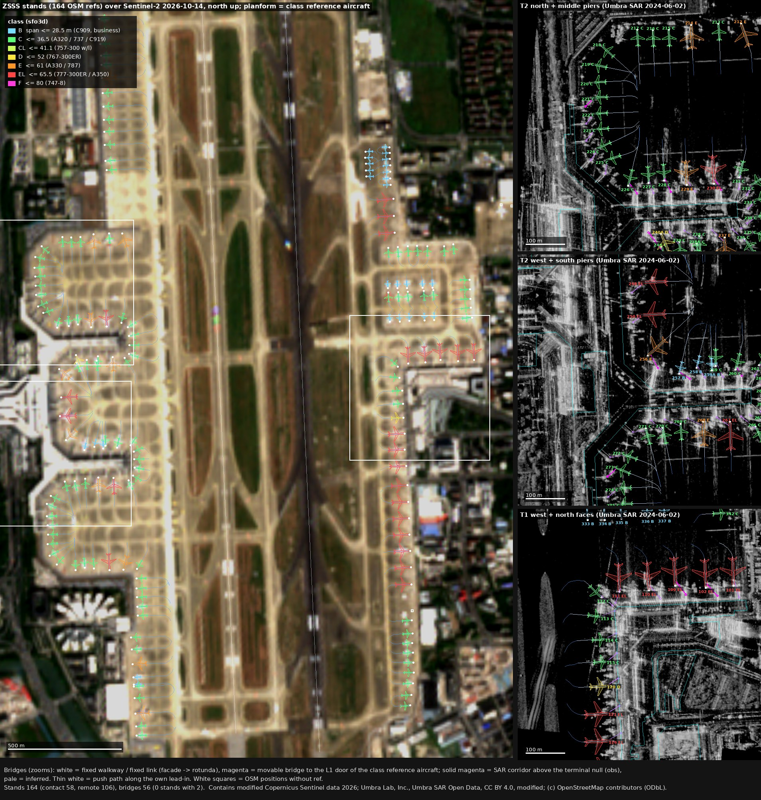
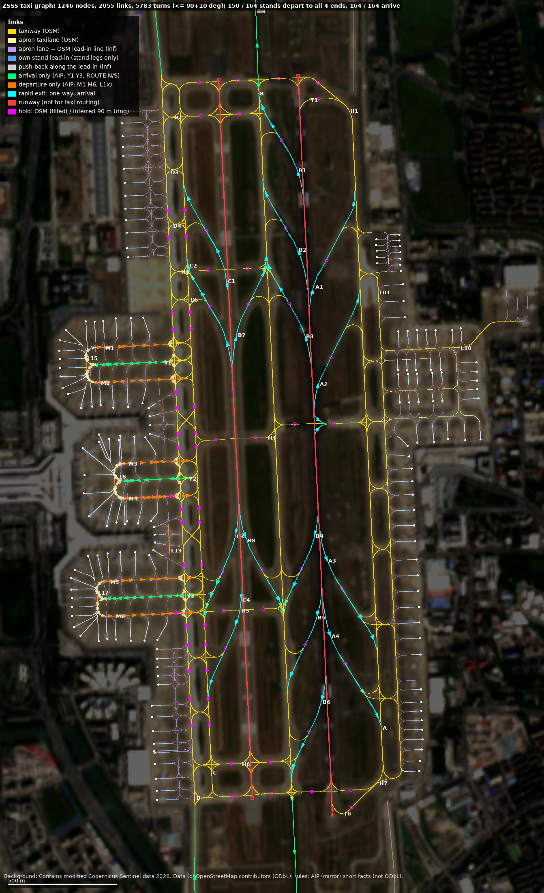
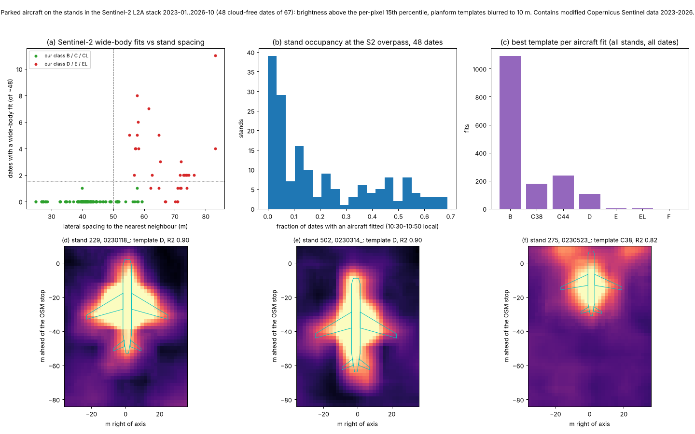

# Phase 1 / A2: stands, jet bridges, remote stands, taxi graph

Date: 2026-11-14. Task A2 of Phase 1 (docs/PLAN.md §7), under owner decisions OD0-OD3 and the §6b working defaults.
Nothing in `sfo3d/`, `pc12/` or `hwd3d/` was touched. Nothing was committed. I made no OSM edits, collected no data
inside the PRC and used no Google, Baidu or Amap material. **Updated after fix round 1 of the QA (`qa_data.md`,
findings H2, M2-M7, L1, L2, L4-L6)**: the numbers below are the rebuilt ones; what changed is listed in `qa_data.md`.

Labels used here:
- **obs**: mapped in OSM, or measured by me on Sentinel-2 or Umbra.
- **inf**: inferred by a stated rule.
- **AIP (mirror)**: a short fact read in the unofficial mirror of AIP China EFF 2026-07-08 (OD3).

No AIP per-stand table (span limits, VDGS list, push-back table) is written to any committed file, and since fix round
1 no stand record carries an AIP-derived field (the former `aip_status` and OSM-only `flag` are gone; stand names are OSM
refs, ODbL). I compared against the AIP locally (log in `refs/cache/aip_checks/`, never committed) and give counts only.

## 0. Summary

| Item | Result |
|---|---|
| Stands | **164** stands from the OSM `parking_position` ref nodes. Every node is the end vertex of an OSM lead-in way. 15 OSM refs have no AIP designator (count only). The 6 AIP-only designators (414-416, 514-516) and the 6 AIP combined positions (E/C) are in `unplaced`, listed by name as "AIP (mirror)". I also found 4 OSM lead-in positions without a ref. |
| Reference point | `nose` = the OSM stop node, i.e. the end of the painted lead-in line as mapped, used as the nose tip of the class reference aircraft (inf). On the Sentinel-2 stack the narrow-body fits put the nose about 1 m behind it, inside the 10 m pixel spread, so it is not applied. At VDGS stands the stop refers to the nose wheel or pilot, a few metres behind the tip [inf]: a per-type nose offset is due when the models are placed (Phase 2/4, `nose_note`). `hdg` = the final lead-in segment. |
| Size classes | sfo3d classes from our own evidence: stand geometry, a wide-spacing prior (now ≥ **60 m**), a cap for stands with one open side (at the class of their bounded neighbour), and parked aircraft fitted on **48 cloud-free Sentinel-2 dates** with a wider search and a fixed, neighbour-masked fit domain. Result: **C 101, B 27, EL 23, E 11, D 2**. 25 classes are obs (a wide-body was seen on ≥ 2 dates). Every stand now carries `span_max`, the largest span that clears its neighbours at their class maxima. |
| AIP agreement (local, counts only) | Of 149 comparable stands: **107 same class**, **134 within one class**, **134 agree on wide vs narrow**. Over-classing is gone on the west remote apron (0 of 13 above the AIP, was 7); in exchange 14 stands are narrow in our data but wide in the AIP (was 5). |
| Checks | 0 planform overlaps outside the 5 declared `excl` pairs, at the reference size and at the sfo3d class maximum (with `span_max`). Pavement: max 5.4 % of a planform off pavement with the lead-in buffers, **11.5 %** (608) without them (the non-circular metric, QA L4). 25 neighbour pairs are closer than the ICAO clearance, because SHA rows are built tighter. |
| Jet bridges | OSM `aeroway=gate` nodes: 55 of 58 associated. The Umbra SAR corridor test is now calibrated on **314 terminal-adjacent pseudo-stands** (facade points between gates; null p95 **1.92**, against 0.97 for the old remote-stand null). **12 bridges are seen on SAR** (obs) plus 1 retracted; 43 are unclear (inferred bridges); 2 shared; 4 absent. 58 contact stands, **56 bridge records, none doubled** (the three second-bridge candidates have a reach of 45-72 m and are rejected). T1 rotundas sit at the end of a fixed link so that the reach is ≤ 40 m. |
| VDGS comparison (local, counts only) | All 54 AIP VDGS stands are contact stands in our data (112 is now `unclear` with an inferred bridge). 13 of the 54 have a SAR-seen bridge; 0 SAR bridges are at non-VDGS stands. |
| Remote stands | 106 stands. Bus service is inferred for all except the 12 business-apron positions. Push-back follows each stand's **own lead-in, reversed, to its first apron lane** (median 81 m, max 188 m; 87 longer than 1.5 × the class length are flagged). The AIP lane rules for 232-235, 262-265, 286-290 and 401-416 are checked and flagged where OSM lacks the lane. |
| Taxi graph | 1,246 nodes and 2,055 links: 807 taxiway, 881 taxilane (732 of them OSM lead-in lines reclassified as apron lanes, `src: inf`), 165 own lead-in links (`stand = <name>`), 38 runway links (`use: runway`, not for taxi routing) and 164 push-back links. 52 rapid-exit links are one-way runway → taxiway, `use: arrival`, per landing direction. A **turn table** (`turns`, 5,783 allowed transitions, ≤ 90° + 10° digitising tolerance) encodes the AIP turn limit and the crossing rules. Edge-based check: **164 / 164 stands arrive from all four landing directions; 150 / 164 depart to all four take-off ends**; the 14 others need a short OSM one-way apron lane against its direction (two Phase-3 options with measured numbers in §6). |
| Images | `stands_overlay.jpg`, `taxigraph.png`, `stands_s2_evidence.png`, and `bridges_sar_<pier>.jpg` (7 contact sheets), all listed with sha256 in `SOURCES_stands.json` (new, QA L1). |



## 1. Stands from OSM (`tools/airport/stand_geom.py`, `build_stands.py`)

- **What OSM has** (pinned extract of 2026-11-14):
  - 164 `aeroway=parking_position` nodes with `ref`;
  - 461 untagged `parking_position` ways (the painted lead-in lines);
  - 58 `aeroway=gate` nodes.
- **All 164 ref nodes are end vertices of lead-in ways** (measured). 159 have degree 1. Five (333-337) are inner vertices: there the lead-in continues one vertex past the stop, and the longest arriving segment gives the heading.
- **Primary lead-in.** For each stand this is the shortest path through the lead-in network to a taxiway vertex (Dijkstra), not passing through another stand's stop. All 164 stands have one. Lengths: median 124 m, maximum 211 m.
- **Reference point and heading.** `nose` = the ref node; `hdg` = the direction of the final segment into it (true). The final segment is long and straight: median 67.5 m, minimum 13.1 m. Calling it the nose tip of the class reference aircraft is inf. The Sentinel-2 check (§3) puts narrow-body noses a median 1 m behind it, but the fits have a spread of several metres at 10 m pixels, so no offset is applied.
- **Names.** These are the OSM refs (ODbL), compared locally with the AIP designators: 149 match and 15 have no AIP
  designator. Since fix round 1 (QA M2) no per-stand AIP field is written: the match / no-match result is in the local
  log only, and the committed files give the count. (PLAN.md §1, committed before this round, still names the 15; that
  is the lead's / owner's call.) The 2026 chart notes "Stand number adjusted".
- **Unplaced** (`unplaced[]`, `src: obs`, `refs: ['aip_mirror']`, `listed_in: "AIP (mirror)"`):
  - 414, 415, 416, 514, 515, 516: AIP designators with no OSM node, and the AIP gives no coordinates.
  - The 6 AIP combined or alternative positions (216E, 220E, 281E, 404C, 408C, 413E). AIP (mirror) AD 2.20 3.2.7 lists the combinations 215+216, 219+220, 280+281 and 412+413.
  - Imagery check: the Sentinel-2 stack shows no new concrete apron south of 413 up to 2026-10-14. Median brightness there is 0.11-0.12 in every year, against 0.18-0.19 on the 404-410 apron. So 414-416 cannot be located from our imagery.
- **Positions without ref** (`positions[]`, obs):
  - three hangar-apron positions at the north-east hangars;
  - one lead-in between 511 and 517, next to the business-aviation terminal, where the AIP has 514-516. It is not identified with a designator.
- **Alternative positions.** Stands whose fuselage boxes (30 × 4 m, +3 m buffer) overlap are grouped: 238/238A, 259/259A, 604/604B. Together with 240/240A and 306/307, whose class planforms overlap, they form the 5 `excl` pairs.

## 2. Registration of the Umbra SAR scene (`tools/airport/sar_registration.py`)

The task note gave "about 3-4 m east". I measured it on full-resolution bands (`refs/cache/imagery/umbra_fullres_reg/`).

- **East-west.** In 6 bands across both runways, the dark paved band lies **+2.87 to +4.12 m east of the OSM centrelines (mean +3.44 m)**. Widths are 63-76 m, which includes shoulders.
- **North-south.** Across TWY H2, between grass islands, the paved band is 3.9 / 4.8 m south of the OSM line in Umbra, and 1-7 m south (mean 4.0 m) in the two Sentinel-2 scenes, whose N-S registration to OSM is within about 1 m (phase 0). Umbra and Sentinel-2 therefore agree, and the offset belongs to the OSM H2 line, not to the image.
- **Applied (fix round 2, re-verify N4):** the single Phase-1 value Umbra − OSM = (+3.07 m E, 0 m N) of `tools/common/umbra_reg.py`, removed before every SAR sample (`stand_sar.py`, `stands_plates.py`; `sar_registration.json` records it as `applied_shift_en_m`). It is the median of 41 runway-band stations on the 1.4 m overview, measured by `twy_refit.py` on every run (the tool stops if the measurement leaves the constant by more than 0.05 m). The 6 full-resolution bands above (+3.44 m) and the QA's own measurement (+2.99 m) agree within a third of the overview pixel. Until fix round 2 this task applied +3.4 m; the change moved stand 272 from `present` to `unclear` (its corridor score, 1.87, is now just below the null p95 of 1.92); otherwise only the SAR scores quoted in the bridge records changed.
- A1 estimated +6.1 E / −0.9 N from 13 taxiway runs on the 1.4 m overview. That taxiway fit absorbed the taxiway errors (QA C1 M1) and is no longer used by any data tool. Task B3's `umbra_layover.py` and `umbra_crops.py` still use it (outside the data builders; see `qa_data.md`, Fix round 2).

## 3. Size classes

Classes are sfo3d's (`js/live/airport.js` CLASS_MAX), with the SHA reference type per class (`tools/airport/acplan.py`; public length and span; inf planform sketch):

| Class | Reference aircraft |
|---|---|
| B | C909 27.3 m |
| C | A321 35.8 m |
| CL | 757-300 41.1 m |
| D | 767-300ER 47.6 m |
| E | A330-300 60.3 m |
| EL | 777-300ER 64.8 m |
| F | 747-8 68.4 m |

**Evidence 1: geometry** (inf, an upper bound). This is the largest class whose planform, placed on the stand and on every neighbour at the same class, keeps:
- 2.5 m from the neighbour planforms. The tightest code-C rows at SHA (38.5 m stop spacing, 35.8 m spans) leave 2.7 m; ICAO asks 4.5 m;
- 3 m from buildings;
- 15 m between the tail and any apron taxilane or taxiway centreline.

The first constraint that fails is recorded, for example `neighbour 215 (EL)`, `taxilane behind` or `building`.

**Evidence 2: prior** (inf). A stand ≥ **60 m** from its lateral neighbours, or from its one neighbour when the other side
is open, is taken as designed for wide-bodies, up to EL; otherwise it is capped at class C. The threshold was 50 m;
fix round 1 raised it (QA M4), because the west remote apron is spaced 51-60 m and the 50 m prior admitted wide-bodies
there.

**Evidence 2b: one open side** (inf, fix round 1). A stand with a lateral neighbour on one side only is capped at that
neighbour's class (44 stands), unless Sentinel-2 shows a wide-body on ≥ 2 dates.

**Evidence 3: parked aircraft on Sentinel-2** (obs; `tools/airport/stand_s2.py`, `stands_s2_evidence.png`).
- **Stack.** 67 Sentinel-2 L2A dates, 2023-01-03 to 2026-10-14, tile cloud < 20 %. They are fetched as 2.3 × 3.4 km windows over the stand areas only (`refs/cache/s2_stack/`, local).
- **Scene selection and alignment.** 48 dates have ≤ 2 % cloud or shadow in the window. Each is aligned to S2B 2026-10-14 by FFT cross-correlation (sub-pixel); that scene's OSM offset is the phase-0 value.
- **Excess image.** Per stand, a stand-aligned 2 m patch. The background is the per-pixel 15th percentile over the dates; the excess is brightness minus background.
- **Fit** (changed in fix round 1, QA M4). Seven planform templates (B, C38, C44, D, E, EL, F), blurred to the 10 m pixel, are fitted with nose shift **−12..+10 m** and lateral **−5..+5 m** (was −8..+6 / ±3). A fit counts when R² ≥ 0.75 (zero-mean) and the amplitude ≥ 0.035. Calls whose best shift sits on a search bound are **discarded** (395). The fit domain is a **fixed** |v| ≤ 36 m with the lateral neighbours masked beyond the mid-line, instead of |v| ≤ half the nearest spacing, which had built the spacing into the result.
- **Result:** 1,614 aircraft fits (was 1,898), 108 of them wide-body templates (was 181). B is still the most frequent best fit (1,091).
- **Occupancy** at the 10:30-10:50 local overpass: median 11 %, mean 20 %, maximum 69 % of dates.
- **Limits.** Template size at 10 m is coarse and under-sizes narrow-bodies (noses often in pier shadow in winter). At T1 the contact stands show very low occupancy at that hour, so the method is nearly blind there. Only the wide/narrow split is used, and the observed class sets a cap one step higher.

**Rule.**
1. Class = min(geometry, prior), then the one-open-side cap.
2. If a wide-body was fitted on ≥ 2 dates, the class is raised to the largest class that is feasible with the neighbours at their own classes, capped one class above the largest template fitted on ≥ 2 dates. This happened at 12 stands: 212, 214, 229, 237, 240A, 246, 256, 268, 284, 406, 603, 606.
3. Pairs that still overlap would become `excl`; none did.
4. **`span_max`** (fix round 1, QA M4) is written for every stand: the sfo3d `CLASS_MAX` span, reduced where two neighbours at their class-max planforms (class-max span and length on the reference shape) come closer than 2.5 m. 11 pairs clash (220/221, 287/288 and the business-apron row 301-312); 16 stands carry a `span_max` below their class maximum (36.2-36.3 m at 220/221 and 287/288, 22.3-26.0 m on the business apron).

`cls_src` is `obs` for the 25 stands with wide-body evidence and `inf` for the rest. Each record has `cls_evidence`: the geometry class and limit, the prior, the one-open-side neighbour, the neighbours and spacings, and the Sentinel-2 dates, calls and class.

**Results by area:**

| Area | Classes |
|---|---|
| T2 aprons Nr. 2 (70) | C 53, E 8, EL 5, B 3, D 1 |
| T1 north face (6) | EL 5, C 1 |
| T1 west face (7) | EL 3, C 3, D 1 |
| East apron (30) | C 17, B 10, EL 3 |
| Business apron (12) | B 12; `span_max` 22.3-26.0 m |
| West remote, Apron 4 (13) | C 12, E 1 (406, wide-body seen) |
| East remote along A (16) | EL 7 (501-511, 72-74 m spacing), C 9 |
| South-west, Apron 6 (10) | C 6, E 2, B 2 |

**Local AIP comparison** (counts only; the AIP limit is mapped to a class by the same reference spans):
- 149 stands compared. Same class: 107 (was 105). Within one class: 134 (133). Wide vs narrow agreement: 134 (133).
- Difference, ours minus AIP: −4: 4, −3: 5, −2: 5, −1: 21, 0: 107, +1: 6, +4: 1.
- Over-classing has nearly gone (2+ classes above the AIP: 1 stand, was 10; west remote apron 0 of 13, was 7). The one
  left is the corner stand 101 (+4): its only neighbour, 102, is EL, so the cap does not bind. Under-classing grew
  (2+ below: 14, was 6): T2 stands that the AIP allows for wide-bodies but where we see no wide-body on ≥ 2 dates. That
  is the safer error for the simulator (no overlapping aircraft), and it is reported, not corrected from the AIP.

**Checks** (`checks_at_build`):
- No two stands' planforms overlap except the 5 declared `excl` pairs, both at the reference size and at the class maximum with `span_max` (QA script `stand_qa2.py`: 0 and 0; one pair at 2.2 m and one at 2.49 m).
- Pavement: with the 12 m lead-in buffers counted as paved, the maximum planform area outside is 5.4 % (608). Without them (OSM aprons, A1 taxiway surfaces and runways only), the maximum is **11.5 %** (608) and every other stand is below 5 % (`no_leadin_buffers`, QA L4).
- 25 pairs are below the ICAO clearances (minimum 0.25 m). They are reported, not enforced: SHA is built tighter, and the 2.5 m rule is ours.

## 4. Jet bridges (`tools/airport/stand_sar.py`, `bridges_sar_*.jpg`)

**Scene.** Umbra SAR Open Data, UMBRA-05 spotlight, **2024-06-02 01:46:48Z (09:46 local)**, X-band VV, GEC 0.35 m (about 0.22 m pixels), CC BY 4.0. Full-resolution windows were read by range requests (`refs/cache/imagery/umbra_fullres_stands/`). The scene is 2.5 years older than OSM and Sentinel-2.

**OSM gate nodes** (obs, ODbL). There are 58 `aeroway=gate` nodes: 45 at T2 tagged `layer=2`, and 13 at T1.
- **T2:** stand 2nn ↔ gate nn (the phase-0 SAA rule). It holds geometrically for all 43 T2 stands with a matching gate: the gate lies a median 16.6 m ahead and 21.7 m to the left of the stop (IQR 11.9-25.5 ahead, 16.7-28.9 left).
- **T1:** 12 gates are associated greedily, nearest first, each gate once, the gate ahead of the stop.
- 53 of the 55 associated gates are on the aircraft's left (L1 door) side.
- 3 gates are unassociated: 6, 47 and 49. Gates 47 and 49 have no stand of their own (there are no stands 247 or 249). A spare gate could become the second bridge of the nearest wide stand (gate 6 → 110, gate 49 → 250), but both are rejected since fix round 1: their reach is 72 m and 45.2 m (limit 45 m).
- On the SAR scene the T2 fixed links appear as bright rectangles ending near the gate nodes. The gate node is therefore taken as the rotunda (inf).

**Corridor test** (obs where it fires).
- For each candidate (an OSM gate within 50 m ahead, or within 75 m of T1/T2), take the 3 m wide strip from the gate node G to the L1-door zone D (6 m behind the nose, 2.5 m left), over t = 3 m to 0.7 |GD|.
- Compare its median log-amplitude with its mirror image across the stand axis. A parked aircraft is symmetric about the axis and cancels; a bridge on the left side does not.
- **Null** (fix round 1, QA M3): the same test on **314 terminal-adjacent pseudo-stands**: facade points every 4 m whose outward normal is within 30° of the face, more than 25 m from any OSM gate, with the pseudo gate off the facade by the face's median gate distance and the pseudo stop at the median gate offset; kept when the pseudo stop is more than 25 m from every real stop and both strips are more than 8 m from every real gate-to-door corridor. Result (fix round 2, with the +3.07 m registration): median −0.10, **p95 1.92**, maximum 2.84 (near variant p95 2.19, L2 variant p95 1.60). The former null on 99 remote stands (p95 0.97) is kept in `null_remote` for comparison: it had none of the facade layover, shadow and sidelobes of the contact stands.
- **Scene geometry per face** (`stand_sar.json` `faces`): sensor azimuth 275.5°, incidence 38.08° (Umbra metadata). With an assumed 25 m terminal height, the layover reaches 31.6 m in front of the T1 west face and 4.4 m in front of the T1 north face; the shadow reaches 19.4 m in front of the T2 west face, 14.3 m (T2 south), 9.3 m (T2 middle north), 7.1 m (T2 middle south) and 2.7 m (T2 north).
- An earlier brightness-only ray test had no discrimination and was discarded.

**Status per stand:**

| Status | Count | Stands / meaning |
|---|---|---|
| present (obs) | 12 | 102, 109, 221, 226, 228, 240, 246, 256, 257, 260, 262, 273 |
| present_retracted (obs) | 1 | 230 |
| unclear (inf) | 43 | OSM gate, but the corridor is not above the terminal null; plus 112 (corner stand, below); 272 since fix round 2 (§2) |
| shared | 2 | 238A, 259A: alternative positions using the bridge of 238 / 259 |
| absent | 4 | 220, 240A, 276, 277: no OSM gate and the corridor below half the null p95 |
| none | 102 | no terminal within 75 m (remote) |

With the terminal null, 18 stands drop from `present` (272 in fix round 2) and 2 from `present_retracted` to `unclear`, 1 goes from `present` to `present_retracted`, and 112 goes from `absent` to `unclear`. The bridges of the downgraded stands stay, as inferred records. The decision whether a contact stand has a bridge rests mostly on the OSM gate node.

**Stand 112** (QA M3): a corner stand at the T1 north face whose facade lies straight ahead (46 m). The left / right test cannot separate a bridge from its mirror image there (scores −0.65 with the gate ahead, −1.30 from the facade point), so this is no evidence of absence. It is now `unclear` with an inferred contact bridge from the facade point; the QA saw a double-walled linear structure from the terminal corner on the full-resolution crop.

**Bridge records.**
- Each record (sfo3d `bridges[]` fields) has:
  - `gate`; `door` (1, or 2 for a second bridge);
  - `attach` (the nearest point on the T1/T2 outline) and `rotunda`;
  - `walk` (attach → rotunda: the fixed walkway / fixed link); `cab` (docked at the door of the class reference aircraft, inf); `reach_m` (rotunda → cab);
  - `src` and `evidence` (scores, terminal-null p95, contact-sheet file).
- **Rotunda placement** (fix round 1, QA M3). At T2 the OSM gate node is the end of the fixed link and is the rotunda. At T1 the gate nodes sit on the facade; where the docked reach from there would exceed 40 m, the rotunda is placed at the end of a fixed link out along the facade normal so that the reach is 40 m (fixed links of 8.3-24.5 m at 101, 102, 109, 110, 111 and 112; the SAR shows structures about 30 m out from the T1 north face). The longest reaches left are 52.5 m (240) and 48.4 m (266), both T2 gate nodes, flagged `reach_flag`; before the fix 7 bridges exceeded 50 m.
- **Second bridges.** A door-2 bridge now needs its own rotunda (at least 8 m along the facade from bridge 1, `src: inf`) and a reach ≤ 45 m. The candidates were 102 (L2 corridor, 53.6 m), 110 (spare gate 6, 72 m) and 250 (spare gate 49, 45.2 m): all rejected. **56 bridges at 58 contact stands, none doubled** (was 62 at 57, 7 doubled).

**Local VDGS comparison** (54 stands in the AIP (mirror), counts only):
- 54 are contact stands in our data (112 included now).
- 13 have a SAR-seen bridge (present or retracted).
- 0 SAR bridges are at non-VDGS stands.
- 4 of our contact stands are not VDGS stands.

Phase 0 had T2 counts of 43 or 45 bridges against 41 VDGS stands. OSM's 45 T2 gate nodes match the 45-bridge figure.

**Sentinel-2.** Bridges cannot be resolved at 10 m. The stack is used only for the aircraft. The bridges themselves sit in the per-pixel background and cancel out.

## 5. Remote stands, aprons, push-back

- **Remote** (`remote[]`, 106; service inferred; each record has `src` and `evidence`):
  - east apron north of T1, 313-342: 30;
  - T2 apron remote rows, 212-220 and 276-290 among others: 25;
  - east remote apron along TWY A / L01, 501-525: 16;
  - west remote apron (Apron Nr. 4), 401-413: 13;
  - business apron, 301-312, service "business (FBO / crew transfer)": 12;
  - south-west apron (Apron Nr. 6), 601-608: 10.
- AIP (mirror) AD 2.20 3.2.2.3: stand-off (remote) and VIP stands use marshaller guidance; listed stands have VDGS. Bus service for remote stands is inf (phase 0 bus gates T03-T08 etc. at T1, 41-45 and 51-55 at T2).
- **Push-back** (`stands[].push`, inf, all 164 stands; changed in fix round 1, QA M5): the aircraft is pushed along its
  **own lead-in**, reversed (`pts`), from the stop to the first vertex where the line meets an apron lane, another
  lead-in, a stand or a taxiway (`junction`, `push_dist_m`, `end_kind`), then the tail is turned onto the lane there in
  either direction (`tail_headings`). The own lead-in is the same stretch that the taxi graph tags `stand = <name>`.
  - Lengths: median **81 m** (was 117 m along the old chord), 32 over 100 m, 3 over 150 m (246 188 m, 256 168 m, 250
    150 m; was 30), maximum 188 m. 144 pushes end at an apron lane, 20 on a taxiway.
  - 401-413 and 601-608 now end after about 80 m at the first apron lane, not 174-194 m out on TWY D.
  - **Cap.** 87 pushes are longer than 1.5 × the class reference length; they carry a `flag`. Cutting them at the cap
    was tried: the aircraft is then left on its own lead-in facing the stand, and with the 90° turn rule 34 stands
    could not depart, so the cap is a flag, not a geometry change (`PUSH_CAP_GEOMETRIC` in `build_stands.py`).
  - **AIP lane rules** (`aip_rule`, flagged where not met): L11 (401-416), L12 (232-235) and L14 (286-290) have no OSM
    ref, so those pushes end at the first apron lane (22 stands flagged); OSM has L13, but the own lead-ins of 262-265
    end on another lane (4 flagged).
- **AIP short facts in `aip_facts`** (one block with its own notice, not covered by ODbL):
  - all stands are "Taxi in, Push back";
  - stands 232-235 push back to a holding point on L12, 262-265 on L13, 286-290 on L14, then start up and taxi to D;
  - 401-416 (span < 65 m) push back to a holding point on L11;
  - no simultaneous movements at adjacent stands.
- **Not transcribed (local only, OD3):** the remaining push-back and nose-direction rules (AD 2.20 3.2.2.4-3.2.2.5) and the end-of-push point table.

## 6. Taxi graph (`tools/airport/build_taxigraph.py`, `data/sha_taxigraph.json/.js` = `window.SHA_TAXIGRAPH`)

**Format.** sfo3d's `sfo_taxigraph.js` fields are kept, so `TaxiNet` can use the file unchanged:
- `edges` [[x0, z0, x1, z1, way]], 6,277;
- `ways`, 768;
- `aprons`, `leadins`;
- `halfWidth` 11.5 m (half the 23 m AIP width).

A routable graph is added:
- **`nodes`:** 1,005 junctions, 164 stands, 37 OSM holds, 36 runway nodes, 4 runway ends; each with `src` and `evidence`.
- **`links`**, each with `a`, `b`, `kind`, `ref`, `len`, `pts`, `dir`, `use`, `status`, `src` and `evidence` (OSM way and
  version, or the rule); `stand`, `for_landing`, `span_max` where they apply.
- **`turns`** (new): the allowed transitions `[link_in, link_out]` at every node, 5,785 pairs. A router must be
  edge-based and use only these.
- **`runways`:** every connection with its along-runway position, side and angle; rapid exits and end connectors marked.
- **`hold_inf`**, **`rules`** (AIP short facts, one block with its own notice), **`routing`** (the rules below),
  **`checks_at_build`**. `licence` and `attribution` are those of `sha_airport.json` (QA L2).

**Sources.**
- Taxiways and taxilanes: A1, including the re-fitted runs (A1, A2, H2, H4, H7, BN, N, an unnamed taxiway).
- Lead-ins: OSM; a lead-in vertex shared with a re-fitted taxiway vertex moves with it.
- Runways: the OSM runway ways with their 22-23 junction nodes, extended to A1's placed ends.
- Vertices are joined where they coincide (shared OSM nodes).

**Routing rules** (fix round 1, QA H2 / M6, lead decisions):

| Rule | Effect |
|---|---|
| Runway links | `use: runway` (38): not for taxi routing; only an explicit backtrack may use them |
| Rapid exits | acute links (< 50°) off the runway more than 400 m from either end, with the rest of their named chain: one-way runway → taxiway, `use: arrival`, `for_landing` (52 links). Acute links nearer the ends (T1, T6, fillets) stay entries / exits in both directions. |
| Turns | `turns` allows a transition when the turn is ≤ 90° + 10° digitising tolerance (directions over the first 15 m of each link; OSM junctions have no fillets). 2,605 candidate transitions exceed it. |
| Runway crossings | at a runway node, a transition between two taxiway links is allowed only on H1-H7 (18R/36L) or H1, H4, H7 (18L/36R); 14 other transitions are blocked |
| Own lead-ins | the stretch of a stand's primary lead-in up to its first junction: `kind: leadin`, `use: stand`, `stand: <name>` (165 links), allowed only as the first or last leg of that stand's routes |
| Apron lanes | the other OSM `parking_position` lines (732 links): `kind: taxilane`, `osm_kind: leadin`, `src: inf` |
| Push links | 164, along the own lead-in (`pts`), only as the first leg of a departure; at the push end the tail may be turned onto any lane, never back onto an own lead-in |
| Y1-Y3 arrival only | OSM `oneway=yes` |
| M1-M6, L11-L17 departure only | M1-M6 OSM `oneway=yes`. L13, L15-L17 have no OSM oneway tag: they stay usable both ways, departures only, one aircraft at a time (AIP 3.1.5). A2 had inferred "towards TWY D" per link, which zig-zagged on short links and blocked T2 departures under the turn rule. L11, L12, L14 have no OSM ref. |
| ROUTE-NORTH (BN → N) / ROUTE-SOUTH (BS → S) | one-way arrival links; span < 36 m normal, 36-65 m limited, ≥ 65 m forbidden (`span_max` 65, `span_normal_max` 36); N joins BN through an unnamed OSM link north of the extent edge |
| Other short facts kept in `rules` | no vacating via H3/H4/H5 (applied in the check); vacate via the first or second rapid exit within 50 s; intersection departures 18R via H2 and 36L via H6 (applied); no landings on 18R/36L 1600-2300 UTC |

**Rapid exits** (one-way, arrival):

| Runway | Landing | Rapid exits |
|---|---|---|
| 18L/36R | 36R | B1, B2, A1, B3, A2, one unnamed link |
| 18L/36R | 18L | B4, A3, B5, A4, B6, one unnamed link |
| 18R/36L | 36L | C1, B7, C2 |
| 18R/36L | 18R | B8, C3, C4 |

**Holds.**
- OSM: 37 holds (obs; no designators). 31 of them are on C and D, west of 18R/36L, at 183 m (median).
- Inferred: 34 runway-holding positions at **90 m** from the centreline, on every taxiway touching a runway where OSM has no hold within 30 m. The 90 m is ICAO code 4 CAT I from memory (inf).

**Checks** (`checks_at_build`):
- There is 1 main component of 1,243 nodes. The only other piece is a 3-node taxiway under construction.
- **Edge-based reachability** (new): Dijkstra over (link, node) states with the turn table, one-way and use rules,
  runway links excluded and own lead-ins only for their stand. Departures start with the push link and end on a link
  entering a runway node within 450 m of the take-off end (or H2 / H6 for the intersection take-offs) with a line-up
  turn within the limit. Arrivals start on a link leaving the runway (rapid exits of that landing direction, or other
  exits within the turn limit, not H3-H5) and end at the stand.
  - **Arrivals: 164 / 164 stands from all four landing directions.**
  - **Departures: 150 / 164 stands to all four take-off ends.** The other 14 (218, 219, 225-227, 238A, 239, 240,
    240A, 271, 272, 278-280) cannot leave the push end without using an OSM `oneway=yes` apron lane against its
    direction. The graph keeps the OSM tags (observed) and reports the 14; Phase 3 decides. Measured numbers for the two
    options (fix round 2, `tools/verify/qa_c1/fix2/dep14_options.py`, the independent edge-based router at 100°):
    - 12 stands are freed by one lane segment each: 218 / 219 by 10.0 m, 225 / 226 by 5.9 m, 239 / 240 / 240A by
      8.1 m, 271 / 272 by 10.8 m, 278-280 by 9.7 m. 227 needs two segments (5.9 + 24.4 m = 30.3 m), 238A two
      (8.1 + 39.1 m = 47.2 m); without them they would need a turn of 113° / 102°, beyond the 100° rule. 7 distinct
      segments (107.9 m in total) are involved; with them open, all 14 reach all four take-off ends.
    - **Option A, the push continues along the lane:** the tug pushes on over those segments to the next junction (towed
      movement, so the taxi one-way rule need not apply). The 14 pushes grow from 93-133 m to 100-143 m, all below the
      150 m long-push mark (227: 109 → 139 m; 238A: 93 → 140 m). No one-way tag changes; the push links would carry the
      extra segment(s) and a flag.
    - **Option B, a soft one-way rule for apron lanes:** taxiing against `oneway=yes` on an apron lane allowed for at
      most D metres per route. D = 15 m or 30 m frees 12 of the 14 (227 needs 30.3 m); D = 50 m frees all 14. It
      touches every route in the router and needs a conflict rule (one aircraft on the segment at a time).
    - Not chosen here: relaxing all 57 one-way apron lanes (it frees all 14 as well, but drops observed tags) or a
      strict 90° turn rule (29 stands could not depart).
  - Median route length: departure 2,273 m, arrival 1,323 m.
- With the QA's own route sets routed on this graph (`qa_data.md`, Fix round 1): 0 routes taxi along a runway, 0
  contain a reversal > 120°, 0 use another stand's lead-in.



## 7. Images (all in `docs/phase1/`, attribution on each; generator, attribution, licence and sha256 in `SOURCES_stands.json`)

| File | Content |
|---|---|
| `stands_overlay.jpg` | Left: all stands over Sentinel-2 2026-10-14, with class-coloured reference planforms and lead-ins. Right: three Umbra SAR zooms (T2 north and middle piers, T2 west and south piers, T1) with names, classes, bridges (solid magenta = SAR corridor above the terminal null, pale = inferred) and push paths. No imagery outside the detailed extent. |
| `taxigraph.png` | Links by kind and use (own lead-ins, apron lanes from lead-in lines, runway links not for routing), one-way arrows, rapid-exit chains, push paths, OSM and inferred holds, runway ends, the edge-based check result. |
| `stands_s2_evidence.png` | (a) wide-body fits vs spacing; (b) occupancy; (c) template histogram; (d-f) example excess images with the fitted template (229 wide, 502 wide, 275 narrow). |
| `bridges_sar_{t1_north,t1_west,t2_north,t2_middle_n,t2_west,t2_middle_s,t2_south}.jpg` | Contact sheets of stand-aligned SAR crops (nose up, 100 × 90 m), with the OSM stop, the door zone, the gate node and the corridor score. |



## 8. Observed vs inferred

**obs:**
- OSM stand refs, lead-ins, gate nodes, holds and taxiway geometry, OSM one-way tags;
- the registration offsets (§2);
- parked aircraft per stand and date on Sentinel-2, occupancy, and the wide-body evidence behind 25 classes;
- SAR corridor signatures above the terminal null (13 present, 1 retracted);
- AIP (mirror) short facts (labelled, in `aip_facts` / `rules` blocks with their own notice).

**inf:**
- the nose definition (and the missing per-type nose offset);
- 139 classes (geometry, prior, one-open-side cap) and every `span_max`;
- the 2.5 m / 3 m / 15 m / 60 m / 40 m / 45 m thresholds;
- planform sketches;
- rotundas (gate node, or the end of a T1 fixed link), cab positions and attach points;
- the 42 unclear bridges, which rest on the OSM gate (or, at 112, the facade);
- bus service;
- push-back geometry (own lead-in to the first lane) and the push flags;
- the own lead-in / apron-lane split, rapid-exit directions, the turn table and its 10° tolerance;
- the 34 holds at 90 m;
- the T1 gate association.

## 9. Open issues

1. **Bridges at the T1 west face and the T2 middle piers are unclear.** Bridges oriented along the radar range direction (east-west) are seen end-on, and the symmetric test cannot separate them from GSE. Against the terminal-adjacent null (fix round 1) only 13 bridges are seen; 42 contact stands keep inferred bridges. One open optical image better than 1 m (none found so far, Q6) would settle them.
2. **The Umbra scene is from 2024-06-02.** Bridge changes since then, and the 2026 renumbering, are not covered. 258/259/259A and 238/238A/239/240/240A look like MARS groups in OSM; their exact AIP pairing is not resolved.
3. **No F class.** Our evidence cannot tell a 747-8 from a 777. The AIP 747-8 stand (248) is EL in our data.
4. **414-416 and 514-516 stay unplaced.** One OSM lead-in without a ref (between 511 and 517) is a candidate for one of them, but it is not named.
5. **Some data are not in OSM or not transcribed.** Taxilane span limits on the aprons (AD 2.20 3.1.1 chart), hold designators and pattern-B holds are not in OSM. The AIP push-back table stays local.
6. **Template sizes on Sentinel-2 under-size narrow-bodies.** Only the wide/narrow split is used.
7. The ICAO clearances (4.5 / 7.5 m) and the 90 m holding distance are quoted from memory. The standards task (B3) may replace them.
8. **14 stands have no departure route that keeps every OSM one-way tag** (fix round 1, §6): each needs a short apron
   lane against its OSM direction. The tags are kept; Phase 3 decides how a push or tow continues there (§6: option A,
   push on by 5.9-47.2 m, pushes 100-143 m; option B, soft one-way rule, 50 m frees all 14).
9. **Long pushes.** 87 pushes along the own lead-in are longer than 1.5 × the class length (flagged). The AIP
   end-of-push table (local only) would fix them; L11, L12 and L14 are not in OSM.
10. **Under-classing.** The stricter prior and the one-open-side cap leave 14 stands narrow that the AIP allows for
    wide-bodies (local count). Sentinel-2 at 10 m sees few wide-bodies at T2 at 10:30 local. More dates or better
    imagery would lift them; the AIP limits are not copied in (OD3).

## 10. Files and reproduction

Run from the repository root with `python3 -I`; the order matters:
```
python3 -I sha3d/tools/airport/s2_stack.py sha3d/refs/cache/s2_stack 20                 # 67 S2 windows (local)
python3 -I sha3d/tools/airport/umbra_stand_windows.py sha3d/refs/cache/imagery/umbra_fullres_stands
python3 -I sha3d/tools/airport/umbra_stand_windows.py sha3d/refs/cache/imagery/umbra_fullres_reg reg
python3 -I sha3d/tools/airport/sar_registration.py sha3d sha3d/data/meas/sar_registration.json
python3 -I sha3d/tools/airport/stand_s2.py sha3d sha3d/data/meas/stand_s2.json
python3 -I sha3d/tools/airport/stand_sar.py sha3d sha3d/data/meas/stand_sar.json sha3d/docs/phase1/bridges_sar
python3 -I sha3d/tools/airport/build_stands.py sha3d          # data/sha_stands.json/.js (deterministic, md5 checked twice)
python3 -I sha3d/tools/airport/build_taxigraph.py sha3d       # data/sha_taxigraph.json/.js (deterministic)
python3 -I sha3d/tools/airport/stands_plates.py sha3d         # stands_overlay.jpg, taxigraph.png, stands_s2_evidence.png
python3 -I sha3d/tools/airport/write_sources_phase1.py sha3d  # docs/phase1/SOURCES_{airport,stands}.json (sha256)
```
The airport chain (`airport.md` §7: pinned OSM, Sentinel-2 cut, `rwy_ends`, `twy_refit`, `build_airport`) runs first.
All three builders are deterministic (md5 checked twice) and give the same bytes in a scratch copy without the local
AIP mirror (fix round 1, QA L5).

**Committable:**
- tools: `tools/airport/{stand_geom,acplan,s2_stack,stand_s2,umbra_stand_windows,sarwin,sar_registration,stand_sar,build_stands,build_taxigraph,stands_plates,write_sources_phase1}.py`;
- data: `data/sha_stands.json/.js`, `data/sha_taxigraph.json/.js`, `data/meas/{stand_s2,stand_sar,sar_registration}.json`, `data/SOURCES_stands.json`;
- docs: this report, the images above and `docs/phase1/SOURCES_stands.json`.

The builds read only committed inputs plus `data/meas/*`. The AIP files are used only for the local probes and counts, which go to `refs/cache/aip_checks/` (local), and are skipped when absent.

**Local only:**
- `refs/cache/s2_stack/` (28 MB) and `refs/cache/imagery/umbra_fullres_{stands,reg}/` (42 MB + 4 MB). Both are redistributable with attribution and each has a SOURCES.json, but the build does not need them.
- `refs/cache/aip/` and `refs/cache/aip_checks/` (never committed).
