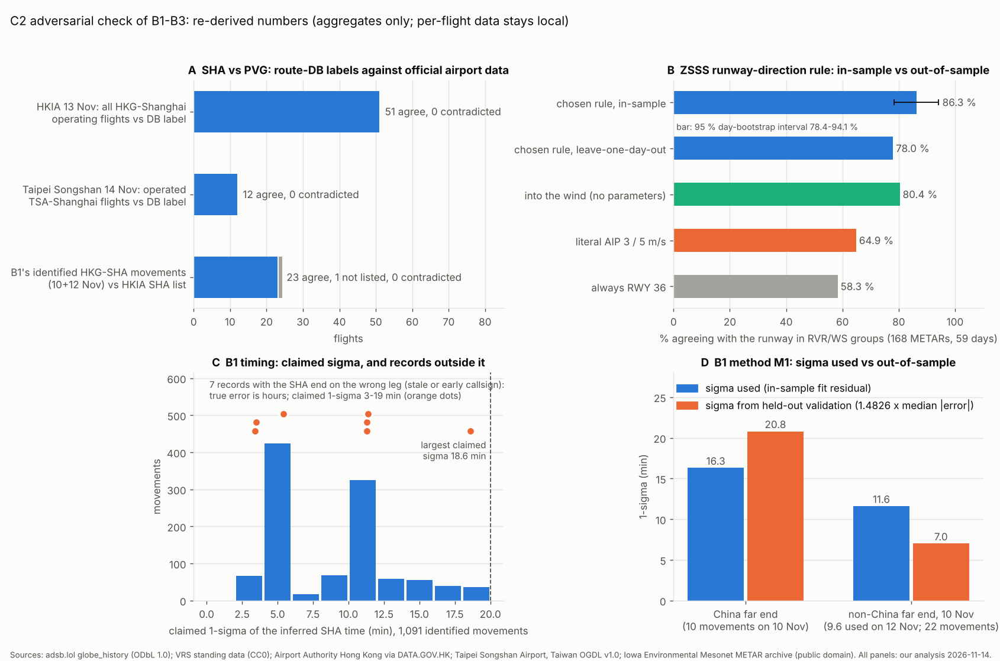

# C2: adversarial check of research B1-B3 (observed elsewhere, simulator facts, standards and references)

Task C2, Phase 1. Written 2026-11-14. Owner decisions OD0-OD3 and the working defaults of `docs/PLAN.md` §6a/§6b
apply. I re-opened the key sources myself and tried to refute the claims in:

| Task | Report |
|---|---|
| B1 | `docs/phase1/observed_elsewhere.md` |
| B2 | `docs/phase1/sources_sim.md` |
| B3 | `docs/phase1/standards_refs.md` |

I targeted three kinds of claim:
- licence and terms claims;
- numbers;
- the SHA-vs-PVG disambiguation.

I also checked two things about the files:
- that nothing non-redistributable or per-flight is marked committable;
- that no whole AIP list or standard text is transcribed.

Where I could not re-open a source, the claim is marked **not confirmed**.

**Labels:** **[obs]** = I measured it or read it in this session. **[inf]** = inferred by a stated rule. Verdicts:

| Verdict | Meaning |
|---|---|
| **confirmed** | I re-opened the source or re-derived the number and it holds. |
| **confirmed, corrected** | It holds, but the wording or a detail is wrong. |
| **refuted** | My evidence contradicts it. |
| **not confirmed** | I could not re-open or re-derive it. |

**Rules kept**
- I did not call api.adsb.lol or OpenSky, and did not use Google, Baidu or Amap.
- I registered no accounts and collected or solicited nothing inside the PRC.
- New downloads went into `refs/cache/verify_c2/` with a `SOURCES.json`. That folder is git-ignored and local only. It holds:
  - one blobless clone of `wiedehopf/tar1090-db` (README and update script only);
  - eleven terms pages;
  - one Commons API answer.
- Every script that reads downloads ran with `python3 -I`.
- No per-flight data leaves `refs/cache/`. This report gives no registration, ICAO address or observed per-flight time.
- `sfo3d/`, `pc12/` and `hwd3d/` are untouched. Nothing was committed.



---

## 0. Verdicts in brief

| Claim (task) | Verdict | My evidence |
|---|---|---|
| VRS standing data is CC0 and crowd-sourced (B1) | **confirmed** | The clone's `LICENSE` reads "CC0 1.0 Universal". The README says "built from the aviation data submitted by Virtual Radar Server users". `git ls-remote` shows HEAD still at 24ce542 on 14 Nov. There were 29 bot commits in the 31 days to 12 Nov. |
| Mictronics is ODC-By (B1) | **confirmed** | The README sentence and the ODC-By `LICENSE` file are present at 479e4d0. That is also the upstream HEAD on 14 Nov. |
| The readsb identity DB is "probably not independent" of Mictronics (B1, marked [unverified]) | **confirmed, upgraded to obs** | The tar1090-db README says it is the database "using the database maintained by Mictronics". Its `update.sh` downloads Mictronics `indexedDB_old.zip` **and** ADS-B Exchange `basic-ac-db.json.gz`. readsb's `--db-file` help points to tar1090-db. The 100 % agreement is therefore circular. |
| adsb.lol archive is ODbL (B1) | **confirmed** | adsb.lol historical page: "license: ODbL 1.0 , use it freely, just keep it open." |
| 542 / 549 identified movements, 69.2 / 70.1 % of 783.4 (B1) | **confirmed** | I recounted them from the local per-flight tables (§2.1). |
| 1,376 SHA and 5,075 PVG callsigns in VRS (B1) | **confirmed** | I recounted them from the raw CSVs without B1's index. |
| SHA-vs-PVG labels are reliable (B1) | **confirmed for HK and Taiwan routes; domestic still unproven** | The DB label agrees with official airport data: HKIA 51 of 51 and Taipei Songshan 12 of 12. 23 of B1's 24 HKG-route movements are on HKIA's SHA list and none is on its PVG list (§2.2). |
| Type mix 44.0 / 23.9 / 25.7 / 6.4 / 0 % (B1) | **confirmed** | Recounted over 1,091 movements. |
| Timing: "50–56 % within ±10 min and all within ±20 min" (B1) | **refuted as worded** | These are 1-σ values, not error bounds. 7 records (0.6 %) put the SHA event on the wrong leg: their error is hours, while their stated σ is 3–19 min (§2.3). |
| σ = 1.4826 × the out-of-sample median \|error\| "for that method" (B1) | **refuted for M1** | The code takes M1's σ from the residuals of its own fit (in-sample). For China far ends that is 16.3 min, against 20.8 min out of sample (§2.4). |
| No observed per-flight times in the committable report (B1) | **refuted (minor)** | §4 of `observed_elsewhere.md` gives inferred per-flight offsets for one named flight and an observed far-end delay for another (§5). |
| AWC, NWS, IEM, DATA.GOV.HK, Taiwan OGDL, aviationstack, FlightLabs and AeroDataBox terms (B2) | **confirmed** | All the quotes were re-read on the live pages (§1). The AAHK dataset page itself reset the connection: **not confirmed** at dataset level. |
| METAR statistics (B2) | **confirmed** | Re-derived from the IEM CSVs with my own parser (§3.1). |
| Runway rule agrees 86.4 % with RVR/WS designators (B2) | **confirmed, corrected** | 86.3 % is in-sample. A leave-one-day-out choice of thresholds gives **78.0 %**. The parameter-free "into the wind" rule gives 80.4 % (§3.2). |
| NOTAM facts F4551, F4552, F4313, F4301, F4275/76, F4543 (B2) | **confirmed** | Checked word for word against the eAIP summary `F.pdf`. |
| AD 2.20 quotes (B2) | **confirmed** | All are present in the local mirror text. |
| MH 5001-2021: designation, dates, Annex 14 basis, price, parameters checked (B3) | **confirmed** | Checked on the PDF cover and preface, clauses 6.2.2, 6.2.4 and 6.2.5, table 4.12.6, and the four amendment pages (§4.1). |
| 25 photo licences per file (B3) | **confirmed** | The live Commons API matches the licence and author for 25 of 25. The contact sheet holds 23; 06 and 25 are left out (§4.2). |
| Contact sheet properly attributed for commit (B3) | **confirmed, corrected** | Author and licence are on each tile. There are no licence or file links, no notice of the crops, and it points to a SOURCES.json that stays local (§4.2). |
| Building-height arithmetic (B3) | **confirmed** | cot 38.08° is 1.2763, not 1.2748. The difference is 0.1 % and changes no stated height. The photo-ratio sums reproduce. |
| No whole AIP list or standard text transcribed (B2, B3) | **mostly confirmed** | No standard text or figure is in the committable files. B2's NOTAM table lists 16 of the 17 ZSSS NOTAMs (§5). |

---

## 1. Licence and terms claims, re-opened

| Source | Claim | Re-opened (2026-11-14) | Verdict |
|---|---|---|---|
| VRS standing data | CC0; crowd-sourced; daily bot | Clone `LICENSE` and README. Upstream HEAD is 24ce542. 29 commits between 14 Oct and 12 Nov. | confirmed |
| Mictronics aircraft-database | ODC-By 1.0 | README plus `LICENSE` (ODC-By preamble). HEAD is 479e4d0. | confirmed |
| readsb / tar1090-db | "probably not independent" | tar1090-db README and `update.sh` (Mictronics plus the ADS-B Exchange basic DB). The repo has no LICENSE file. | **independence refuted** (obs). The registry check shows consistency, not truth. |
| readsb source | GPL-3.0; dbFlags 1/2/4/8 = military, interesting, PIA, LADD | `README-json.md` | confirmed |
| adsb.lol globe_history | ODbL 1.0 | adsb.lol docs page, quote verbatim | confirmed |
| Wikipedia | CC BY-SA 4.0 | standard; not re-fetched | confirmed (standard licence) |
| aviationweather.gov | 100 requests/min, 400 entries, 30 days, custom User-Agent | Live page, all four phrases present. The page also says "Cross-origin resource sharing is not permitted", so a browser app must go through the relay. | confirmed |
| NWS disclaimer | public domain unless noted | Live page, verbatim | confirmed. The reports themselves are CAAC met-service products exchanged under ICAO/WMO; "public domain" is the US hosts' statement (low risk). |
| IEM | "in the public domain and may be used freely" | Live page, verbatim | confirmed |
| DATA.GOV.HK | free for commercial and non-commercial use, with attribution | Live terms page, verbatim. "Data" includes data of the "Relevant Organisations" (here AAHK). | confirmed. The dataset page reset the connection, so dataset-specific terms are **not confirmed**. |
| Taiwan OGDL v1.0 | 不限目的 … 重製、散布、公開傳輸; compatible with CC BY 4.0 | Live licence page, verbatim. Dataset 37242 lists 授權方式 政府資料開放授權條款-第1版. | confirmed (37248 not re-opened) |
| aviationstack | "informational and noncommercial or personal use only … not … posted on any network computer" | Live page, verbatim | confirmed. It is the site's general "Materials" clause; the API-plan terms come from the pricing page (not re-read). |
| FlightLabs | "The Free plan cannot be used for any commercial or public use or redistribution under any circumstances." | Live page, verbatim | confirmed |
| AeroDataBox | "does not qualify as an Application … data feed, dataset"; End Users get "no right to extract, copy, redistribute" | Live page, verbatim | confirmed |
| OpenFlights | ODbL; routes.dat last changed 2017-02-02; 411 SHA rows | `data/LICENSE`, `git log`, row count | confirmed |
| eAIP NOTAM summary | no terms published; treat as all rights reserved | not re-checked live; Phase 0 copy used | not confirmed (accepted as the conservative default) |
| CAAC MH 5001-2021 | no licence; footer "版权所有：中国民用航空局"; cost price 98 CNY | Cached official page footer and PDF cover (成本价 98.00 元) | confirmed. Not redistributable is the right default. |
| FAA AC 150/5340-1M | US Government work | not re-opened | not confirmed (standard status of FAA ACs) |
| Commons photos (25 files) | per-file licences | live API (§4.2) | confirmed 25 / 25 |

---

## 2. B1 numbers and the SHA-vs-PVG question

### 2.1 Recount from the local per-flight tables [obs]

Script: `tools/verify/b1_recount.py`. Its inputs stay local.

| Quantity | B1 | Recount: 10 Nov / 12 Nov |
|---|---|---|
| Rows on a VRS SHA route (incl. rejected) | 558 / 562 | 558 / 562 |
| Identified (with a method) | 542 / 549 | **542 / 549** |
| Arrivals / departures | 281/261, 287/262 | 281/261, 287/262 |
| Share of 783.4 | 69.2 / 70.1 % | 69.2 / 70.1 % |
| Distinct aircraft; registration and type empty | 232 / 248; 0 | 232 / 248; 0 |
| Duplicate callsign + role | – | 0 |
| DB check | 132 / 118 far end match; 4 / 6 contradicted | Same. 2 of the 4 and 2 of the 6 contradict the **SHA end** (`sha_end_mismatch`), not the far end. |
| σ median, P90, max | 10.2 / 8.1; 15.9 / 11.4 | 10.2 / 8.1; 15.9 / 11.4; **max 18.6 / 16.2** |
| Share with σ ≤ 10 min | 50–56 % | 49.8 / 55.7 % |
| Nearest-fix distance P10 / median / P90 | 213 / 590–626 / 1,110 km | 213 / 590 / 1,110 and 214 / 626 / 1,113 km. Maximum 1,238 km; none beyond 1,300 km. |
| Type mix, both days (1,091 movements) | 44.0 / 23.9 / 25.7 / 6.4 / 0 % | 44.0 / 23.9 / 25.7 / 6.4 / 0 % |
| VRS callsigns, total / ZSSS / ZSPD (raw CSVs) | 628,956 / 1,376 / 5,075 | 628,956 / 1,376 / 5,075. Top airlines CES 471, CSH 209, CQH 191, DKH 122. |

One small slip: B1 §2 says "228 / 239 (95 %)", but `observed_elsewhere_stats.json` counts 240 aircraft (228 / 240).

### 2.2 SHA vs PVG: independent checks [obs]

The test that matters is an official far-end source that names the Shanghai airport. Two lawful open datasets do this:
- HKIA flight information (DATA.GOV.HK, 13 Nov, already cached by B2);
- Taipei Songshan real-time flights (Taiwan OGDL, 14 Nov, already cached by B2).

Scripts: `tools/verify/hk_tsa_dbcheck.py`, `tsa_dbcheck.py`, `b1_vs_hkia.py`.

| Check | Result |
|---|---|
| VRS DB label vs HKIA: every HKG↔Shanghai operating flight on 13 Nov (flight number → ICAO callsign) | **51 / 51 agree**: 13 SHA, 38 PVG, 0 contradicted, 0 missing |
| VRS DB label vs TSA: operated (Master = 1) TSA↔Shanghai flights on 14 Nov | **12 / 12 agree**: 8 SHA, 4 PVG. The 12 codeshare rows are not in the DB, as expected. |
| B1's identified movements with far end VHHH (10 + 12 Nov) vs HKIA's SHA flight list (13 Nov; same daily flight numbers) | **23 on HKIA's SHA list, 1 not listed that day, 0 on HKIA's PVG list.** HKIA shows 13 SHA movements a day; B1 identified 12 a day (≈ 92 %). |
| Airline-level gap? Sichuan Airlines, Capital, West Air, Loong and others have 0 SHA callsigns in VRS | Wikipedia's SHA list (25 airlines) **also** lists none of them, so this is not a DB gap. 4 of the 12 "not in DB" inverse candidates on 10 Nov were Sichuan Airlines; they are probably PVG- or other-Yangtze-delta-bound. |
| Edge altitude near Nanjing: are the out-of-band DB-SHA arrivals PVG-like? | Of 210 DB-SHA arrivals whose last fix is at 118.6–119.7 E, 140 are in the 25,900–27,300 ft band. The rest sit at 27,300–29,000 ft or are still descending below 25,900 ft. Only **10 (4.8 %)** are at 29,000 ft or higher, where the PVG median is. The band test alone could allow up to ~29 % mislabels in the worst case; this distribution says the real share is small. |
| Rotation test | **not re-run**. I read it from B1's stats JSON: 266/340 and 262/330 same-airport pairs against 1 mixed. My own sequence test on the SHA table (§2.3) found no arrival→departure gap shorter than 51 min (321 pairs, P5 79 min). |

**What this settles.**
- For HK and Taiwan routes the SHA/PVG label is right in every official case I could test: 63 of 63 DB labels and 23 of 23 listed B1 movements.
- It does **not** settle the domestic two thirds. No open official source names the Shanghai airport for domestic flights.
- The Wikipedia (6.3 % "PVG only") and far-end (3–5 %) contradiction rates remain the best estimate of the domestic error.
- A defensible reading of the headline: 69–70 % is an **upper** figure. About 65–70 % of movements get a correct real identity.

### 2.3 Timing: the "within ±20 min" claim, and wrong-leg records [obs]

**1. Wording.** B1 writes "50–56 % of movements are within ±10 min and all are within ±20 min". The numbers are σ ≤ 10 min and σ ≤ 20 min.
- If the errors were normal, about 32 % of movements would be off by more than 1 σ, and some by more than 20 min.
- Fix: say "1-σ ≤ 10 min for 50–56 %, 1-σ ≤ 19 min for all".

**2. Wrong-leg records.** Two tests were run on the inferred SHA times along each aircraft's day (`tools/verify/b1_sequence.py`, `b1_heading2.py`):

- **Sequence test.** A SHA departure followed by a SHA arrival on the same aircraft must leave time for the round trip. I used B1's own China air-time fit plus 30 min on the ground. Of 282 such pairs, **3 are impossible beyond 2 σ**. For example, a departure to Songshan followed 67 min later by an arrival from Songshan, when the round trip needs about 182 min.
- **Heading test.** I compared the track at the fix used for M2 with the bearing to ZSSS (arrivals) or from ZSSS (departures). 16 of 986 movements with a track are more than 90° off. The 7 movements below are clearly wrong:
  - **arrivals:** 4 whose last fix is on the **next** leg, heading away from SHA and descending into the far end, still under the inbound callsign;
  - **departures:** 3 whose first fix is on the **previous** leg, inbound to SHA, already under the outbound callsign.

  Each of the 7 is a record spanning 4 h or more. They arise because B1 splits flights only at gaps longer than 4 h, and a short SHA round trip fits inside the coverage gap.
- The other 9 of the 16 are not errors of this kind. 8 are departures to Shenzhen first seen in the approach pattern 16–26 km from ZGSZ (genuine long gaps). One is ambiguous (93°).

**What this means.**
- 7 of 1,091 identified movements (0.64 %) carry a SHA time that is wrong by hours, while their stated σ is 3.4–18.6 min.
- The identities are real; only the SHA time and role sequence are wrong.

**Fix:**
- reject or re-split any record whose nearest fix heads more than 90° away from the expected direction;
- split at gaps shorter than the leg's air time plus 30 min (instead of 4 h) when the callsign's DB route is short;
- re-run.

**3. Bias.** In the 900–1,300 km China-arrival bin, the out-of-sample median of predicted − actual is **−6.6 / −4.5 min**: the model predicts the arrival 4.5–6.6 min early. 114–144 identified movements a day have their nearest fix beyond 900 km. B1 mentions bias only beyond 1,300 km, where no identified movement lies. The point estimates are not corrected for this bias. Correct it or state it.

### 2.4 M1 σ is in-sample [obs, code]

`observed_elsewhere.py`: `air = (a, b, sig(air_all[2]))`. The σ comes from the fit's own residuals. The out-of-sample validations are computed but not used for M1.

| M1 class | σ used | Out-of-sample σ (1.4826 × median \|e\|) | Movements |
|---|---|---|---|
| China far end | 16.3 min | 20.8 min (leave-one-route-out, median \|e\| 14.0 min, P90 50 min, bias +8.7 min, n 72) | 10 departures to Shenzhen on 10 Nov |
| Other far end | 11.6 min (10 Nov), 9.6 min (12 Nov) | ≈ 7 min (HKG–TPE held out, median \|e\| 4.6–4.7 min) | 22 |

M1 is chosen whenever its σ is the smaller. So the 10 China M1 picks displaced M2 (σ 18.6 min) only because of the understated in-sample value. With the validated σ they would be M2, or stay M1 at σ about 21 min, beyond the "all ≤ 20 min" claim. Fix: use `val['M1_cn_loro']` and `val['M1_hkg_tpe']` for M1's σ.

### 2.5 Smaller points

- **Inverse search.** The DB misses 12 / 640 and 5 / 669 of all gap-bound candidates (1.9 / 0.7 %). If every missing callsign were Shanghai-bound, the miss rate among Shanghai-bound candidates would be 12 / 287 and 5 / 284 (4.2 / 1.8 %). That is still small, but B1's summary sentence reads as SHA-specific.
- **"DB right 95–97 %".** Half of the contradictions are at the SHA end (`sha_end_mismatch`, 2 + 2). Those are cases where the DB's SHA claim itself was wrong, not only the far end.
- **Not re-derived:**
  - git-blame ages (63 % older than 2 years);
  - the Wikipedia pair check (read from the stats JSON; 1,238 / 1,376 = 90.0 %);
  - the M2 validation tables;
  - the HKG–TPE M1 numbers (read from the stats JSON).

---

## 3. B2 numbers

### 3.1 METAR statistics [obs]

`tools/verify/wx_check.py` is my own parser over the four IEM CSVs. B2's numbers reproduce:

| Item | Recount |
|---|---|
| Routine reports | 67,817 in 1,413.0 days = 48.0 a day |
| Gaps | all 30 min except 4 × 60 and 1 × 120 min |
| Off-minute reports | 1,287 |
| Trend groups | NOSIG 64,770 (93.7 %), BECMG 4,327 (6.3 %), TEMPO 7 |
| Wind unit | MPS in all 69,104 reports |
| QNH | 980–1044 hPa; no A groups |
| CAVOK | 53.2 % |

### 3.2 Runway-direction rule [obs]

**Hints.** My designator search found **168** RVR/WS hints on 59 days: 98 for 36 and 70 for 18 (123 RVR, 45 WS). B2 found 169 on 60 days. No report names both directions.

| Variant | Agreement |
|---|---|
| B2's rule (> 1.5 m/s twice or > 4 m/s once), in-sample | 145 / 168 = **86.3 %** (day-bootstrap 95 % CI 78.4–94.1 %) |
| Same family, thresholds chosen on the other days (leave-one-day-out over a 6 × 5 grid) | **78.0 %** |
| "Into the wind" (no parameters; \|headwind\| < 0.5 m/s keeps) | **80.4 %** |
| Literal AIP 3 / 5 m/s | 64.9 % |
| Always RWY 36 | 58.3 % |

- **The rule's advantage is not established.** The difference from "into the wind" has a day-bootstrap 95 % interval of −0.7 to +13.8 percentage points.
- **The qualitative reading stands.** ATC turns the runway at small tail winds; the AIP's 3–5 m/s is not the trigger.
- **Climatology is robust:**
  - north flow 48.2 % with B2's rule (B2: 48.3 %);
  - 0.56 changes a day;
  - 47–54 % across all the threshold choices.
- **Fix:** report 86 % as in-sample and give the out-of-sample figure of about 78–80 %.

### 3.3 NOTAMs [obs]

Every NOTAM fact in B2's table matches `refs/cache/aip/eaip_notam_summary_2026-11/extracted/F.pdf` (sha256 c15fa9ae…):

| NOTAM | Checked |
|---|---|
| F4551/26 | 10 Nov 1700 – 29 Nov 2200, 1700–2200 daily; crossing via H4 and H7 |
| F4552/26 | 17 named links plus the A, B and H sections |
| F4313/26 | stand 267, 14 Nov 1700 – 21 Nov 1000 |
| F4301/26 | 50 s; B4 1,850 m, A3 1,890 m, A2 1,715 m, B3 1,950 m |
| F4275/26, F4276/26 | the WIP areas |
| F4543/26 | crane 35 m at 177° / 3,599 m |
| F4548–50/26 | the previous phase |

- The summary's own header reads "still in force on 2026-11-02 07:06".
- B2's table silently omits F3511/26. It does not matter for the simulator.

### 3.4 Schedules and hourly profile

Rechecked:
- HKIA, 13 Nov: 13 SHA movements (6 departures from HKG and 7 arrivals);
- TSA, 14 Nov: 4 operated flights each way;
- domestic share: 6,978 + 10,905 of 282,692 movements is 6.3 % international and regional, so 93.7 % domestic;
- hourly scaling: 783.4 / 545.5 = 1.436, and the day totals 407.7 + 375.5 = 783.2.

Checks on B2's "illustrative" record:
- The sketch (an illustrative callsign / type / time) was checked against the local observed tables and is not a disguised per-flight record (details local only).
- B2 says the schedule data come from "US, Hong Kong and Taiwan hosts" beside "nothing collected inside the PRC". Hong Kong is a PRC SAR. Downloading published open data is not "collection inside the PRC" in the §6b sense, as with caac.gov.cn, but the wording should be fixed.
- Not re-tested: the airline-site reachability codes, FAA NOTAM Search 403, ICAO API and AirLabs (**not confirmed**; all are conservative "No" findings).

---

## 4. B3

### 4.1 MH 5001-2021 [obs]

**Document facts** (cached official PDF and CAAC pages):

| Item | Found |
|---|---|
| Cover | "MH 5001—2021, 代替 MH 5001—2013, 2021-09-18 发布, 2021-12-01 施行" |
| Price | 成本价 98.00 元 |
| Preface | implements 附件 14 第 I 卷 **第八版** |
| CAAC page | 有效 |
| Amendment 1 | 2024-01-03, in force 2024-11-28 |
| Amendment 2 | 2024-01-23, "自发布之日起施行" (in force on publication) |
| Amendment 3 | announcement dated 2024-08-09, page dated 2024-08-16, in force 2024-11-28 |
| Amendment 4 | 2025-06-21 |

**Parameters spot-checked against the text** (all as B3 states):

| Clause | Text found |
|---|---|
| 6.2.2-4 | numerals ≥ 9 m, may be scaled up to 2× |
| 6.2.4-3 | stripes start 6 m from the threshold; out to ≤ 3 m from the edge or 27 m from the CL; ≥ 30 m long (45 m preferred), ~1.8 m wide and apart; double centre gap; ≥ 1.8 m bar at a displaced threshold |
| 6.2.5-2 | the aiming point coincides with the visual approach slope origin where a slope indicator exists |
| Table 4.12.6 | CAT I, code 3–4: 90 m; note b, code F: 100 m |

Not re-opened: MH/T 5083-2024 and 民航综机发〔2025〕1号.

### 4.2 Photos [obs]

**Live Commons API** (one POST after one HTTP 429) for the 25 files:
- licence short name and artist match B3's `SOURCES.json` for **25 / 25**: CC BY 4.0 × 3, CC BY-SA 4.0 × 15 (incl. 06), CC BY-SA 3.0 × 4, PD-self × 2, GFDL 1.2 × 1;
- no restriction field is set;
- no deletion or copyright category is shown.

**Contact sheet.** It shows exactly 23 tiles; 06 (identifiable people) and 25 (GFDL only) are left out. Its attribution falls short for a committed file:
- Each tile names author, licence and Commons title, but there is **no licence URL or file link**. The footer points to `refs/cache/photos/commons/SOURCES.json`, which stays local unless the owner opts in.
- The tiles are cropped and scaled, but the sheet does not say so. CC BY 4.0 and BY-SA 4.0 §3(a)(1)(B) require indicating modifications.
- Tiles 15 and 18 show a garbled author field ("…, Taken o"), from an EXIF sentence in the Artist field.
- Tile 09 is captioned "T2 landside facade", but it shows the airside apron, as B3's own table says.

Fix: commit a credits list (title, author, licence plus URL, page URL, "cropped and scaled") beside the sheet, and fix the two captions. BY-SA 3.0 inside a BY-SA 4.0 compilation is allowed (3.0 permits later versions).

### 4.3 Heights

The layover factor used is 1.2748, but cot 38.08° is **1.2763**. The 0.1 % difference leaves every height unchanged at the stated precision (e.g. 42.7 m layover gives 33.46 m against 33.5 m). The photo-ratio heights reproduce (26.4 m and 8.9 m). **Not re-derived:** the DSM statistics and the SAR wall profiles.

---

## 5. Committable vs local; transcription

**Per-flight data**
- `refs/cache/observed_elsewhere/` is ignored by `sha3d/.gitignore` (`git check-ignore` confirms). Its SOURCES.json says "WITHHELD".
- `observed_elsewhere_stats.json`, `sources_sim_hourly.json`, `sources_sim_wx_stats.json` and `SOURCES_sim.json` contain no callsign patterns, B- registrations or ICAO hex addresses (regex scan). The B1 figure is aggregate only.
- **Exception, medium.** `observed_elsewhere.md` §4 ("Check against published schedules") gives:
  - for one named flight, its inferred-minus-scheduled take-off offsets on the two days, from which its inferred times can be recovered;
  - for another named flight, that its far-end take-off "was itself seen to be about 30 min late" on one day.

  These are per-flight results of observed-elsewhere data, against the §6b default and against B1's own sentence that the report holds "no … observed per-flight times". Fix: give only the aggregate ranges and drop the per-flight sentences.

**Non-redistributable sources**
- Kept local, and correctly flagged in their SOURCES.json: CAAC PDFs and renders, NOTAM-derived JSON, eAIP flight routes, airline PDFs, the GFDL and privacy photos.
- Correctly marked redistributable:
  - METAR (public domain hosts);
  - HKIA (DATA.GOV.HK terms);
  - TSA (OGDL).

**Standards text**
- No CJK passage longer than a document title or a sign word ("停") appears in `tools/standards/*`, `tools/photos/*` or `data/meas/b3_*.json`.
- `standards_markings.png` is B3's own drawing from numbers.
- The §1.3 table is a paraphrased digest of about 60 parameters with clause numbers: facts, not text. Acceptable under the stated default, but owner review is advised.

**AIP and NOTAM lists**
- B2's §4.2 table covers **16 of the 17** ZSSS F-series NOTAMs, with two verbatim NOTAM texts and the full F4552 link list. B2's rules say "No whole AIP list or NOTAM checklist is copied". That is not literally true; the table is a near-complete paraphrased checklist. Low severity: NOTAMs are operational facts, but the eAIP has no terms. Fix: keep only the NOTAMs the simulator applies.
- B2's AD 2.20 quotes (about 10 short rules) are each short and verified, but together they digest most of AD 2.20. Owner check advised (OD3).
- No stand, VDGS or frequency list appears in B1–B3.

---

## 6. Findings and fixes (ranked)

| # | Severity | Finding | Fix |
|---|---|---|---|
| 1 | medium | B1: 7 of 1,091 movements (0.64 %) put the SHA event on the wrong leg, so the time is wrong by hours while the stated σ is 3–19 min. "All within ±20 min" mistakes a 1-σ value for an error bound. | Add a heading check at the nearest fix and a span check, and split at shorter gaps. Reword as "1-σ ≤ 19 min". Re-run. |
| 2 | medium | B1: M1's σ is the in-sample fit residual, not out-of-sample as the report says. For China it is 16.3 min against 20.8 min validated; for other far ends 11.6 against ≈ 7 min. | Use the validated M1 errors for σ. Re-run the method choice. |
| 3 | medium | B1: `observed_elsewhere.md` §4 publishes per-flight inferred offsets for a named flight and an observed far-end delay for another, against §6b and the report's own claim. | Replace with aggregate ranges. |
| 4 | medium | B2: the runway rule's 86.4 % is in-sample. Out of sample it is 78.0 %, not better than "into the wind" (80.4 %; difference CI −0.7 to +13.8 pp). | Report in- and out-of-sample figures. Optionally use the parameter-free rule as the fallback. |
| 5 | low | B1: SHA vs PVG is confirmed only for HK and Taiwan (63 / 63 official, 23 / 23 B1). Domestic labels rest on the DB. 69–70 % is an upper figure; about 65–70 % is defensible. | State the external checks and the upper-bound reading. Re-test when more open far-end data exist. |
| 6 | low | B1: uncorrected −4.5 to −6.6 min bias in the China arrival bin at 900–1,300 km (114–144 movements a day); only the > 1,300 km bias is mentioned. | Subtract the bin bias or state it. |
| 7 | low | B1: the registry "independence" is now refuted (tar1090-db is built from Mictronics plus ADS-B Exchange's basic DB); the inverse-search miss rate is relative to all gap-bound candidates; half the "far-end" contradictions are SHA-end ones; 228 / 239 should read 228 / 240. | Update the wording. |
| 8 | low | B3: the contact sheet lacks licence and file URLs and a modification notice, and points to a local-only SOURCES.json. Two author fields are garbled and one caption is wrong. | Commit a credits list with URLs and "cropped and scaled". Fix the captions. |
| 9 | low | B2: the NOTAM table is a near-complete paraphrase of the ZSSS F-series checklist (16 of 17) despite the "no checklist copied" statement. The AD 2.20 quotes together digest most of that section. | Trim to the NOTAMs applied. Owner check of the AD 2.20 quotes. |
| 10 | low | B2: "Hong Kong hosts" are listed as if outside the PRC. The "public domain" status of METARs is the US hosts' statement (the reports originate with the CAAC met service). | Fix the wording; keep the attribution. |
| 11 | low | B3: layover factor 1.2748 against cot 38.08° = 1.2763. | Cosmetic. |

## 7. Files

| Path | What | Committable? |
|---|---|---|
| `docs/phase1/verify_research.md` | this report | yes |
| `docs/phase1/verify_research.png` | summary figure (aggregates only; sources in the footer) | yes |
| `tools/verify/*.py` | C2 check scripts: recount, sequence and heading tests, HKIA/TSA checks, METAR re-derivation, figure | yes (no data inside; they print per-flight lines to the terminal when run on the local tables) |
| `refs/cache/verify_c2/` (`SOURCES.json`, `web/`, `commons/api_25.json`, `tar1090_db/repo`) | re-opened terms pages, Commons answer, tar1090-db README and script | **no**, local reference only |

**Reproduce** (from `sha3d/`):
```
python3 -I tools/verify/b1_recount.py refs/cache/observed_elsewhere/sha_observed_2026-11-10.csv refs/cache/observed_elsewhere/sha_observed_2026-11-12.csv
python3 -I tools/verify/hk_tsa_dbcheck.py refs/cache && python3 -I tools/verify/tsa_dbcheck.py refs/cache && python3 -I tools/verify/b1_vs_hkia.py refs/cache
python3 -I tools/verify/b1_sequence.py refs/cache && python3 -I tools/verify/b1_heading2.py refs/cache
python3 -I tools/verify/wx_check.py refs/cache/metar/iem_zsss
python3 -I tools/verify/plot_verify.py refs/cache docs/phase1/verify_research.png
```

**Attribution for the figure.**
- ADS-B: contains information from ADSB.lol (https://adsb.lol), ODbL 1.0.
- Routes: VRS standing data (CC0).
- Flight information: Airport Authority Hong Kong via DATA.GOV.HK; Taipei Songshan Airport (CAA), Taiwan OGDL v1.0.
- Weather: Iowa Environmental Mesonet, Iowa State University.

---

## Fix round 1 (2026-11-14): B1-B3 corrected

Every finding of §6 was worked on in `sha3d/`. Nothing was committed.

**Rules kept**
- No call to api.adsb.lol or OpenSky. B1 was re-run from the same local scan files.
- Every script that reads downloads ran with `python3 -I`.
- One public schedule page (a foreign carrier's SHA route) was read to redo the B1 schedule check. Its per-flight content
  stays in the local spot-check file.
- `sfo3d/`, `pc12/` and `hwd3d/` are untouched (`git status` clean).
- Per-flight data stays in `refs/cache/observed_elsewhere/` (ignored; `git check-ignore` confirms).

`verify_research.png` above still shows the state before this round. It is kept as the record of the check.

| # | Finding | Fix | Result after the re-run |
|---|---|---|---|
| 1 | B1 wrong-leg records; "all within ±20 min" | `observed_elsewhere.py`: SHA/PVG-route flights are cut at coverage gaps longer than the leg air time + 30 min (was 4 h): 24 / 28 flights, 25 / 29 cuts. Heading check at the fix nearest SHA: > 90° the wrong way → drop the nearest segment and re-test, else reject; not tested within 60 km of the far end. Span check: span > leg air time + 30 min → reject. `dedupe` now prefers the consistent piece. Wording: "1-σ ≤ 10 min for 51–68 %, ≤ 19 min for all", with the 1-σ caveat. | C2 tests re-run on the new tables. No record spans more than 4 h (was 7). Heading test: 0 wrong-leg records. The 8 left > 90° are all SHA→Shenzhen departures first seen 16–26 km from ZGSZ in the approach pattern. Sequence test: the Songshan-type case (67 against 182 min) is gone. 3 flags remain, all SHA–Urumqi round trips (638–649 min). The 672 min they are said to need comes from the test's China air-time line stretched to 3,272 km; the global line gives 553 min. So they are artefacts of the test, not wrong legs. Rejected: 1 (93°); re-split: 1. |
| 2 | M1 σ in-sample | M1 σ = 1.4826 × median \|out-of-sample error\|. China: leave-one-route-out, 20.7 / 19.5 min (was 16.3 / 19.1). Other far ends: the larger of HKG–TPE (6.9 min) and a new 10-fold-by-route test per distance band (7.0–7.5 min below 800 km, 8.1–11.9 at 800–1,500, 17.7–18.8 at 1,500–2,500). The band test was added because the error grows with distance and HKG–TPE is one 800 km route. Method choice re-run. | M1 5 / 16 movements (was 16 / 16). No Chinese far end takes M1; the Shenzhen departures use M2. σ median 9.4 / 8.0 min, maximum 18.6 / 16.2. |
| 3 | Per-flight statements in `observed_elsewhere.md` | Old §4 schedule sentences and the §1.2 mismatch details removed. The §1.4 flight table moved to the local `spot_checks_local.md`. The report gives counts and ranges only. | Regex scan of the committed B1 report and stats: no callsign, flight number, registration, ICAO address or per-flight time. Schedule check redone on 8 records: take-offs +5 to +42 min, landings −32 to +18 min, all explained (details local). |
| 4 | Runway rule 86 % is in-sample | `rule_check_rvr.py` adds a leave-one-day-out choice of thresholds and a day-bootstrap. `sources_sim.md` §5.2 shows in-sample and out-of-sample side by side. New `metar_zsss.RunwayDirectionIntoWind` is the fallback. | On B2's 169 hints: 86.4 % in sample, **78.1 % out of sample** (C2: 78.0 % on 168). "Into the wind" 80.5 %, nothing fitted. Chosen minus "into the wind": −0.7 to +13.1 pp. |
| 5 | Identified share unverified for domestic routes | B1 summary, §0, new §1.6 and §7 say 69–70 % is an upper figure and about 65–70 % is defensible. The external check covered HK and TSA only (63 / 63 labels, 23 / 23 movements). Also written into `observed_elsewhere_stats.json` (`readings`). | – |
| 6 | 900–1,300 km China arrival bias | M2 removes a bin's out-of-sample bias only where that cuts the **nested** out-of-sample σ by ≥ 5 % and the bias is ≥ 2 min. Nested means each airport is corrected with the other airports' median. | Removed in the China 900–1,300 km arrival bin (−6.6 / −4.5 min; 56 / 71 SHA movements a day): median \|error\| 10.7 → 8.0 and 7.5 → 6.6 min, σ 15.9 → 11.8 and 11.2 → 9.8 min. **P90 worse: 20.7 → 24.6 and 20.2 → 25.9 min** (the bias differs between airports); stated in the report. Also removed for other-class arrivals at 650–900 km (+2.4 / +2.1 min; 3–4 movements). Elsewhere removal made the nested error worse, so the bias stays and is stated. |
| 7 | Registry, inverse search, contradictions, 228 / 239 | Registry agreement now stated as circular (tar1090-db is built from Mictronics plus the ADS-B Exchange basic DB). Inverse miss rate: 1.9 / 0.7 % of all gap-bound candidates, 4.2 / 1.7 % in the worst case among Shanghai-bound ones. "4 + 6 contradictions, half at the SHA end". 228 / 240 and 239 / 253. | – |
| 8 | Contact sheet attribution | New `photos_credits.md` (title, author, licence with URL, Commons file page, modification) and generator `tools/photos/credits.py`. Sheet footer points to it. Tile 09 caption "T2 airside". Author lines of 15 and 18 cleaned (`commons_meta.py`; the bad text was a free-text date field). Tile 19's CJK author now renders. | The tiles are **scaled, not cropped**: `thumbnail` keeps the whole frame, and renditions keep the original aspect. §4.2 above ("cropped") was wrong on that point, and the credits say "scaled, not cropped". |
| 9 | NOTAM table near-complete | `sources_sim.md` §4.2 lists only the applied NOTAMs (F4551, F4552, F4313, F4301, F4275/76, AIRAC AMDT 12 trigger) in our own words. The plate is redrawn with the same set. | The other 11 NOTAMs appear only in the local JSON. The AD 2.20 quotes are left as they were and flagged for the owner's OD3 check. |
| 10 | "Hong Kong hosts"; METAR "public domain" | Hong Kong described as a PRC SAR with its own legal system; open-data download is not collection inside the PRC in the §6b sense. METAR described as NOAA/NWS (AWC) and IEM data, with the NWS ("public domain, unless specifically noted otherwise") and IEM ("Attributing … would be appreciated") statements quoted. The AWC API page itself states no licence. Same wording in `SOURCES_sim.json`. | – |
| 11 | Layover factor | Text corrected to cot 38.08° = 1.2763 in `standards_refs.md`, `umbra_layover.py`, `heights_summary.py` and `b3_building_heights.json`. | The code always used the exact value (K = 1.27627), so no height changes (e.g. 42.7 m → 33.5 m). |

**Re-run numbers (B1, 10 / 12 Nov).**

| | Fix round 1 | Before |
|---|---|---|
| Identified | 542 / 550 (69.2 / 70.2 %) | 542 / 549 |
| Arrivals / departures | 282 / 260 and 287 / 263 | 281 / 261 and 287 / 262 |
| Type mix (A320 family / 737 / wide-body / C919) | 44.0 / 23.9 / 25.6 / 6.4 % | 44.0 / 23.9 / 25.7 / 6.4 % |

B2's hourly profile was re-run on these aggregates: scale ×1.435, busiest hour 56.7.

**Owner sample (local only).**
- `refs/cache/observed_elsewhere/sample_for_owner.csv`: 40 rows over 21 airlines, 14 ICAO types and 19 local
  hours; 20 arrivals and 20 departures; 26 by M2 and 14 by M1.
- Columns: callsign, registration, ICAO type, operator, far-end airport, direction, inferred SHA time (local),
  1-σ, method, nearest-fix distance and an evidence summary.
- `README_sample_for_owner.md` beside it explains the columns and what is observed and what is inferred.
- Every local per-flight record now carries `src` per field (`obs` | `inf`) and an `evidence` block.

**Still open**
- Domestic SHA-vs-PVG labels remain unverified by an official source.
- The AD 2.20 quote set needs the owner's OD3 check.
- The B1 per-flight tables and the sample stay local until the owner has reviewed the sample (PLAN §6b).

**Files changed in this round**

| Kind | Files |
|---|---|
| Tools | `tools/adsb/{observed_elsewhere,report_observed_elsewhere,legs,write_sources_observed}.py`, `tools/wx/{rule_check_rvr,metar_zsss}.py`, `tools/notam/notam_plate.py`, `tools/photos/{contact_sheet,commons_fetch}.py`, `tools/photos/subjects.json`, new `tools/photos/{commons_meta,credits}.py`, `tools/standards/{umbra_layover,heights_summary}.py` |
| Docs | `observed_elsewhere.{md,png}`, `observed_elsewhere_stats.json`, `sources_sim.md`, `sources_sim_notam.png`, `sources_sim_hourly.{json,png}`, `sources_sim_wx_stats.json`, `SOURCES_sim.json`, `standards_refs.md`, `photos_contact_sheet.jpg`, new `photos_credits.md`, this section |
| Data | `data/meas/b3_building_heights.json` (text only) |
| Local only | `refs/cache/observed_elsewhere/{sha_observed_*,sample_for_owner.csv,README_sample_for_owner.md,spot_checks_local.md,SOURCES.json}`, `refs/cache/photos/commons/SOURCES.json` (author and date fields cleaned) |

**Reproduce** (from `sha3d/`):
```
python3 -I tools/adsb/observed_elsewhere.py 2026-11-10 2026-11-12     # about 3.5 min; stats, figure, local tables, owner sample
python3 -I tools/sim/hourly_profile.py .
python3 -I tools/wx/rule_check_rvr.py .
python3 -I tools/notam/notam_plate.py refs/cache/notam/zsss_notams_2026-11.json docs/phase1/sources_sim_notam.png 2026-11-14
python3 -I tools/photos/contact_sheet.py refs/cache/photos/commons docs/phase1/photos_contact_sheet.jpg tools/photos/subjects.json
python3 -I tools/photos/credits.py refs/cache/photos/commons docs/phase1/photos_credits.md tools/photos/subjects.json
python3 -I tools/verify/b1_heading2.py refs/cache && python3 -I tools/verify/b1_sequence.py refs/cache
```
