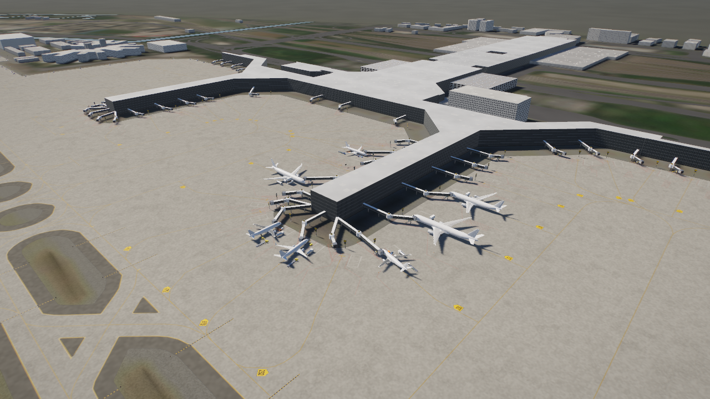

# Phase 2c: stands, jet bridges, VDGS, stand signs, remote-stand equipment

Date: 2026-11-20. Package P2c of Phase 2 (docs/PLAN.md §7), on the core fork (commit 8ca06f7, docs/phase2/core.md).
Fork base: sfo3d @ **e3218d6**. Nothing in `sfo3d/`, `pc12/` or `hwd3d/` was modified; nothing was committed.

Tags as in docs/PLAN.md: **obs** (seen in a source / measured), **inf** (inferred: rule, default or placeholder).
Standard: CAAC **MH 5001-2021** 《民用机场飞行区技术标准》 (docs/phase1/standards_refs.md §1; clauses cited below were read
in the local copy `refs/cache/standards/caac_mh5001_2021/MH5001-2021.pdf`, short parameters only).

**Result.** All 164 stands of `window.SHA_STANDS` are live gate objects. The 56 data bridges (13 seen on the Umbra SAR,
43 inferred from OSM gate nodes; one per stand) are sfo3d's apron-drive bridges - fixed walkway on columns, rotunda on its
pedestal, rotunda corridor, three telescoping tunnels, drive column and bogie, PCA unit, cab bubble with rotating cab,
bellows fitted to the drawn fuselage, service landing and stair, floodlight and beacon - built from the data's attach /
walkway / rotunda points. Each contact stand has a VDGS unit with a CAAC stand-number sign above it, and each bridge a
CAAC triangular-prism stand-number sign on its rotunda. Remote stands have post-mounted stand-number signs, an idle stair
unit as a cue, and passenger stairs plus apron buses when an aircraft is parked. A DEBUG option parks static aircraft
(models by URL from `../sfo3d/data/models/`) to check scale, docking and GSE. A DEBUG overlay draws every stand's lead-in
and push-back path. With the class reference aircraft parked, **54 of 56 bridges dock**. The two that do not (111, 235)
would need a cab turn beyond the sell sheet's limit (§2.6).

---

## 1. Files

Each forked file starts with `forked from sfo3d@e3218d6 <path>`.

| File | Status | Contents |
|---|---|---|
| `js/live/gates.js` | **rewritten** (was the core's stub; forked from sfo3d `js/live/airport.js` standGates + the `js/live/app.js` gate glue) | the extension: `shaGates(stands, hdgVec)` (data → gate objects), the reach fix (§2.4), `setGateWorld` input (T1 / T2 outlines, apron lanes, pavement), `gsign` program, the system start, DEBUG park and push overlay, light sprites, QA hooks, statistics and the legend text |
| `js/live/gate_system.js` | adapted (fork of sfo3d `js/live/gates.js`, committed half-done by the interrupted attempt; finished here) | the engine. Kept: bridge kinematics, docking paths, solids, rest poses per occupant, VDGS placement, GSE hull tests. Changed: §2-§5 (no module-scope data; world coordinates; `autoModel`, `autoRest`, SHA height targets, CAAC signs, remote stands, glazed sides, sign-housing fix). The interrupted attempt's duplicate imports (`newSignGeo` / `signQuad` / `meshOfSign` both imported and declared: a SyntaxError) and its calls of non-existent functions (`remoteGeo`, `stairShape` …) are resolved |
| `js/live/gate_signs.js` | **new** (fork of the `SIGN_VS` / `SIGN_FS` / `makeAtlas` parts of sfo3d `js/live/signs.js`) | the `gsign` program and the atlas of CAAC stand-number faces and VDGS display text; no FAA sign faces |
| `js/world/gates.js` | adapted | GSE meshes (sfo3d's set unchanged) + **new** passenger stairs (one mesh per 0.1 m of door sill) and apron bus; `stairDoors`, `stairShape`, `stairHull`, `BUS_HULL`. Removed: the SFO-grid import (`stToWorld`, which the sha3d `geo.js` does not export, so the core's copy could not load) and sfo3d's legacy offline `GateSystem` class |
| `jobs/gates.mjs` | **new** | the renders and checks of this report (`SOFTGL=1 OUT=docs/phase2 PREFIX=gates node livetest.mjs jobs/gates.mjs`) |
| `tools/gates/plate_compare.py` | **new** | the plate-vs-render comparison image (§8) |
| `docs/phase2/gates.md`, `gates_*.png` | **new** | this report, renders at deviceScaleFactor 1 |

No core file was edited: everything plugs in through `registerExtension({name: 'gates', …})` (js/live/ext.js).

## 2. Jet bridges

### 2.1 Data → gate objects (`shaGates`, sfo3d `standGates`)

World coordinates throughout: `g.nose` = the data stop point `[x, z]`, `g.dir` = `hdgVec(hdg)`. The engine's s,t helpers
(`stW`, `stD`) are the identity. Per bridge the data gives `attach`, `rotunda`, `walk` (attach → rotunda), `cab` (docked at
door 1 of the class reference, inf), `reach_m`, `src`. These map to the sfo3d fields `attachW`, `rotundaW`, `walkW`,
`cabW`. Walks shorter than 0.5 m become null: the T1 west face, where the rotunda is the facade gate node. The data has no
`model`, `ext_range`, `stow`, `rotunda_max_r`, `cab_convention` or `type_stops`. Those are inferred (§2.2-2.3) or take the
donor's defaults: cab sense CW = −1 as sfo3d inferred it, rotunda radius ≤ 2.45 m, and every type stopping with its
nose tip on the stop point, as in the data's `nose_note`. Alternative positions 238A / 259A (`bridge_status: shared`)
share the bridge of 238 / 259 (`sharesBridgesOf`). The engine docks that bridge to whichever position is occupied.

Class limits come from the data's `class_max` and `span_max` (`maxSpan` = min(class, span_max + 0.1)). The accepted types
of a stand are the modelled types within those limits (sfo3d `acceptedTypes`).

### 2.2 Bridge model: `autoModel` (inf)

The make at ZSSS is unknown (PLAN §4). The Oshkosh AeroTech AT2 / AT3 sell-sheet table stays as an **inf placeholder**.
For each sheet model, the docked pivot distances (door + the model's cab spacer, from the rotunda) of the stand's accepted
types are tested against the model's range: operational retraction to max(operational extension, mechanical stop − 0.3 m),
as the engine's `jointOk`. Weights: the class reference 100, common SHA types 10 (A320 family, 737, A330, 787, 777,
A350, 767, 747; PLAN §1 fleet estimate), others 1. The highest score wins; among equals the shortest retraction, then
the shorter extension. A bridge that reaches nothing takes the longest unit. Result:

| Model | T1 | T2 |
|---|---|---|
| AT3 47/85 | – | 3 |
| AT3 52/100 | 1 | 10 |
| AT3 58/116 | 6 | 10 |
| AT3 61/127 | – | 6 |
| AT3 65/133 | – | 9 |
| AT3 68/144 | 6 | 2 |
| AT3 72/150 | – | 3 |

At 55 bridges every accepted type is within the chosen model's extension range (`b.modelWhy`). At 238 only the types
at 238 itself are; those at its alternative position 238A are not. 111 and 235 are in range but fail the cab turn (§2.6).
No AT2 was chosen: the docked reaches are 23-40 m.

### 2.3 Rest pose: `autoRest` (inf)

The data has no rest pose. A bridge rests **fully retracted towards door 1 of the class reference**. This is a common
rest pose; no ZSSS photo shows a resting bridge close enough to confirm it. `finishPrep` keeps that pose where it is
clear of:
- the stand's accepted aircraft by **3.75 m** (MH 5001-2021 table 4.13.5 note a: at a nose-in VDGS stand the clearance
  from the nose to "the movable end of a bridge at its return point" may be reduced to 3.75 m);
- the neighbours' aircraft (0.5 m);
- every fixed bridge part;
- the building outlines.

Otherwise it turns the pose by up to 80° (the rotunda swings 87.5°) and, failing that, extends it by up to 3 m.
All 56 retracted poses were clear as placed (`restTurned` 0, `restBlocked` 0). The engine's per-occupant parking
(sfo3d close-out round 7) moves a resting bridge out of the way of a neighbour's aircraft at run time. Its clearances
(code A/B 3.0, C 4.5, D-F 7.5 m) equal MH 5001-2021 table 4.13.5; the comment now cites that table.

### 2.4 Over-long reaches (inf)

Three data bridges are longer than any sell-sheet unit (AT3 72/150: 41.4 m operational, 43.7 m mechanical):
- 236: 44.8 m;
- 266: 48.4 m;
- 240: 52.5 m.

The data flags 240 and 266 itself ("the docked cab position or the rotunda (OSM gate node) is uncertain"). Without a
change they could never dock. `reachFix` (gates.js) therefore moves the rotunda out along the fixed link until the
docked reach is 43 m (at most 15 m) and extends the fixed link to it: **236 by 2.6 m, 266 by 8.7 m, 240 by 12.4 m**.
Each bridge records this in `b.rotundaMoved` and in `rotundaSrc`, and keeps the data point as `b.rotundaData`. Every
other bridge uses the data's rotunda unchanged; the engine's own drum-clearance shift (≤ 2 m) moved none.

### 2.5 Heights (inf)

- **Departure level** (`DEPARTURE_LEVELS`, the fixed walkway at the building), no published level:
  - **T1: 4.5 m**, inf. The T1 airside concourse roof reads 9 ± 2 m (standards_refs.md §3), so 4.5 m leaves the 3 m
    walkway under it. The walkway may slope 1:12, as in sfo3d.
  - **T2: 5.0 m, near level (≤ 1:60)**, obs-low. Photo 09 (T2 airside, 2013) shows the long glazed fixed links running
    level, one storey up, over the apron service road and its vehicles to the rotundas. The clearance of about 4.5 m is
    an eye estimate.
- **Rotunda floor**: sfo3d's minimax slope over the docked door sills, kept within the walkway's band. sha3d change:
  the height targets are the **common SHA types** wherever the bridge docks any of them. With every accepted type and a
  1:12 band, the regional jets' low sills had pulled the T2 C-stand floors down to 2.5 m, below what photo 09 shows.
  Result: T1 3.5-4.5 m (median 4.5); T2 4.2-5.0 m (median 4.5). The steepest docked tunnel of any accepted type is
  1:5.9 (T2 B stands with regional jets; the limit is 1:4).
- Slope limits 1:12 / 1:4 and the tunnel cross-sections are **US boarding-equipment design values** (FAA AC 150/5220-21C,
  36 CFR 1191), carried from the donor and labelled inf placeholders in the code. They are not marking, sign or lighting
  constants; no CAAC equivalent was transcribed.

### 2.6 Docking check (class reference parked at every bridge stand, `SHA.qa.gates().refDock`)

**54 / 56 dock.** The two that do not:

| Stand | Why | Note |
|---|---|---|
| 111 (T1 north face, EL) | cab turn 114° > the sheet's 92.5° cw | data rotunda = the end of an 11.7 m inferred fixed link off the facade |
| 235 (T2 north pier tip, C) | cab turn 97° | OSM gate node as the rotunda (inf) |

Both rest retracted when an aircraft parks. The fix belongs in the stand data (rotunda position); it is not tuned here.
Every DEBUG-parked aircraft in the renders below docks (§8).

### 2.7 Appearance

- **Glazed sides** (new material choice). Tunnels and fixed links use the objects shader's curtain-wall glass (mat 1,
  1.8 m mullions) on their sides, with plain roofs and floors. Photo 09 (docs/phase1/photos_credits.md) shows glazed
  fixed links and a glazed tunnel with an advertising panel at T2 (obs, appearance only). Photo 16 shows grey metal
  panels with windows on the outer tunnel near the cab, so all-glass sides are a simplification. T1 is assumed to be the
  same (inf). sfo3d's white steel tunnel with a window strip (mat 9) is not used.
- Each bridge's floodlight (at night) and beacon (flashing while the bridge moves) are drawn as light sprites by the
  extension's `lights` hook.

## 3. VDGS

- **Where:** at the 56 bridge stands. AIP (mirror) AD 2.20 3.2.2.3 lists 54 VDGS stands; `stands.md` §4 compares them
  locally (counts only).
- **Placement:** sfo3d's `vdgsSpot`. The unit stands on the stand centreline ahead of the stop (MH 5001-2021 9.4.6-1: on
  or near the extension of the stand centreline, visible from the left seat), at the first spot that no bridge part
  reaches in any pose (rest, docking paths, docked for every accepted type) with 0.5 m clearance.
  - A facade mount is tried first where the wall is within 14 m of the stop. Beyond that, posts come first and the
    facade (up to 45 m away) is only a fallback.
  - The wall must reach 4.2 m above the unit: T1 wall top 9 m (the concourse, photo ratio), T2 25 m (data rule).
- **Result:** all 56 units are **on posts** (5.2 m to the display base, inf). The ZSSS stops lie 20-40 m from the
  outlines: T2 fixed links are about 30 m long, and the T1 stops are about 25 m from the facade.
- **Display:** amber text on black, showing the stand number while idle and the docked type designator (A-VDGS, 9.5.7-2:
  "所引导的飞机的型号和机型"). Make and layout are unknown: **inf**.
- **Housing fix:** the stand-number sign above the display was hidden inside its own housing (a sign-convention slip,
  also in the sfo3d donor: the housing's local z is the face normal). It now sits behind the face
  (`gates_t2_vdgs_234.png`).

## 4. CAAC stand-number signs (机位号码标记牌, MH 5001-2021 8.5)

| Clause | Rule | Implementation |
|---|---|---|
| 8.5.1 | a stand-number sign at every stand where possible | all 164 stands: VDGS-top sign at bridge stands, post sign elsewhere |
| 8.5.2 | at bridge stands, an additional sign on the bridge's **fixed end** (登机廊桥固定端) | a prism on a 0.6 m mast on each rotunda roof (56) |
| 8.5.3 | stand-mounted sign on the extension of the stand centreline, else offset to the **left** of the centreline (direction of entry); hung on buildings or ground-mounted | VDGS-top sign on the centreline; remote post at 6-24 m ahead of the stop on the centreline, else 4-10 m to the left; clear of buildings, apron lanes (taxiway 11.5 m, taxilane 7.5 m half-widths, inf) and the neighbours' class-reference planforms |
| 8.5.4 | **yellow background, black characters**; lit at night, preferably internally | atlas face `#f2c40c` / `#0a0a0a` (sRGB values inf: the app. I colour table is not transcribed); `gsign` faces emissive at night |
| 8.5.5 | the characters are the stand number (lat / lon optional, ≤ 1/4 height) | stand number only |
| 8.5.6 | numerals **≥ 600 mm**; margins: horizontal ≥ 1/20, vertical ≥ 1/5 of the face height (sign without lat / lon) | numerals 0.55 of the face height (vertical margins 0.225 each); horizontal margins 0.18; faces: VDGS 1.4 m (numerals 0.77 m), remote post 1.1 m (0.61 m) |
| 8.5.8 | bridge-mounted: same number as the stand served; **triangular prism** preferred; faces show only the stand number; angle between faces ≥ 60°; characters 1/2-3/4 of the face height | prism of three 1.2 m faces at 60° (numerals 0.66 m = 0.55 of the face), one face towards the arriving aircraft |

Mounting heights and the post design are **inf**. Photos 17 / 14 / 09 show yellow boards with black digits ("213",
"247"-"249", "256") on posts and above bridge heads. The pavement stand-number plates (6.2.16) belong to the markings
package; these signs do not duplicate them.

## 5. Remote stands and GSE

Remote and VIP stands use marshaller guidance (AIP (mirror) AD 2.20 3.2.2.3) and bus boarding (data
`remote[].service`, inf). They get no VDGS and no bridge.
- **Sign:** post-mounted (§4).
- **Empty stand:** an idle self-propelled stair unit (cue; inf). It is parked parallel to the stand axis at the stand
  head, or beside the stop where the head is grass or a lane: many remote rows end at the apron edge. It must be on
  pavement, off the lanes and outside every neighbour's class-reference planform. **94** placed: every non-business
  remote stand. Not at the business stands 301-312.
- **Parked aircraft** (`placeVehicles`, every hull sampled against the aircraft, the other aircraft, the bridges and the
  buildings, as sfo3d):
  - **passenger stairs** square to door 1L and the last left door (narrow bodies), or to doors 1L and 2L (wide bodies).
    The front edge is 0.15 m outside the widest skin over the door; the platform is at the fitted door sill
    (`stairDoors`);
  - **one or two apron buses** (narrow / wide body) parallel to the forward fuselage on the left. The bus is 14 × 3.0 ×
    3.1 m (inf);
  - sfo3d's set: belt loaders on the 737 / A320 cargo-door sills, baggage train, catering truck at R2, fuel truck,
    GPU, cones.
- **Unchanged from sfo3d:** the same GSE set appears at bridge stands. The GSE livery is generic; Chinese GSE liveries
  are an open fidelity item.
- **Stair geometry:** platform 1.8 × 1.7 m with 1.0 m rails, a 38° flight with 0.2 m risers over a 2.2 m chassis, and a
  driver cab under the platform when the sill is ≥ 2.35 m. All inf (no datasheet read).

## 6. DEBUG features

- `?park=<stand>[:<ICAO>],…` (also `contact`, `remote`, `all`), or `SHA.qa.park(stand, icao, animate)`. This parks a
  **static** aircraft at the stand (nose tip on the stop point, heading = stand heading). Default types by class: B
  E190, C A320 / B738 alternating by stand number, CL B752, D B763, E A333, EL B77W, F B748. The aircraft uses sfo3d's
  `.sfom` by URL with a neutral livery. The stand's bridge then docks (instantly, or animated at the sheet's rates with
  `animate`) and the GSE is placed. **Clearly debug:** while anything is parked, the scene note reads
  "DEBUG ?park=: n static aircraft (not traffic)", and the aircraft carry `debugPark`. There is no traffic engine
  before Phase 3, and nothing is parked without the option. Related hooks: `SHA.qa.unpark(stand)`, `unparkAll()`,
  `parked()`.
- `?debug=push` (or `debug=gates`) draws an overlay, not paint:
  - lead-ins, cyan;
  - push-back paths, magenta dashes (the data's `push.pts`: own lead-in reversed to the first apron lane or junction,
    inf);
  - push ends, magenta discs;
  - stop points, cyan discs;
  - data rotundas, blue;
  - data docked cabs, green.
- `?legend=1` (the core's legend slot) adds the gates line: "Jet bridges: 13 seen on SAR (observed), 43 from OSM gate
  nodes only (inferred), drawn alike; bridge model, rest pose, levels, VDGS position and GSE inferred".
- QA: `SHA.qa.gates()` returns the summary, the per-bridge table and the class-reference docking test.
  `SHA.qa.gate(name)` gives the accepted types, VDGS / sign spot and bridge details. `SHA.qa.bridgeView(name)` is a
  camera on the stand's bridge.

## 7. Observed vs inferred

| Element | Tag | Where kept |
|---|---|---|
| stand position, number, heading | obs (OSM), stop as nose tip inf | `g.src`, `g.posSrc`, data `nose_note` |
| bridge exists | obs at 13 (SAR corridor), inf at 43 (OSM gate node) | `b.src`, `g.bridgeStatus`; drawn alike (owner rule: flag, not style) |
| attach / walkway / rotunda | inf (data); 3 rotundas moved (inf) | `b.rotundaSrc`, `b.rotundaMoved`, `b.rotundaData` |
| bridge model, rest pose, levels, cab sense | inf | `b.modelUsed` / `modelSrc` / `modelWhy`, `b.autoRest`, `b.HbTag` / `HbSrc` |
| VDGS position and display | inf | `g.vdgsSrc` |
| stand signs | standard (MH 5001-2021 8.5), placement inf | §4 |
| stairs, buses, GSE | inf | §5 |
| DEBUG aircraft | debug, not traffic | scene note, `ac.debugPark` |

## 8. Renders and comparison

`jobs/gates.mjs`: time 2026-11-14 03:00Z (11:00 local), quality high, SOFTGL (llvmpipe), 1280 × 720, deviceScaleFactor 1.
DEBUG aircraft at 229, 230, 231, 233, 234, 237, 239 (T2 north pier), 113, 115, 121, 127, 102, 110 (T1), 401, 403, 404,
406 (west remote apron), 501, 502 (east remote apron). The terminals and markings in the renders come from the other
packages' work in progress (placeholder buildings, paint) and are not reviewed here. I looked at every render.

| File | View | What it shows / comparison |
|---|---|---|
| `gates_t2_north_pier.png` | T2 north pier from the north-east | the whole pier: fixed links on columns over the service strip, rotundas, retracted bridges at the empty stands, bridges docked at 229 (A333), 230 (B77W), 231, 233, 234 (A320 / B738), 237, 239; posts with VDGS. Layout as the stands plate's T2 north + middle panel |
| `gates_compare_plate_t2.png` | plate vs render, north up, about 1 px/m | left: the Phase 1 plate (Umbra SAR, OSM stands, bridges to the L1 door); right: our top view with the push-back overlay. Stands, bridge sides (left of the aircraft), fixed-link lengths (about 30 m from the pier) and bridge-less stands (218-220, 212-217) agree. The crop is matched by eye, not georeferenced. `tools/gates/plate_compare.py` |
| `gates_t2_pier_tip.png` | pier tip 232-236, low oblique | glazed tunnels and level fixed links, the rotunda prism signs, the long bridge of 231, docked 233 / 234 with belt loaders, tug and carts, GPU, cones. Photo 09 shows the same chain at T2: level glazed fixed link, rotunda, tunnel, drive column, cab with the service stair |
| `gates_t2_bridge_233.png` | close-up at the 233 rotunda | the **CAAC prism signs** "231" "232" "233" (yellow, black numerals; 8.5.8), glazed fixed links, a VDGS post from behind, the cab docked at the B738's door 1L. Photo 09 shows "256" and photo 14 shows "247"-"249" as yellow boards on top of the T2 bridge heads: the same place |
| `gates_t2_vdgs_234.png` | from the cockpit of the A320 at 234 | VDGS display "A320" (the docked type, 9.5.7) under the stand-number sign "234" (8.5.3 / 8.5.6) on its post on the stand centreline |
| `gates_t2_north_face.png`, `gates_t2_south_face_rest.png` | the pier's two long faces | resting bridges retracted towards their stands (autoRest), VDGS posts, docked wide bodies |
| `gates_t1_west_face.png`, `gates_t1_west_close.png` | T1 west face 113-127 | bridges whose rotunda is the facade gate node (no fixed walkway), docked 113 / 115 / 121 / 127, VDGS posts "114" "115". The tower stand-in on the T1 roof is the core placeholder (terminals package) |
| `gates_t1_north_face.png` | T1 north face 101-112 | rotundas at the end of the inferred fixed links (8-24 m), docked 102 / 110 (B77W); the east apron's remote stands in front with post signs and idle stair units |
| `gates_remote_west_apron.png` | west remote apron 401-413 | DEBUG aircraft at 401, 403, 404, 406 with stairs, buses and GSE; post signs on the grass ahead of the stops |
| `gates_remote_close_404.png` | 404 (A321, front) and 403 (B738) | sign "404" facing the arriving aircraft; at 403 the stairs at doors 1L and the last left door and a bus beside the forward fuselage; at 404 the front stair, fuel truck, catering truck |
| `gates_remote_idle_405.png` | 405-406 | the idle stair unit at an empty stand head (405); at 406 (A333) two stairs (doors 1L / 2L), buses, catering |
| `gates_remote_east_apron.png` | east remote apron 501-511 | 501 (B77W) and 502 (A333) with stairs and buses; idle stair units and post signs at 504-508 |
| `gates_push_t2_north_pier_top.png`, `gates_push_t2_south_top.png`, `gates_push_t1_top.png`, `gates_push_remote_west_top.png`, `gates_push_t2_plate_frame.png` | top-down, `?debug=push` | every stand's lead-in (cyan) and push-back path (magenta dashes) to its push end; the AIP-ruled push ends of 232-235 (TWY L12), 262-265 (L13) and 286-290 (L14) are not drawn (the data's push is the own lead-in, stands.md §5) |
| `gates_night_t2_pier_tip.png` | 20:30 local | the internally lit stand signs (8.5.4), tunnels lit from inside at 0.4 of a facade's glow (inf), cab floodlights |
| `gates_phone_t2.png` | 390 × 844, iPhone UA, touch, UI shown | `?legend=1` appends the gates line to the core's legend; the DEBUG note is in the panel. The layout holds at phone size |

What the photos show and the model does not:
- the advertising panels on some tunnels (09);
- the metal-panel sections of the outer tunnel near the cab (16);
- the PCA hoses (16);
- the apron floodlight masts (09, 14);
- the red-hatched bridge areas on the apron, which belong to the markings package.

Photo 14 also shows a small dark plate with the aircraft's registration digits just below the 777's nose. It may be a
VDGS display mounted low, or a bridge-head display. VDGS mounting at ZSSS stays unverified (§10).

## 9. Checks

- **No module-scope SFO data:** the gate files import no `data/*` module. Stands arrive as `ctx.stands`
  (`window.SHA_STANDS`), outlines as `ctx.airport`, lanes as `ctx.taxigraph`.
- **No FAA marking, sign or lighting constants:** `grep -i 'faa|5340|AC 150'` over the four gate files finds only the
  boarding-equipment references of §2.5 (labelled inf) and history comments.
- **Fork headers** are present in all four forked files.
- **Start-up cost:** the gate system builds in 0.7-1.0 s on this sandbox's software GL (CPU-bound path planning for 56
  bridges, measured in `summary.buildMs`).

## 10. Open issues

1. **Bridge make and kinematics are placeholders.** The Oshkosh AT2 / AT3 table and the US slope and section values
   (§2.2, §2.5) stand in for an unknown ZSSS make, possibly a Chinese manufacturer (unverified). Every bridge is labelled
   inf, but the dimensions are not ZSSS-sourced.
2. **111 and 235 cannot dock** (cab turn 114° / 97° > 92.5°). The rotunda positions are inferred: an inferred fixed link
   at T1, an OSM gate node at T2. Fixing them in the stand builder (`tools/airport/build_stands.py`) would beat a
   renderer-side override.
3. **Three rotundas moved** 2.6 / 8.7 / 12.4 m out along the fixed link (236 / 266 / 240) so that the bridges can dock
   (§2.4). This should be confirmed or replaced in the stand data, which already flags 240 / 266.
4. **Departure levels** are a guess at T1 (4.5 m) and an eye estimate from one photo at T2 (5.0 m, level links). The
   rotunda floors are fitted to the common types (§2.5). A published section, or a photo-measured level with a solved
   camera as sfo3d did, would replace them.
5. **VDGS:** make, display and mounting are unknown. All 56 units are on posts; whether ZSSS mounts them on posts or on
   the facade or bridge head is unverified. 56 VDGS stands here vs 54 in the AIP (mirror): the stand builder's local
   comparison shows 4 of our contact stands are not AIP VDGS stands. They keep their units until the data marks them.
6. **Push-back:** the overlay shows the data's push (own lead-in reversed). The AIP's holding-point pushes (232-235 →
   L12, 262-265 → L13, 286-290 → L14, 4xx → L11) are not transcribed (OD3) and not drawn.
7. **GSE fleet:**
   - generic liveries;
   - the stair and bus sizes are not sourced;
   - the two-stair practice, and an idle stair at every non-business remote stand (94), are cues, not observations;
   - stairs and buses appear only with a parked aircraft (the DEBUG option until Phase 3 parks traffic).
8. **Glazed material at T1** is assumed (T2 from photo 09). The T2 fixed links, which standards_refs.md §2.3 describes
   as two-level, are drawn as one walkway.
9. **Stop point = nose tip** of every type (data `nose_note`); per-type stop offsets (sfo3d `type_stops`) do not exist
   for ZSSS. A VDGS stop usually refers to the nose wheel or the pilot, so the DEBUG aircraft and the docked bridges may
   sit a few metres off the real pose.
10. **Start-up:** the 56-bridge preparation takes 0.7-1.0 s here (CPU-bound path planning, measured in software GL).
    Phone cost is unmeasured on a real device. sfo3d's 120 bridges took longer and ran on phones.
11. **Phase 3 hook-up:**
    - the traffic engine should call `scene.gateSys.setOccupant(g, typeKey, animate, now, {nose, dir}, icao)` as
      sfo3d's `applyGate`;
    - for 238A / 259A it should call it on the base stand (`g.sharesBridgesOf`);
    - it should set `gateSys.aircraftFootprints`, which the DEBUG park sets now;
    - it can use `extension`, `pushClearEta`, `undockEarly`, `expectArrival` and `makePlan` as in sfo3d.
