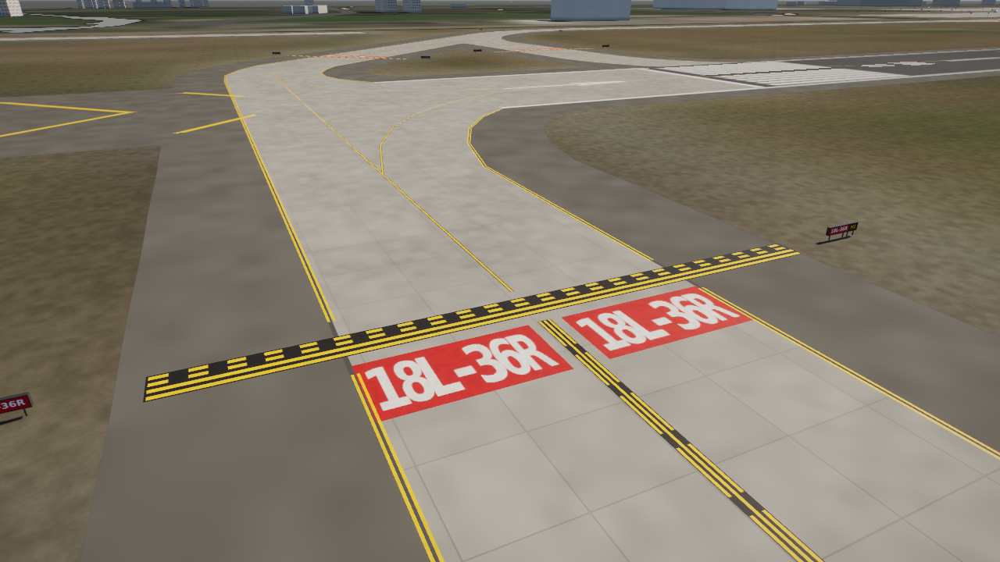
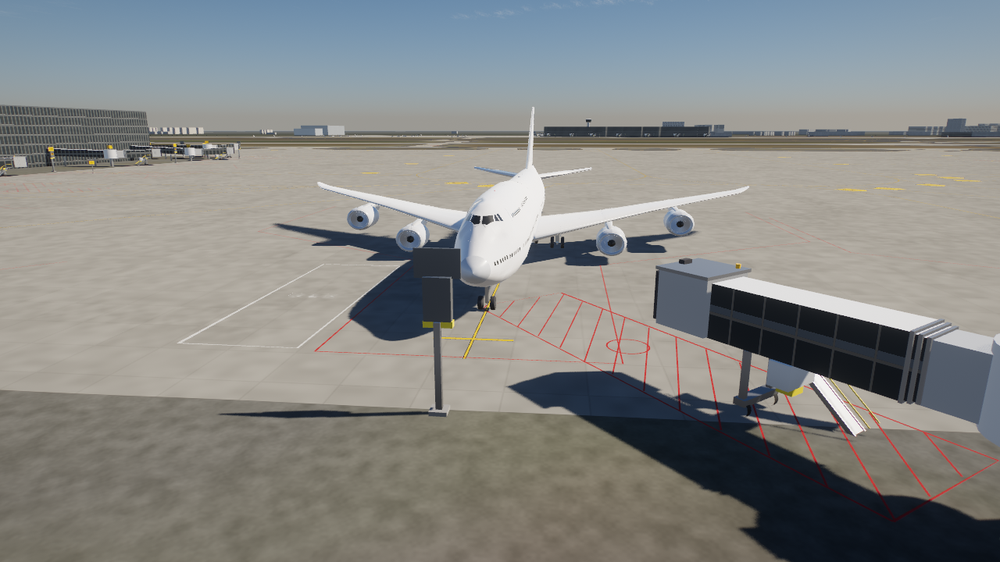
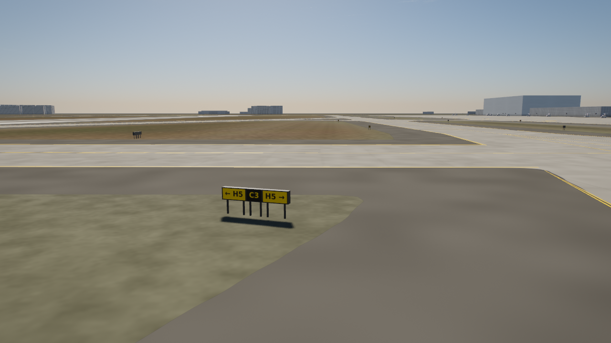

# Phase 2b: CAAC markings and signs (MH 5001-2021)

Date: 2026-11-20. Package P2b of Phase 2 (docs/PLAN.md §7), on the core fork (8ca06f7, docs/phase2/core.md). The earlier
attempt (2026-11-14) left no files in the tree, so this package was written from the core stubs. Nothing in `sfo3d/`,
`pc12/` or `hwd3d/` was modified, and nothing was committed. The plain WebGL2 `live.html` path is used (working default Q7).

Tags: **obs** (seen in a source), **inf** (inferred: a rule, a choice inside a printed range, or a rendering default),
**AIP (mirror)** (short fact from the unofficial AIP mirror, OD3).

## 0. Result

| Layer | What is drawn | Source of the dimensions | Placement |
|---|---|---|---|
| Runway paint (ground shader) | threshold stripes 12 / 16, CAAC designation numerals, displaced-threshold bar and arrows, pre-threshold chevrons on the blast pads, aiming point at the PAPI origin, 5 TDZ pairs per end, centreline, edge stripes cut at 33 taxiway junctions, tyre rubber | MH 5001-2021 6.2.2-6.2.7, 6.2.25, fig. 6.2.2-2 | AIP (mirror) widths, DTHR, pads, PAPI distances; OSM centrelines |
| Taxiway decals | yellow 0.15 m centrelines with 0.05 m black edges on concrete, double edge lines, runway lead-on / lead-off lines 0.9 m clear of the runway CL | 6.2.8, 6.2.14 | OSM taxiways and taxilanes (re-fitted, A1) |
| Holding positions | 38 pattern A (4 OSM + 34 inferred at 90 m), 33 intermediate (OSM nodes on C / D / M4 / M6), 22 enhanced centrelines, 44 painted mandatory markings ("18L-36R" etc.) | 6.2.10-6.2.12, amd. 4 | OSM nodes + taxi graph `hold_inf` |
| Stand and apron decals | 164 lead-ins, 164 stop lines, 151 stand-number plates, 164 stand safety lines (91 hatched overlaps), 56 bridge activity areas, 265 equipment areas with "设备区" | 6.2.16-6.2.20, table 4.13.5 | OSM lead-ins and stop nodes; envelopes inf |
| Signs | 141-145 assemblies, about 260 panels: runway designation + location at pattern A holds, location signs at intermediate holds, direction assemblies at named junctions; internally lit at night | ch. 8, table 8.2.6 | all inf (OSM taxiway refs for the texts) |


## 1. Files

| File | Status | Content |
|---|---|---|
| `js/live/caac_markings.js` | new | **the one parameter table** (`CAAC`): 135 entries, each `[value, 'clause']` or `[value, 'inf: reason']`; the fig. 6.2.2-2 numeral and letter polygons; helpers `stripeLayout`, `tdzPositions`, `tdzPairCount`, `aimStartNoPapi`, `arrowH`, `glyphWidth`, `paramList` |
| `js/live/markings.js` | stub replaced | the extension: runway-paint GLSL (`sha_ground_paint` chunk), numeral signed-distance atlas, per-end uniforms, edge-interruption mask, `buildWorld` (decals + signs), `start` (`SHA.markings`). EDT functions forked from sfo3d@e3218d6 js/world/textures.js |
| `js/live/caac_decals.js` | new, forked from sfo3d@e3218d6 js/live/markings.js | decal shader and ribbon builder (extended with polygons and character quads); taxiway, hold, stand and apron decals; character atlas |
| `js/live/caac_signs.js` | new, forked from sfo3d@e3218d6 js/live/signs.js | sign shader, face atlas, box / panel mesh; CAAC sign content and placement |
| `jobs/markings.mjs` | new | render job: `end:`, `endtop:`, `hold:`, `sign:`, `stand:`, `standm:` (QA model), `plate:`, `view:`, `look:` |
| `docs/phase2/markings.md`, `markings_*.png` | new | this report, 24 renders |

No core file was changed. `js/live/entry.js` already imports `markings.js`.

## 2. The parameter table

`CAAC` has 135 entries: 103 cite a clause, figure or table of MH 5001-2021 (or amendment 4), and 32 are `inf`. Some cited
entries are values we chose inside a printed range; their text says so. `SHA.markings.params()` lists them all. The CAAC PDF stays local
(`refs/cache/standards/`); only short numbers with clause references are in the code.

Inferred choices (all inside the standard's ranges unless stated):

| Item | Choice | Range / reason |
|---|---|---|
| Stripe gap | 1.45 m (45 m runway), 1.575 m (60 m) | "约 1.8 m"; fitted so the outer stripe ends 3 m from the edge (6.2.4-3), as standards_refs.md §1.3 says. The Phase-1 drawing script divided by one gap too many (1.243 m); fixed here |
| Stripe length | 45 m | ≥ 30 m, "宜为 45 m" (6.2.4-3) |
| Numerals | 9 m | ≥ 9 m, up to 2× (6.2.2-4); ZSSS size unknown |
| Centreline | 30 m stripes, 20 m gaps, 0.45 m | 6.2.3-3 / -4 (CAT I) |
| Aiming point | 60 × 9 m; inner gap 18 m (45 m runway) / 22.5 m (60 m) | table 6.2.5 ranges |
| Aiming point start | PAPI distance (AIP mirror): 474 m (18L/36R), 393 m (18R/36L) | 6.2.5-2: the visual approach slope origin; the PAPI position is used as that origin |
| TDZ | pattern A, 22.5 × 3 m, at 150, 300, 600, 750, 900 m (450 m omitted: within 50 m of the aiming point) | 6.2.6; pattern A or B unknown at ZSSS |
| Arrow head | half base h/8, legs h/12, shaft 0.45 m from 2 m behind the tip | fig. 6.2.4 is not fully dimensioned |
| Arrow count | an arrow only if its tail is ≥ 3 m inside the pavement: 1 arrow (100 m DTHR), 5 arrows (300 m) | 30 m arrows, first tip 20 m before the bar (fig. 6.2.4 (b)) |
| Holds | runway hold if ≤ 120 m from the CL, else intermediate | 4.12.6 gives 90 m (CAT I, code 4); the 33 OSM nodes at 182-310 m sit on the parallel taxiways |
| Marking characters | condensed bold sans, advance 0.33 × height | fig. 6.2.12-3 (about 0.28-0.35); two "18L-36R" plates fit a 23 m taxiway |
| Stand envelopes | class reference aircraft (sha_stands.json `class_ref`), wing root at 0.36 L, leading-edge sweep tan 32°, clearance B from table 4.13.5, nose 3.75 m | 6.2.18 + table 4.13.5 note a |
| Stop line | 6 × 0.3 m at the OSM stop node | ≥ 2 × 0.15 m (6.2.16-7) |
| Colours | linear albedos white 0.70, yellow (0.80, 0.52, 0.035), red (0.46, 0.035, 0.03), black 0.022 | App. I chromaticity not modelled |

## 3. Runway paint

The ground-shader hook (`vec4 shaGroundPaint(...)`) loops over the runways and exits early off the runway band. It
draws in runway coordinates: x from the pavement end, y to the right of the landing pilot. Coverage is anti-aliased with
the pixel footprint, and repeating patterns fade to their mean density at distance. Paint is white on both the asphalt
18L/36R and the concrete 18R/36L (no black borders on the runways: 6.2.1-7 says "宜", inf). Yellow is used only for the
chevrons.

| | 18L | 36R | 18R | 36L |
|---|---|---|---|---|
| Width (AIP mirror) | 45 | 45 | 60 | 60 |
| Displaced threshold (AIP mirror) | 100 m | 100 m | 300 m | 300 m |
| Arrows / bar | 1 / 1.8 m | 1 / 1.8 m | 5 / 1.8 m | 5 / 1.8 m |
| Blast pad → chevrons | 60 m, yes | 60 m, yes | 120 m, yes | 120 m (AIP 120 × 75 m = surface), yes: fix round 1 L1 |
| Stripes | 12 × 45 m | 12 | 16 × 45 m | 16 |
| Designation (letter, then number) | L, 18 | R, 36 | R, 18 | L, 36 |
| Aiming point from the DTHR | 474 m | 474 m | 393 m | 393 m |
| TDZ pairs (distance between thresholds) | 5 (3,200 m → 6 positions) | 5 | 5 (2,700 m → 6) | 5 |

- **Layout from the threshold (fig. 6.2.2-1 (b)):** stripes at 6-51 m; 12 m gap; letter at 63-72 m; 6 m gap; number at
  78-87 m; 12 m gap; centreline from 99 m. One stripe rhythm runs from the first end's centreline start to the far end's.
  This places the stripes 6 m beyond the threshold (6.2.4-2). The Phase-1 drawing put them 6 m beyond the 1.8 m bar,
  i.e. 1.8 m further in; the clause text decides here.
- **Numerals:** the CAAC forms of fig. 6.2.2-2 (not a font). I drew the polygons from the printed dimensions; the few
  undimensioned vertices were read off the figure at 400 dpi to about ±0.1 m. "1" has its 0.3 m flag; "4" is 3.9 m wide
  and "7" 3.5 m; "6" and "9" are 9.5 m tall; the digit pair has a 2.2 m clear gap. All 13 glyphs (0-9, L, R, C) go into a
  2,210 × 352 R8 signed-distance atlas: 32 px/m, ±0.6 m spread, built from a 2× raster in about 0.3 s.
- **Edge stripes:** 0.9 m, interrupted where a taxiway surface polygon (`surfaces.taxiway`) reaches 2.5-5 m beyond the
  edge, ±2 m. This gives 16 junctions on 18L/36R and 17 on 18R/36L, held in a 4096 × 4 R8 mask (1 m per texel).
- **END 150 m on 18R/36L** (TORA ends 150 m short of the far pavement end) needs no marking: that pavement is the
  displaced part of the opposite end and carries its arrows. It matters to the lighting package (red stopway lights).
- **Rubber:** streaks along the main-gear tracks from about 120 to 1,250 m past the threshold, over paint and pavement
  (rendering, inf).

 

## 4. Taxiways and holding positions

- **Centrelines** (412 pieces from 299 OSM ways): yellow 0.15 m, with a 0.25 m black underlay off the runways (6.2.8-2;
  the black edge is interrupted on the runway, per the fig. 6.2.8-2 note). Cuts:
  - 0.9 m clear of every holding marking (6.2.8-3);
  - 0.9 m clear of the runway CL stripe at 10 crossings and steep ends;
  - over the runway designation numerals, where the runway marking wins (6.2.1-2).
  36 ends meet a runway CL tangentially (< 35°). These are moved to run parallel 0.9 m clear of the CL stripe and
  continued for 60 m (6.2.8-5), so the lead-on and lead-off lines look as in fig. 6.2.8-2.
- **Edge lines:** two 0.15 m lines with a 0.15 m gap (6.2.14), 52.8 km in all, along the taxiway-polygon boundary
  wherever it borders a shoulder or grass (not along aprons or runways). They are interrupted 0.9 m short of holding
  markings (amendment 4).
- **Pattern A** at 38 runway-holding positions: 4 × 0.3 m lines with 0.3 m gaps, the two runway-side lines dashed
  0.9 / 0.9 m, and a 0.1 m black surround (concrete). Each spans the taxiway plus its shoulders, measured on the 2 m
  pavement map and capped at ±22 m (amendment 4). The positions are the 4 OSM nodes at 88.8-92.2 m and the taxi graph's
  34 inferred holds at 90 m (4.12.6). **Pattern B is not used:** ZSSS is CAT I with one holding position per taxiway
  (6.2.10-3).
- **Exit-only taxiways** (16 holds on arrival-only links: A1-A4, B1-B8, C1-C4) get the pattern A marking only. They get
  no enhanced centreline (amendment 4, 6.2.8-6 2)), no painted mandatory marking and no hold signs. The optional
  "NO ENTRY" markings and runway-vacated signs are not drawn.
- **Intermediate holds** (33 OSM nodes on C, D, M4, M6): single dashed 0.3 m line, 0.9 / 0.9 m, black surround
  (fig. 6.2.11-1).
- **Enhanced centrelines** at the 22 entry holds: 0.15 m side dashes, 3 m dashes with 1 m gaps, 0.15 m clear of the CL,
  over 47 m from the marking, on a black band (fig. 6.2.8-4 (a)). Amendment 4 makes them mandatory; their presence at
  ZSSS has not been observed (inf).
- **Mandatory instruction markings:** one red plate each side of the CL (taxiway ≥ 23 m), 4 m white characters with a
  0.5 m margin, ≥ 1 m from the CL and the hold (6.2.12). The text is the runway designation in the order seen from the
  holding side (e.g. "36L-18R" facing west at H6). These are recommended for runway-incursion prevention (6.2.12-2); the
  ZSSS paint has not been observed (inf).



## 5. Stands and apron

- **Lead-ins:** the 164 OSM lead-in lines (`sha_stands.json` `leadin`) in yellow 0.15 m with a 0.05 m black edge, each
  continued 4 m past the stop node as the alignment line.
- **Stop lines:** 6 × 0.3 m, square to the alignment line, drawn AT the OSM stop node. Since fix round 1 the node is
  the **nose-wheel stop** for every package (6.2.16-7: with guidance the stop line marks the nose-wheel position; gates
  fix round 1 M5): aircraft park with their nose-gear contact on it, and the stand envelopes below are shifted forward by
  the class reference's `class_ref.<cls>.nose_gear_m` (integration fix round 1). The stop-line position itself stays inf
  (the OSM node as mapped).
- **Stand number plates:** yellow pentagon, 5 m body plus a 2 m point, 0.1 m black border, black 4 m numerals
  (fig. 6.2.16-2). Each sits 18 m along the lead-in (or 35 % of a short one), 1 m clear of the line, on the outer side of
  the lead-in's first turn, pointing to the stand. 151 are placed. 13 are skipped: 9 would overlap an overlay /
  alternative stand's plate, and 4 would sit on another lead-in. The gates package draws the stand-number sign boards
  (8.5); these plates are the painted marking (6.2.16).
- **Stand safety lines:** red 0.1 m (6.2.18). Each is a multi-segment line from the class reference aircraft: nose tip
  `nose_gear_m` ahead of the stop node (C 5.07 m, E 6.67 m, EL 5.89 m ...: `sha_stands.json` class_ref); fuselage + B; wing leading edge; wingtip + B, back to the tail + 3 m. B comes from table 4.13.5 (C 4.5 m,
  D-F 7.5 m) and the nose clearance is 3.75 m (note a). Where the line runs inside a neighbour's envelope it is dashed
  (1.0 / 0.5 m), and the overlap of the two envelopes is hatched at 45° (0.1 m lines, 2 m clear): 91 overlaps.
- **Bridge activity areas** (56 contact stands with a bridge): a 9 m band from the rotunda to the docked cab + 2 m, red
  0.12 m outline, 45° hatching 2 m apart, and a 3 m wheel circle at 62 % (inf shape; 6.2.17 / 6.2.20 give the line
  types).
- **Equipment areas** (265): white 0.15 m rectangles beside the fuselage ahead of the wing, outside every stand envelope
  and not on the bridge side, with "设备区" in white 黑体 (6.2.20-1). Size and position are inf.
- **Not drawn (no data):** wingtip clearance lines and apron service roads (no airside road geometry in the data),
  hydrant pits, chock boxes, push-back lines and holding points, taxiway shoulder bars (6.2.15).



## 6. Signs

All sign positions are inferred: no sign position at ZSSS is sourced. Face sizes follow table 8.2.6 for code 3-4:
mandatory signs 400 mm text on a 600 mm face, information signs 300 mm on 450 mm. Each face top is at the 1.1 m maximum
mounting height, on two frangible legs. Assemblies stand 11 m from the 23 m taxiway edge, the table minimum. A footprint
on pavement is pushed out by up to 12 m, otherwise the sign is dropped (85 dropped). The faces are lit internally at night
(8.2.3).

| Assembly | Rule | Count |
|---|---|---|
| Runway designation sign (red, white "18L-36R" in the order seen, 8.3.6) + location sign outboard (black, yellow ref) | both ends of every pattern-A hold except exit-only (8.3.3, 8.3.5, 8.4.2-3 1)) | 44 |
| Location sign with yellow border | intermediate holds, left of each travel direction (8.4.2-3 6)) | 45 |
| Direction assembly: location sign + yellow direction signs, arrows by turn angle, left turns on the left (8.4.3-3 / -6), divider lines | taxi-graph nodes where two named taxiways meet; left side, 60 m before the junction (8.4.3-10, -12), or 15 m before the junction on arms of 35-65 m (8.4.3-11) | 52 (17 of them on short arms) |

Texts use only OSM taxiway refs: a sign with no ref is not drawn, and taxi-guidance signs use Latin characters only
(8.4.1). The runway-vacated, intersection take-off and destination signs and the "HP n" points are not drawn.



## 7. Observed versus inferred

- Every world item carries `src: 'inf'` and `layer: 'markings' | 'signs'`. `SHA.markings.holds()` gives each hold's
  `src`: obs for the OSM node, inf for the 90 m rule.
- **obs:** the standard's dimensions (the table entries with a clause); the OSM centrelines, holds, lead-ins and stop
  nodes; the AIP (mirror) runway facts.
- **inf:** that the paint exists at ZSSS at all, and its exact geometry. None of it is visible in the open imagery
  (Sentinel-2 at 10 m) or in SAR. The photos confirm only the apron style at T2 (§8).
- For the planned Observed/Inferred legend, one line is suggested: *"Markings and signs: CAAC MH 5001-2021 dimensions;
  presence and placement inferred from OpenStreetMap geometry; ZSSS paint not surveyed."*

## 8. Renders (deviceScaleFactor 1) and the T2 photos

`SOFTGL=1 OUT=docs/phase2 PREFIX=markings VIEWS='...' node livetest.mjs jobs/markings.mjs`. The time is 11:00 local
(2026-11-14T03:00Z); the night renders are at 21:30.

| Render | What I checked |
|---|---|
| `markings_rwy_18L.png`, `_36R`, `_18R`, `_36L` | behind each threshold: arrows in the displaced part, 1.8 m bar, 12 / 16 stripes, letter then number, centreline, TDZ, aiming point; edge stripes cut at the junctions; holds with red plates at the crossings (36R) |
| `markings_desig_18L_top.png`, `markings_dthr_36L_top.png` | near-vertical: CAAC "1" with flag, "8" with waist notches, "3", "6"; the 12 m / 6 m / 12 m spacing; CL starting 12 m after the number; 16 stripes with a double centre gap |
| `markings_dthr_18R_arrows_top.png` | 300 m displaced part of 18R: five 30 m arrows 20 m apart, the H-crossing holds 90 m off the CL with mandatory plates, chevrons on the pad |
| `markings_aim_tdz_18L.png` | aiming point (9 m bars) at 474 m past the DTHR; TDZ pairs; rubber; a rapid-exit centreline leaving the runway |
| `markings_runways_far.png` | the same paint from about 4 km: no visible shimmer in the still, chevrons visible |
| `markings_hold_A_H1.png`, `markings_hold_A_H6.png` | pattern A (solid lines on the holding side, dashed on the runway side); "18L-36R" / "36L-18R" in the right order; enhanced CL; edge lines interrupted; signs at both ends |
| `markings_hold_A_exit_A1.png`, `markings_hold_intermediate_C.png` | exit-only: pattern A only; intermediate: single dashed line, CL cut 0.9 m each side, location signs |
| `markings_sign_direction.png`, `markings_sign_hold_H7.png` | "← H5 \| C3 \| H5 →" (location in the middle); "H7 \| 18L-36R" (location outboard on the left) |
| `markings_stand_233.png`, `markings_plate_233.png`, `markings_plate_248.png` | lead-ins with black edges, stop line, pentagon plates readable from the taxilane, safety lines, hatching, equipment areas |
| `markings_stand_248_photo16.png` | QA-only 747-8 (sfo3d model by URL) at T2 stand 248, the type in photo 16 |
| `markings_apron_t2.png` | T2 pier apron from 300 m |
| `markings_night_hold_H1.png`, `markings_night_sign.png` | lit sign faces at 21:30; the paint stays dark (no flood-light positions yet) |
| `markings_phone_hold_H1.png`, `markings_phone_rwy_36L.png` | 390 × 844, iPhone UA, touch, low tier: the same content |

**Comparison with the T2 photos** (`docs/phase1/photos_contact_sheet.jpg`; single photos, obs for that place and date):

| Photo | Seen | In the model |
|---|---|---|
| 16 (2023, 747-8 at a T2 bridge stand) | red stand safety lines; red 45° hatching between the nose and the bridge; a red ring (pit); white equipment rectangles; yellow lead-in with dark edges and short dark-backed stop bars | `markings_stand_248_photo16.png`: red safety line, red-hatched bridge band and wheel circle, white equipment rectangle, yellow lead-in with black edge and stop line. Missing: the pit ring (no pit positions), the several type-coded stop bars (one line drawn) |
| 09 (2013, T2 airside) | a broad red-hatched zone under the bridges; white boxes; a dark asphalt service road with white edges, yellow centre dashes and Chinese text ("双向") | the hatching is drawn as a narrower band (inf); the service road is not drawn (no geometry) |
| 14 (2023, T2) | rows of white diagonal GSE parking stalls on the concrete apron | white equipment rectangles only (no stall rows; inf) |
| 17 (2018, T2 north) | thin yellow taxiway lines on light concrete | 0.15 m yellow with black edges: thin and visible in the same way |

## 9. FAA audit

Search of `sha3d/js` for `1020`, `AC 150`, `5340`, `0.3048` and `FAA`: no FAA marking or sign constant is in any code path.
The remaining hits are:
- the METAR decoder (FAA coding references, the foot constant);
- the labelled lighting stubs (core);
- pressure altitude in `geo.js`.

sfo3d's FAA shader marks, `markings.js` (AC 150/5340-1) and `signs.js` (FAA hold and distance-remaining signs) were
never forked; only geometry helpers were taken, with headers. The core's `js/world/textures.js` still contains sfo3d's
font-based `makeGlyphAtlas` / `glyphCode`. It is generic, nothing imports it, and it was not touched (it is core-owned).

## 10. Cost

| Stage | Time (sandbox, llvmpipe) |
|---|---|
| Runway set-up | 0.45-0.63 s (numeral atlas 0.27-0.34 s, edge mask 0.18-0.29 s) |
| Decals | 0.44-0.55 s |
| Signs | 0.05 s |

The decal mesh has 54 k vertices and 41 k triangles in one alpha-blended item (black, paint and characters layers in that
order, no depth writes). The sign mesh is one opaque item, near pass only. The runway paint adds about 2 texture lookups
and one loop per ground fragment near a runway, and returns at once elsewhere.

## 11. Open issues

1. **Nothing is observed at ZSSS:** the TDZ pattern (A drawn), numeral size (9 m), stripe length (45 m), enhanced
   centrelines, mandatory markings, sign positions and texts. They stay inf until a photo or an official chart shows them.
2. **Stop line vs nose (5 m): closed in fix round 1.** One convention for all packages: the OSM stop node is the
   nose-wheel stop (6.2.16-7); the gates package parks by the nose-gear contact and the envelopes, safety lines, hatching
   and equipment areas here are shifted by `nose_gear_m` (integration fix round 1).
3. **Runway-end lead-on lines** (36 tangential OSM ends) are extended 60 m at 0.9 m clear of the CL. At the runway ends
   they run alongside the designation area (they are cut over the numerals). Whether ZSSS paints them is unknown.
4. **Signs:** 85 candidates had no clear spot within 12 m and 65 arms were shorter than 35 m. Exit signs, runway-vacated,
   "NO ENTRY", intersection take-off, destination and "HP n" signs are not drawn. Junction choice is simple: every
   named-taxiway node, one assembly per arm.
5. **Apron:** wingtip clearance lines and service roads need airside road geometry (not in `sha_airport.json`). Pits,
   chock boxes, push-back lines, type-coded stop bars and taxiway shoulder bars are not drawn. The stand envelopes are
   class reference planforms, not the AIP span limits per stand.
6. **Edge-stripe gaps** follow the 23 m taxiway buffers (with round joins) rather than real fillets.
7. **Runway borders on concrete:** 18R/36L has no black borders (6.2.1-7 "宜", inf). The Sentinel-2 hint cannot tell.
8. **Lighting** (ch. 7: stop bars at the holds, RGL, RWSL, taxiway CL lights) belongs to the lighting package. The hold
   list (`SHA.markings.holds()`, with direction `u` and extents) is ready for it.
9. **Character shapes** for painted text are a condensed system font, not the grid characters of fig. 6.2.12-3. The CJK
   apron text depends on a system CJK font (WenQuanYi here; phones have one).

## Hooks for other packages

- `window.SHA.markings`:
  - `plan()`: the runway marking plan per end (DTHR, pad, aim, TDZ, stripe layout, designation positions);
  - `holds()`: `{id, p, u (towards the runway), kind 'A' | 'intermediate', exitOnly, rwy, ref, text, src, eL, eR}`;
  - `signs()`: sign assemblies;
  - `apron()`: `{equipment, bridge, envelopes}` world rings, e.g. for GSE parking in the equipment areas;
  - `info()`, `params()`, `CAAC`;
  - `setRunwayPaint(on)`.
- `js/live/caac_markings.js`: the CAAC table and helpers, for the lighting package and a later three.js path. Both
  should take dimensions from here rather than re-type them.
- World items: decals `prog 'caacDecal'` and signs `prog 'caacSign'`, both `src: 'inf'`.

## Fix round 1 (2026-11-21)

Findings from `review_visual.md` assigned to this package. Files changed: `js/live/markings.js`, `js/live/caac_markings.js`,
`js/live/caac_decals.js`, `js/shaders/ground.js`, `jobs/markings.mjs`, this report. `js/live/caac_signs.js` is unchanged.
Check renders are in `out/fix1/markings/` (gitignored; `before/` was rendered with the Phase 2 code before any edit, `after/`
with the fixed code); six before / after composites are in `docs/phase2/fix1_markings_*.png` (all from deviceScaleFactor 1
renders, 1280 × 720 or 390 × 844). Snapshot mode console: `SCENES=snapshot jobs/integration.mjs` -> 0 errors, 0 warnings,
0 page errors. None of the no-browser tests in `CLAUDE.md` touches these files; the four modules pass `node --check`.

| Id | What changed | Evidence | Status |
|---|---|---|---|
| H1 | **Directional anti-aliasing footprints.** `js/shaders/ground.js` now takes `dFdx / dFdy(wp.xz)` in `main()` (uniform control flow) and passes them to the paint hook, whose signature is now `shaGroundPaint(wp, fw, dxy, apt, paved, rough)`. In `markings.js` every runway projects them on its axis `d` and normal `n` (`jx`, `jy` = d(s, t) per screen pixel), and every edge is smoothed over 0.6 × the footprint **along its normal**: along-track `fwS` for stripe ends, CL dash ends and their fade, bar, TDZ and aiming-point ends; across-track `fwT` for stripe sides, the stripe fade to mean density (`smoothstep(0.45, 1.1, fwT)`), CL width, edge stripes, TDZ / aiming-point sides, arrow shafts; the leg normal for chevrons and arrow-head legs. The numerals / letters use the footprint along the signed-distance gradient (finite difference over one footprint, `textureLod` at the footprint's minor axis, no implicit derivatives in the branch), and the clamped part of the field (beyond ±0.6 m) gets no coverage, so large footprints no longer paint a grey box. Stripes and CL dashes use centred coordinates (symmetric edge ramps). All values `inf` (rendering choices, not dimensions). | `fix1_markings_stripes.png`: the four `rwy:` views (1280 × 720) now show **6 + 6 = 12** stripes at 18L and 36R and **8 + 8 = 16** at 18R and 36L, counted in the renders (before: two solid blocks each); the letter and number read as separate glyphs (they are only 3-4 px tall at 420 m, so legible only as shapes). `fix1_markings_phone.png`: the same counts at 390 × 844 (`MOBILE=1`), 36L 16 and 18L 12 (before: blocks). `fix1_markings_water_far.png` (lower part): `end:36R,800,3000,4` from 3 km: edge stripes, CL dashes and TDZ now visible where the old paint was a blur; no moiré. Shimmer proxy: two renders 0.7 m apart, runway window mean \|Δ\| 0.13 -> 0.17 grey levels, p95 1 -> 1, while the paint contrast (std) rose 17.8 -> 20.2. | fixed |
| M4 | **Runway markings win over lead-on lines** (6.2.1-2). `caac_decals.js` `rwyMarkWins(p)` replaces the numeral-only cut: taxiway lines are cut over the designation numerals (as before) and kept 0.9 m clear (the 6.2.8-3 clearance from the runway CL, applied to the CL arrows that stand in for it and to the bar, `inf`) of the displaced-threshold arrow heads and shafts and of the 1.8 m threshold bar; slivers under 1.5 m (3 m for the 60 m parallels) are dropped. **Only lead-ons in a displaced portion's take-off direction** keep their 60 m parallel: 4 of 36 point towards the pavement end (18R/36L, s = 99 and 3191 m, both sides) and are dropped (`info.decals.centrelines.leadOnsDroppedInDisplacedPortion`); their curves remain up to the arrow cut. | `fix1_markings_rwy_36L.png`: before, two yellow lines through the arrow heads; after, the lines stop short of each head and run 0.9 m clear of the shafts; the top view of the 36L displaced portion shows no yellow over arrows or bar. `after/a2_endtop_18R_40_330.png`: 18R bar and arrow clear. | fixed |
| M6 (shader) | Water body albedo 0.016 / 0.022 / 0.016 -> **0.050 / 0.060 / 0.045** (turbid green-brown), Fresnel with a **0.06 floor** (`mix(0.06, 1, (1 - N·V)^5)`), body weighted by (1 - F). Water with full coverage (wider than ~10 m) gets the full term; narrow drains (peak coverage < 0.9 in the 4 m map) stay body-only as before. `inf` rendering values. The dotted bank-kerb outlines are geometry in `terminals.js` (buildings package). | `fix1_markings_water_far.png`: overview pond (28, 35, 32) -> **(58, 66, 58)** sRGB at midday, close to the far rivers (47, 63, 76) and greener; the canals at grazing angle still pick up the sky, with a smaller jump. | fixed (shader part) |
| M1 (a) | Apron night flood 0.06 -> **0.42 × albedo**, warm tint (1.0, 0.82, 0.6), varied by ±12 % over ~2 km and ±7 % over ~150 m: `APRON_FLOOD` / chunk `sha_apron_flood` in `js/shaders/ground.js` (`inf`, chosen against photos 12, 13, 19, 20; no fixture positions). The decal shader uses the same chunk (apron map from the ground uniforms), so lead-ins, safety lines and 设备区 boxes are lit like the apron. Runway / taxiway / stop-bar lighting is Phase 5 and not added. | `fix1_markings_night_apron.png` (21:30): apron concrete (22-28 grey) -> **(100-121, 87-106, 68-84)** sRGB, apron paint readable. Parked aircraft and GSE are not lit by the flood (other shaders: handoff). | partly (a done; b, c are Phase 5 / view-set decisions) |
| L1 | **One source per end:** the chevrons cover the paved pad surface drawn by the ground (`runways[].blast_pads` ring, via `js/geo.js` `blastPads`), with `aip_facts.blast_pad_m` only as a fallback. Reason: 6.2.25 marks the pre-threshold pavement "在跑道入口前的全长" (over its full length), and at 36L the paved surface is measured at 120 m (S2, two scenes, and Umbra agree within 3 m: `data/meas/rwy_ends.json`), whereas the AIP (mirror) gives 75 m (probably the declared blast pad only). 18L, 36R (60 m) and 18R (120 m) agree with the AIP. `SHA.markings.info()` carries `padSrc` per end, and the 36L entry states the conflict. | `fix1_markings_pads.png` top: 36L chevrons now cover the whole 120 m pad (before: the inner 75 m only). | fixed (doc corrections in airport.md / standards_refs.md: handoff) |
| L10 | **Fig. 6.2.25 re-read** (300 dpi from the local copy): the last full chevron's apex is X/2 + X/4 before the line where the marking ends, so the nearest chevron is cut by that line. Only its outer legs, X/4 long, are painted, and its apex would lie X/4 inside the runway. The far end is cut ≤ 1.5 m from the pavement edge, and 0 ≤ W − X ≤ 15 m. **The Phase 2 offset is right** (`chevronLastLegFromThr` = X/4; the table comment now says why). New: no chevrons where taxiway / apron pavement crosses the pad (airfield map G channel > 0.5; the 18L end taxiway reaches ~4 m onto the pad; 18R and 36L have small overlaps, 36R none). | `fix1_markings_pads.png`: 18L pad, cut legs X/4 next to the pavement end, then full chevrons at 30 m; zoom: before, the legs ran onto the taxiway pavement; after, they stop at its edge. | fixed |

Other effects: the decal build takes about 0.58 s (was 0.44-0.55 s). There are now 416 centreline pieces (was 412) and 32 lead-on
parallels (36 tangential ends: 4 dropped). `jobs/markings.mjs` has a new `thr:<end>` view (the app's threshold view, same as
`views.mjs rwy:`) for the stripe count. Commands:

```
SOFTGL=1 OUT=out/fix1/markings/after PREFIX=a1 T=snapshot VIEWS='rwy:18L;rwy:36R;rwy:18R;rwy:36L' node livetest.mjs jobs/views.mjs
SOFTGL=1 MOBILE=1 W=390 H=844 OUT=out/fix1/markings/after PREFIX=a2phone T=snapshot VIEWS='rwy:36L;rwy:18L' node livetest.mjs jobs/views.mjs
SOFTGL=1 OUT=out/fix1/markings/after PREFIX=a2 VIEWS='end:36R,800,3000,4;end:36R,800.7,3000,4;endtop:18L,-90,330;endtop:36L,-360,480;endtop:36L,-150,300;endtop:18R,40,330' node livetest.mjs jobs/markings.mjs
SOFTGL=1 OUT=out/fix1/markings/after PREFIX=a2n T=2026-11-20T13:30:00Z VIEWS='park:229+230+231+233+234;t2pier@night_t2pier;stand:233,-,70,1,24@night_stand_233' node livetest.mjs jobs/views.mjs
SOFTGL=1 OUT=out/fix1/markings/after PREFIX=a3 T=snapshot VIEWS='overview;t2' node livetest.mjs jobs/views.mjs
SOFTGL=1 SCENES=snapshot node livetest.mjs jobs/integration.mjs
```

Open after this round: the numerals stay small in the threshold view because they are 9 m long and only 3-4 px tall at
420 m. The ZSSS numeral size is not observed; 6.2.2-4 allows up to 2 ×. The apron flood is uniform until floodlight masts
exist (M2). Aircraft and GSE are dark against the lit apron at night.

### Integration notes (fix round 1, 2026-11-21)

- **L1 correction.** `aip_facts.blast_pad_m` is [length, width] at both ends (AIP (mirror) AD 2.12: "120×75m on the both
  ends" for 18R/36L, "60×60m" for 18L/36R), not one length per end. The Phase 2 code (and the L1 fix's `padAip`) read
  index [1] = 75 m (the pad width) as the 36L length; that was the whole "36L conflict". `runwayPlan` now reads [0] at
  both ends. Nothing on screen changes (the chevron length is the surface ring, 120 m at 18R and 36L), but `padSrc` for
  36L now reads "paved pad surface 120 m = AIP (mirror) 120 m". No conflict was recorded in airport.md; it notes the
  length × width reading instead, and standards_refs.md §1.3 / §1.4 have the fig. 6.2.25 reading.
- **Stand envelopes on the nose-wheel convention** (gates hand-off): `buildStands` shifts each class planform forward by
  `class_ref.<cls>.nose_gear_m`, so the red nose-clearance line no longer crosses a parked aircraft's nose. The stop line,
  lead-in and alignment line stay at the stop node. The gates package's equipment-area idle stairs and the masts (which
  avoid the painted envelopes) read the shifted rings; see integration.md for the counts.

## Fix round 2 (2026-11-21)

Findings from `review_visual_fix1.md` assigned to this package: N2, M1 (with N4, which M1 points to) and M4 (with N8,
which M4 points to). Files changed: `js/shaders/ground.js`, `js/live/markings.js`, `js/live/caac_markings.js`,
`js/live/caac_decals.js`, `jobs/markings.mjs`, this report. `js/live/caac_signs.js` is unchanged. Check renders are in
`out/fix1/markings2/` (gitignored). `before/` was rendered with the fix round 1 code. For the night "before" state I used the
reviewer's own renders (`view_night_*.png`, `out/review1/night/`). `after/` was rendered with this round's code; the
buildings fixer's concurrent edits (fill rings, object flood) are in those renders too. Four composites are
`docs/phase2/fix2_markings_*.png`, all from 1280 × 720 renders at deviceScaleFactor 1. Console: `SCENES=snapshot,park
jobs/integration.mjs` -> both scenes clean (0 errors, 0 warnings, 0 page errors, 0 failed requests). The four night and
five day runs below logged no warning either. None of the no-browser tests in `CLAUDE.md` touches these files; all five
modules pass `node --check`.

| Id | What changed | Evidence | Status |
|---|---|---|---|
| N2 | **The airside fill is lit at night.** A new **apron light map** is built in `markings.js` (`apronLightMap`, `groundUniforms`): RG8, 4 m per texel over the airfield-map rect. **R = lit area**: the aprons, plus any airside pavement that packages add through the `pavement()` hook. That pavement is found as `pavedAt` ≥ 0.5 with no core surface (runway, shoulder, blast pad, taxiway, helipad, apron) within one texel, so it is the T1 / T2 fill today (0.084 km², 5,256 texels) and any fill ring the buildings package adds later. R also carries a Gaussian spill past the area's edge (16 m: 0.2 at 20 m, 0.03 at 30 m, exact EDT). The approach is generic, so it does not depend on how `sha_buildings3d.json` stores the fill. `shaApronFlood` (chunk `sha_apron_flood`, same signature) now uses `lit = max(apron, R)` when `uApLightOn` = 1. Without the map (a program that does not set the uniform), it falls back to the fix round 1 flood. The decal shader uses the same uniforms, so paint on the fill is lit. Its flood sample now runs in uniform control flow (the rect test multiplies). All values are inf (`CAAC.apronFlood`). | `fix2_markings_night_fill.png`. T2 pier fill at 21:30: (32, 28, 21) -> **(73, 64, 51)** sRGB mean, and (39, 34, 28) -> (84, 74, 60) on the north side (`after/a3n_night_t2pier.png`). Under the stand 233 bridge: (0, 0, 1) -> **(59, 51, 42)** (`after/a3n_night_stand_233.png`). The fill reads as lit, darker asphalt beside the concrete. The difference is the albedo (0.085 against 0.30), not the light. | fixed |
| M1 (with N4) | **The flood is no longer one even sheet with a hard polygon edge.** (1) The R spill gives a ~20-30 m soft edge onto the taxiway and the grass beyond the apron. (2) **G = mast pools.** In the first frame after the gates package has placed its masts (its `start()` runs after ours, so the `frame` hook reads `SHA.qa.masts()` once), `applyMastPools` sums `1 / (1 + (d / 60 m)²)` over the 73 masts. Each pool is centred 25 m ahead of its mast along its facing and truncated continuously at 360 m. The sum is normalised to the mean over the painted stand envelopes (9.2.6: the stand average is the reference), clamped to [**0.5** (9.2.6-2: other apron areas ≥ 50 % of the stand average, which also meets the 4:1 avg:min uniformity of 9.2.6-1), 1.8] and scaled by one gain so that the mean over the lit area stays at the fix round 1 level (the reviewer measured and accepted that level). The page reports gain 1.276, stand mean ×1.28, lit minimum ×0.64, maximum ×2.30. The cost is paid once: the map takes about 120 ms at build, the pools about 95-145 ms in their first frame. The texture is updated in place, so every holder of the reference sees it (the buildings package's object flood reads the same map, `objects.js shaObjFlood`). Sums from neighbouring masts give each stand light from more than one direction, in the spirit of 9.2.2. `SHA.markings.apronLight()` returns the statistics and `at(x, z)` → [lit, factor]. `jobs/markings.mjs` prints them. N3 (unlit aircraft) belongs to other packages; the buildings fixer's object flood is visible on GSE and bridges in the after renders, but the aircraft are still dark. | `fix2_markings_night_pools.png` (east apron from 900 m): before, one flat tone (p5 / p50 / p95 = 81 / 94 / 103 on the open apron). After, pools around the mast rows and a dimmer apron between them (T2 view open apron p50 94 -> 70, pools p95 up to 133-144). Column profile across the lower apron edge: 65 -> 1 within 8 px before, 55 -> 14 -> 2 after. | partly (N2 and N4 parts fixed; aircraft lighting, N3, is outside this package) |
| M4 | **Inner crossings at 36L / 18R.** A node probe that replicates the lead-on logic against `sha_airport.json` (scratch, not committed) shows that the parallels beside the arrow shafts between s = 3177-3237 (36L) and 65-125 (18R) are **not** the backtrack pair's. They are the 60 m take-off-direction parallels of the **outermost** lead-ons (36L s = 3237 heading north, 18R s = 65 heading south: 6.2.8-5, allowed). The backtrack pair (s = 3191 / 99, heading towards the pavement end; already without a parallel) was clamped onto the same 0.9 m line at its tangent point, so it merged into those parallels and read as a curve continuing towards the pavement end. The reviewer's "outermost crossings s = 99 / 3191" are the second crossings; the outermost are at 65 / 3237. Fix: `leadOnAllowed` is now applied **before** the clamp. A backtrack curve is no longer clamped onto the 0.9 m offset; it is cut where it comes within 0.9 m (`CAAC.taxiway.backtrackClear`, inf, the 6.2.8-3 clearance by analogy) of that line, within 40 m of its tangent point. Counter: `backtrackCurvesStoppedClear` = 4. | `fix2_markings_leadons.png` (80 m top views, `before/b_endtop_36L_-200_80.png` vs `after/a2_endtop_36L_-200_80.png`, and the same for 18R). Before, both backtrack curves ran into the lead-on line. After, they end visibly short of it, and the only parallels are the outer pairs'. The 300 m views requested by the reviewer are `after/a2_endtop_36L_-150_300.png` and `a2_endtop_18R_-150_300.png`. At that scale (3 px per m) the difference is a few pixels; the 80 m pair is the readable evidence. | fixed |
| N8 (part of M4) | **Continuous across threshold marking (6.2.8-3, fig. 6.2.8-2).** `rwyMarkWins` now cuts only at the designation numerals (6.2.1-2). The threshold bar and the arrow legs / shafts are no longer cut. The take-off parallels therefore cross the arrow-head legs in the displaced portions (as the clause requires), and crossing centrelines run over the 1.8 m bar. Recorded in `caac_markings.js` as `taxiway.crossThreshold` (6.2.8-3), `cutAtDesignation` (6.2.1-2) and `backtrackClear` (inf). Centreline pieces 416 -> 408. | `fix2_markings_thr_bar.png`: 18L before (gap 0.9 m above and below the bar), after (continuous); the "L" cut above the stripes is unchanged. | fixed |

Hand-offs: none required. The light-map uniforms (`uApLight`, `uApLightRect`, `uApLightOn` in `app.world.groundU`) and
`APRON_FLOOD.gScale` (2.5) are a stable interface. The buildings package already reads them in `objects.js` / `app.js` for
the object flood, and the aircraft programs can do the same. Keep the texture reference: it is updated in place.

Commands (from `sha3d/`):

```
SOFTGL=1 OUT=out/fix1/markings2/before PREFIX=b VIEWS='endtop:36L,-150,300;endtop:36L,-120,110;endtop:18R,-120,110' node livetest.mjs jobs/markings.mjs
SOFTGL=1 OUT=out/fix1/markings2/before PREFIX=b VIEWS='endtop:36L,-200,80;endtop:18R,-200,80;endtop:18R,-150,300' node livetest.mjs jobs/markings.mjs
SOFTGL=1 OUT=out/fix1/markings2/after PREFIX=a2 VIEWS='endtop:36L,-150,300;endtop:36L,-200,80;endtop:18R,-150,300;endtop:18R,-200,80;endtop:18L,30,160' node livetest.mjs jobs/markings.mjs
SOFTGL=1 OUT=out/fix1/markings2/after PREFIX=a3n T=2026-11-20T13:30:00Z VIEWS='park:229+230+231+233+234;t2pier@night_t2pier;stand:233,-,70,1,24@night_stand_233;look:600,2.5,-300,250,22,900@night_east_apron;look:-760.58,2.5,-138.65,250,30,260@night_233_far' node livetest.mjs jobs/views.mjs
SOFTGL=1 OUT=out/fix1/markings2/integ SCENES=snapshot,park node livetest.mjs jobs/integration.mjs
```

Open after this round:
- The fill is asphalt, and lit asphalt stays darker than lit concrete. Photos 13 / 19 show this band as the brightest part
  of the apron, which the albedo of the fill (buildings N6) would have to answer. The mast pools are as good as the
  inferred mast positions (gates N5: they move between quality tiers, and the pools follow them).
- The light map has 4 m texels. Where the fill meets grass its edge is soft, not the crisp 1 m edge of the apron; the
  spill hides most of it. Aircraft and bridges cast no shadow in the flood (the masts are not shadow casters).

## Fix round 3 (2026-11-27)

Findings from `review_visual_fix2.md` assigned to this package: **V1** (medium), **V6** (low) and the stale "73 masts"
comment. Files changed: `js/live/markings.js`, `js/live/caac_markings.js`, `js/live/caac_decals.js`, `js/shaders/ground.js`
(comments and the flood `src` string only; the GLSL is unchanged), `jobs/markings.mjs`, this report. `js/live/caac_signs.js`
is unchanged. Check renders are in `out/fix3/markings/` (gitignored), all SOFTGL, 1280 × 720, deviceScaleFactor 1. The
"before" state is the review's: the committed `view_night_stand_233.png`, `view_night_t2pier.png`, `view_rwy_36L.png`,
`view_rwy_18R.png` and the reviewer's `out/review2/night/rvn_night_east_apron.png` and probe (`out/review2/day/rv_probe.json`).
The gates fixer moved masts while I worked (67 masts at my first after-runs, 59 at the final ones); the final renders and
tables below are with 59. Four composites: `docs/phase2/fix3_markings_night_233.png`, `fix3_markings_night_t2pier.png`,
`fix3_markings_lightmap.png`, `fix3_markings_backtrack.png`. Console: `SCENES=snapshot,park jobs/integration.mjs` -> both
scenes clean (0 errors, 0 warnings, 0 page errors, 0 failed requests); every render run below logged no warning or error.
All six owned modules pass `node --check`; `node tools/buildings/test_buildings3d.mjs` (it reads `caac_markings.js`) passes.

| Id | What changed | Evidence | Status |
|---|---|---|---|
| V1 | **Stands are held to the stand level; the 0.5 floor is only for the rest of the apron** (MH 5001-2021 9.2.6-1 / -2, read again in the local copy: 9.2.6-1 "机位上" horizontal ≥ 20 lx, avg:min ≤ 4:1; 9.2.6-2 other apron ≥ 50 % of the stand average). `applyMastPools` (`markings.js`) now builds a **stand mask**: the painted envelopes, bridge areas and equipment areas (`SHA.markings.apron()`), plus the package-added airside pavement (T1 / T2 airside fill, stand-head fill; `apronLightMap` now keeps it as `addedPav`, including the one-texel rim next to the apron) within `standFillR` 60 m of a contact-stand node (58 stands with `contact` or bridges): the ground under the bridges. Floors: painted stand texels ≥ `standFloor` 1.0 × the reference (the mean of the mast pools over the envelopes, as before); the fill under the bridges ≥ `standFillLevel` 1.25 × the stand mean S; every other texel ≥ `floor` 0.5 × S, where S is the envelope mean **after** the stand floor (so 9.2.6-2 is met against the stands as lit). The floor field is max-dilated and box-blurred by `standEdge` 12 m (the raised level falls off over ~24 m past an outline instead of stepping at the painted line; never lowered inside it). The gain is recomputed so that the mean over the lit area stays at the fix round 1 level. The stored G is rounded **up** so the floors hold in the 8-bit map. Nothing here depends on where the masts are: with no mast near a stand it sits at exactly the stand level. New table entries (`CAAC.apronFlood`): `standFloor` (1.0, inf: 9.2.6-1, the clause prints 20 lx and 4:1, no floor relative to the pools), `standFillLevel` (1.25, inf: ≥ 1.0 by 9.2.6-1, the extra 0.25 chosen against photos 13 / 19, obs: the band under the bridges is the brightest part of the apron at night), `standFillR` (60, inf), `standEdge` (12, inf); `floor` keeps 9.2.6-2 and now says where it applies. Also fixed: `SHA.markings.apronLight().at(x, z)` returned G × 2, i.e. 0.8 × the shader's factor (gScale is 2.5); it now returns `[lit, factor = G × gScale, stand flag (1 painted stand, 2 fill under bridges, 0 other)]`. The reviewer's probe values ("0.50" at the floor nodes) were in the old scale: those nodes were at 0.63 = 0.5 × the gain 1.259. New stats in `apronLight().masts`: `standLevel`, `standMeanFactor`, `standFillFloorFactor`, `otherFloorFactor`, `otherMeanFactor`, `check926`. `jobs/markings.mjs` waits for the pools and prints the stand-floor summary, and with `LIGHTTABLE=1` the per-stand table from `apronLight().at(stop node)`; it also takes `park:` views. | **Per-stand table** (`LIGHTTABLE=1`, 59 masts): standLevel 1.118, stand mean 1.273, other-apron floor 0.636, gain 1.114; **0 of 164 stand nodes below the stand level** (30 exactly at it, min 1.118, median 1.343, max 1.882), every node on a stand texel. The 18 the review listed (14 at the old floor, 4 within 0.05): 110 1.44, 111 1.17, 112 1.39, 121 1.24, 126 1.18, 231 1.00, 232 1.19, 233 1.27, 234 1.30, 250 1.36, 262 1.29, 263 1.36, 333 1.36, 334 1.14, 335 1.09, 336 1.54, 337 1.20, 413 1.00 (× the stand level). Same result with the 67-mast placement earlier in the round (standLevel 1.098, 0 below), so the floor does not follow the masts. `check926`: stands avg:min 1.14, other apron avg:min 1.38, other min / stand mean 0.500. **Named night views** (21:30, `park:229+230+231+233+234`): `view_night_stand_233` framing (`a5n_night_stand_233.png`), fill under the 233 bridge (31, 27, 22) -> **(69, 60, 50)** sRGB (patch x 100-200, y 480-530; (32, 28, 22) -> (70, 61, 51) at x 270-320, y 470-520), above the (59, 51, 42) target; the 233 envelope (92, 80, 63) -> (139, 124, 99), now the brightest ground in the frame (taxilane far side (85, 73, 57), apron right (110, 96, 76)). `view_night_t2pier` framing (`a4n_night_t2pier.png`): pier-tip fill, median of the 17,092 px that were the dark band, (30, 25, 20) -> **(62, 54, 44)**. In light-map terms the viewed stands are no longer the darkest: the fill under the bridges is at 1.58 and the envelopes ≥ 1.12, against 0.64 on the open apron. Pixel-wise the asphalt band (albedo ~0.085, photo 09 shows asphalt there) still reads darker than lit concrete (0.30). East apron from 900 m (`a4n_night_east_apron.png` vs the reviewer's render): luminance p5 / p50 / p95 54 / 66 / 122 -> 55 / 84 / 106; the pools are flatter because more of the apron is stand, and the edges are still soft. Cost: the pool pass is 215-240 ms once, on the first frame after the masts (was 68-145 ms). | fixed |
| V6 | **Backtrack curves stop at the runway edge** (`CAAC.taxiway.backtrackStop` = 'runway edge', inf, recorded next to `backtrackClear`; option 2 of the review's three, with 6.2.1-2 "runway markings win on the runway" by analogy; ZSSS paint not observed). In a displaced portion, a lead-on curve that meets the runway CL heading towards the pavement end (4 at 18R/36L, `leadOnsDroppedInDisplacedPortion`) is now cut where \|t\| < the runway half width (30 m at 18R/36L), within `backtrackReach` 150 m (inf) of its tangent point, instead of 0.9 m short of the lead-on line. Its taxiway part up to the edge stays; the outer pairs' take-off parallels (6.2.8-5) are unchanged. `backtrackClear` (0.9 m) remains only as the lower bound. `info().decals.centrelines.backtrackStop` reports it. | `fix3_markings_backtrack.png`, app threshold views `jobs/markings.mjs thr:36L` / `thr:18R` (`a3_thr_36L.png`, `a3_thr_18R.png`, T=snapshot) against `view_rwy_36L` / `view_rwy_18R`. Yellow-pixel count on the runway below the inner crossing line (columns of the take-off parallels masked): 36L 307 -> **0**, 18R 288 -> **0**. The curve ends now lie ~100 px left and right of the parallels (28.8 m from the lead-on line on the ground), where they met them before with a 1-2 px gap. Top views `a3_endtop_36L_-150_300.png` / `a3_endtop_18R_-150_300.png`: the downward curves of the inner crossing end at the runway edge, the upward (take-off) curves and the outer parallels are as before. | fixed |
| "73 masts" | `caac_markings.js` `apronFlood` comment no longer gives a mast count ("their number and places are the gates package's, read at run time"). | `grep 73 js/live/caac_markings.js` -> nothing. `caac_markings.js` feeds the provenance hash of `data/sha_buildings3d.json`: see hand-offs. | fixed (hand-off for the data hash) |

Hand-offs (files I do not own):
- **Data provenance hash** (lead / buildings): re-run `python3 -I tools/buildings/build_buildings3d.py` and check that only
  the provenance hash (`inputs_sha256_16`) of `data/sha_buildings3d.json` / `.js` changed. `caac_markings.js` changed in this
  round (comment, `apronFlood.standFloor / standFillLevel / standFillR / standEdge`, `taxiway.backtrackStop / backtrackReach`),
  but not the values the tool parses (`stand.clearB`, `noseE`, `classLetter`).
- **`sha3d/CLAUDE.md`** (lead), Conventions: the ground-shader bullet should say the light map holds the stands at the stand
  level (`CAAC.apronFlood.standFloor` 1.0 × the reference, 9.2.6-1; fill under contact-stand bridges `standFillLevel` 1.25 ×
  the stand mean; other apron 0.5 × the stand mean, 9.2.6-2; soft edge `standEdge` 12 m), independent of the mast places;
  `apronLight().at(x, z)` -> `[lit, factor (G × gScale), stand flag]` (it was G × 2). The taxiway bullet should say that
  backtrack curves in a displaced portion stop at the runway edge (`CAAC.taxiway.backtrackStop`, inf), not 0.9 m short.
- **Reviewer's probe** (`out/review2/rv.mjs`): `L.at()[1]` is now the shader factor (× 1.25 against the old reading). Compare
  against `apronLight().masts.standLevel`, or use `jobs/markings.mjs` with `LIGHTTABLE=1`.
- Optional (buildings, N6): the airside fill under the bridges is asphalt (photo 09 agrees), so it stays darker than lit
  concrete at night. If the owner wants the photo 13 / 19 look (that band the brightest), the remaining lever is lighting
  from fittings the model does not draw (terminal face, bridge floods), not albedo.

Commands (from `sha3d/`):

```
SOFTGL=1 OUT=out/fix3/markings/after PREFIX=t T=2026-11-20T13:30:00Z LIGHTTABLE=1 VIEWS=';' node livetest.mjs jobs/markings.mjs   # per-stand table, ~15 s
SOFTGL=1 OUT=out/fix3/markings/after PREFIX=a4n T=2026-11-20T13:30:00Z VIEWS='park:229+230+231+233+234;t2pier@night_t2pier;stand:233,-,70,1,24@night_stand_233;look:600,2.5,-300,250,22,900@night_east_apron' node livetest.mjs jobs/views.mjs
SOFTGL=1 OUT=out/fix3/markings/after PREFIX=a5n T=2026-11-20T13:30:00Z VIEWS='park:229+230+231+233+234;stand:233,-,70,1,24@night_stand_233' node livetest.mjs jobs/views.mjs
SOFTGL=1 OUT=out/fix3/markings/after PREFIX=a3 T=snapshot VIEWS='thr:36L;thr:18R;endtop:36L,-150,300;endtop:18R,-150,300' node livetest.mjs jobs/markings.mjs
SOFTGL=1 OUT=out/fix3/markings/integ SCENES=snapshot,park node livetest.mjs jobs/integration.mjs
python3 -I out/fix3/markings/compose.py                                   # the fix3_markings_*.png composites
```

Per-stand light at the stop node, × the stand level (59 masts; `c` = contact stand), from `out/fix3/markings/after/log_table_final.txt`:

```
101 1.097c · 102 1.263c · 109 1.053c · 110 1.439c · 111 1.167c · 112 1.386c · 113 1.114c · 114 1.175c · 115 1.175c · 120 1.237c · 121 1.237c · 126 1.175c
127 1.237c · 212 1.000 · 213 1.026 · 214 1.184 · 215 1.430 · 216 1.412 · 217 1.219 · 218 1.000 · 219 1.000 · 220 1.088 · 221 1.237c · 222 1.246c
223 1.237c · 224 1.412c · 225 1.509c · 226 1.368c · 227 1.325c · 228 1.281c · 229 1.175c · 230 1.272c · 231 1.000c · 232 1.193c · 233 1.272c · 234 1.298c
235 1.202c · 236 1.044c · 237 1.211c · 238 1.237c · 238A 1.000c · 239 1.026c · 240 1.000c · 240A 1.360 · 246 1.316c · 248 1.237c · 250 1.360c · 256 1.132c
257 1.237c · 258 1.061c · 259 1.000c · 259A 1.167c · 260 1.175c · 261 1.044c · 262 1.290c · 263 1.360c · 264 1.360c · 265 1.290c · 266 1.097c · 267 1.237c
268 1.272c · 269 1.368c · 270 1.175c · 271 1.254c · 272 1.333c · 273 1.175c · 274 1.509c · 275 1.561c · 276 1.623 · 277 1.570 · 278 1.456 · 279 1.430
280 1.483 · 281 1.676 · 282 1.588 · 283 1.061 · 284 1.097 · 285 1.026 · 286 1.000 · 287 1.000 · 288 1.000 · 289 1.097 · 290 1.105 · 301 1.377
302 1.439 · 303 1.281 · 304 1.246 · 305 1.368 · 306 1.307 · 307 1.193 · 308 1.000 · 309 1.000 · 310 1.000 · 311 1.000 · 312 1.000 · 313 1.070
314 1.053 · 315 1.202 · 316 1.061 · 317 1.211 · 318 1.184 · 319 1.404 · 320 1.447 · 321 1.404 · 322 1.167 · 323 1.316 · 324 1.254 · 325 1.211
326 1.553 · 327 1.219 · 328 1.140 · 329 1.167 · 330 1.175 · 331 1.430 · 332 1.167 · 333 1.360 · 334 1.140 · 335 1.088 · 336 1.544 · 337 1.202
338 1.570 · 339 1.667 · 340 1.684 · 341 1.561 · 342 1.246 · 401 1.000 · 402 1.184 · 403 1.325 · 404 1.465 · 405 1.465 · 406 1.202 · 407 1.175
408 1.193 · 409 1.202 · 410 1.061 · 411 1.000 · 412 1.000 · 413 1.000 · 501 1.000 · 502 1.000 · 504 1.000 · 506 1.000 · 508 1.000 · 510 1.000
511 1.000 · 517 1.167 · 518 1.307 · 519 1.474 · 520 1.570 · 521 1.561 · 522 1.491 · 523 1.333 · 524 1.053 · 525 1.000 · 601 1.114 · 602 1.149
603 1.149 · 604 1.000 · 604A 1.097 · 604B 1.000 · 605 1.140 · 606 1.061 · 607 1.105 · 608 1.000
```

Open after this round: the table is from the gates package's 59-mast placement as it stood during this round. The floors
do not depend on it, but the values above the floor do. The stored G is rounded up (ceil) since the last code change; the
67-mast table and the `a4n_*` renders predate that (at most 1 LSB, 0.01 in factor), the table above and `a5n_night_stand_233` do not. Aircraft and bridges still cast no shadow in the flood.
