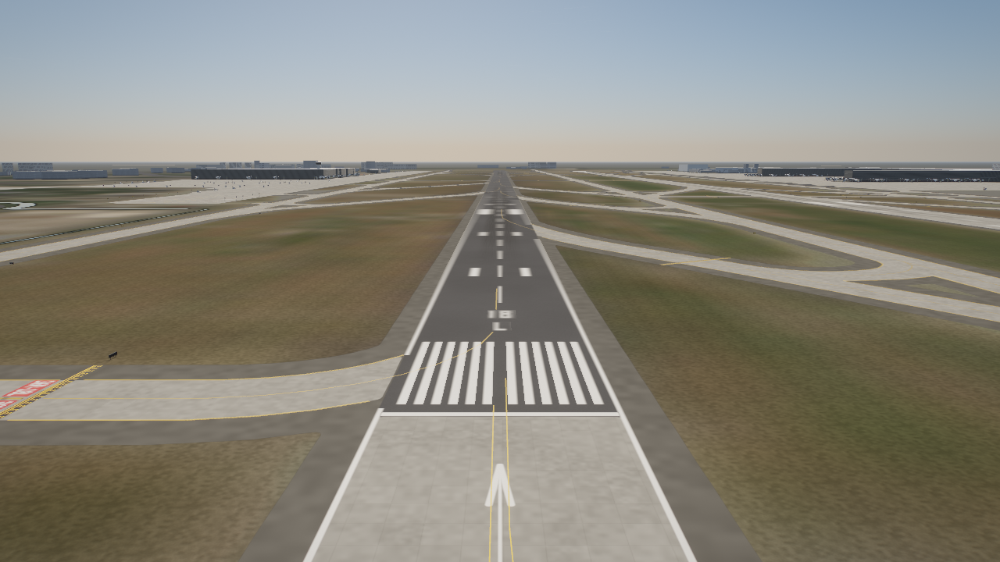
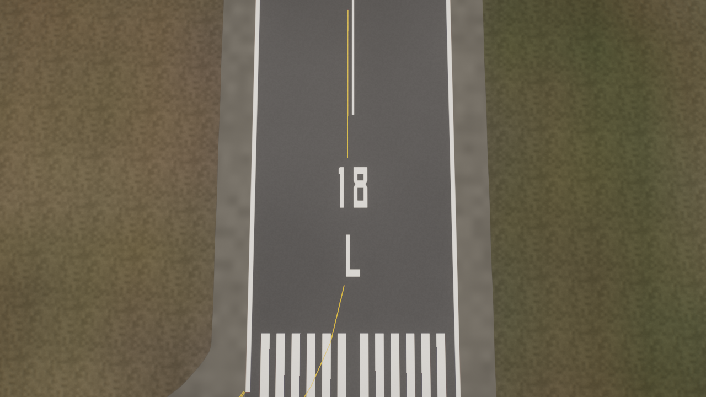
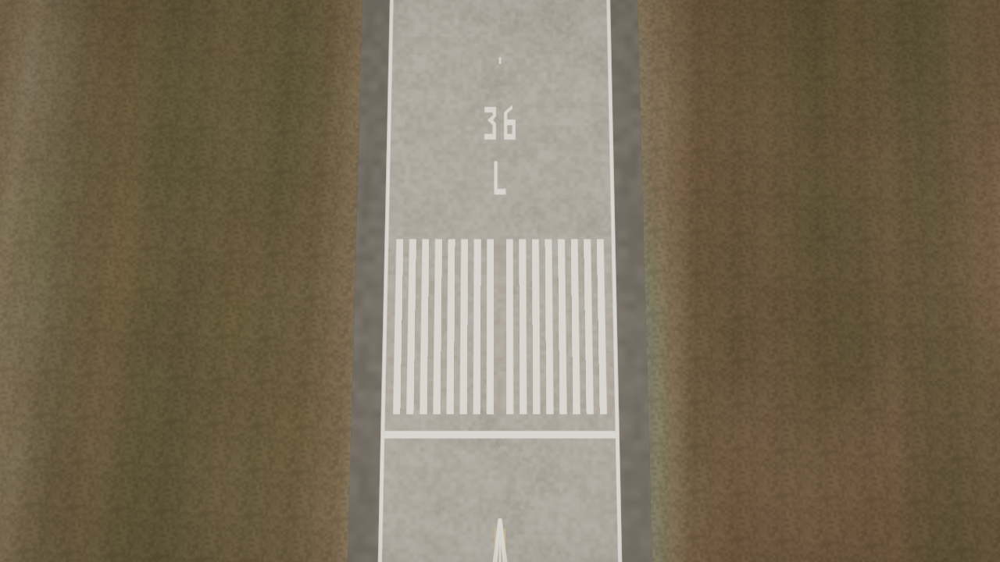

# Phase 2b: CAAC markings and signs (MH 5001-2021)

Date: 2026-11-20. Package P2b of Phase 2 (docs/PLAN.md §7), on the core fork (8ca06f7, docs/phase2/core.md). The earlier
attempt (2026-11-14) left no files in the tree, so this package was written from the core stubs. Nothing in `sfo3d/`,
`pc12/` or `hwd3d/` was modified, and nothing was committed. The plain WebGL2 `live.html` path is used (working default Q7).

Tags: **obs** (seen in a source), **inf** (inferred: a rule, a choice inside a printed range, or a rendering default),
**AIP (mirror)** (short fact from the unofficial AIP mirror, OD3).

## 0. Result

| Layer | What is drawn | Source of the dimensions | Placement |
|---|---|---|---|
| Runway paint (ground shader) | threshold stripes 12 / 16, CAAC designation numerals, displaced-threshold bar and arrows, pre-threshold chevrons on the blast pads, aiming point at the PAPI origin, 5 TDZ pairs per end, centreline, edge stripes cut at 33 taxiway junctions, tyre rubber | MH 5001-2021 6.2.2-6.2.7, 6.2.25, fig. 6.2.2-2 | AIP (mirror) widths, DTHR, pads, PAPI distances; OSM centrelines |
| Taxiway decals | yellow 0.15 m centrelines with 0.05 m black edges on concrete, double edge lines, runway lead-on / lead-off lines 0.9 m clear of the runway CL | 6.2.8, 6.2.14 | OSM taxiways and taxilanes (re-fitted, A1) |
| Holding positions | 38 pattern A (4 OSM + 34 inferred at 90 m), 33 intermediate (OSM nodes on C / D / M4 / M6), 22 enhanced centrelines, 44 painted mandatory markings ("18L-36R" etc.) | 6.2.10-6.2.12, amd. 4 | OSM nodes + taxi graph `hold_inf` |
| Stand and apron decals | 164 lead-ins, 164 stop lines, 151 stand-number plates, 164 stand safety lines (91 hatched overlaps), 56 bridge activity areas, 265 equipment areas with "设备区" | 6.2.16-6.2.20, table 4.13.5 | OSM lead-ins and stop nodes; envelopes inf |
| Signs | 141-145 assemblies, about 260 panels: runway designation + location at pattern A holds, location signs at intermediate holds, direction assemblies at named junctions; internally lit at night | ch. 8, table 8.2.6 | all inf (OSM taxiway refs for the texts) |

## 1. Files

| File | Status | Content |
|---|---|---|
| `js/live/caac_markings.js` | new | **the one parameter table** (`CAAC`): 135 entries, each `[value, 'clause']` or `[value, 'inf: reason']`; the fig. 6.2.2-2 numeral and letter polygons; helpers `stripeLayout`, `tdzPositions`, `tdzPairCount`, `aimStartNoPapi`, `arrowH`, `glyphWidth`, `paramList` |
| `js/live/markings.js` | stub replaced | the extension: runway-paint GLSL (`sha_ground_paint` chunk), numeral signed-distance atlas, per-end uniforms, edge-interruption mask, `buildWorld` (decals + signs), `start` (`SHA.markings`). EDT functions forked from sfo3d@e3218d6 js/world/textures.js |
| `js/live/caac_decals.js` | new, forked from sfo3d@e3218d6 js/live/markings.js | decal shader and ribbon builder (extended with polygons and character quads); taxiway, hold, stand and apron decals; character atlas |
| `js/live/caac_signs.js` | new, forked from sfo3d@e3218d6 js/live/signs.js | sign shader, face atlas, box / panel mesh; CAAC sign content and placement |
| `jobs/markings.mjs` | new | render job: `end:`, `endtop:`, `hold:`, `sign:`, `stand:`, `standm:` (QA model), `plate:`, `view:`, `look:` |
| `docs/phase2/markings.md`, `markings_*.png` | new | this report, 24 renders |

No core file was changed. `js/live/entry.js` already imports `markings.js`.

## 2. The parameter table

`CAAC` has 135 entries: 103 cite a clause, figure or table of MH 5001-2021 (or amendment 4), and 32 are `inf`. Some cited
entries are values we chose inside a printed range; their text says so. `SHA.markings.params()` lists them all. The CAAC PDF stays local
(`refs/cache/standards/`); only short numbers with clause references are in the code.

Inferred choices (all inside the standard's ranges unless stated):

| Item | Choice | Range / reason |
|---|---|---|
| Stripe gap | 1.45 m (45 m runway), 1.575 m (60 m) | "约 1.8 m"; fitted so the outer stripe ends 3 m from the edge (6.2.4-3), as standards_refs.md §1.3 says. The Phase-1 drawing script divided by one gap too many (1.243 m); fixed here |
| Stripe length | 45 m | ≥ 30 m, "宜为 45 m" (6.2.4-3) |
| Numerals | 9 m | ≥ 9 m, up to 2× (6.2.2-4); ZSSS size unknown |
| Centreline | 30 m stripes, 20 m gaps, 0.45 m | 6.2.3-3 / -4 (CAT I) |
| Aiming point | 60 × 9 m; inner gap 18 m (45 m runway) / 22.5 m (60 m) | table 6.2.5 ranges |
| Aiming point start | PAPI distance (AIP mirror): 474 m (18L/36R), 393 m (18R/36L) | 6.2.5-2: the visual approach slope origin; the PAPI position is used as that origin |
| TDZ | pattern A, 22.5 × 3 m, at 150, 300, 600, 750, 900 m (450 m omitted: within 50 m of the aiming point) | 6.2.6; pattern A or B unknown at ZSSS |
| Arrow head | half base h/8, legs h/12, shaft 0.45 m from 2 m behind the tip | fig. 6.2.4 is not fully dimensioned |
| Arrow count | an arrow only if its tail is ≥ 3 m inside the pavement: 1 arrow (100 m DTHR), 5 arrows (300 m) | 30 m arrows, first tip 20 m before the bar (fig. 6.2.4 (b)) |
| Holds | runway hold if ≤ 120 m from the CL, else intermediate | 4.12.6 gives 90 m (CAT I, code 4); the 33 OSM nodes at 182-310 m sit on the parallel taxiways |
| Marking characters | condensed bold sans, advance 0.33 × height | fig. 6.2.12-3 (about 0.28-0.35); two "18L-36R" plates fit a 23 m taxiway |
| Stand envelopes | class reference aircraft (sha_stands.json `class_ref`), wing root at 0.36 L, leading-edge sweep tan 32°, clearance B from table 4.13.5, nose 3.75 m | 6.2.18 + table 4.13.5 note a |
| Stop line | 6 × 0.3 m at the OSM stop node | ≥ 2 × 0.15 m (6.2.16-7) |
| Colours | linear albedos white 0.70, yellow (0.80, 0.52, 0.035), red (0.46, 0.035, 0.03), black 0.022 | App. I chromaticity not modelled |

## 3. Runway paint

The ground-shader hook (`vec4 shaGroundPaint(...)`) loops over the runways and exits early off the runway band. It
draws in runway coordinates: x from the pavement end, y to the right of the landing pilot. Coverage is anti-aliased with
the pixel footprint, and repeating patterns fade to their mean density at distance. Paint is white on both the asphalt
18L/36R and the concrete 18R/36L (no black borders on the runways: 6.2.1-7 says "宜", inf). Yellow is used only for the
chevrons.

| | 18L | 36R | 18R | 36L |
|---|---|---|---|---|
| Width (AIP mirror) | 45 | 45 | 60 | 60 |
| Displaced threshold (AIP mirror) | 100 m | 100 m | 300 m | 300 m |
| Arrows / bar | 1 / 1.8 m | 1 / 1.8 m | 5 / 1.8 m | 5 / 1.8 m |
| Blast pad → chevrons | 60 m, yes | 60 m, yes | 120 m, yes | 75 m, yes |
| Stripes | 12 × 45 m | 12 | 16 × 45 m | 16 |
| Designation (letter, then number) | L, 18 | R, 36 | R, 18 | L, 36 |
| Aiming point from the DTHR | 474 m | 474 m | 393 m | 393 m |
| TDZ pairs (distance between thresholds) | 5 (3,200 m → 6 positions) | 5 | 5 (2,700 m → 6) | 5 |

- **Layout from the threshold (fig. 6.2.2-1 (b)):** stripes at 6-51 m; 12 m gap; letter at 63-72 m; 6 m gap; number at
  78-87 m; 12 m gap; centreline from 99 m. One stripe rhythm runs from the first end's centreline start to the far end's.
  This places the stripes 6 m beyond the threshold (6.2.4-2). The Phase-1 drawing put them 6 m beyond the 1.8 m bar,
  i.e. 1.8 m further in; the clause text decides here.
- **Numerals:** the CAAC forms of fig. 6.2.2-2 (not a font). I drew the polygons from the printed dimensions; the few
  undimensioned vertices were read off the figure at 400 dpi to about ±0.1 m. "1" has its 0.3 m flag; "4" is 3.9 m wide
  and "7" 3.5 m; "6" and "9" are 9.5 m tall; the digit pair has a 2.2 m clear gap. All 13 glyphs (0-9, L, R, C) go into a
  2,210 × 352 R8 signed-distance atlas: 32 px/m, ±0.6 m spread, built from a 2× raster in about 0.3 s.
- **Edge stripes:** 0.9 m, interrupted where a taxiway surface polygon (`surfaces.taxiway`) reaches 2.5-5 m beyond the
  edge, ±2 m. This gives 16 junctions on 18L/36R and 17 on 18R/36L, held in a 4096 × 4 R8 mask (1 m per texel).
- **END 150 m on 18R/36L** (TORA ends 150 m short of the far pavement end) needs no marking: that pavement is the
  displaced part of the opposite end and carries its arrows. It matters to the lighting package (red stopway lights).
- **Rubber:** streaks along the main-gear tracks from about 120 to 1,250 m past the threshold, over paint and pavement
  (rendering, inf).

 

## 4. Taxiways and holding positions

- **Centrelines** (412 pieces from 299 OSM ways): yellow 0.15 m, with a 0.25 m black underlay off the runways (6.2.8-2;
  the black edge is interrupted on the runway, per the fig. 6.2.8-2 note). Cuts:
  - 0.9 m clear of every holding marking (6.2.8-3);
  - 0.9 m clear of the runway CL stripe at 10 crossings and steep ends;
  - over the runway designation numerals, where the runway marking wins (6.2.1-2).
  36 ends meet a runway CL tangentially (< 35°). These are moved to run parallel 0.9 m clear of the CL stripe and
  continued for 60 m (6.2.8-5), so the lead-on and lead-off lines look as in fig. 6.2.8-2.
- **Edge lines:** two 0.15 m lines with a 0.15 m gap (6.2.14), 52.8 km in all, along the taxiway-polygon boundary
  wherever it borders a shoulder or grass (not along aprons or runways). They are interrupted 0.9 m short of holding
  markings (amendment 4).
- **Pattern A** at 38 runway-holding positions: 4 × 0.3 m lines with 0.3 m gaps, the two runway-side lines dashed
  0.9 / 0.9 m, and a 0.1 m black surround (concrete). Each spans the taxiway plus its shoulders, measured on the 2 m
  pavement map and capped at ±22 m (amendment 4). The positions are the 4 OSM nodes at 88.8-92.2 m and the taxi graph's
  34 inferred holds at 90 m (4.12.6). **Pattern B is not used:** ZSSS is CAT I with one holding position per taxiway
  (6.2.10-3).
- **Exit-only taxiways** (16 holds on arrival-only links: A1-A4, B1-B8, C1-C4) get the pattern A marking only. They get
  no enhanced centreline (amendment 4, 6.2.8-6 2)), no painted mandatory marking and no hold signs. The optional
  "NO ENTRY" markings and runway-vacated signs are not drawn.
- **Intermediate holds** (33 OSM nodes on C, D, M4, M6): single dashed 0.3 m line, 0.9 / 0.9 m, black surround
  (fig. 6.2.11-1).
- **Enhanced centrelines** at the 22 entry holds: 0.15 m side dashes, 3 m dashes with 1 m gaps, 0.15 m clear of the CL,
  over 47 m from the marking, on a black band (fig. 6.2.8-4 (a)). Amendment 4 makes them mandatory; their presence at
  ZSSS has not been observed (inf).
- **Mandatory instruction markings:** one red plate each side of the CL (taxiway ≥ 23 m), 4 m white characters with a
  0.5 m margin, ≥ 1 m from the CL and the hold (6.2.12). The text is the runway designation in the order seen from the
  holding side (e.g. "36L-18R" facing west at H6). These are recommended for runway-incursion prevention (6.2.12-2); the
  ZSSS paint has not been observed (inf).

## 5. Stands and apron

- **Lead-ins:** the 164 OSM lead-in lines (`sha_stands.json` `leadin`) in yellow 0.15 m with a 0.05 m black edge, each
  continued 4 m past the stop node as the alignment line.
- **Stop lines:** 6 × 0.3 m, square to the alignment line. **Placement is inf:** the stop line is drawn AT the OSM stop
  node. The stand data (A2) and the gates package treat that node as the nose tip. With visual docking guidance, a stop
  line marks the nose wheel (6.2.16-7), about 5 m behind the nose. This 5 m question stays open (stands.md nose_note).
- **Stand number plates:** yellow pentagon, 5 m body plus a 2 m point, 0.1 m black border, black 4 m numerals
  (fig. 6.2.16-2). Each sits 18 m along the lead-in (or 35 % of a short one), 1 m clear of the line, on the outer side of
  the lead-in's first turn, pointing to the stand. 151 are placed. 13 are skipped: 9 would overlap an overlay /
  alternative stand's plate, and 4 would sit on another lead-in. The gates package draws the stand-number sign boards
  (8.5); these plates are the painted marking (6.2.16).
- **Stand safety lines:** red 0.1 m (6.2.18). Each is a multi-segment line from the class reference aircraft: nose at the
  stop node; fuselage + B; wing leading edge; wingtip + B, back to the tail + 3 m. B comes from table 4.13.5 (C 4.5 m,
  D-F 7.5 m) and the nose clearance is 3.75 m (note a). Where the line runs inside a neighbour's envelope it is dashed
  (1.0 / 0.5 m), and the overlap of the two envelopes is hatched at 45° (0.1 m lines, 2 m clear): 91 overlaps.
- **Bridge activity areas** (56 contact stands with a bridge): a 9 m band from the rotunda to the docked cab + 2 m, red
  0.12 m outline, 45° hatching 2 m apart, and a 3 m wheel circle at 62 % (inf shape; 6.2.17 / 6.2.20 give the line
  types).
- **Equipment areas** (265): white 0.15 m rectangles beside the fuselage ahead of the wing, outside every stand envelope
  and not on the bridge side, with "设备区" in white 黑体 (6.2.20-1). Size and position are inf.
- **Not drawn (no data):** wingtip clearance lines and apron service roads (no airside road geometry in the data),
  hydrant pits, chock boxes, push-back lines and holding points, taxiway shoulder bars (6.2.15).

## 6. Signs

All sign positions are inferred: no sign position at ZSSS is sourced. Face sizes follow table 8.2.6 for code 3-4:
mandatory signs 400 mm text on a 600 mm face, information signs 300 mm on 450 mm. Each face top is at the 1.1 m maximum
mounting height, on two frangible legs. Assemblies stand 11 m from the 23 m taxiway edge, the table minimum. A footprint
on pavement is pushed out by up to 12 m, otherwise the sign is dropped (85 dropped). The faces are lit internally at night
(8.2.3).

| Assembly | Rule | Count |
|---|---|---|
| Runway designation sign (red, white "18L-36R" in the order seen, 8.3.6) + location sign outboard (black, yellow ref) | both ends of every pattern-A hold except exit-only (8.3.3, 8.3.5, 8.4.2-3 1)) | 44 |
| Location sign with yellow border | intermediate holds, left of each travel direction (8.4.2-3 6)) | 45 |
| Direction assembly: location sign + yellow direction signs, arrows by turn angle, left turns on the left (8.4.3-3 / -6), divider lines | taxi-graph nodes where two named taxiways meet; left side, 60 m before the junction (8.4.3-10, -12), or 15 m before the junction on arms of 35-65 m (8.4.3-11) | 52 (17 of them on short arms) |

Texts use only OSM taxiway refs: a sign with no ref is not drawn, and taxi-guidance signs use Latin characters only
(8.4.1). The runway-vacated, intersection take-off and destination signs and the "HP n" points are not drawn.

## 7. Observed versus inferred

- Every world item carries `src: 'inf'` and `layer: 'markings' | 'signs'`. `SHA.markings.holds()` gives each hold's
  `src`: obs for the OSM node, inf for the 90 m rule.
- **obs:** the standard's dimensions (the table entries with a clause); the OSM centrelines, holds, lead-ins and stop
  nodes; the AIP (mirror) runway facts.
- **inf:** that the paint exists at ZSSS at all, and its exact geometry. None of it is visible in the open imagery
  (Sentinel-2 at 10 m) or in SAR. The photos confirm only the apron style at T2 (§8).
- For the planned Observed/Inferred legend, one line is suggested: *"Markings and signs: CAAC MH 5001-2021 dimensions;
  presence and placement inferred from OpenStreetMap geometry; ZSSS paint not surveyed."*

## 8. Renders (deviceScaleFactor 1) and the T2 photos

`SOFTGL=1 OUT=docs/phase2 PREFIX=markings VIEWS='...' node livetest.mjs jobs/markings.mjs`. The time is 11:00 local
(2026-11-14T03:00Z); the night renders are at 21:30.

| Render | What I checked |
|---|---|
| `markings_rwy_18L.png`, `_36R`, `_18R`, `_36L` | behind each threshold: arrows in the displaced part, 1.8 m bar, 12 / 16 stripes, letter then number, centreline, TDZ, aiming point; edge stripes cut at the junctions; holds with red plates at the crossings (36R) |
| `markings_desig_18L_top.png`, `markings_dthr_36L_top.png` | near-vertical: CAAC "1" with flag, "8" with waist notches, "3", "6"; the 12 m / 6 m / 12 m spacing; CL starting 12 m after the number; 16 stripes with a double centre gap |
| `markings_dthr_18R_arrows_top.png` | 300 m displaced part of 18R: five 30 m arrows 20 m apart, the H-crossing holds 90 m off the CL with mandatory plates, chevrons on the pad |
| `markings_aim_tdz_18L.png` | aiming point (9 m bars) at 474 m past the DTHR; TDZ pairs; rubber; a rapid-exit centreline leaving the runway |
| `markings_runways_far.png` | the same paint from about 4 km: no visible shimmer in the still, chevrons visible |
| `markings_hold_A_H1.png`, `markings_hold_A_H6.png` | pattern A (solid lines on the holding side, dashed on the runway side); "18L-36R" / "36L-18R" in the right order; enhanced CL; edge lines interrupted; signs at both ends |
| `markings_hold_A_exit_A1.png`, `markings_hold_intermediate_C.png` | exit-only: pattern A only; intermediate: single dashed line, CL cut 0.9 m each side, location signs |
| `markings_sign_direction.png`, `markings_sign_hold_H7.png` | "← H5 \| C3 \| H5 →" (location in the middle); "H7 \| 18L-36R" (location outboard on the left) |
| `markings_stand_233.png`, `markings_plate_233.png`, `markings_plate_248.png` | lead-ins with black edges, stop line, pentagon plates readable from the taxilane, safety lines, hatching, equipment areas |
| `markings_stand_248_photo16.png` | QA-only 747-8 (sfo3d model by URL) at T2 stand 248, the type in photo 16 |
| `markings_apron_t2.png` | T2 pier apron from 300 m |
| `markings_night_hold_H1.png`, `markings_night_sign.png` | lit sign faces at 21:30; the paint stays dark (no flood-light positions yet) |
| `markings_phone_hold_H1.png`, `markings_phone_rwy_36L.png` | 390 × 844, iPhone UA, touch, low tier: the same content |

**Comparison with the T2 photos** (`docs/phase1/photos_contact_sheet.jpg`; single photos, obs for that place and date):

| Photo | Seen | In the model |
|---|---|---|
| 16 (2023, 747-8 at a T2 bridge stand) | red stand safety lines; red 45° hatching between the nose and the bridge; a red ring (pit); white equipment rectangles; yellow lead-in with dark edges and short dark-backed stop bars | `markings_stand_248_photo16.png`: red safety line, red-hatched bridge band and wheel circle, white equipment rectangle, yellow lead-in with black edge and stop line. Missing: the pit ring (no pit positions), the several type-coded stop bars (one line drawn) |
| 09 (2013, T2 airside) | a broad red-hatched zone under the bridges; white boxes; a dark asphalt service road with white edges, yellow centre dashes and Chinese text ("双向") | the hatching is drawn as a narrower band (inf); the service road is not drawn (no geometry) |
| 14 (2023, T2) | rows of white diagonal GSE parking stalls on the concrete apron | white equipment rectangles only (no stall rows; inf) |
| 17 (2018, T2 north) | thin yellow taxiway lines on light concrete | 0.15 m yellow with black edges: thin and visible in the same way |

## 9. FAA audit

Search of `sha3d/js` for `1020`, `AC 150`, `5340`, `0.3048` and `FAA`: no FAA marking or sign constant is in any code path.
The remaining hits are:
- the METAR decoder (FAA coding references, the foot constant);
- the labelled lighting stubs (core);
- pressure altitude in `geo.js`.

sfo3d's FAA shader marks, `markings.js` (AC 150/5340-1) and `signs.js` (FAA hold and distance-remaining signs) were
never forked; only geometry helpers were taken, with headers. The core's `js/world/textures.js` still contains sfo3d's
font-based `makeGlyphAtlas` / `glyphCode`. It is generic, nothing imports it, and it was not touched (it is core-owned).

## 10. Cost

| Stage | Time (sandbox, llvmpipe) |
|---|---|
| Runway set-up | 0.45-0.63 s (numeral atlas 0.27-0.34 s, edge mask 0.18-0.29 s) |
| Decals | 0.44-0.55 s |
| Signs | 0.05 s |

The decal mesh has 54 k vertices and 41 k triangles in one alpha-blended item (black, paint and characters layers in that
order, no depth writes). The sign mesh is one opaque item, near pass only. The runway paint adds about 2 texture lookups
and one loop per ground fragment near a runway, and returns at once elsewhere.

## 11. Open issues

1. **Nothing is observed at ZSSS:** the TDZ pattern (A drawn), numeral size (9 m), stripe length (45 m), enhanced
   centrelines, mandatory markings, sign positions and texts. They stay inf until a photo or an official chart shows them.
2. **Stop line vs nose (5 m):** the stop line is drawn at the OSM stop node, which the stand data and the gates package
   use as the nose tip. This needs one decision shared with the gates package.
3. **Runway-end lead-on lines** (36 tangential OSM ends) are extended 60 m at 0.9 m clear of the CL. At the runway ends
   they run alongside the designation area (they are cut over the numerals). Whether ZSSS paints them is unknown.
4. **Signs:** 85 candidates had no clear spot within 12 m and 65 arms were shorter than 35 m. Exit signs, runway-vacated,
   "NO ENTRY", intersection take-off, destination and "HP n" signs are not drawn. Junction choice is simple: every
   named-taxiway node, one assembly per arm.
5. **Apron:** wingtip clearance lines and service roads need airside road geometry (not in `sha_airport.json`). Pits,
   chock boxes, push-back lines, type-coded stop bars and taxiway shoulder bars are not drawn. The stand envelopes are
   class reference planforms, not the AIP span limits per stand.
6. **Edge-stripe gaps** follow the 23 m taxiway buffers (with round joins) rather than real fillets.
7. **Runway borders on concrete:** 18R/36L has no black borders (6.2.1-7 "宜", inf). The Sentinel-2 hint cannot tell.
8. **Lighting** (ch. 7: stop bars at the holds, RGL, RWSL, taxiway CL lights) belongs to the lighting package. The hold
   list (`SHA.markings.holds()`, with direction `u` and extents) is ready for it.
9. **Character shapes** for painted text are a condensed system font, not the grid characters of fig. 6.2.12-3. The CJK
   apron text depends on a system CJK font (WenQuanYi here; phones have one).

## Hooks for other packages

- `window.SHA.markings`:
  - `plan()`: the runway marking plan per end (DTHR, pad, aim, TDZ, stripe layout, designation positions);
  - `holds()`: `{id, p, u (towards the runway), kind 'A' | 'intermediate', exitOnly, rwy, ref, text, src, eL, eR}`;
  - `signs()`: sign assemblies;
  - `apron()`: `{equipment, bridge, envelopes}` world rings, e.g. for GSE parking in the equipment areas;
  - `info()`, `params()`, `CAAC`;
  - `setRunwayPaint(on)`.
- `js/live/caac_markings.js`: the CAAC table and helpers, for the lighting package and a later three.js path. Both
  should take dimensions from here rather than re-type them.
- World items: decals `prog 'caacDecal'` and signs `prog 'caacSign'`, both `src: 'inf'`.
