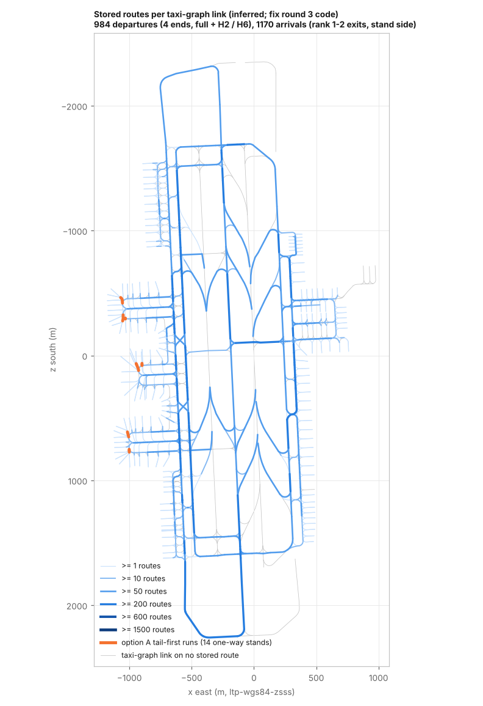
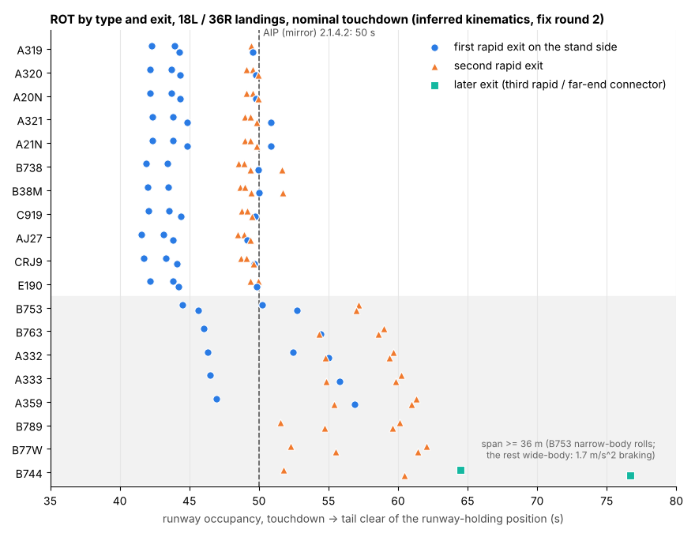

# Phase 3 P3-B: routing and kinematics

Package P3-B of `docs/phase3/design.md` (§4.1-§4.6, §5, §7.1, §7.2), built 2026-11-27; **fix round 1** the same day
answers the adversarial verification (V1-V17, section "Verification fixes, round 1"); **fix round 2** (also 2026-11-27)
answers the second verification (H1, M1, M2, L1, C1-C5; section "Verification fixes, round 2"); **fix round 3** (also
2026-11-27) answers the two findings of the third verification (V3-1 tail clear after runway blocks, V3-2 pose semantics and
main-gear kinematics) and records the lead's ROT decision (last section "Verification fixes, round 3"). The tables below are
re-measured after round 3. Everything here is **inferred**
(`src: 'inf'`) except the taxi graph, the stands and the runway data it reads, which keep their own labels; airfield rules
come from "AIP (mirror)" short facts carried in `data/sha_taxigraph.json` `rules.facts` / `routing.turns` and
`data/sha_airport.json` `aip_facts`. No per-flight data is used or stored. No FAA constants and no SFO airfield values;
aircraft-type priors taken from sfo3d are cited and labelled inf.

| File (sha3d/) | What |
|---|---|
| `js/sim/router.js` | edge-based taxi router, lane rules, pushes (option A included), end-arounds, exits, holds, blocks, F4552 variant, route assembly |
| `js/sim/path.js` | integer fillet geometry (route-level fillets, bounded corner merging, vertex stations by projection, turn profile), deterministic arctangent, display evaluation |
| `js/sim/perf.js` | performance table per ICAO type (integers) |
| `js/sim/traj.js` | push, taxi, approach, landing roll, line-up, take-off, climb-out trajectories; exit model; display poses with an oversteered nose and a no-slip main gear (round 2); main-gear speed caps from the deterministic gear follower, pose reference point (round 3) |
| `js/sim/bodies.js` | aircraft planforms as bodies (forked from sfo3d@e3218d6 `js/live/ground.js`, degrees, no `antOf`) |
| `tools/sim/build_routes.mjs` | builds `data/sha_routes.json` / `.js` and `data/SOURCES_routes.json` |
| `tools/sim/test_router.mjs`, `tools/sim/test_traj.mjs` | the acceptance tests (58 and 28 checks) |
| `data/sha_routes.json` / `.js` (`window.SHA_ROUTES`), `data/SOURCES_routes.json` | the route table (331.6 KiB) and its sources |
| `docs/phase3/movement_{routes,rot,profiles}.png` | three aggregate figures (`movement_rot.png` re-made in fix round 2; `movement_routes.png` and `movement_profiles.png` re-made from the round-3 code) |

```bash
node tools/sim/build_routes.mjs            # -> data/sha_routes.json/.js + data/SOURCES_routes.json (about 15 s)
node tools/sim/test_router.mjs [--quick]   # 58 checks (--quick skips the all-route pavement scan: about 3 min instead of 4-5)
node tools/sim/test_traj.mjs               # 28 checks (about 45 s: every published pose point on a 0.1 s grid)
```

---

## 0. Result in brief

| Acceptance (design §7.2, P3-B; re-measured after fix round 3) | Measured | Status |
|---|---|---|
| 164 / 164 × 4 departure and arrival ends; option A for the 14 by rule, same runs as `optA_push.mjs` or shorter | departures 656 / 656, arrivals 656 / 656 (an exit on the stand side); option A: the 14 one-way stands found by rule, 14 same runs, 0 shorter, 0 other | pass |
| 0 runway-link use outside line-up; 0 off-list crossings; 0 foreign lead-ins; 0 turns > 100° | 0 / 0 / 0 / 0 over 6,740 routes (306,703 graph transitions; max 100.0°, p99 41.7°). **Driven path** (fix round 1, V3): 0 arcs > 100° and 0 heading changes > 100° within 40 m over every served route (2,996 checked in `test_router`). **Driven push path** (fix round 2, M2): 0 of 984 pushes (max arc 97.9°, max 40 m window 98.3°) | pass |
| Option A pushes: swept planform and every gear point on pavement, class reference | 14 stands × 4 ends: 0 of 37,416 gear samples, 0 of 162,136 outline samples off | pass |
| End-around ≥ 90 % of span < 36 m west-side arrivals; never ≥ 65 m; 36-65 m via H2 / H6 | 372 / 372 = 100 %; 0 / 20; 352 / 352 via H2 / H6 | pass |
| Route table deterministic (md5 twice), ≤ 0.6 MB, with the F4552 variant | md5 `cb02dcb49de845a2bc8a1e7f30b1afdd` twice; 339,518 B = 331.6 KiB; F4552 variant 828 routes, 0 using a closed link (round 3 changed only `params.router.tailClear`: the link sequences are those of round 2) | pass |
| Baked integer geometry = float path length within 1 cm per piece | 0 of 735,735 pieces > 1 cm (max 0.500 cm); integer geometry rebuilt at run time from the stored link sequences (§6, D1); vertex stations, blocks, boxes, holds and push end where the path is (round 1); every metre of every route inside some block, resources from the geometry (round 2) | pass (with deviation D1) |
| **V3-1 (round 3): no planned stop with the tail inside a runway's far holding position** | 0 of 8,628 runway no-stop blocks / end boxes on 7,700 routes (all variants and span classes) whose first plannable stop leaves the tail of the class's longest type inside the far end (tail-clear markers, D20); verifier's `check_tailstop`: 0 of 17,848 (was 12,961); no hold inside a runway block or marker; queue room behind every such hold ≥ the class's longest type | pass |
| `test_traj`: trajectories within the §4.4 limits | 0 violations of accelerations, speeds (piece caps, turn zones and the round-3 main-gear zones), R ≥ R_min, push limits; **V3-2 (round 3)**: every published pose point - the reference point x / z at `gs`, the displayed nose at `noseGs`, the displayed main gear at `mainGs` - with 0 steps > v dt + 0.1 m at 1 s and 0.5 s (≈ 5.0 M windows each; the verifier's endpoint rule on x / z: 0 of 570,053 1 s windows); displayed main-gear lateral acceleration ≤ the piece's a_lat + 1 % (max 1.007 × a_lat; 1.0 m/s², 1.25 on rapid exits); yaw ≤ 14.1°/s; joins ≤ 0.08 m / 0.3°; slip ≤ 3.3° outside the stand zones; line-up ≤ 60 s (max 29 s) | pass |
| Take-off roll ≤ TORA − 400 m | 0 of 98 type × end × entry cases; smallest margin beyond the 400 m: 294 m; a wide-body is never lined up at H2 / H6 (C4) | pass |
| ROT (round 3, D24: lead decision, inf, reversible by the owner): touchdown → tail clear ≤ 50 s (AIP (mirror) AD 2.20 2.1.4.2) for ≥ 90 % of the nominal **narrow-body** type × chosen-exit cases on **18L/36R** | **90.0 %** of 80 (p50 49.0 s, p90 50.0, max 57.2); zero margin (two cases at 49.99 s) | pass |
| ROT report rows (not tuned): narrow-bodies on 18R/36L; wide-bodies; the design §5 "≤ 70 s for all" | 18R/36L narrow-bodies 87.5 % of 48 (max 69.0 s); wide-bodies 18L/36R 12.1 % of 33 (max 76.7 s), 18R/36L 0 % of 28 (max 75.7 s); all cases with the ±60 m spread: max 77.5 s, 61 of 566 over 70 s (east runway 4 of 337) | report |
| Glide path 3.0° ± 0.1° | 2.981-3.044° (6,392 samples, 12 km to the flare) | pass |
| No transcendental call on the commit path | 0 calls in 96 table route builds + 4 stands of live routing, every trajectory builder (since round 3 including the deterministic gear follower and its main-gear caps), the exit model, `timeAtS` / `sAt`; 0 `**` operators | pass |

The design's ROT rows are replaced by the narrow-body target and report rows (D24, §7). Everything else passes (re-measured in
fix round 3).

---

## 1. What was built

### 1.1 Interfaces (design §7.1: all frozen names kept, fields added)

```js
import { makeRouter, closedLinksFor, END_IDS } from './js/sim/router.js';
import { perfOf } from './js/sim/perf.js';
import * as TJ from './js/sim/traj.js';

TJ.initTraj(SHA_ROUTES);                                   // runway-end geometry (integer cm) from the route table
const router = makeRouter(SHA_TAXIGRAPH, { table: SHA_ROUTES, stands: SHA_STANDS, closedLinks: null, crossOnly: null });
const P = perfOf('A320');

// departure: push (tail first) + 90 s start-up, taxi from the push end to the line-up point, take-off roll and climb-out
const dep = router.departure('233', '36L', { entry: 'full' /* or 'H6' / 'H2' */, spanCm: P.spanCm });
const push = TJ.pushTraj(dep, P, tOffBlock);               // marks.pushEndMs; ends after the start-up hold
const taxi = TJ.groundTraj(dep, P, push.t1, { stops: [{ sCm, untilMs }] });   // stops = block waits from C1
const to   = TJ.takeoffTraj('36L', dep.lineup, P, tRoll);  // marks.liftoffMs, rollCm, extentMs, fadeMs, rollOk

// arrival: exit choice (seeded u), approach, landing roll, taxi-in
const ch = TJ.chooseExit(router, '36R', '233', P, u, { tdOffsetCm });          // {exit, why, route, rotMs, ...}
const app = TJ.approachTraj('36R', P, tTd, { tdOffsetCm });                   // marks.thresholdMs, tdSCm, extentMs
const land = TJ.landingTraj('36R', P, tTd, { route: ch.route, tdSCm: app.marks.tdSCm });
const tin = TJ.groundTraj(ch.route, P, land.t1, { vStart: land.marks.vExitCms });
const rot = TJ.rotMs(land, tin);                           // touchdown -> tail clear of the runway-holding position
const pose = TJ.evalTraj(tin, t, {});                      // display only (floats, trigonometry); x / z = the reference point
                                                           // (moves at gs), pose.nose / pose.main = the displayed gears (round 3)
```

- `makeRouter(G, {table, closedLinks, stands, crossOnly, live, slim, runwayEnds})` -> `{departure(stand, end, {entry, spanCm, geom}),
  arrival(exitId, stand, {spanCm, geom}), exits(end, all), optionA(stand), standSide, westOfWest, clsOf, info(),
  clearCache()}`. `stands` is accepted but not needed (stand nodes, push links and lead-ins come from the taxi graph;
  `build_routes.mjs` reads the stands' `span_max`); `live: true` ignores the table.
  `exits(end)` returns the ranked rapid exits (rank 1-2 per side), `exits(end, true)` adds rank 3 and the far-end
  connectors (`kind: 'end'`, rank 9). `info()` says whether the table or live routing is in use (+ `turnRule`: routes
  checked / re-routed / kept by the path-level turn rule; since round 2 also `pushBanned` / `pushKept`). `slim: true` (for C1)
  drops the assembly inputs (`verts`, `vS`, the paths' vertex stations) from served routes. Round 2: `runwayEnds` (traj.js
  `runwayGeom(airport)`) gives `lineup.toraCm` / `toraLeftCm` with `live: true` (C2); `departure(..., {entry: 'H2' | 'H6',
  spanCm >= 3600})` is served at full length with `route.entryAsked` and `route.entryNote` (C4). Round 3: `departure(...)` /
  `arrival(...)` take `opts.tailCm` (a type's own nose-gear -> tail distance for the tail-clear markers; default the span
  class's largest, `ROUTER.foot.tailCm`).
- **Route** (frozen fields + additions): `kind, stand, end, exitId, links: [[linkId, fromNode]], lenCm, pieces: [{kind:
  'line' | 'arc', lenCm, rCm, vmaxCms, linkId, + s0Cm, turn, tag, g}], blocks: [{id, s0Cm, s1Cm, noStop, + kind, node |
  link, dir, twoWay, start, crossing, landing, end}], push: {lenCm, optionA: {run, node, swing, turnDeg, record} | null, +
  pieces, path, verts, nLinks, node, swing, swingVirtual, tailHdg, run, fallback, resources}, holds: [{sCm, node, kind:
  'rwyhold' | 'lineup' | 'leadin' | 'endbox', + runway, ref, dwellMs, end, src}], crossings: [{runway, node, sCm, nearEnd,
  + ref, alongCm, sInCm, sOutCm, holdSrc}], lineup: {node, sCm, + rwySCm, entrySCm, holdSCm, toraCm, toraLeftCm}`; added
  `entry, cls, geom, path, vS, verts, zones, exit, vacate, endAround, src, variant`; fix round 1 added `route.turn = {maxArcDeg,
  maxWinDeg, ok, winS0Cm}` (the driven path's largest arc and 40 m heading change), link blocks of the swing branch
  (`swing: true`), lane blocks from the pieces, and a non-enumerable `route.lineup.route` back-reference (no JSON cycle).
  Fix round 2 added: `route.gapFill` (stretches filled by a geometric block, 0 everywhere), `route.geoBoxes` (junction
  boxes of nodes beside the path that are not route vertices, `geo: true`); block flags `behind` (a
  block from s = 0 under the start-up fuselage, to the end of the taxi's near stretch, often `[0, 0]`: held from the taxi
  start until the tail has passed that station),
  `geo` (gap fill), `geoOnly` (a lane block found by geometry only), `held` (a lane the push held, continued from s = 0);
  `push.chain` ([[linkId, fromNode]]: X and its straight-ahead continuations, real link ids), `push.onGraph`, `push.turn =
  {maxArcDeg, maxWinDeg, ok}` (the driven push path), `push.startFoot = {blocks, boxes, lanes, tailCm}` (the start-up
  fuselage's footprint); arrivals `exit.oppositeSide`, `exit.reCross` (`{node, ref, sCm, vacateFrom}` when the route
  re-crosses the runway it landed on).
  Fix round 3 (V3-1) added: block kind `clear`, the **tail-clear marker** `{id: 'clr:<runway>:<crossing node>' |
  'clr:<runway>:vacate' | 'clr:endbox:<end>', kind: 'clear', of: <the runway block / end box id>, s0Cm: its start, s1Cm: its far
  end + tailCm, noStop: true, tailClear: true, res: false, tailCm}` - a no-stop stretch, **not a resource** (C1 reserves
  nothing for it); on every runway no-stop block (`crossing`, `landing`) and end box `tailClearCm` (the nose station from which
  a stop may be planned) and `tailCm`; on crossing blocks `node`; `route.tailCm`; `route.vacate.tailClearCm`; pieces
  `aLatCms2` (the a_lat of the piece: 100, or 125 on rapid exits and the runway lead).
- **Traj** = `{t0, t1, segs: [{t0, t1, s0Cm, v0Cms, aCms2, kind, + s1Cm, v1Cms}], route, phases: [[t, phase]], + kind,
  role, dir, perf, path | rwy, marks, warn}` (`route` is present on every kind since fix round 1: the route, or null for
  an approach / landing / take-off built without one; pass `opts.route`). **pose** = `{x, y, z, hdg, pitch, roll, gs, vs,
  ground, gear, flaps, spoilers, phase, + nose, main, noseGs, mainGs, mainChord, tip, steerDeg, t, nosePath}`. **Fix round 3
  (V3-2): x, z = the REFERENCE point**, the nose-gear station s on the route centreline (push: the tug's nose gear on the push
  path; runway / air: the nose gear on the runway axis), which moves at `gs` (m/s; the speed of the commit path); `nose` =
  [x, z] the DISPLAYED nose-gear contact (oversteered outward in corners, round 2; = [x, z] on straights, pushes and the
  runway) moving at `noseGs`; `main` = [x, z] the displayed no-slip main-gear centre moving at `mainGs`; `hdg` = the body axis
  main -> displayed nose; `tip` = nose tip (from `nose` along `hdg`); `nosePath` = [x, z] (round 2 name); `mainChord` = round
  0's chord model; `steerDeg` = nose-wheel angle. Draw the body from `nose` (or `main`) and `hdg`; every published point moves
  consistently with its own published speed (round 2 had x, z on the displayed nose with gs of the centreline).
- Extra exports: `router.js` `ROUTER, END_IDS, runwayOfEnd, graphFingerprint, closedLinksFor, simplify`; `path.js` `PATH,
  atanDet, atan2Det, angleDet, hdgDet, buildPath, projectOnPieces, turnProfile, pieceAt, pointAt, floatLen`; `perf.js`
  `PERF, WAKE, NM_CM, kt2cms`; `traj.js` `TRAJ, FOLLOW, runwayGeom, initTraj, isqrt, arrivalEntryCms, pushTraj, landingTraj,
  flareOverrunCm, wheelAimSCm, touchdownSCm, sAt, timeAtS, vAt, phaseAt, chooseExit, rotMs, gearFollower (round 2: `opts.model`
  'over' | 'tractrix'), pushFollower, followAt, noseAt, turnZones (round 2), mainGearZones, followRatio (round 3), _internal`
  (tests only); `path.js` also `arcPointDet` (round 2), `sinCosDet, pointAtDet` (round 3: deterministic sine / cosine and
  point evaluation for the gear follower on the commit path); `bodies.js` `samples, inside, bodyOf,
  bodyFromNoseGear, overlaps, fusIn, clearance, gearOf, sweptSamples`.

All modules are pure ES modules (node 22 and the browser): no DOM, no module-scope `window.*`; the data are passed in.
Headings at the interfaces are degrees true (`js/geo.js` `hdgVec`).

### 1.2 Reference point and conventions

- `s` is the **nose-gear station** along the filleted centreline (the stand stop node is the nose-wheel stop, CLAUDE.md
  "Conventions"). A departure route starts at the push end (s = 0) and ends at the line-up point; the push has its own
  path (`route.push.path`, s = 0 at the stand node, tail first). An arrival route starts on the runway centreline 50 m
  before the exit node and ends at the stand node.
- **Gear model (display; fix round 1, V5; fix round 2, M1).** The main gear cannot slip sideways. Forward taxi since round
  2: **judgemental oversteering** - the displayed nose gear is steered outward in corners so that the no-slip main gear
  follows the centreline: N(s) = P(s) + w (O(s) - P(s)), O(s) = P(s - wb) + wb t(s - wb) (with w = 1 the tractrix of O is
  exactly the centreline one wheelbase behind); w < 1 only where the nose would be more than 10 m off the centreline, on
  fillets below 20 m (none below 10 m), over a departure's first wheelbase + 50 m (the main gear is where the push left it)
  and in the arrival's stand zone, with ramps short enough to keep the nose's sideways rate <= 0.2. The main gear is the
  tractrix of the displayed nose (pursuit at the wheelbase), integrated once per route and wheelbase (`gearFollower`, 10 cm
  steps, 1 m samples) and shared by every trajectory on that route; round 1's model (nose gear on the path) is
  `gearFollower(route, wb, {model: 'tractrix'})`. Push: the time reverse - the
  nose gear (the tug) on the push path, the main gear the tractrix of the push path traversed backwards from the push
  end, where both gears are aligned on a 33 m straight. At the stand (the last / first 2.5 wheelbases + 10 m) the main
  gear is blended onto the lead-in (the chord position) so that the stand pose matches the gate engine's parked pose; the
  take-off roll continues the tractrix until it is on the centreline. The heading is main gear → nose gear. Round 0's
  chord model (both gears on the path, up to 48.7° of lateral slip) stays available as `pose.mainChord`.
- **Fix round 3 (V3-2).** The pose's x / z is the reference point (the nose-gear station on the centreline, moving at gs);
  the displayed gears are `pose.nose` / `pose.main` with their own speeds `noseGs` / `mainGs`. The follower is now
  **deterministic** (path.js `pointAtDet`, `angleDet`: + − × ÷ √ only; Float64 samples) because it feeds the commit path:
  where the oversteer weight is 1 and the main gear is within 0.5 mm of the centreline it stays exactly on P(s − wb) (the
  10 cm pursuit steps alone drift ~0.1-1 mm at each curvature change); between the 1 m samples the displayed main gear is a
  Catmull-Rom spline (round 2's linear interpolation put a ±2 % sawtooth on the body's yaw rate in every turn) or, on those
  stretches, P(s − wb) itself. Per 1 m interval the follower records the peak main-gear speed ratio, yaw per metre and their
  product (4 sub-steps), and `groundTraj` caps the nose-station speed wherever the displayed main gear would exceed the
  piece's a_lat (1.0 m/s², 1.25 on rapid exits and the runway lead) or yaw faster than 20°/s (`mainGearZones`, part of
  `turnZones`, §3.2).
- Runway trajectories use the runway axis: s = cm from the physical runway end of that direction (negative on final),
  the **nose-gear** station like everything else; the glide path, flare and touchdown are defined for the **main gear**
  (`approachTraj` segments = main-gear stations + wheelbase; `marks.tdSCm` = main-gear touchdown station; V9).
- Segment boundaries are integers (ms, cm, cm/s). Inside a segment the position is the quadratic through (t0, s0) and
  (t1, s1) with the start speed v0; since fix round 1 its end speed is v1Cms within 1 cm/s and `aCms2` its acceleration
  within 0.5 cm/s² (V7); accelerating legs are cut into ≤ 4 s and cruises into ≤ 10 s segments, so integrating the
  frozen fields (t0, s0Cm, v0Cms, aCms2) ends within 14 cm of s1Cm. `sAt` / `timeAtS` / `vAt` remain the exact evaluation.

### 1.3 Route table (`data/sha_routes.json`, `window.SHA_ROUTES`)

`{v, what, licence, attribution, generator, src, src_note, inputs_sha256_16, graph_fp, params, stands, exits, optionA,
runwayEnds, variants, groups, counts, format}`:
- `groups["dep|<end>|<entry>|<variant>"]` and `groups["arr|<end>:<exit>|<n|w|x>|<variant>"]` = `{rev, t: [linkId,
  parent, ...], leaf: [per stand: trie node | -1 not stored (use the base / class n entry) | -2 no route], lenN, lenW,
  (dep) pn, sw, td}`: the link sequences as a trie (departures stored reversed so that routes to one end share their
  runway-side tails), the route lengths of the narrow and the wide geometry (verification), and per departure the
  pushed links (push link + tail-first run), the swing link and the push-turn angle.
- Span classes for arrivals: `n` < 36 m, `w` 36-65 m, `x` ≥ 65 m; `w` / `x` entries are stored only where they differ
  from `n` and the stand's `span_max` admits them.
- `runwayEnds`: per end the integer geometry (end point, unit direction, length, threshold and PAPI aim stations,
  TORA / TODA / ASDA / LDA, intersection entries, profile, extent distances). `exits`: the ranked exit list. `optionA`:
  the 14 option A records. `variants.F4552`: the closed link ids, window, `crossOnly` and the target record (§2.6).
- 62 groups, 22,287 trie nodes; 984 departures (164 × 4 full length + 164 × 2 intersection entries) and 2,756 arrivals;
  0 null routes in the base variant.
- `graph_fp` is an FNV-1a fingerprint of the routable part of the taxi graph; the router uses the table only when the
  graph's fingerprint matches and the closure set is the base or a known variant, otherwise it routes live with the same
  code (about 12 ms per stand for all four ends at once since fix round 1: the path-level turn check assembles each route).

---

## 2. Routing (`router.js`)

### 2.1 Search
Dijkstra over states (link, exit node), integer cm costs, a binary heap with a deterministic tie-break on the state key.
Transitions only from the committed `turns` table (≤ 90° + 10°, one-way, crossings on the list). Use rules: runway links
never (the line-up and the arrival's runway lead are runway-centreline pieces added by assembly, not taxi links);
`status: construction` skipped; a stand's own lead-in only for that stand; push links only as the first leg;
arrival-only (Y1-Y3) / departure-only (M1-M6, L11-L17) per role; `span_max` per link. One search per stand serves all
four take-off ends (multi-goal); arrivals one search per exit × span class.

Costs: length; + 5 km per 18R/36L crossing for arrivals from the east runway with span < 36 m (end-around preference);
+ 10 km for an end-around at 36-65 m ("limited"); wide-bodies (≥ 36 m) cross 18R/36L free only at H2 (landing 18L) /
H6 (landing 36R); a pushed metre costs 3 taxied metres. Departures cross 18L/36R at H1 / H4 / H7 only (taxigraph list):
142 of 328 departures to 18R/36L cross it, all at one crossing.

### 2.2 Pushes and option A
Design §4.3 pushed along the reversed lead-in and then "turned the tail onto the lane". At the OSM lead-in forks that
produced impossible starts (the forward taxi beginning in the push direction; the first version had virtual swings on
532 of 656 departures, `out/phase3/B/push_ends.png`). So **every** push now has the option A structure: the push link,
then a tail-first run over 0-2 two-way apron lanes (≤ 60 m, motion turns ≤ 100°; a retry with up to 4 links / 150 m for
the few ends the short runs cannot reach), a push-turn (≤ 100°) that swings the tail into a branch X at the junction K,
and a forward start through K (≤ 100°). The push ends ≥ 2 m past the push-turn arc and far enough into X for a 20 m
fillet of the forward turn, and (fix round 1, V2) with no bend of the push path within one wheelbase past it, so both
gears are aligned when the taxi starts; 40 m of push path stay beyond the push end for the main gear.
- **Fix round 2 (H1): the push stays on the graph.** Beyond X's far node the push path follows the straight-ahead chain
  (`push.chain`: at each far node the link deflecting ≤ 45°, an apron lane or taxiway, never a lead-in, runway or
  arrival-only lane) up to 90 m from K, with the real link ids; a virtual straight only where the graph ends, and a push end
  on it (`push.onGraph` false) makes the router search another K / X (0 left). The alignment window is the class's largest
  wheelbase (n 19 m, w 33 m, x 32 m), bends under 10° do not count, it moves the push end at most 20 m, and a push end inside
  a gentle arc stays on the arc (round 1 moved it past every 0.2° digitising kink and to the end of any arc: on the real
  chain that made pushes up to 98 m past K).
- **Fix round 2 (M2): the driven push path keeps the turn rule.** Push paths merge two corners only into one < 100°
  (`pushMergeMaxCos`; a merged corner over a 29 m run lane had made 102-131° arcs), and a push whose driven path (stand ->
  push end) has an arc > 100° or turns > 100° within 40 m bans its candidate (run + swing) and the search is repeated
  (`depTurnFix`): base 36 departures re-searched, 0 kept; F4552 38 / 0. Push fillets ≥ 10.8 m (p01 14.4 m).
- Over all 656 departures (fix round 2): run 0 lanes 84, 1 lane 508, 2 lanes 52, 3-4 lanes 12 (the long retry); push
  length p10 / p50 / p90 / max 84 / 131 / 158 / 213 m (74 above 150 m; round 1: 84 / 137 / 174 / 238); push end past K
  p50 11.7 m, p90 25.4, max 46.0 (148 beyond X's far node, on the chain); chain 1-8 links; push-turn max 97°; motion turns in
  the run max 52.7°; 0 graph fallbacks.
- **Option A** (the 14 stands whose push end reaches no take-off end: 271 279 280 272 278 227 219 226 240A 240 225 218
  239 238A) is found by rule: the shortest run that reaches all four ends. Same runs as `optA_push.mjs` for 14 / 14, runs
  7.2-59.4 m, push-turns 3-67°, push lengths 116-194 m (median 158; the scratch: 134-191 m, median 149, with a 20 m
  push-turn radius; here 25 m, and the push end is placed for the forward fillet). `route.push.optionA` carries `{run,
  node, swing, turnDeg, record}` for those 14 only.
- `route.push.resources` (fix round 2, H1: from the geometry under the aircraft), for C1 to reserve for the push and the
  90 s start-up: the blocks of the push link and the run, the junction boxes along the run and at K, the chain's blocks up
  to the push end + tail, and every block (link within 4.5 m of the centreline), junction box (node within 15.5 m) and
  one-at-a-time lane (`lane:<ref>`, within 6.5 m) under the push sweep - the push path from the stand to the push end +
  the tail (the largest nose-gear -> tail distance of the class: n 40, w 71, x 69 m) - and under the straight start-up pose
  (nose gear -> tail along the push direction). p50 19, max 53 ids per departure; 230 of 656 departures hold a lane.
  `push.startFoot` lists the start-up pose's blocks, boxes and lanes; they are also route blocks from s = 0 (§2.5).

### 2.3 End-arounds and wide-body crossings
Arrivals from 18L/36R to stands west of 18R/36L: span < 36 m 372 / 372 on ROUTE-NORTH / ROUTE-SOUTH (south flow N 23,
S 163; north flow N 138, S 48: the shortest stays, as the design kept it); 36-65 m 352 / 352 cross at H2 / H6; ≥ 65 m 0 /
20 end-arounds. Every end-around carries an `endbox:<18R|36L>` block (noStop; 30-800 m beyond the 18R/36L end, ≤ 300 m
laterally) and an `endbox` hold 30 m before it (HP1-HP4 are not in the data: inferred holds).

### 2.4 Exits and entries
- Exits per landing end (m from the physical end; e/w = side, number = rank): 18L B4/w1 1,978, A3/e1 2,073, B5/w2
  2,337, A4/e2 2,407, B6/w3 2,737; 36R A2/e1 1,851, B3/w1 2,069, A1/e2 2,274, B2/w2 2,409, B1/w3 2,826; 18R B8/e1 1,942,
  C3/w1 1,942, C4/w2 2,296; 36L B7/e1 1,972, C2/w1 1,972, C1/w2 2,315; plus a far-end connector per side (rank 9, kind
  `end`, 3,079-3,338 m) as the last resort. The unnamed rapid links before the F4301 first exits are excluded (review
  L1). F4301 first exits vs the graph: +28, +83, +36, +19 m.
- Arrival route: 50 m runway lead before the exit node (room for the exit fillet), exit fillet with a_lat 1.25 m/s²,
  vacate = the first runway hold of the landing runway after the exit node (OSM [obs] or `hold_inf` 90 m), a 5 s stop
  before turning onto the lead-in (AIP (mirror) AD 2.20 3.2.2.2; at the junction box start when the box is no-stop), the
  last 15 m at ≤ 1 m/s.
- Departures: `entry` `'full'` (the full-length connector) or the intersection H2 (18R) / H6 (36L) (AIP (mirror) AD 2.20
  2.1.7; TORA 2,988 m measured from the intersection). Line-up = the arc onto the centreline + 35 m (≥ wheelbase + 2 m of
  every type); `lineup.toraLeftCm` = TORA left from the line-up point. Since round 2 the router serves span ≥ 36 m at full
  length even when an intersection is asked (`entryAsked`, `entryNote`; design §4.2: code C may use H2 / H6) (C4).
- Fix round 2 (L1): an arrival on an exit opposite the stand (`exit.oppositeSide`: only the exit model's last resort, e.g.
  18R/36L under F4552) that re-crosses the runway it landed on without reaching a holding position of that runway in
  between never leaves its strip: the vacate point is the far side of the re-crossing, the landing block runs to it, and no
  hold is placed on the strip (`exit.reCross`; 142 of 4,920 served arrival routes).

### 2.5 Assembly: pieces, blocks, holds
- Pieces from `path.js` (§3.1). Blocks: per link blocks of ≥ 60 m (`b:<link>:<k from a>`, `dir`, `twoWay`; the window
  comes from the stations of the link's own vertices, which since fix round 1 are where the path passes them, V1), the
  swing chain's blocks from the push end back to K on a departure (`swing: true`; round 2: every chain link with its real
  id, and the junction boxes at the chain's own nodes), junction boxes `j:<node>` = fillet region + 15 m (`noStop` when a
  taxiway touches the node; `start` for the box the route starts in), one-at-a-time lanes `lane:<ref>` (Y1-Y3, M1-M6,
  L15-L17), runway strips `rwy:<runway>` (crossings and the landing roll noStop; the line-up block not), `endbox:<end>`;
  since round 3 a tail-clear marker `clr:*` per runway no-stop block and end box (no-stop from the block's start to its far
  end + the class's nose-gear → tail distance; `res: false`, not a resource; D20). About 100 blocks per route. Block windows
  (nose in to tail out + 5 s) are C1's.
- **Lanes by geometry (fix round 2, H1).** A lane block covers the pieces whose in- or out-link carries the ref (V4) and
  every stretch where the nose gear comes within 3 m (+0.5 m chord tolerance) of the lane's centreline in any direction,
  when the stretch contains a sample within 37° of the lane's direction (entering and leaving at an angle included); a bare
  crossing of a lane's mouth (never along it) is not a lane block - it lies in the junction box (tested). A lane the push
  held continues from s = 0 when the taxi reaches it within 60 m (`held`).
- **Behind blocks (fix round 2, H1).** At the taxi start the fuselage lies behind s = 0 on the chain. Every block, box and
  lane of `push.startFoot` that the route does not already hold from s = 0 is a block from s = 0 (`behind: true`) to the
  end of the taxi's first stretch whose nose gear is still within the footprint tolerance of it (4.5 m of the link part,
  15.5 m of the node), `[0, 0]` when the taxi moves straight away from it: C1's window "nose in to tail out" makes it last
  from the taxi start until the tail has passed that station. (The first version had `[0, 0]` for all; the verifier's
  box check flagged 278 boxes whose node lies beside the taxi start, e.g. 275 → 18L `j:632` 4.3 m from s = 2 m; now
  `[0, 15.8 m]`.) 13,793 over the 1,640 departures of all variants and classes (p50 8 per base departure).
- **Junction boxes by geometry (fix round 2, H1, after the verifier re-run).** A junction node within 15.5 m of the nose
  path that is not one of the route's own vertices (a node of an adjacent or crossing link; an OSM junction the route's
  link passes without sharing it, e.g. 271 → 18L passes node 525 of the rapid exit B7 at 1.8 m) gets a box over each pass
  within 15.5 m (`geo: true`, `noStop` by the same taxiway rule), unless a box of that node already covers the pass or the
  pass is inside a runway block. Before this, 2,545 of 29,598 such passes on the base departures (622 within 4 m) had no
  box of their node; after it 0 of 97,896 passes within 15 m on departures and rank-1/2 arrivals (`out/phase3/B/fix2/nodenear.mjs`).
- **Every metre inside some block (fix round 2, H1).** After assembly any stretch of [0, lenCm] outside every block of
  positive length would get the block of the nearest link (`geo: true`, `route.gapFill`); 0 stretches on 6,740 routes.
- Holds: `rwyhold` before every crossing (`sCm` = strip entry), `lineup` (departures, at the runway-holding position),
  `leadin` (arrivals, `dwellMs` 5000), `endbox`. Crossings: `{runway, node, ref, sCm, sInCm, sOutCm, nearEnd, alongCm}`.

### 2.6 F4552 / F4551 variant
`tools/sim/build_routes.mjs` embeds a derived effect record of F4552/26 (window 2026-11-10T17:00Z to 2026-11-29T22:00Z,
daily 17:00-22:00Z; targets as taxiway names and "between" spans, no NOTAM text; short facts (OD3) from the eAIP NOTAM
Summary in force 2026-11-02 07:06Z, sources_sim.md §4.2) and the F4551 crossing restriction (18L/36R only via H4 / H7).
`closedLinksFor(G, targets)` maps it to 103 links (a "between" chain whose end refs share no node uses the nearest chain
node within 150 m). The variant is stored for the 18R / 36L ends only, for the routes that use a closed link or an
off-list crossing: 828 routes, 0 using a closed link; every departure to 18R / 36L keeps a route. 552 variant arrivals
have no route (leaving 18R/36L to the east means taxiway B, closed); there are no landings in the F4551 window anyway
(design §5 night row). The local `refs/cache` NOTAM extraction is only compared by taxiway names (counts in the log).

---

## 3. Kinematics (`path.js`, `perf.js`, `traj.js`)

### 3.1 Integer geometry
- Link interiors are simplified (Douglas-Peucker, 1 m) and the route's vertex chain is filleted **per route**: R =
  min(room, max(R_nom, R_tol)) with R_nom 45 m (narrow) / 55 m (wide geometry), R_tol the radius that cuts 1 m off the
  vertex, the room on each leg shared max-min fairly between neighbouring corners; corners whose room would leave less
  than 15 m are merged with their neighbour (kinks < 30° of either sign absorbed, combined deflection < 150°) - since fix
  round 1 only while every absorbed input vertex stays within 8 m of the merged corner's legs (cascaded merges had moved
  corners 60-140 m off the links, V1 / V3). Every input vertex gets the station of its own place on the path (`vS`: the
  arc midpoint, or its projection onto the pieces when merged, V1).
- Path-level turn rule (fix round 1, V3; router `ROUTER.pathTurn`): a route whose driven path has an arc of more than
  100° or turns more than 100° within any 40 m is searched again with the transitions in that stretch banned (a
  departure's forward start at K by its swing / first-link pair, since round 2 also the push candidate when the push path
  fails, M2), up to 8 times. Base table: 4,968 route checks, 120 re-routed, 0 kept (F4552: 2,100 / 95 / 0); `route.turn`
  reports the measures, `route.push.turn` the push path's.
- All in integer cm with `+ − × ÷` and `Math.sqrt` only: tan(θ/2) = |u × v| / (|u||v| + u·v), arc angle from `atanDet`
  (argument reduction + Horner polynomial; correctly rounded basic operations give identical results in every engine),
  pieces `{kind, s0Cm, lenCm, rCm, turn, vmaxCms}`. `pointAt` (display) evaluates the same pieces with floats.
- Fillet radii over all routes: min 6.0 m, p01 18.2, p10 29.4 m; 171 arcs below the B77W fillet floor (13.5 m; 106 in
  round 1), 47 below the A321 floor (7.3 m; 0 in round 1): since round 2 a departure's first metres follow the push path's
  real chain back to K, whose piece starts are more and closer vertices; for the type that uses a route, 0 arcs below R_min
  and 18 between R_min and 1.6 R_min (`test_traj`), all at taxi starts (speed caps √(a_lat R) apply).

### 3.2 Speed profile
Forward / backward passes on integer speeds over the piece caps (link kind, √(a_lat R), zones, stops; since round 2 the
**turn zones**: an arc's cap holds until the main gear has left it, [s0, s0 + len + wheelbase], `turnZones`), legs with
ceil distances, a peak search per leg; legs shorter than 500 ms merged into a neighbour without raising any speed (two
legs merge only when the second accelerates no harder than the first - round 2: a short braking leg merged into a gentler
one had lifted 6.76 m/s over a 6.54 m/s cap - else the first leg's acceleration is carried over the short one; a cruise in
a speed valley is split between its neighbours at the lowered valley speed); each leg chained from the actual end speed of
the previous one, its duration the whole ms (within 3 of the exact one) that ends at the target speed within the caps
+ 2 % (V7); segments `{t0, t1, s0Cm, s1Cm, v0Cms, v1Cms, aCms2, kind}` with integer ms boundaries;
`timeAtS` uses τ = 2d / (b + √(b² + 4Ad)) (no cancellation). Stops `{sCm, dwellMs | untilMs}` are C1's block waits.
Arrival taxi starts at `arrivalEntryCms` (the highest speed from which the caps ahead can be met at −1.5 m/s², ≤ 25 m/s).
Fix round 3 (V3-2): the caps include the **main-gear zones** (`mainGearZones`: v ≤ √(a_lat / QW) and v ≤ 20°/s / YW per 1 m
interval where that is below the piece / turn-zone cap; zones merged while their caps stay within 5 %), every speed
maximum of the plan is **held ≥ 1 s** (`holdPeaks`, `TRAJ.peakHoldMs`: a triangular peak puts up to 0.3 m more into a 1 s
step than its larger end speed × 1 s; the peak is lowered to the highest speed whose stretch is ≥ 1 s long, speeds only
lowered), alternating with the short-leg merge until stable; in the chaining a planned plateau before a braking leg that is
entered below its speed stays at the actual speed, and when no whole-ms duration meets both the end speed and the
acceleration caps the caps win (the end speed then misses the target by at most one ms of quantization).

### 3.3 Push, approach, landing, take-off
- `pushTraj`: tail first at ≤ 1.2 m/s, ±0.3 m/s², then the 90 s start-up hold (`marks.pushEndMs`).
- `approachTraj`: straight-in from 12 km on the 3° PAPI path. The PAPI path is the **pilot's eye** path through the PAPI
  abeam point (`papi.inward_of_dthr_m`); the wheels fly `eyeToWheelCm` lower (door-1 sill + 0.9 m + main-gear-to-cockpit
  × sin 2.5°: 3.2-7.4 m), flare from 12 m to a 1 m/s sink. Nominal touchdown −9 to +69 m from the PAPI abeam point over
  the types; wheel height over the threshold 13.2-21.6 m (eye 24.8 / 20.6 m). Since fix round 1 (V9) these are the
  **displayed main gear's** values (the segments carry the nose station = main + wheelbase): measured from the poses,
  main-gear touchdown −8.9 to +69.4 m, main gear over the DTHR 13.0-21.6 m, no flare starting before the DTHR. The caller
  adds its seeded ±60 m (`tdOffsetCm`). Glide path measured 2.981-3.044°.
- `landingTraj` (two-phase): roll-out at 0.5 m/s² (idle reverse + drag), then braking at a_dec (2.0 narrow / 1.7 wide)
  timed to reach the turn-off speed (25 m/s, or the route's lower entry speed) at the route start 50 m before the exit
  node; null when the exit is too close for the type.
- `chooseExit(router, end, stand, perf, u, {tdOffsetCm})`: the stand's side; the first exit the deceleration reaches with
  the route's entry speed, else the second, seeded 70 / 30 by `u` when both are reachable; the second pick is replaced
  by the first when the second gives ROT > 50 s and the first ≤ 50 s (AIP (mirror) AD 2.20 2.1.4.2); fallbacks: a later
  rapid exit, then the far-end connector. Returns `{exit, why, needSCm, side, rotMs, route}`.
- `takeoffTraj(end, lineup, perf, tRoll)`: constant a_to to Vlof, rotate 3°/s to 8°, liftoff, climb γ 7° to 3,000 ft
  with +0.6 m/s² to 250 kt, straight on the runway heading; `marks.extentMs` at the extent edge, `fadeMs` 15 km beyond
  the far end. A320 on 36L: liftoff 38.6 s / 1,489 m; extent edge after 77 s at 424 m AGL; fade after 186 s at 914 m.
- `evalTraj(traj, t, out)` (display): x / z the reference point (round 3; moves at gs), `nose` the displayed nose gear
  (oversteered in corners since round 2) at `noseGs`, `main` (no-slip model, §1.2) at `mainGs`, `nosePath` (= x / z),
  `mainChord`, `tip`, `steerDeg` (the displayed nose gear's direction of motion
  vs the body axis), y on the runway profile or the air path, heading (main → nose gear), pitch, roll 0, gs (m/s), vs,
  ground, gear / flaps / spoilers by phase (sfo3d attitude rules). `noseAt(gearFollower(route, wb), route.path, s)` gives
  the displayed nose without a trajectory (C2).

---

## 4. Parameters (all `src: 'inf'` unless noted)

### 4.1 Router (`ROUTER`)
| Parameter | Value | Basis |
|---|---|---|
| `fullLengthCm` | 120 m | an entry within 120 m of the end counts as full length (H1, H7, T6, end connectors) |
| `intersection` | 18R: H2, 36L: H6 | AIP (mirror) AD 2.20 2.1.7 |
| `optA` | run ≤ 60 m, ≤ 2 lanes, turns ≤ 100°; retry ≤ 150 m / 4 links | design §4.1 (retry: this package) |
| `xPenCm`, `eaLimitedPenCm` | 5 km per 18R/36L crossing; 10 km for a 36-65 m end-around | design §4.1; AIP (mirror) AD 2.20 2.3.3 |
| `wideCrossFree` | 18L: H2, 36R: H6 | AIP (mirror) AD 2.20 2.3.3 ("mainly cross 18R (36L) via H2 (H6)") |
| `spanNarrowCm`, `spanEaMaxCm` | 36 m, 65 m | AIP (mirror) AD 2.20 2.3.3 |
| `exclusiveLanes` | Y1-Y3, M1-M6, L15-L17 | AIP (mirror) AD 2.20 3.1.5 (taxigraph rules.facts) |
| `endExitWithinCm` | 600 m | a far-end connector within 600 m of the end is the last-resort exit |
| `rollLeadCm` | 50 m | arrival route starts 50 m before the exit node (exit fillet room) |
| `lineupLeadCm`, `lineupAlignCm` | 150 m, 35 m | a centreline vertex 150 m down the runway for the line-up fillet; the route ends 35 m past the arc (≥ wheelbase + 2 m of every type) |
| `lineupTurnCos` | 45° | a line-up node's runway link must point within 45° of the take-off heading |
| `holdLatCm`, `holdSearchCm`, `holdSnapCm` | 90 m, 300 m, 15 m | taxigraph `hold_inf` rule; search window |
| `boxPadCm`, `blockMinCm` | 15 m, 60 m | design §4.5 |
| `endBox` | 30-800 m beyond the end, ≤ 300 m lateral, hold 30 m before | design §4.1 / §4.5 (box extent: this package) |
| `simplifyCm` | 1 m | OSM digitising jitter would cap turn speeds |
| `swingExtCm`, `pushTailRoomCm` | 90 m, 40 m | push path into the swing branch; main gear room beyond the push end |
| `pushWeight` | 3 | a pushed metre costs 3 taxied metres (1.2 against 7-12 m/s) |
| `pushEndPastArcCm`, `fwdTurnRCm` | 2 m, 20 m | push end past the push-turn arc; room for a 20 m forward fillet (≥ 1.6 R_min of every type) |
| `caps` (m/s) | taxiway 12 / wide 10, taxilane 7, lead-in 3, rapid exit 25, line-up 5, push 1.2; last 15 m ≤ 1 | design §4.4 |
| `leadinStopMs` | 5 s | AIP (mirror) AD 2.20 3.2.2.2 (`aip_facts.stop_before_leadin`); 5 s inf |
| `xPenWideCm` (fix round 1) | 20 km per 18R/36L crossing other than H2 (landing 18L) / H6 (landing 36R) for spans ≥ 36 m | AIP (mirror) AD 2.20 2.3.3; more than any detour along B (V10) |
| `pathTurn` (fix round 1) | arc and 40 m window ≤ 100°, ≤ 8 re-searches, ± 10 m around the stretch | AIP (mirror) AD 2.20 2.3.1 (90°) + the turns table's 10° digitising tolerance (V3) |
| `pushAlignCm` (fix round 1) | 33 m straight past the push end | the largest wheelbase (A35K 32.5 m): both gears aligned when the taxi starts (V2) |
| `pushResCm` (fix round 1) | 90 m | `push.resources` holds the swing branch's blocks within 90 m of K (V4); since round 2 superseded by the footprint below |
| `pushAlignCm` (fix round 2) | n 19 m, w 33 m, x 32 m | the class's largest wheelbase (js/aircraft/types.js): both gears aligned past the push end (was 33 m for all) |
| `pushAlignTh`, `pushAlignExtraCm` (fix round 2) | 10°, 20 m | bends below 10° (digitising curvature, gentle lane bends) do not break the alignment; the alignment moves the push end at most 20 m |
| `chainCos` (fix round 2) | 45° | the straight-ahead continuation of the swing chain beyond X's far node (an apron lane or taxiway; never a lead-in, runway or arrival-only lane) (H1) |
| `foot` (fix round 2) | links 4.5 m, lanes 6.5 m, junction nodes 15.5 m, 1 m samples, tail n 40 / w 71 / x 69 m | the footprint of the push sweep and the start-up pose: 4 / 6 / 15 m + 0.5 m chord tolerance; tail = largest nose-gear -> tail distance of the class (types.js); the 15.5 m node radius also places the geometric junction boxes along every route (H1) |
| `laneTolCm`, `laneCos`, `laneGapCm`, `laneHoldCm` (fix round 2) | 3.5 m, 37°, 3 m, 60 m | lanes by geometry on the route path; a pushed lane continues from s = 0 when reached within 60 m (H1) |
| `pushTurn`, `pushMergeMaxCos` (fix round 2) | 100° (arc, 40 m window); merges < 100° | the driven push path keeps the turn rule (M2) |
| `wideFullLength` (fix round 2) | true | span ≥ 36 m always lines up at full length (design §4.2) (C4) |
| `tailClear` (fix round 3) | kinds crossing, landing, endbox; tail = `foot.tailCm` (n 40 / w 71 / x 69 m, ≥ every perf.js type of the class: 39.7 / 70.8 / 68.5 m) or `opts.tailCm` | design §4.5 no-stop zones ("crossing hold → first block beyond the runway"); the holding position protects the strip only when the tail is past it (V3-1) |

### 4.2 Geometry (`PATH`)
| Parameter | Value | Basis |
|---|---|---|
| `rNomCm` | 45 m narrow / 55 m wide geometry | design §4.4 |
| `rPushCm` | 25 m (nose gear) | inf (`optA_push.mjs` used 20 m) |
| `rFloorCm` | 15 m | merge below; above the largest fillet floor 1.6 × 0.27 × wheelbase (B77W 13.5 m) |
| `cutTolCm` | 1 m | a small deflection may take the radius that cuts 1 m off the vertex |
| `mergeMaxCos`, `mergeKinkTan` | 150°, 30° | merged corners < 150°; neighbour kinks < 30° absorbed |
| `mergeDevCm` (fix round 1) | 8 m | a merge keeps every absorbed vertex within 8 m of the merged legs (4 m left 169 arcs < 15 m, 8 m 39; unbounded: 258 route nodes > 20 m off the path) |
| `aLatCms2`, `aLatRapidCms2` | 1.0, 1.25 m/s² | design §4.4; RET design 93 km/h on a 550 m radius ≈ 1.2 m/s² (ICAO, from memory, unverified); since round 3 every piece carries its own `aLatCms2` (the main-gear caps use the piece under the main gear) |

### 4.3 Performance (`PERF`, `perfOf`)
| Parameter | Value | Basis |
|---|---|---|
| `aToCms2`, `aDecCms2` | 2.0 narrow-body / 1.7 wide-body (wake H / J) m/s² | design §4.2 / §4.4 |
| `taxiMaxCms` | 12 / 10 m/s (span < / ≥ 36 m) | design §4.4 |
| `taxiAccCms2`, `taxiDecCms2` | +1.0 / −1.5 m/s² | design §4.4, under sfo3d `ctlGround` caps (traffic.js:2795) |
| `pushCms`, `pushAccCms2`, `startupMs` | 1.2 m/s, 0.3 m/s², 90 s | design §4.3 |
| `vExitCms`, `rapidMaxCms` | 25 m/s | design §4.4 rapid-exit entry bound (§4.2 said 20: D4) |
| `climbAccCms2`, `vClimbCms` | 0.6 m/s², 250 kt | inf |
| `steerFactor`, `filletFactor` | R_min = 0.27 × wheelbase; fillet ≥ 1.6 R_min | sfo3d traffic.js:2782, :457 |
| geometry | span, length, nose / main gear stations, track, sill | `js/aircraft/types.js` SPEC; C919 (A320 stand-in scaled to 35.8 / 38.9 m [sec]) and AJ27 (CRJ900 stand-in, 27.3 / 33.5 m, `class_ref.B`); business jets generic 28 / 30 m |
| Vlof | sfo3d `LIFTOFF_KT` (traffic.js:154, observed at SFO: an aircraft-type prior, inf here), else 125 / 150 / 165 kt by length | design §4.4 |
| Vapp | Vref + 5 kt per type, 125-160 kt | from memory, unverified |
| wake | H ≥ 136 t MTOW, J = A388 | ICAO Doc 4444 from memory, unverified (`WAKE` pair minima likewise) |
| `eyeToWheelCm` | sill + 0.9 m + (x_main − 2.5 m) × 0.0436 | inf (seated eye height; sin 2.5° approach pitch) |

### 4.4 Trajectories (`TRAJ`)
| Parameter | Value | Basis |
|---|---|---|
| `glideDeg` / `tanGlide` | 3° (literal tangent) | AIP (mirror) PAPI 3° (`aip_facts.ends.*.papi.angle_deg`) |
| `approachCm` | 12 km before the threshold | design §4.4 |
| `flareFromCm`, `tdSinkCms` | 12 m, 1 m/s | sfo3d attitude rule (traffic.js:3135); design §4.4 |
| `climbDeg`, `climbToCm` | 7°, 3,000 ft | design §4.4 |
| `fadeBeyondEndCm` | 15 km | design §4.4 |
| `rotateDegS`, `rotatePitchDeg` | 3°/s to 8° | sfo3d attitude (traffic.js:3138) |
| `LEG_MIN_MS`, `SEG_MAX_MS`, `CRUISE_MAX_MS` (fix round 1) | 0.5 s, 4 s, 10 s | shorter legs merged; segments cut so the frozen integer fields integrate to within 14 cm (V7) |
| `FOLLOW` (fix round 1, display) | 10 cm steps, 1 m samples, stand alignment over 2.5 wheelbases + 10 m | no-slip main gear (V5) |
| `FOLLOW.oversteer` (fix round 2, display) | nose ≤ 10 m off the centreline; none on fillets ≤ 10 m, partial to 20 m; ramps ≥ 10 m and ≥ 5 × the offset change; none over a departure's first wheelbase + 50 m; faded to 0 in the arrival's stand zone | judgemental oversteering, main gear on the centreline (M1); 10 m: measured best of 6 / 8 / 10 / 15 m (§5) |
| turn zones (fix round 2) | an arc's cap held over [s0, s0 + len + wheelbase] | the main gear (and the yaw) is on the arc one wheelbase after the nose station (M1; `turnZones`) |
| `FOLLOW.yawMaxDegS`, `capJoin` (fix round 3) | 20°/s; main-gear zones merged while within 5 % | the yaw guard is test_traj's bound since round 1 (V2); main-gear a_lat ≤ the piece's a_lat (design §4.4, D8) (V3-2) |
| `FOLLOW.snapCm` (fix round 3) | 0.5 mm | a main gear this close to P(s − wb) where the oversteer weight is 1 stays on it exactly (pursuit-step drift) (V3-2) |
| `TRAJ.peakHoldMs` (fix round 3) | 1 s | a speed maximum holds ≥ 1 s: no 1 s step of the reference point exceeds its larger end speed × 1 s + 0.1 m (design §5 kinematics row) (V3-2) |
| `rotMaxMs` | 50 s | AIP (mirror) AD 2.20 2.1.4.2 |
| `rolloutDecCms2` | 0.5 m/s² before braking | inf (idle reverse + drag) |

---

## 5. Test results (aggregates)

Re-measured after fix round 3 (`out/phase3/B/fix3/test_router_full.txt`, `test_traj_final.txt`).

`tools/sim/test_router.mjs`: **58 / 58 pass** (quick about 3 min; the full run adds the all-route pavement scans, 4.0 min
in this sandbox).
- Table: two builds give the same md5 (`cb02dcb49de845a2bc8a1e7f30b1afdd`); the committed file is up to date; `.js` wraps
  the same JSON; 331.6 KiB (.js 331.8 KiB); the router recognises the base and the F4552 closure set; table link sequences
  = live routing (base and F4552: 0 mismatches); stored route lengths = run-time rebuild (0 mismatches).
- Rules over 6,740 routes (departures and arrivals, both variants, all span classes; 306,703 taxi transitions, 735,735
  pieces): every taxi transition is in the committed `turns` table (option A geometric starts excluded); one-way 0, use
  0; 0 runway links, 0 off-list crossings, 0 foreign lead-ins, 0 transitions > 100° (max 100.0°, p99 41.7°); integer
  pieces = float length (max 0.500 cm); holds present; blocks inside the route. Pushes: 1,430 runs of 1-2 lanes, 210
  swings at the lead-in fork, 0 graph fallbacks; run motion turns max 52.7°, push-turns max 97.0°.
- Fix round 1 rows (2,996 base routes of span class n, independent float geometry): vertex stations ≤ 0.05 m off
  (142,339 node vertices); 0 of 174,383 link blocks misplaced (214 block parts that a fillet cuts off a short link);
  0.17 % of 7,765 km on a route link outside a block of that link; 0 of 139,404 junction boxes without their node's
  nearest path point (behind and geometric boxes included since round 2); 0 of 1,738 holds and 0 of 2,012 vacate points
  off; 0 of 984 pushes ending before K; driven path 0 of 2,996 routes over 100° (arc or 40 m window); 0 of 299,676 lane
  metres outside a lane block; 186 / 186 push resource sets with their lane; V10 776 / 776 wide-body arrivals over every
  exit cross at H2 / H6.
- Fix round 2 rows (all 6,740 routes; geometry at 1 m): **H1** 0 m outside every block (gap fills 0; 13,793 behind
  blocks); start-up fuselage 0 of 11,713 link blocks and 0 junction boxes missing from `push.resources` / the s = 0
  blocks (1,640 departures); push sweep 0 of 21,445 links missing; lanes under push / start-up 0 of 575 missing; route
  stretches along a lane 0 of 2,984 outside a lane block; junction passes within 15 m 0 of 232,020 outside a box of their
  node (base routes; 27,807 geometric boxes); bare lane-mouth crossings 4,901 (29.6 km), 0 outside a box. **M2** 0 of
  984 driven push paths over 100° (max arc 97.9°, 40 m window 98.3°). **L1** every served arrival (all exits, every
  stand, both variants: 4,920 routes, 2,350 opposite-side, 142 re-crossing): holds 0 of 3,344 and vacate points 0 of 4,920
  off. **C4** B77W asked H2 → full, A320 keeps H2. **C2** live router with `runwayEnds`: 36L full TORA 3,150 m, 3,077.66 m
  left, H6 2,988 m.
- **M1 pavement** (all base routes, class reference type, 2 m steps, 3,660,682 samples of 1 nose + 2 main wheels; off
  drawn incl. shoulders / load-bearing / the 11.5 m half-width corridor): displayed (oversteer) nose 2,233 / 2,717 / 0,
  main wheels 4,903 / 7,249 / 348 (0.099 % off load-bearing, 788 routes; round 2: 4,918 / 7,267 / 348); round-1 tractrix main
  wheels 5,338 / 46,942 / 39,873 (0.641 %); chord main wheels 4,827 / 6,851 / 275 (0.094 %). Junction list for the taxi-graph
  owner: round 2, M1.
- Fix round 3 rows (V3-1; 7,700 routes: `allRoutes` + the departures of span classes w / x, both variants): 8,628 runway
  no-stop blocks and end boxes (crossing 2,784, landing 5,100, end box 744), each with a tail-clear marker; first plannable
  stop (a block boundary outside the open interior of every no-stop block, no chaining) minus the tail of the class's longest
  perf.js type (n 39.7 / w 70.8 / x 68.5 m) behind the far end: 0 of 8,628; holds inside a runway block or marker 0 of
  11,228 (INFO: 4,848 inside a no-stop junction box, round 0 on, §8); queue room behind a runway / line-up / end-box hold that
  follows a tail-clear stretch: 3,528 holds, min 59 m, p10 117, p50 685 m (without the tail clear 99 / 756 m), 0 shorter than
  the longest type of the class.
- Route lengths: departures median 2,277 m, p90 3,183, max 3,919; arrivals median 2,485 m, p90 4,978, max 5,883 (the
  end-arounds). Option A pushes: 0 of 37,416 gear and 0 of 162,136 outline samples off. Other pushes (INFO): gear 0 of
  351,396 samples off; wing tips of the wide class references over verges on 17 stands (outline 6,948 of 1,522,716).
  Fillets over all routes: min 6.0 m, p01 18.2 m, p10 29.4 m.

`tools/sim/test_traj.mjs`: **28 / 28 pass** (about 45 s). 3,936 trajectories (push + taxi-out + take-off for 164 × 4,
approach + landing + taxi-in for 164 × 4 with the exit model, the stand's class reference type), about 194,000 segments;
since round 3 every push / taxi-out / taxi-in posed on a 0.1 s grid.
- Accelerations, speeds (piece caps, turn zones and main-gear zones since round 3), radius (0 below R_min; 18 arcs between
  R_min and 1.6 R_min): 0 violations. **V3-2 rows**: every published point against its own published speed (reference
  x / z at gs, `nose` at noseGs, `main` at mainGs): 0 of 4,984,408 1 s windows and 0 of 4,994,248 0.5 s windows with a step
  > (the largest published speed in the window) × dt + 0.1 m; speeds not inflated (0.5 s path length ≥ 0.97 × the smallest
  speed × dt − 0.1 m): 0; mainGs / gs up to 1.217, noseGs / gs up to 1.727 (the displayed gears in transients and tight
  oversteered turns); displayed main-gear lateral acceleration (main speed × yaw rate over ≥ 1 m or 0.5 s windows) ≤ the
  piece's a_lat + 1 %: 0 of 4,341,108 windows over (12,035 over a_lat itself by ≤ 0.7 %: the +2 cm/s speed tolerance of the
  integer legs, D13), max 1.251 m/s² on a rapid exit, max / a_lat 1.007; yaw rate max 14.07°/s on those windows (13.7°/s at
  the 0.5 s sampling; limit 20). Joins push → taxi 0.002 m, taxi → take-off ≤ 0.082 m, approach → landing 0.000 m,
  landing → taxi-in ≤ 0.064 m. Main-gear slip outside the stand alignment zones p99 2.86°, max 3.25°; inside them p99
  16.1°, max 21.7° at ≤ 4.7 m/s (D11). Nose-wheel angle p99 43.3°, max 65.8° (≤ 75°). Stand poses within 0.5° of the lead-in
  chord. Segments (V7): 0 of about 220,800 over (end speed ≤ 0.999 cm/s off v1Cms); the frozen fields integrate to within
  14.0 cm of s1Cm. Traj.route on every kind.
- Push 0 / start-up 0 violations; line-up from the hold p50 24 s, max 29 s; taxi-out p50 264 s (p90 346), taxi-in
  (18L / 36R) p50 383 s (p90 568).
- Take-off: 0 of 98 cases over TORA − 400 m, smallest margin beyond it 294 m (18R / 36L full length, the heavies).
- ROT (D24, §7): narrow-bodies on 18L/36R 90.0 % of 80 nominal cases ≤ 50 s (pass); report rows in §7. Glide path
  2.981-3.044°; main gear touchdown −8.9 .. +69.4 m from the PAPI abeam point, over the DTHR at 13.0-21.6 m. Determinism
  16 / 16. Bodies: degrees and nose-tip placement verified. No transcendental call on the commit path (96 builds incl. live
  routing; the gear follower included since round 3); 0 `**` lines.
- Cost (node, this sandbox, shared CPU): `makeRouter` with the table 20-30 ms; route + push + taxi + take-off build p50
  8.3 ms (max 31 ms; round 2: 1.9 ms - the deterministic gear follower and its main-gear caps, D22); route assembly about
  2.1 ms per departure, 1.35 ms per arrival (load average about 5); `build_routes.mjs` about 15 s.



*Stored routes per taxi-graph link (984 departures: 4 ends at full length + the H2 / H6 entries; 1,170 arrivals: the
first / second exits of the stand side; span class n); the 14 option A tail-first runs in orange; runway links are never
taxi links (thin gray). Re-made from the round-3 code.*



*ROT from touchdown to the tail clearing the runway-holding position, 18L / 36R, nominal touchdown (re-made in fix round
1). Narrow-bodies meet 50 s at the first exit and mostly at the second; wide-bodies (shaded) do not.*


*Re-made from the round-3 code. Top: the first 400 m of the taxi-out A321 288 -> 18L (the verifier's V3-2 example) against
the piece caps, the turn zones and the round-3 main-gear caps (orange: where the displayed main gear, still where the push
left it and cutting inside the first fillets, would exceed a_lat 1.0 m/s²); the speed maxima are held ≥ 1 s. Middle:
landing roll and exit, A320 on 18L to stand 233 (18L:B4, ROT 42 s). Bottom: the approach on the 3° path (main-gear wheels;
the PAPI eye path dashed).*

---

## 6. Deviations from the design (with reasons)

- **D1 Baked geometry -> stored link sequences + deterministic rebuild.** The design (§4.1) baked per-transition fillet
  trims. Fillets here are route-level (the room on a leg is shared with the next corner, corners are merged, 1 m
  simplification), so a transition alone does not determine its fillet. The table stores the link sequences (tries) and
  both route lengths; the browser rebuilds the integer pieces with the same integer pipeline (no trigonometry), and the
  test proves table == run-time rebuild (0 mismatches) and integer == float within 1 cm (max 0.5 cm). The file is 329.7
  KiB instead of the ~2 MB of a fully baked table.
- **D2 Graph identity** by an FNV-1a fingerprint of the routable graph (`graph_fp`) instead of the file's sha256 at run
  time (sha256 needs the asynchronous `crypto.subtle` in the browser); `inputs_sha256_16` stays in the table and in
  `SOURCES_routes.json` for the tools.
- **D3 Pushes generalised** (§2.2): every push is tail-first run + swing + forward start, not the reversed lead-in plus a
  virtual tail turn. Option A records are kept for the 14 stands as the design names them.
- **D4 Turn-off speed 25 m/s** (the §4.4 rapid-exit bound) instead of §4.2's 20 m/s. Measured with the same cases: at
  20 m/s only 27.4 % of type × exit cases meet 50 s (narrow-bodies 43.6 %); at 25 m/s 64.7 % (narrow-bodies 93.7 %).
- **D5 Two-phase landing roll** (roll-out at 0.5 m/s², braking timed to the exit) instead of braking from touchdown:
  braking from touchdown reaches the turn-off speed well before the exit and covers the rest at 25 m/s (a modelling
  argument; the two variants were not compared separately).
- **D6 Touchdown** from the eye path: the PAPI path is flown by the eye, the wheels touch down earlier, the flare floats
  them later; nominal −9 to +69 m from the PAPI abeam point (design: the abeam point ± 60 m); the seeded ±60 m is added
  by the caller.
- **D7 Exit model additions**: rank-3 exits and far-end connectors as fallbacks (without them B744 had no reachable exit
  on some sides); reach is computed with the route's entry speed; the 70 / 30 second pick yields to the first exit when
  only the first meets 50 s.
- **D8 Rapid exits a_lat 1.25 m/s²** (turns elsewhere 1.0); the arrival route starts 50 m before the exit node.
- **D9 Rolls by body, taxi by span**: take-off / braking accelerations by wake H / J (B753, span 41 m, rolls as a
  narrow-body), taxi speed and fillet radii by span ≥ 36 m.
- **D10 Interface additions** (§1.1): fields added only. `makeRouter` takes `stands` (optional), `crossOnly`, `live`;
  `groundTraj` opts add `leadinStop, sStart, sEnd, phase`; new functions `pushTraj, landingTraj, chooseExit, rotMs, sAt,
  timeAtS, vAt, phaseAt`. `initTraj(SHA_ROUTES)` must be called once (runway geometry), or `opts.rwy` passed.
- **D11 Stand alignment of the main gear (fix round 1).** The displayed main gear is the no-slip tractrix (design §4.4
  "the test samples the actual gear points"), but at the stand it is blended over 2.5 wheelbases + 10 m onto the lead-in
  so that the first push pose / last arrival pose equals the gate engine's parked pose (OSM lead-ins are often too short
  for the tractrix to align: up to 14° off without the blend). Inside these zones the main gear slips up to 23.4° (p99
  16.9°) at ≤ 5.2 m/s; everywhere else ≤ 2.8°.
- **D12 Path-level turn rule (fix round 1).** The design checks turns at the graph level (transitions ≤ 90° + 10°). The
  router also enforces it on the driven path (arc and 40 m window ≤ 100°) by re-routing; 95 base and 68 variant routes
  changed, none had to be kept.
- **D13 Segment quantization (fix round 1).** Segment accelerations stay within the caps + 2 % + 1 cm/s² and end speeds
  within 2 cm/s above a leg target (the 1 ms quantization of short legs), so that the end speed equals v1Cms within 1 cm/s.
- **D14 Pushes on the real swing chain (fix round 2, H1).** Round 1 ended most pushes on a straight virtual extension of
  the swing link. The push now follows the real straight-ahead links beyond X (≤ 45° per node, apron lane or taxiway, never
  arrival-only, ≤ 90 m from K) and ends where the class wheelbase window fits (bends < 10° ignored, ≤ 20 m extension);
  a candidate whose push leaves the graph or breaks the push turn rule is banned and the search repeated (§2.2). Push
  lengths p50 131 m, p90 158, max 213 (round 1: 137 / 174 / 238).
- **D15 Displayed gear: oversteered nose gear (fix round 2, M1).** The design's display has the nose gear on the
  centreline. For forward taxi the displayed nose gear now runs up to 10 m outside it in turns so that the no-slip main
  gear tracks the centreline (§1.2); the commit path (s, segments, blocks) is unchanged, `pose.nosePath` keeps the
  centreline point, and the displayed nose moves at v / cos δ in turns. Pushes keep the tug on the push path.
- **D16 Turn zones, concave merging (fix round 2, M1).** An arc's speed cap holds until the main gear has left the arc
  (arc end + wheelbase), and short legs merge only into a concave neighbour. Slightly slower out of turns: taxi-out p50
  253 → 264 s, taxi-in 375 → 383 s, ROT max 75.9 → 77.5 s.
- **D17 Blocks and resources by geometry (fix round 2, H1).** Beyond the design's blocks from the route's own links:
  `push.resources` from the geometry under the push sweep and the start-up pose; `behind` blocks from s = 0 for what the
  start-up pose covers; geometric junction boxes for nodes within 15.5 m of the path that are not route vertices; lane
  blocks from geometric lane runs (`geoOnly`) and held across push → taxi (`held`); gap-fill blocks (`geo`, none needed).
  A bare crossing of a lane's mouth is held by its junction box, not by a lane block.
- **D18 Re-crossing merged into the landing (fix round 2, L1).** An opposite-side exit that re-crosses the landing runway
  without reaching a holding position of it in between vacates on the far side of the re-crossing (no hold on the strip).
- **D19 Wide-bodies at full length in the router (fix round 2, C4).** Design §4.2 lets code C use H2 / H6; the router
  now serves span ≥ 36 m at full length even when an intersection is asked (`entryAsked`, `entryNote`).
- **D20 Tail-clear markers (fix round 3, V3-1).** Design §4.5's no-stop sequence "crossing hold → first block beyond the
  runway" ended at the far holding position's nose station, so the first plannable stop could leave the tail inside the 90 m
  line. Every runway no-stop block and end box now has a no-stop marker to its far end + the class's nose-gear → tail
  distance (`kind: 'clear'`, `res: false`: not a resource, it only extends the no-stop sequence).
- **D21 Pose reference point (fix round 3, V3-2).** `pose.x / z` is the design's reference point again (the nose-gear
  station on the centreline, moving at `gs`, as in rounds 0-1); round 2's oversteered nose and the no-slip main gear are the
  added fields `pose.nose` / `pose.main` with their own speeds `noseGs` / `mainGs`.
- **D22 Main-gear speed caps on the commit path (fix round 3, V3-2).** The design caps turns on the centreline radius. The
  displayed main gear (tractrix of the oversteered nose) cuts inside where the oversteer is limited and turns harder in
  transients, so `groundTraj` also caps the speed from the gear follower, which is therefore deterministic and part of the
  commit path (a trajectory now depends on `FOLLOW`); build cost route + push + taxi about 8.9 ms per departure (was ~2.6).
- **D23 Speed maxima held ≥ 1 s (fix round 3, V3-2).** A triangular speed peak (accelerate, brake at once) is lowered to a
  1 s plateau; taxi times change by < 1 s (taxi-out p50 264 s, taxi-in p50 383 s).
- **D24 ROT acceptance as a narrow-body target (fix round 3; lead decision, inf, reversible by the owner).** Design §7.2
  "ROT ≤ 50 s for ≥ 90 % of type × exit cases" and §5 "≤ 70 s for all" are replaced by: the AIP (mirror) AD 2.20 2.1.4.2 50 s
  is the target for ≥ 90 % of the nominal narrow-body type × chosen-exit cases on the landing runway of the segregated mode
  (18L/36R); 18R/36L and the wide-bodies are reported, not tuned (no ZSSS ROT evidence); C1 spaces each arrival with its own
  computed ROT (`chooseExit(...).rotMs`). Braking and turn-off speeds are unchanged (§7).

---

## 7. What does not meet the acceptance, and limits

- **ROT (fix round 3: the narrow-body target, D24).** On 18L/36R **90.0 %** of the 80 nominal narrow-body type × chosen-exit
  cases vacate within 50 s (p50 49.0 s, p90 50.0, max 57.2) - **pass**, with no margin: two A320-family cases on 36R:B2
  sit at 49.99 s. Reported, not tuned: narrow-bodies on 18R/36L 87.5 % of 48 (max 69.0 s; landings there only when
  18L/36R is unavailable, AD 2.20 2.1.1); wide-bodies 12.1 % of 33 on 18L/36R (p50 55.8 s, max 76.7) and 0 % of 28 on
  18R/36L (p50 73.7 s); all nominal cases 62.4 % of 189. With the seeded ±60 m touchdown spread: p50 49.5 s, p90 72.7, max
  77.5; 61 of 566 cases over 70 s (east runway 4 of 337, all B744 / B77W). Wide-bodies brake at 1.7 m/s² from 140-155 kt,
  are longer (the tail must clear the hold) and on 18R/36L often reach no rapid exit of the stand's side. Raising a_dec or the
  25 m/s turn-off speed would pass by assumption, not evidence (no ZSSS ROT data here): not done. The scheduler spaces each
  arrival with its own `rotMs` (C1, §8).
- **Pavement: data gaps at a few junctions** (INFO, C2's acceptance; M1). With the oversteered display 0.099 % of the
  main wheels' samples (786 routes) are outside the half-width corridor and 7,267 of 3.66 M off the load-bearing pavement:
  wheels on or beside the centreline where the OSM pavement polygons stop short. Most of them at node 662 (276, −392), 544
  (225, −981), 473 (266, −391), 603 (247, −793), 464 (242, −794) (list in round 2, M1, and
  `out/phase3/B/fix2/pavement_junctions.json`). Other pushes (not option A): gear 0 of 351,396 samples, wing tips of the
  wide class references over verges on 17 stands (outline 6,948 of 1,522,716 samples).
- **Fillets**: over all routes the smallest arc is 6.0 m (p01 18.2 m); 171 arcs are below 13.5 m (the B77W fillet floor)
  and 47 below the A321 floor; for the class reference type of each route no arc is below R_min, 18 between R_min and
  1.6 R_min (taxi starts; `test_traj`). A larger type on a narrow-class route is the scheduler's stand / class rule.
- **Memory** (design §5 "Memory ≤ 40 MB", C2): an assembled departure route costs 69.3 kB of heap with `makeRouter(...,
  {slim: true})`, 75.9 kB without (round 1: 63.6 / 70.0 kB; round 2 added the footprint fields, the chain and the
  geometric boxes; node --expose-gc, 500 routes). About 500 distinct routes in a day take about 35 MB: C2 must measure it
  against the 40 MB budget; the display gear followers add up to about 40 kB per active movement (Float32, 1 m samples).
- **Assembly cost**: about 2.2 ms per departure and 1.35 ms per arrival with the footprints and the geometric boxes
  (measured on this shared CPU, load average about 5; round 1 about 0.4 ms), i.e. about 1 s for a day's routes: C1 should
  assemble lazily (time-sliced) and cache by (stand, end, entry, class). Round 3: route + push + taxi about 8.9 ms per
  departure (the deterministic gear follower and the main-gear caps on the commit path, D22), about 7 s for a day's first
  builds; the design's "full-day commit ≤ 300 ms" (§5) needs time-slicing and caching by C1.
- **Memory (round 3)**: a slim departure route 70.5 kB; with its push and taxi trajectories and the gear follower (Float64
  samples, per-interval speed ratio / yaw) about 98 kB (A321; node --expose-gc, 500 departures).
- **Lane block start** (verifier `dbg_lanes3` row `taxiStartWithoutLaneBlockFromS0`, 52): a departure that reaches a
  one-at-a-time lane after the taxi start gets the lane block where the nose reaches the lane (nose-in), not from s = 0,
  unless the push sweep held the lane (then from s = 0, `held`). This is the block semantics, not a gap: 0 of 1,555
  along-lane stretches uncovered by our own geometry.
- Climb-out is straight on the runway heading (the SID turn has no published direction here); go-arounds are not modelled.

---

## 8. Notes for the other packages

- **C1 (scheduler)**: call `initTraj(SHA_ROUTES)` once (or pass `opts.rwy`) **before any approach, landing or take-off
  trajectory** (runway geometry; C3). Build departures with `pushTraj` -> `groundTraj` (stops from block waits) ->
  `takeoffTraj`; arrivals with `chooseExit` (seeded `u`, `tdOffsetCm`) -> `approachTraj` -> `landingTraj` ->
  `groundTraj`. Reserve `route.push.resources` for push + start-up (since round 2 from the geometry under the push sweep
  and the start-up pose, lanes included); then `route.blocks`: noStop sequences must be traversed whole; `behind` blocks
  start at s = 0 (the start-up fuselage) and end with the tail passing their `s1Cm`; `geo` boxes are junctions beside
  the path; `lane:*` are the one-at-a-time lanes (`held`: continued from the push); `rwy:*` with `crossing` / `landing` /
  `lineup`; `endbox:*` on end-around arrivals (the departures' end-box windows are C1's, from `takeoffTraj` marks).
  **Fix round 3 (V3-1): a no-stop sequence is the union of no-stop blocks that overlap or touch, and a stop may be planned
  only at a block boundary outside the open interior of every no-stop block.** The tail-clear markers (`kind: 'clear'`,
  `res: false`) run from each runway no-stop block's start (and each end box's) to its far end + the tail, so the first
  plannable stop after a crossing or a vacate leaves the whole aircraft behind the far holding position; **reserve nothing
  for a `res: false` block** (it is not a resource; the link blocks and boxes under it are). `tailClearCm` on the runway
  block / end box is the same station. Holds are mandatory stops and **override the no-stop flag of a junction box** they
  lie in (round 0 on: 4,848 of 11,228 holds on the 7,700 test routes lie inside a no-stop junction box - line-up 1,576,
  end box 744, runway 901, lead-in 1,627: the 15 m pad reaches the hold line; the holding aircraft keeps that box reserved); no hold lies inside a runway block or a tail-clear marker (tested). The queue
  room between a tail-clear end and the next runway / line-up hold is ≥ 59 m (p10 117 m) and longer than the longest type of
  the class at every such hold. Arrivals: space each landing with its own computed ROT (`chooseExit(...).rotMs`, touchdown
  → tail clear of the vacate point; D24).
  Holds: `rwyhold` (crossing), `lineup`, `leadin` (dwell 5 s, applied by `groundTraj` unless `leadinStop: false`),
  `endbox`. In the F4552 window pass `SHA_ROUTES.variants.F4552.closedLinks` and `.crossOnly` to `makeRouter` (a second
  router instance): the router recognises the stored variant; another closure set (e.g. `closedLinksFor(G,
  targets).ids` for a new NOTAM) routes live with the same code.
- **C1**: build routes with `makeRouter(..., {slim: true})`, lazily and cached by (stand, end, entry, span class): 2.2 ms
  per departure, 1.35 ms per arrival (§7); since round 3 the first `groundTraj` of a (route, wheelbase) also builds the gear
  follower and its main-gear caps (route + push + taxi about 8.9 ms per departure; cached on the route's path object, so
  keep the route objects and reuse them across the commit iterations). Pass `{route}` to `approachTraj` / `landingTraj` (Traj.route) and `tdSCm:
  approach.marks.tdSCm` (the main-gear touchdown station) to `landingTraj`; `takeoffTraj` finds the route through
  `lineup.route`. Departure block windows start at the push end inside the swing chain (`swing: true` blocks). Wide-bodies
  are lined up at full length by the router (`entryAsked`, `entryNote`; C4): no need to enforce it.
- **C2 (day suite)**: pose sampling via `evalTraj`; since round 3 `pose.x / z` is the reference point (the nose-gear
  station on the centreline; the §5 kinematics row at `gs`), the displayed gears `pose.nose` (the oversteered nose gear,
  speed `noseGs`) and `pose.main` ([x, z] m, the no-slip tractrix of `pose.nose`, speed `mainGs`), `pose.mainChord` round
  0's chord model; the nose tip `pose.tip`, the nose-wheel angle `pose.steerDeg`; check each displayed point against its
  own speed. Gear points and the planform for the pavement and separation checks come from `pose.nose` / `pose.main` and
  `pose.hdg`, not from `pose.x / z`. `noseAt(follower, path, s)` gives the displayed nose without a trajectory. Measure the pavement on
  three surfaces (drawn incl. shoulders, load-bearing, the 11.5 m half-width corridor) with these poses: a tractrix of the
  centreline (as the verifier's `check_routes2` gear rows) is round 1's model, not the display. The swept planform via
  `bodies.js` `sweptSamples(T, x, z, hdg)`. For a live router without the table pass `runwayEnds` (C2 finding) to get
  `lineup.toraCm`. Memory: 69.3 kB per slim route (§7), to be measured against the 40 MB budget. The ROT and pavement
  items above will show in the day test.
- **D (app)**: `evalTraj` is display evaluation (floats); **draw the aircraft from `pose.nose` (nose-gear contact) or
  `pose.main` and `pose.hdg`** (since round 3 `pose.x / z` is the centreline reference point, up to 10 m inside the displayed
  nose gear in corners); the label speed is `gs`; `phase` names: pushback, holding (start-up and stops), taxi,
  lineup, takeoff, departure (after liftoff), approach, final, landing (until the tail clears the vacate point).
  `SHA_ROUTES` is 331.5 KiB.
- **Data owners (taxi graph / airport)**: the taxi graph lacks L11, L12, L14 (push holding points of AIP 232-235 / 262-265
  / 286-290 / 401-416) and the end-around holding points HP1-HP4: the AIP push-to-holding-point instructions of those
  stands are not modelled (the generalised push of §2.2 applies), and the end-box holds are inferred. The pavement
  polygons stop short of the centreline geometry at the junctions listed in round 2, M1 (nodes 662, 544, 473, 603, 464,
  334, 898, 64, 345, 376, 149, 159, 374, 527, 468; `out/phase3/B/fix2/pavement_junctions.json`): a refit of those
  junctions' pavement (or of the taxi-graph fillets there) would remove most remaining off-pavement wheel samples.
- No sfo3d file was changed; nothing was committed (sub-agent rule).

---

## Verification fixes, round 1

The adversarial verifier (`out/phase3/B_verify1/`, its scripts re-run against the fixed code into
`out/phase3/B/fix1/verifier_rerun/`) refuted ten claims (V1-V10) and confirmed seven (V11-V17). Each is answered below:
what was wrong, what changed, the evidence after the change, and the test that now guards it. Code: `js/sim/path.js`,
`router.js`, `traj.js`; tests: `tools/sim/test_router.mjs` (34 → 44 checks), `test_traj.mjs` (17 → 26 checks); table
rebuilt (`data/sha_routes.*`, md5 `b098bfc0e38a8e5a84f186aef3e8c7ac`, twice). Scratch analyses and plots of this round:
`out/phase3/B/fix1/` (gitignored).

**V1 (high) - vertex stations, blocks, boxes, holds, push end: confirmed and fixed.** `buildPath` gave input vertices that
had been merged into another corner a share of the merged arc, not their place on the path; worse, cascaded merges (a
corner absorbing the straight vertices of the next link, then the next) had moved some corners 60-140 m off the links
(e.g. 604 → 18L ran 60-80 m west of its taxilane; `out/phase3/B/fix1/routes_a.png` vs `routes_b.png`). Fixes: every input
vertex now gets the station of its own place on the path (`vS`: arc midpoint, or the projection onto the pieces for a
merged vertex, monotone; `path.js projectOnPieces`, + − × ÷ √ and `atanDet` only); a merge is kept only if every vertex
it absorbs stays within 8 m of the merged legs (`PATH.mergeDevCm`). Evidence (verifier's own scripts): node-vertex
station error max 150 m → **0.1 m** (`check_vs`, 82,245 vertices); junction boxes without their node within 25 m
2,833 → **0**; link blocks < 50 % on their link 2,208 → **218** (all short links whose part the fillet cuts off: the
path never comes within 12 m of it); path on a route link outside its blocks 3.3 % → **0.25 %**; holds 45 → **0** off;
vacate points 0 off (18R:C4 now on the 90 m line); pushes ending before K 0 (262's ended 15 m before K). New tests
(`test_router` V1 rows): stations ≤ 1 m (max 0.05 m), blocks where the path runs along their part of the link (± 16 m,
0 of 174,142 misplaced), ≥ 99.5 % coverage (99.79 %), every box contains its node's nearest path point, every hold /
vacate point at a holding position or 90 ± 2 m, every push ends beyond K.

**V2 (medium) - joins and yaw rate: confirmed and fixed.** The 262 cusp came from V1 (push end before K). The push →
taxi joins jumped because the taxi's first pose put the main gear on a straight extension of the first taxi piece. Now
(with V5's gear model) the departure taxi's main gear starts where the push left it, the push ends with ≥ 33 m of
straight push path beyond it (`ROUTER.pushAlignCm`, so both gears are aligned), and the take-off roll continues the
taxi's main gear. Evidence: push → taxi joins 0.000 m / 0.000° for all 656 (were up to 7.0 m main gear / 25.3°);
taxi → take-off ≤ 0.08 m / 0.30°; approach → landing 0; landing → taxi-in ≤ 0.064 m / 0.004°; yaw rate max 11.7°/s
(was 148°/s at 262). New tests (`test_traj`, every stand × end, poses at 0.25 s push / 0.5 s taxi): joins ≤ 0.1 m nose and
main gear and ≤ 1°, yaw ≤ 20°/s, position steps.

**V3 (medium) - turns > 100° on the driven path: confirmed and fixed; the round-0 "0 turns > 100°" was graph-level
only.** Neither proposed geometric fix works alone: capping merges at 100° left 47 arcs < 15 m (min 0.46 m) and still 39
routes over 100° within 40 m; splitting a corner into two fillets has the same radius for the same room, so the window
test fails as before (`out/phase3/B/fix1/merge_cap.mjs`). The turns come from the topology: short links whose OSM
geometry keeps turning after the 15 m the turns table looks at. So the router enforces the rule on the driven path
(`ROUTER.pathTurn`): a route with an arc > 100° or > 100° within 40 m is searched again with the transitions in that
stretch banned (for a departure's forward start, its swing / first-link pair), up to 8 times. With the 8 m merge bound:
95 base and 68 F4552 routes re-routed, 0 kept. Evidence: arcs > 100° 442 → **0** and routes turning > 100° within 40 m 210 → **0** over
the 8,380 served routes (verifier's `check_routes`); max arc 99.97°; 3,395 arcs of 90-100° remain inside the +10°
digitising tolerance (AD 2.20 2.3.1 says 90°). New test: `test_router` V3 (2,996 routes, own float headings at 1 m).

**V4 (medium) - one-at-a-time lanes and push resources: confirmed and fixed.** Lane blocks are now built from the pieces
whose in- or out-link carries the ref (fillets included) and include the departure's swing remainder; the swing branch
also gets its link blocks on the taxi route (`swing: true`); `push.resources` adds the junction boxes along the run, the
swing branch's blocks within 90 m of K and `lane:<ref>` for an exclusive run or swing link. Evidence (`check_lanes`):
uncovered departure lane metres 5,560 → **0**, arrival 3,292 → **0**, departures starting on a lane without a block
31 stands → **0**; `push.resources` with a lane 0 → 124 of 228 departures on exclusive lanes (the others reach the lane
only after K). New tests: every lane-piece metre inside a lane block (0 of 301,770 m uncovered), push resources hold the
lane of an exclusive run / swing link (186 / 186).

**V5 (medium) - the chord model is not the actual gear: confirmed and fixed.** The displayed main gear is now a no-slip
model (§1.2): forward taxi = tractrix of the nose-gear path, push = the time reverse (backward tractrix from the aligned
push end), take-off roll = the tractrix continued; at the stand a blend over 2.5 wheelbases + 10 m puts the main gear on
the lead-in so the parked pose matches (D11). `pose.main` is this model, `pose.mainChord` the chord model, `pose.steerDeg`
the nose-wheel angle. Evidence: slip outside the stand zones max 2.8° (the 0.5 s chord measurement; 0 by construction),
inside them max 23.4° at ≤ 5.2 m/s (was up to 48.7° anywhere); nose-wheel angle max 74.6° (≤ 75°); pavement (drawn, incl.
`apron_polys`): no-slip 0.078 % vs chord 0.073 % of gear samples off; tractrix vs chord deviation p99 6.8 m, max 15.8 m
(was 26.9 m with the off-link merges). New tests: slip ≤ 10° outside the alignment zones, nose-wheel angle ≤ 75°, stand
poses within 0.5° of the lead-in chord; INFO both pavement metrics for C2.

**V6 (low) - `**` on the commit path: fixed.** The four `(a - b) ** 2` in `router.js` are now products; `test_traj`
scans router / path / traj / perf / bodies for `**` (0 lines) and its Math guard now also runs live routing (the turn
rule's re-searches). Verifier `check_math`: 0 calls in every phase, 0 `**` lines.

**V7 (low) - inconsistent short segments: fixed.** Planned legs shorter than 500 ms are merged into a neighbour without
raising any speed; each leg is chained from the previous segment's actual end speed with the whole-ms duration (within 3
ms of the exact one) that ends at the target within the caps + 2 % (D13); accelerating legs are cut into ≤ 4 s and
cruises into ≤ 10 s segments. Evidence: segments whose quadratic misses v1Cms by > 2 cm/s 45,114 → **0** (max 0.999
cm/s); aCms2 vs the quadratic ≤ 0.5 cm/s²; the frozen fields (t0, s0Cm, v0Cms, aCms2) integrate to within 14.0 cm of
s1Cm (the verifier's `check_iface` route: 2.5 cm, 0 interface misses); speed spikes gone (the verifier's position-derived accelerations: 0 over). New
tests: `test_traj` V7 rows (178,173 segments).

**V8 (low) - Traj.route on air / runway trajectories: fixed.** `approachTraj`, `landingTraj` take `opts.route` and carry
`route` (null without one); `takeoffTraj` takes `opts.route` or the non-enumerable `lineup.route`. Test: V8 row.

**V9 (low) - touchdown measured at the nose gear: fixed.** The glide path, flare and touchdown are now the main gear's:
the approach / landing segments carry the nose station = main-gear station + wheelbase; `marks.tdSCm` stays the
main-gear touchdown station (`landingTraj` converts), `marks.tdNoseSCm` added; `chooseExit` uses the nose station for
reachability. Evidence (displayed poses): main-gear touchdown −8.9 .. +69.4 m from the PAPI abeam point (was −37.6 ..
+53.4 m), main gear over the DTHR 13.0-21.6 m (was 10.8-20.0 m), no flare before the DTHR. Consequence for ROT: V11.
Test: V9 row.

**V10 (low) - wide-body crossings on fallback exits: fixed.** A span ≥ 36 m arrival now pays 20 km per 18R/36L crossing
other than H2 (18L) / H6 (36R) (`ROUTER.xPenWideCm`; 5 km did not outweigh the detour from B6 / B1 / the end
connectors). Evidence: 776 / 776 cases over every exit kind with real spans (38-65 m) cross only at H2 / H6, 0
end-arounds (verifier `dbg7`: 6 → 0). Test: `test_router` V10 row.

**V11 (confirmed) - ROT: still failing, re-measured.** 62.6 % ≤ 50 s (narrow-bodies 89.1 %), max 75.9 s; the V9 station
change moved the nose a wheelbase further down the runway at touchdown (with round 0's station the round-1 routes give
64.4 % / 93.6 %). The verifier's geometric ROT agrees (+0.1 s median, +3.0 s max); east runway 70.1 % ≤ 50 s over its 656
stand × end cases, 100 % ≤ 70 s, max 61.3 s; 48 far-end-connector exits on 18R / 36L remain (no second rapid exit on that
side for the heavies). Still an owner decision (§7).

**V12 (low) - SOURCES bytes and build time: fixed.** `output.bytes` uses `Buffer.byteLength` (337,568 = the file);
build time now about 7 s (the turn rule assembles each live route); this document says so.

**V13 / V14 (confirmed) - option A and the routing rules:** re-run by the verifier's scripts on the fixed code: option A
the same 14 stands and runs, 0 of 6,373,712 planform samples and 0 gear samples off; 0 runway links, 0 off-list
crossings, 0 foreign lead-ins, end-around shares unchanged (372 / 372; 0 / 40 at ≥ 65 m).

**V15 (low) - pavement set: fixed.** `test_router` adds `sha_buildings3d.airside_fill.apron_polys`. (Phase 2's fix round
4 rebuilt `sha_buildings3d.*` during this round; the pavement checks ran on that state and must be re-run after it lands.)

**V16 (confirmed)** - pure modules, degrees at the interfaces: unchanged.

**V17 (low) - memory: partly addressed.** `makeRouter(..., {slim: true})` drops the assembly inputs: 70.0 → 63.6 kB per
departure route (500 routes, node --expose-gc). The bulk is the pieces' float display geometry; typed arrays would break
the frozen `pieces: [{...}]` shape. Open for C2's day measurement (§7).

---

## Verification fixes, round 2

The second adversarial verification (`out/phase3/B_verify2/`; its scripts copied to `out/phase3/B/fix2/verifier/` with
the import paths and output directory changed, and re-run against the fixed code) refuted four claims (H1 high, M1 and
M2 medium, L1 low) and confirmed five lows (C1-C5). Each is answered below: what was wrong, what changed, the evidence
after the change (own tests and the verifier's scripts), and the test that now guards it. Code: `js/sim/router.js`,
`path.js`, `traj.js`; tests: `tools/sim/test_router.mjs` (44 → 56 checks), `test_traj.mjs` (26 checks, step check
re-stated); table rebuilt (`data/sha_routes.*`, md5 `f5c6b45363ffde00e15868b2e45ac323`, twice; 331.5 KiB). Scratch
analyses: `out/phase3/B/fix2/` (gitignored).

**H1 (high) - push end on a virtual straight, resources and lane blocks by tags, uncovered metres: confirmed and fixed.**
What was wrong: (a) round 1 ended most pushes on a straight virtual extension of the swing link X past its far node (the
start-up pose stood over links that no block or resource named); (b) `push.resources` and the lane blocks came from the
route's link tags, so a link, box or lane under the aircraft but not on the route was free for another movement; (c) some
route metres lay in no block at all (verifier: 0.059 % of the path along route links, and stretches between blocks).
Changes (§2.2, §2.5, D14, D17):

- the push continues along the real straight-ahead chain beyond X (`push.chain`, real link ids, up to 90 m from K); a
  push end off the graph bans that candidate (0 left, `push.onGraph`); the alignment window is the class wheelbase
  (19 / 33 / 32 m) with a 10° bend threshold and at most 20 m of extension (round 1's 0.2° rule had moved push ends up to
  98 m past K onto the chain);
- footprints by geometry: a 10 m grid of the open non-runway link centrelines and the junction nodes; the push sweep (push
  path to push end + tail of the class) and the straight start-up pose are sampled every 1 m (arcs by chord bisection,
  no trigonometry) and every link part within 4.5 m, junction node within 15.5 m and one-at-a-time lane within 6.5 m goes
  into `push.resources`; the start-up pose's ones are also taxi blocks from s = 0 (`behind`), the lanes among them lane
  blocks from s = 0;
- lane blocks also from the geometry (nose within 3.5 m of a lane centreline on a stretch with a sample within 37° of
  the lane direction; `geoOnly` where no tag), merged across gaps ≤ 3 m; a lane the push held continues into the taxi when
  the taxi reaches it within 60 m (`held`);
- every metre of [0, lenCm] inside a block: stretches outside all blocks get the nearest link's block (`geo`,
  `route.gapFill`; 0 needed).

Evidence (`test_router` 5c rows, all routes of both variants and all span classes): 0 m uncovered on 6,740 routes (1 m
samples), gap-fill stretches 0; start-up footprint: 0 of 11,713 links and 0 junction boxes missing from `push.resources`
and from the taxi's s = 0 blocks; push sweep 0 of 21,445 links missing; lanes under the push or start-up 0 of 575 missing;
route stretches along a lane (≥ 10 m within 3 m, parallel) 0 of 2,984 outside a lane block; bare lane crossings
(4,901 stretches, 29.6 km) all inside a junction box. The verifier's scripts on the fixed code: `dbg_pushocc` start-up
links unreserved 0 (push end past K p50 11.8 m, p90 25.4, max 46.1; 148 beyond X's far node, all on the chain);
`dbg_cover` 0 uncovered metres on departures and arrivals, 0 unreserved push links; `check_routes2` lanes 0 of
627,074 lane metres uncovered (round 1: 25,134), `push.resourcesLane` 440 / 440 (round 1: 310 / 495), link-block
coverage of the path along route links 99.95 % (0.052 % uncovered, the cut-off fillet parts of short links as in round 1),
other pushes' gear off the drawn pavement 469 → 0 samples; `dbg_lanes3` 0 lanes missing, 0 deep. Its row
`taxiStartWithoutLaneBlockFromS0` (52) counts departures whose taxi reaches a lane later (e.g. 271 → 18L reaches M5 at
45 m): the lane block starts where the nose reaches the lane (C1's "nose in" window), and when the push sweep held it
the block runs from s = 0 (`held`); measured with our own geometry (`out/phase3/B/fix2/lanecheck.mjs`): 0 of 1,555
along-lane stretches uncovered.

Two more changes after re-running the verifier's scripts on the fixed code. (1) Its box check (`check_routes2` boxes:
the box window must contain the station of the path point nearest its node) flagged 278 of 276,001 boxes, all `behind`
boxes `[0, 0]` whose node lies beside the taxi start (275 → 18L `j:632`, 4.3 m from the path at s = 2 m): behind blocks now
run from s = 0 to the end of the taxi's first stretch still within the footprint tolerance of them (`j:632` `[0, 15.8 m]`),
and `test_router` V1 includes behind boxes. (2) Looking for the same pattern elsewhere showed junction nodes beside the
path that are not route vertices: 2,545 of 29,598 passes within 15.5 m of a junction node on the base departures had no
box of that node (622 within 4 m, e.g. 271 → 18L passes node 525 of the rapid exit B7 at 1.8 m without sharing it), so a
movement through that junction would not have conflicted with this one. Such nodes now get geometric boxes over each pass
(`geo: true`, `route.geoBoxes`; §2.5): 0 of 97,896 passes within 15 m uncovered on departures and rank-1/2 arrivals
(`out/phase3/B/fix2/nodenear.mjs`), and a new `test_router` row checks every pass within 15 m on all base routes: 0 of
232,020 outside a box of its node (27,807 geometric boxes). Verifier re-run: boxes 6 of 311,186 flagged, all on 605 →
36L@H6 (both variants): the behind boxes `j:187`, `j:419`, `j:885` lie under the start-up tail (36-46 m behind the nose at
s = 0) and the taxi loops back past the same nodes at 148-151 m, where a second box of each node holds them (`j:187`
`[143, 182 m]`, `j:419` geometric `[131, 164 m]`, `j:885` `[135, 173 m]`); the check looks 150 m beyond each box and pairs
the behind box with the second pass. `dbg_cover` and `dbg_pushocc` unchanged (0 / 0).

**M1 (medium) - main gear off the load-bearing pavement and the half-width corridor: confirmed; display model changed,
three metrics reported.** What was wrong: round 1's displayed main gear was the no-slip tractrix of a nose gear exactly on
the centreline, so in every tight turn it cut the corner by up to R − √(R² − wb²) (9.7 m for a B77W on a 55 m fillet):
46,942 class-reference samples off the load-bearing pavement and 39,873 outside the half-width corridor (0.641 %); the
round-1 test only measured the drawn pavement including shoulders. Changes (§1.2, §3.2, D15, D16):

- judgemental oversteering for forward taxi (`traj.js FOLLOW.oversteer`): the displayed nose gear N(s) = P(s) + w (O(s)
  − P(s)) with O(s) = P(s − wb) + wb t(s − wb), so that the main gear (the tractrix of N, no slip) runs on the
  centreline; w = 1 unless the nose would be more than 10 m off the centreline (then w = 10 m / the arc's largest
  offset), w = 0 on fillets ≤ 10 m (partly to 20 m), ramps of max(10 m, 5 (1 − w) D), a departure's first wheelbase
  ramped from the push's pose, and a fade to the stand alignment of arrivals (D11); pushes keep the tug on the push path;
- turn zones: an arc's speed cap holds from its start until the main gear has left it (arc end + wheelbase), so the main
  gear's yaw rate stays within √(a_lat / R); short legs merge only into a concave neighbour (else they keep the previous
  leg's acceleration);
- `noseAt`, `turnZones`, `pose.nosePath` exported for C2; `gearFollower(..., {model: 'tractrix'})` keeps round 1's model
  for comparison. Fillets were not enlarged: the room on the legs bounds them (§3.1), and the geometric fix needs no
  route change.

Evidence (`test_router` pavement scan, all base routes, class reference type, 2 m steps, 3,660,682 samples; drawn =
incl. shoulders, load-bearing = without, corridor = 11.5 m of the centreline or inside a runway / apron / fill polygon):

| Model | nose off drawn / load-bearing / corridor | main wheels off drawn / load-bearing / corridor |
|---|---|---|
| displayed (round 2, oversteer) | 2,233 / 2,717 / 0 | 4,918 / 7,267 / 348 (0.099 %, 786 routes) |
| round-1 tractrix (nose on the centreline) | 2,393 / 3,185 / 0 | 5,338 / 46,942 / 39,873 (0.641 %) |
| chord (both gears on the path) | 2,393 / 3,185 / 0 | 4,827 / 6,851 / 275 (0.094 %) |

The M1 check passes: displayed main gear off load-bearing ≤ 1.25 × chord (1.06 ×) and ≤ tractrix / 3 (0.15 ×), nose never
outside the corridor. Cost: the displayed nose moves at v / cos δ in turns (`test_traj` step check states it), yaw rate
max 14.4°/s (was 11.7), main-gear slip outside the stand zones max 3.55° (was 2.84), taxi-out p50 264 s (was 253), ROT
max 77.5 s (was 75.9: the exit's speed cap now holds until the main gear has left the turn). The remaining misses are
data: wheels on or next to the centreline where the OSM pavement polygons stop short; the junctions with the most off
samples (`out/phase3/B/fix2/pavement_junctions.json`): node 662 (276, −392; taxilane) 2,254 samples on 117 routes, 544
(225, −981) 1,910 on 54, 473 (266, −391) 587, 603 (247, −793; L01) 500, 464 (242, −794) 372, 334 (360, 790; L01) 199, 898
(−590, 1617) 171, 64 (−551, 2052; S) 167, 345 (377, 1145) 158, 376 (328, 816) 135, 149 (−347, 751; C4 / H5) 112, 159 (−506,
759; C3 / H5) 94; request to the taxi-graph / airport owner (§8). The verifier's `check_routes2` gear rows model the nose on
the centreline with their own tractrix (main 31,912 / 270,398 / 226,950 at 1 m, unchanged by design): they measure
round 1's model, not `pose.main`; C2's day test should sample `pose.main` / `pose.x, z` (since round 3 `pose.main` / `pose.nose`).

**M2 (medium) - driven push paths turning more than 100°: confirmed and fixed.** What was wrong: the path-level turn rule
(round 1, V3) covered the taxi path only; push paths merged a corner at K with the push link's corner into one arc (102-131°
over 29 m run lanes, e.g. stand 285). Changes: push paths merge two corners only into one < 100° (`ROUTER.pushMergeMaxCos`;
a no-merge rule at K was tried first and gave a 1.36 m fillet), and the turn rule applies to the driven push path (stand
→ push end, `ROUTER.pushTurn`): a push over it bans its candidate (run > swing) in `depTurnFix` and the search repeats
(base 36 departures re-searched, 0 kept; F4552 38 / 0); `push.turn = {maxArcDeg, maxWinDeg, ok}` per route. Evidence:
`test_router` M2 row 0 of 984 pushes over (max arc 97.9°, max 40 m window 98.3°); push fillets ≥ 10.8 m; the verifier's
`dbg_pushturn`: 0 over (max 97.9°, p99 92.8°).

**L1 (low) - 142 holds on the runway strip for opposite-side exits: confirmed and fixed.** What was wrong: an arrival on an
exit opposite the stand (the exit model's last resort, e.g. 18R:C4 → 115 under F4552) re-crosses the runway it landed on;
the router listed that as a crossing with a `rwyhold` at s = 1 m, 4 m from the centreline. Change: a crossing of the
landing runway that starts before the vacate point, or is found only by the lateral fallback, is merged into the landing
(`vacate` = its far side, source `inf-90m-recross` or the hold's; the landing block runs to it; no hold on the strip;
`exit.oppositeSide`, `exit.reCross`). Evidence: `test_router` L1 rows over every served arrival of both variants: 0 of 3,344
holds and 0 of 4,920 vacate points away from a holding position / the 90 m line (2,350 opposite-side routes, 142
re-crossing); verifier `check_routes2` holds 0 of 11,090 off (round 1: 142), `dbg_holds` 0.

**C1 (confirmed) - ROT below the acceptance: unchanged, re-measured, owner decision.** 62.4 % of 189 nominal cases ≤ 50 s
(narrow-bodies 89.1 %, wide-bodies 6.6 %, east runway 67.3 %), max 77.5 s (p50 49.5, p90 72.6; east runway 4 of 337 over
70 s). Turn zones (M1) added 1.6 s to the worst case. No braking or turn-off value was raised to pass (§7).

**C2 (confirmed) - `lineup.toraCm` null in live mode: fixed (optional input).** `makeRouter(G, {runwayEnds})` (or the
table's) gives the live router `toraCm` / `toraLeftCm`; `test_router` C2 row: live 36L full TORA 3,150 m, 3,077.66 m left
from the line-up point, H6 2,988 m. The verifier's `check_math2` compares the table router with a live router built
without `runwayEnds`: its 220 differing departures differ only in `lineup.toraCm` / `toraLeftCm`; with `runwayEnds` 0 of
240 departures differ in any compared field (`out/phase3/B/fix2/tvl.mjs`).

**C3 (confirmed) - `initTraj` order: documented.** `initTraj(SHA_ROUTES)` (or `opts.rwy`) must run before any approach,
landing or take-off trajectory (runway geometry); without it those builders throw `traj: no runway geometry for <end>
(initTraj)`. §8 says so.

**C4 (confirmed) - wide-bodies at H2 / H6: enforced by the router.** `departure(stand, end, {entry: 'H2' | 'H6'})` for
span ≥ 36 m returns the full-length route with `entryAsked` and `entryNote` (`ROUTER.wideFullLength`); `test_router` C4
row: B77W at H2 → full, A320 keeps H2. C1 need not enforce it.

**C5 (confirmed) - slip in the stand zones, memory: re-measured.** Slip inside the stand alignment zones p99 16.3°, max
21.8° at ≤ 4.9 m/s (11,122 of 173,667 samples > 10°; D11 unchanged). Memory: 69.3 kB per assembled departure route with
`slim: true`, 75.9 kB without (500 routes, node --expose-gc; round 1: 63.6 / 70.0 kB - the footprint fields, the chain,
the geometric boxes); about 500 routes a day ≈ 35 MB of the 40 MB budget: C2 must measure. Assembly now costs about 2.2
ms per departure and 1.35 ms per arrival on this shared CPU (load average about 5; round 1 about 0.4 ms; the footprints
and the geometric boxes): about 1 s for a day's routes, so C1 should assemble lazily or time-sliced and cache by (stand,
end, entry, class).

---

## Verification fixes, round 3

The third adversarial verification (`out/phase3/B_verify3/`) still refuted two claims, V3-1 and V3-2 (both medium); the lead
also decided how ROT is accepted. The verifier's scripts were copied to `out/phase3/B/fix3/verifier/` (import paths and the
output directory changed) and re-run against the fixed code; `check_traj3_mainGs.mjs` there is a marked variant that reads
the round-3 pose fields (below). Code: `js/sim/router.js`, `path.js`, `traj.js`; tests: `tools/sim/test_router.mjs` (56 → 58
checks), `test_traj.mjs` (26 → 28 checks; the step rows re-stated, the ROT rows replaced); table rebuilt
(`data/sha_routes.*`, md5 `cb02dcb49de845a2bc8a1e7f30b1afdd` twice, 339,518 B; only `params.router.tailClear` differs from
round 2: the stored link sequences are identical, 22,287 trie nodes - §1.3's 22,104 was stale). Figures
`movement_routes.png` and `movement_profiles.png` re-made from this code (§5; looked at). Scratch: `out/phase3/B/fix3/`
(gitignored).

**V3-1 (medium) - stops with the tail inside the far holding position: confirmed and fixed.** What was wrong: the runway
no-stop blocks ended at the nose station of the far holding position (crossings `[sIn, sOut]`, the landing `[0, vacate]`),
so the first block boundary outside every no-stop block - where C1 may plan a queue stop - left the tail of the aircraft
inside the 90 m line (verifier: 12,961 of 17,848 events, p50 17.1 m, max 66.5 m). Change (`router.js tailClear`,
`ROUTER.tailClear`, D20): every runway no-stop block (`crossing`, `landing`) and every end box gets a no-stop **tail-clear
marker** `clr:<runway>:<crossing node> | clr:<runway>:vacate | clr:endbox:<end>` over [the block's start, its far end + tail],
tail = the span class's largest nose-gear → tail distance (`ROUTER.foot.tailCm` n 40 / w 71 / x 69 m, above every perf.js
type of the class: 39.7 / 70.8 / 68.5 m) or `opts.tailCm`; the marker spans the runway block too, so no boundary from the hold
to the tail-clear station (the far holding position itself included) lies outside the open interior of a no-stop block,
whether C1 chains touching no-stop blocks or not. The marker is `res: false` (not a resource: C1 reserves nothing for it; the
link blocks and boxes under it are the resources) and is added after the gap fill (it covers no metre; `test_router`'s H1
coverage ignores it). The runway block / end box carry `tailClearCm` and `tailCm`, crossing blocks their `node`, the route
`tailCm`, the vacate `tailClearCm` (Route fields, §1.1). Evidence: the verifier's `check_tailstop.mjs` (11,808 routes,
A321 on span-0 routes, the class reference otherwise): **0 of 17,848** events short (crossings 0 / 8,008, vacates
0 / 9,840; was 12,961); `test_router` V3-1 rows over 7,700 routes (both variants, all span classes, departures of every
class): 0 of 8,628 runway no-stop blocks and end boxes whose first plannable stop leaves the longest type's tail inside the
far end; no hold inside a runway block or a marker (0 of 11,228); queue room from a tail-clear end to the next runway /
line-up / end-box hold ≥ 59 m (p10 117 m, p50 685 m; 99 / 756 m without the markers) and longer than the longest type of the
class at all 3,528 such holds. A pre-existing semantic made explicit (§8): 4,848 of those 11,228 holds lie inside a no-stop
**junction box** (its 15 m pad reaches the hold line); a hold is a mandatory stop and overrides the box's no-stop flag.

**V3-2 (medium) - pose semantics, main-gear speed and lateral acceleration: confirmed and fixed.** What was wrong: since
round 2 `pose.x / z` was the displayed (oversteered) nose gear while `pose.gs` stayed the centreline speed, so no published
point moved at gs (the displayed nose up to 1.72 × gs); where the oversteer is limited (the 10 m cap, tight fillets, a
departure's first wheelbase + 50 m) the no-slip main gear cut inside and turned harder than the centreline arc whose cap the
profile kept (main-gear lateral acceleration up to 1.17 m/s²); the yaw maximum quoted (14.4°/s) was at 0.5 s sampling. Changes
(`traj.js`, `path.js`; D21-D23):
- **pose**: x / z = the reference point, the nose-gear station on the centreline (push: the tug on the push path; runway /
  air: the runway axis), moving at `gs`; `pose.nose` = the displayed nose gear at `noseGs`, `pose.main` = the displayed main
  gear at `mainGs` (its own speed: up to 1.22 × gs in transients), `hdg` the body axis main → displayed nose, `tip` from
  `nose`, `nosePath` = [x, z]. D draws the body from `nose` / `main` and `hdg` (§8);
- **deterministic follower** on the commit path: `pointAtDet` (sine / cosine from `sinCosDet`, + − × ÷ only), `angleDet`
  for the slip and yaw, Float64 samples; where the oversteer weight is 1 and the main gear is within 0.5 mm of P(s − wb) it
  stays on it exactly (`FOLLOW.snapCm`; the pursuit steps had drifted 0.1-1 mm at every curvature change, 0.1-0.5 % of
  spurious yaw), and the display then evaluates P(s − wb) itself; elsewhere the main gear between the 1 m samples is a
  Catmull-Rom spline (the linear interpolation of rounds 1-2 put a ±2 % sawtooth on the body's yaw rate in every turn);
- **main-gear caps** (`mainGearZones`, part of `turnZones` and so of `groundTraj`, `arrivalEntryCms` and the exit model):
  per 1 m interval the peak (4 sub-steps) of main speed ratio × yaw per metre gives v ≤ √(a_lat / (ρ ψ')) with the a_lat of the
  piece under the main gear (1.0 m/s², 1.25 on rapid exits and the runway lead; pieces carry `aLatCms2`), and v ≤ 20°/s / ψ'
  (`FOLLOW.yawMaxDegS`), where that is below the piece / turn-zone cap; zones merged while within 5 %;
- **speed profile**: every speed maximum held ≥ 1 s (`holdPeaks`, `TRAJ.peakHoldMs`; a triangular peak puts up to 0.3 m
  more into a 1 s step than its larger end speed × 1 s); in the chaining a planned plateau before a braking leg entered below
  its speed stays there, and when no whole-ms duration meets both the end speed and the acceleration caps the caps win (the
  extra zone breakpoints had exposed 11-176 short high-speed braking legs at −1.55 to −1.66 m/s²).

Evidence (`test_traj`, every stand × end, the class reference, 0.1 s grid): every published point against its own speed
with 0 steps > (the largest published speed in the window) × dt + 0.1 m in 4,984,408 1 s and 4,994,248 0.5 s windows (ref,
main and nose each); speeds not inflated (0.5 s path length ≥ 0.97 × the smallest speed × dt − 0.1 m): 0; displayed
main-gear lateral acceleration ≤ the piece's a_lat + 1 % in all 4,341,108 windows (max 1.007 × a_lat; 12,035 windows within
0.7 % above a_lat itself: the +2 cm/s tolerance of the integer legs, D13, (v + 2 cm/s)² / v²); yaw max 14.07°/s; accelerations,
speeds (now against the turn and main-gear zones too), joins, slip, V7 segments: 0 violations. The verifier's
`check_traj3.mjs` re-run (656 departures, 1,312 arrivals): the reference point x / z - its "nose" rows - **0 of 570,053 1 s
windows** over gs × 1 s + 0.1 m (taxi-out 31,494 → 0, taxi-in 64,719 → 0) and 0 pose-pair steps over v dt + 0.1 m (96,120 /
189,500 → 0), largest step / (v dt) 1.005; main-gear lateral acceleration max **1.007 m/s²** on taxi-out (was 1.169) and
1.2512 on a rapid exit at 1.25 (was 1.2530); yaw max 13.77 / 14.00°/s (was 14.94 / 14.17); joins, ROT agreement unchanged
(0 mismatches). Its main-gear rows still compare `pose.main` with `gs`: 131 + 130 one-second windows (101 + 98 trajectories;
was 338 + 628) and 6 + 32 pose pairs exceed gs × dt + 0.1 m, because the displayed main gear has its own speed `mainGs` (up to
1.15 × gs there). With the marked variant `check_traj3_mainGs.mjs` (main against `mainGs`, the displayed nose against `noseGs`,
the body and the nose wheel from `pose.nose`; `out/phase3/B/fix3/verifier/check_traj3_mainGs2.json`): main-gear pose pairs
0 + 0 over mainGs × dt + 0.1 m; one-second windows judged by their END speeds only 13 + 22 for the main gear and 148 + 490 for
the displayed nose (their speeds peak inside the second: the main gear in transients, the nose at the corners of its path; the
window's largest published speed - `test_traj` - leaves 0); the displayed nose's pose pairs 0 + 2; its x / z rows unchanged
(0); with the body from `pose.nose` its other rows are back at round 3's verified state - behind blocks shorter than the
body 532 (round 3: 534; 693 when the body is hung on the centreline point), nose wheels off the load-bearing pavement
1,175 + 2,055 (1,172 + 2,058), main wheels 2,822 + 5,478 (2,826 + 5,439), main wheels outside the corridor 2 + 295 (2 + 296).

**ROT (lead decision, recorded as inf and reversible by the owner; D24).** The AIP (mirror) AD 2.20 2.1.4.2 50 s is kept as
the **narrow-body** target: ≥ 90 % of the nominal narrow-body type × chosen-exit cases on the landing runway of the
segregated mode, 18L/36R, vacate (tail clear of the holding position) within 50 s. Wide-body ROT and 18R/36L are reported,
not tuned (no ZSSS evidence); C1 spaces arrivals with each landing's own computed ROT (`rotMs`). `test_traj`: the target row
**90.0 % of 80 cases** (p50 49.0 s, p90 50.0, max 57.2) - pass, with no margin: two A320-family cases on 36R:B2 sit at 49.99 s
(49.98 s in round 2; an intermediate state of this round's main-gear caps put them at 50.01-50.02 s, the final caps leave
the W = 1 stretches of the rapid exits untouched). Report rows: narrow-bodies on 18R/36L 87.5 % of 48 (max 69.0 s);
wide-bodies 12.1 % of 33 on 18L/36R (max 76.7 s), 0 % of 28 on 18R/36L (max 75.7 s); all cases with the ±60 m spread
p50 49.5 s, p90 72.7, max 77.5, 61 of 566 over 70 s (east runway 4 of 337). No braking or turn-off value was changed.

**Re-measured** (§0, §5): `test_router` 58 / 58 (full run 4.0 min), `test_traj` 28 / 28 (43 s); route table md5 twice
`cb02dcb49de845a2bc8a1e7f30b1afdd`; M1 pavement (displayed main wheels off load-bearing 7,249 of 3.66 M samples, 0.099 %);
taxi-out p50 264 s, taxi-in p50 383 s; route + push + taxi + take-off build p50 8.3 ms (was 1.9; the follower on the commit
path), a slim departure route 70.5 kB, with its push / taxi trajectories and follower about 98 kB (A321, 500 departures).
The verifier's `capCheck` (its own caps: arcs next to a rapid segment at a_lat 1.0) now finds 2,184 1 m samples above its cap
+ 2 cm/s (round 3: 926), max +2.86 cm/s as before: speeds at the +2 cm/s tolerance of the integer legs (D13) on more stretches
(the held plateaus and the main-gear zone breakpoints); none above +2.86 cm/s.

**Still open (honest limits).** (1) The displayed gears are not the reference point: `pose.main` runs up to 1.22 × gs and the
oversteered `pose.nose` up to 1.73 × gs (its path has corners where the main gear enters or leaves an arc: the nose-wheel
angle jumps by up to atan(wb / R)); both publish their own speed, and a step check that takes the window's end speeds only
(not the largest speed inside the window) still finds the speed peaks inside a second (variant numbers above). (2) Main-gear
lateral acceleration and speeds keep the +2 cm/s integer-leg tolerance (≤ 0.7 % in a_lat). (3) The ROT target is met with no
margin (90.0 %). (4) Holds inside no-stop junction boxes are a semantic C1 must apply (a hold overrides the box). (5) The
gear follower on the commit path costs about 6 ms per (route, wheelbase) on its first build: C1 must keep and reuse the route
objects (§7, §8).
