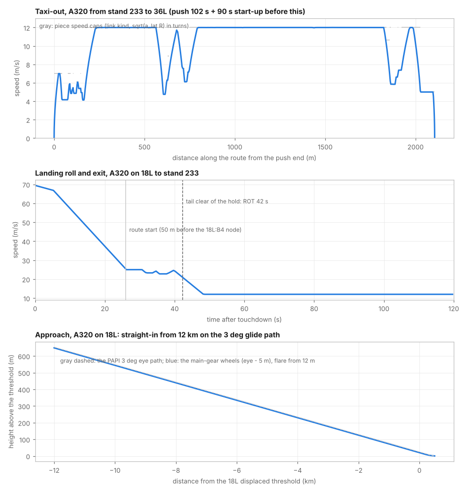

# Phase 3 P3-B: routing and kinematics

Package P3-B of `docs/phase3/design.md` (§4.1-§4.6, §5, §7.1, §7.2), built 2026-11-27. Everything here is **inferred**
(`src: 'inf'`) except the taxi graph, the stands and the runway data it reads, which keep their own labels; airfield rules
come from "AIP (mirror)" short facts carried in `data/sha_taxigraph.json` `rules.facts` / `routing.turns` and
`data/sha_airport.json` `aip_facts`. No per-flight data is used or stored. No FAA constants and no SFO airfield values;
aircraft-type priors taken from sfo3d are cited and labelled inf.

| File (sha3d/) | What |
|---|---|
| `js/sim/router.js` | edge-based taxi router, lane rules, pushes (option A included), end-arounds, exits, holds, blocks, F4552 variant, route assembly |
| `js/sim/path.js` | integer fillet geometry (route-level fillets, corner merging), deterministic arctangent, display evaluation |
| `js/sim/perf.js` | performance table per ICAO type (integers) |
| `js/sim/traj.js` | push, taxi, approach, landing roll, line-up, take-off, climb-out trajectories; exit model; display poses |
| `js/sim/bodies.js` | aircraft planforms as bodies (forked from sfo3d@e3218d6 `js/live/ground.js`, degrees, no `antOf`) |
| `tools/sim/build_routes.mjs` | builds `data/sha_routes.json` / `.js` and `data/SOURCES_routes.json` |
| `tools/sim/test_router.mjs`, `tools/sim/test_traj.mjs` | the acceptance tests (34 and 17 checks) |
| `data/sha_routes.json` / `.js` (`window.SHA_ROUTES`), `data/SOURCES_routes.json` | the route table (326.5 kB) and its sources |
| `docs/phase3/movement_{routes,rot,profiles}.png` | three aggregate figures |

```bash
node tools/sim/build_routes.mjs            # -> data/sha_routes.json/.js + data/SOURCES_routes.json (about 20 s)
node tools/sim/test_router.mjs [--quick]   # 34 checks (--quick skips the all-route pavement scan: 20 s instead of minutes)
node tools/sim/test_traj.mjs               # 17 checks (2 s)
```

---

## 0. Result in brief

| Acceptance (design §7.2, P3-B) | Measured | Status |
|---|---|---|
| 164 / 164 × 4 departure and arrival ends; option A for the 14 by rule, same runs as `optA_push.mjs` or shorter | departures 656 / 656, arrivals 656 / 656 (an exit on the stand side); option A: the 14 one-way stands found by rule, 14 same runs, 0 shorter, 0 other | pass |
| 0 runway-link use outside line-up; 0 off-list crossings; 0 foreign lead-ins; 0 turns > 100° | 0 / 0 / 0 / 0 over 6,740 routes (303,787 transitions; max taxi turn 100.0°, p99 42.3°) | pass |
| Option A pushes: swept planform and every gear point on pavement, class reference | 14 stands × 4 ends: 0 of 38,388 gear samples, 0 of 166,348 outline samples off | pass |
| End-around ≥ 90 % of span < 36 m west-side arrivals; never ≥ 65 m; 36-65 m via H2 / H6 | 372 / 372 = 100 %; 0 / 20; 352 / 352 via H2 / H6 | pass |
| Route table deterministic (md5 twice), ≤ 0.6 MB, with the F4552 variant | md5 `a1c46feef4ead84b33386eed133b92f4` twice; 326.5 kB; F4552 variant 828 routes, 0 using a closed link | pass |
| Baked integer geometry = float path length within 1 cm per piece | 0 of 721,331 pieces > 1 cm (max 0.500 cm); integer geometry is rebuilt at run time from the stored link sequences (§6, D1) | pass (with deviation D1) |
| `test_traj`: trajectories within the §4.4 limits | 0 violations of accelerations, speeds, piece caps, R ≥ R_min, position steps, heading continuity, push limits; line-up ≤ 60 s (max 27 s) | pass |
| Take-off roll ≤ TORA − 400 m | 0 of 98 type × end × entry cases; smallest margin beyond the 400 m: 294 m | pass |
| ROT from touchdown ≤ 50 s for ≥ 90 % of type × exit cases | **64.7 %** of 190 (narrow-bodies 93.7 %, wide-bodies 6.3 %; east runway 67.5 %) | **FAIL** |
| Glide path 3.0° ± 0.1° | 2.981-3.044° (6,392 samples, 12 km to the flare) | pass |
| No transcendental call on the commit path | 0 calls in 96 route builds + every trajectory builder, the exit model, `timeAtS` / `sAt`; the guard counts 5 in one display `evalTraj` | pass |
| (design §5 row, C2's day test) ROT ≤ 70 s for all | max **75.4 s** (p50 49.3, p90 67.0); every case over 70 s is a wide-body at a far-end connector | **FAIL** |

The two ROT rows are the honest failures; §7 explains them. Everything else passes.

---

## 1. What was built

### 1.1 Interfaces (design §7.1: all frozen names kept, fields added)

```js
import { makeRouter, closedLinksFor, END_IDS } from './js/sim/router.js';
import { perfOf } from './js/sim/perf.js';
import * as TJ from './js/sim/traj.js';

TJ.initTraj(SHA_ROUTES);                                   // runway-end geometry (integer cm) from the route table
const router = makeRouter(SHA_TAXIGRAPH, { table: SHA_ROUTES, stands: SHA_STANDS, closedLinks: null, crossOnly: null });
const P = perfOf('A320');

// departure: push (tail first) + 90 s start-up, taxi from the push end to the line-up point, take-off roll and climb-out
const dep = router.departure('233', '36L', { entry: 'full' /* or 'H6' / 'H2' */, spanCm: P.spanCm });
const push = TJ.pushTraj(dep, P, tOffBlock);               // marks.pushEndMs; ends after the start-up hold
const taxi = TJ.groundTraj(dep, P, push.t1, { stops: [{ sCm, untilMs }] });   // stops = block waits from C1
const to   = TJ.takeoffTraj('36L', dep.lineup, P, tRoll);  // marks.liftoffMs, rollCm, extentMs, fadeMs, rollOk

// arrival: exit choice (seeded u), approach, landing roll, taxi-in
const ch = TJ.chooseExit(router, '36R', '233', P, u, { tdOffsetCm });          // {exit, why, route, rotMs, ...}
const app = TJ.approachTraj('36R', P, tTd, { tdOffsetCm });                   // marks.thresholdMs, tdSCm, extentMs
const land = TJ.landingTraj('36R', P, tTd, { route: ch.route, tdSCm: app.marks.tdSCm });
const tin = TJ.groundTraj(ch.route, P, land.t1, { vStart: land.marks.vExitCms });
const rot = TJ.rotMs(land, tin);                           // touchdown -> tail clear of the runway-holding position
const pose = TJ.evalTraj(tin, t, {});                      // display only (floats, trigonometry)
```

- `makeRouter(G, {table, closedLinks, stands, crossOnly, live})` -> `{departure(stand, end, {entry, spanCm, geom}),
  arrival(exitId, stand, {spanCm, geom}), exits(end, all), optionA(stand), standSide, westOfWest, clsOf, info(),
  clearCache()}`. `stands` is accepted but not needed (stand nodes, push links and lead-ins come from the taxi graph;
  `build_routes.mjs` reads the stands' `span_max`); `live: true` ignores the table.
  `exits(end)` returns the ranked rapid exits (rank 1-2 per side), `exits(end, true)` adds rank 3 and the far-end
  connectors (`kind: 'end'`, rank 9). `info()` says whether the table or live routing is in use.
- **Route** (frozen fields + additions): `kind, stand, end, exitId, links: [[linkId, fromNode]], lenCm, pieces: [{kind:
  'line' | 'arc', lenCm, rCm, vmaxCms, linkId, + s0Cm, turn, tag, g}], blocks: [{id, s0Cm, s1Cm, noStop, + kind, node |
  link, dir, twoWay, start, crossing, landing, end}], push: {lenCm, optionA: {run, node, swing, turnDeg, record} | null, +
  pieces, path, verts, nLinks, node, swing, swingVirtual, tailHdg, run, fallback, resources}, holds: [{sCm, node, kind:
  'rwyhold' | 'lineup' | 'leadin' | 'endbox', + runway, ref, dwellMs, end, src}], crossings: [{runway, node, sCm, nearEnd,
  + ref, alongCm, sInCm, sOutCm, holdSrc}], lineup: {node, sCm, + rwySCm, entrySCm, holdSCm, toraCm, toraLeftCm}`; added
  `entry, cls, geom, path, vS, verts, zones, exit, vacate, endAround, src, variant`.
- **Traj** = `{t0, t1, segs: [{t0, t1, s0Cm, v0Cms, aCms2, kind, + s1Cm, v1Cms}], route, phases: [[t, phase]], + kind,
  role, dir, perf, path | rwy, marks, warn}`. **pose** = `{x, y, z, hdg, pitch, roll, gs, vs, ground, gear, flaps,
  spoilers, phase, + main, tip, t}` (x, z = nose-gear contact; `main` = main-gear centre; `tip` = nose tip; gs in m/s).
- Extra exports: `router.js` `ROUTER, END_IDS, runwayOfEnd, graphFingerprint, closedLinksFor, simplify`; `path.js` `PATH,
  atanDet, angleDet, hdgDet, buildPath, pieceAt, pointAt, floatLen`; `perf.js` `PERF, WAKE, NM_CM, kt2cms`; `traj.js`
  `TRAJ, runwayGeom, initTraj, isqrt, arrivalEntryCms, pushTraj, landingTraj, flareOverrunCm, wheelAimSCm,
  touchdownSCm, sAt, timeAtS, vAt, phaseAt, chooseExit, rotMs`; `bodies.js` `samples, inside, bodyOf,
  bodyFromNoseGear, overlaps, fusIn, clearance, gearOf, sweptSamples`.

All modules are pure ES modules (node 22 and the browser): no DOM, no module-scope `window.*`; the data are passed in.
Headings at the interfaces are degrees true (`js/geo.js` `hdgVec`).

### 1.2 Reference point and conventions

- `s` is the **nose-gear station** along the filleted centreline (the stand stop node is the nose-wheel stop, CLAUDE.md
  "Conventions"). The main gear runs on the same path one wheelbase behind (forward taxi) or ahead (push); the heading is
  the main-to-nose chord ("chord model"). A departure route starts at the push end (s = 0) and ends at the line-up point;
  the push has its own path (`route.push.path`, s = 0 at the stand node, tail first). An arrival route starts on the
  runway centreline 50 m before the exit node and ends at the stand node.
- Runway trajectories use the runway axis: s = cm from the physical runway end of that direction (negative on final).
- Segment boundaries are integers (ms, cm, cm/s). Inside a segment the position is the quadratic through (t0, s0) and
  (t1, s1) with the start speed v0, so a segment ends exactly at its integer s1. `aCms2` is that quadratic's rounded
  acceleration: **use `sAt` / `timeAtS` / `vAt`, never re-integrate from `aCms2`**.

### 1.3 Route table (`data/sha_routes.json`, `window.SHA_ROUTES`)

`{v, what, licence, attribution, generator, src, src_note, inputs_sha256_16, graph_fp, params, stands, exits, optionA,
runwayEnds, variants, groups, counts, format}`:
- `groups["dep|<end>|<entry>|<variant>"]` and `groups["arr|<end>:<exit>|<n|w|x>|<variant>"]` = `{rev, t: [linkId,
  parent, ...], leaf: [per stand: trie node | -1 not stored (use the base / class n entry) | -2 no route], lenN, lenW,
  (dep) pn, sw, td}`: the link sequences as a trie (departures stored reversed so that routes to one end share their
  runway-side tails), the route lengths of the narrow and the wide geometry (verification), and per departure the
  pushed links (push link + tail-first run), the swing link and the push-turn angle.
- Span classes for arrivals: `n` < 36 m, `w` 36-65 m, `x` ≥ 65 m; `w` / `x` entries are stored only where they differ
  from `n` and the stand's `span_max` admits them.
- `runwayEnds`: per end the integer geometry (end point, unit direction, length, threshold and PAPI aim stations,
  TORA / TODA / ASDA / LDA, intersection entries, profile, extent distances). `exits`: the ranked exit list. `optionA`:
  the 14 option A records. `variants.F4552`: the closed link ids, window, `crossOnly` and the target record (§2.6).
- 62 groups, 21,742 trie nodes; 984 departures (164 × 4 full length + 164 × 2 intersection entries) and 2,756 arrivals;
  0 null routes in the base variant.
- `graph_fp` is an FNV-1a fingerprint of the routable part of the taxi graph; the router uses the table only when the
  graph's fingerprint matches and the closure set is the base or a known variant, otherwise it routes live with the same
  code (3.5 ms per stand for all four ends at once).

---

## 2. Routing (`router.js`)

### 2.1 Search
Dijkstra over states (link, exit node), integer cm costs, a binary heap with a deterministic tie-break on the state key.
Transitions only from the committed `turns` table (≤ 90° + 10°, one-way, crossings on the list). Use rules: runway links
never (the line-up and the arrival's runway lead are runway-centreline pieces added by assembly, not taxi links);
`status: construction` skipped; a stand's own lead-in only for that stand; push links only as the first leg;
arrival-only (Y1-Y3) / departure-only (M1-M6, L11-L17) per role; `span_max` per link. One search per stand serves all
four take-off ends (multi-goal); arrivals one search per exit × span class.

Costs: length; + 5 km per 18R/36L crossing for arrivals from the east runway with span < 36 m (end-around preference);
+ 10 km for an end-around at 36-65 m ("limited"); wide-bodies (≥ 36 m) cross 18R/36L free only at H2 (landing 18L) /
H6 (landing 36R); a pushed metre costs 3 taxied metres. Departures cross 18L/36R at H1 / H4 / H7 only (taxigraph list):
142 of 328 departures to 18R/36L cross it, all at one crossing.

### 2.2 Pushes and option A
Design §4.3 pushed along the reversed lead-in and then "turned the tail onto the lane". At the OSM lead-in forks that
produced impossible starts (the forward taxi beginning in the push direction; the first version had virtual swings on
532 of 656 departures, `out/phase3/B/push_ends.png`). So **every** push now has the option A structure: the push link,
then a tail-first run over 0-2 two-way apron lanes (≤ 60 m, motion turns ≤ 100°; a retry with up to 4 links / 150 m for
the few ends the short runs cannot reach), a push-turn (≤ 100°) that swings the tail into a branch X at the junction K,
and a forward start through K (≤ 100°). The push ends ≥ 2 m past the push-turn arc and far enough into X for a 20 m
fillet of the forward turn; 40 m of push path stay beyond the push end for the main gear.
- Over all 656 departures: run 0 lanes 74, 1 lane 510, 2 lanes 68, 3 lanes 4 (20 departures used the long retry);
  push length p10 / p50 / p90 / max 84 / 140 / 174 / 238 m (257 above 150 m); push-turn max 97°, p50 39°; motion turns
  in the run max 64.8°; 0 graph fallbacks.
- **Option A** (the 14 stands whose push end reaches no take-off end: 271 279 280 272 278 227 219 226 240A 240 225 218
  239 238A) is found by rule: the shortest run that reaches all four ends. Same runs as `optA_push.mjs` for 14 / 14, runs
  7.2-59.4 m, push-turns 3-67°, push lengths 125-200 m (median 161; the scratch: 134-191 m, median 149, with a 20 m
  push-turn radius; here 25 m, and the push end is placed for the forward fillet). `route.push.optionA` carries `{run,
  node, swing, turnDeg, record}` for those 14 only.
- `route.push.resources`: the blocks of the push link, the run, K and the swing branch, for C1 to reserve for the push
  and the 90 s start-up.

### 2.3 End-arounds and wide-body crossings
Arrivals from 18L/36R to stands west of 18R/36L: span < 36 m 372 / 372 on ROUTE-NORTH / ROUTE-SOUTH (south flow N 23,
S 163; north flow N 138, S 48: the shortest stays, as the design kept it); 36-65 m 352 / 352 cross at H2 / H6; ≥ 65 m 0 /
20 end-arounds. Every end-around carries an `endbox:<18R|36L>` block (noStop; 30-800 m beyond the 18R/36L end, ≤ 300 m
laterally) and an `endbox` hold 30 m before it (HP1-HP4 are not in the data: inferred holds).

### 2.4 Exits and entries
- Exits per landing end (m from the physical end; e/w = side, number = rank): 18L B4/w1 1,978, A3/e1 2,073, B5/w2
  2,337, A4/e2 2,407, B6/w3 2,737; 36R A2/e1 1,851, B3/w1 2,069, A1/e2 2,274, B2/w2 2,409, B1/w3 2,826; 18R B8/e1 1,942,
  C3/w1 1,942, C4/w2 2,296; 36L B7/e1 1,972, C2/w1 1,972, C1/w2 2,315; plus a far-end connector per side (rank 9, kind
  `end`, 3,079-3,338 m) as the last resort. The unnamed rapid links before the F4301 first exits are excluded (review
  L1). F4301 first exits vs the graph: +28, +83, +36, +19 m.
- Arrival route: 50 m runway lead before the exit node (room for the exit fillet), exit fillet with a_lat 1.25 m/s²,
  vacate = the first runway hold of the landing runway after the exit node (OSM [obs] or `hold_inf` 90 m), a 5 s stop
  before turning onto the lead-in (AIP (mirror) AD 2.20 3.2.2.2; at the junction box start when the box is no-stop), the
  last 15 m at ≤ 1 m/s.
- Departures: `entry` `'full'` (the full-length connector) or the intersection H2 (18R) / H6 (36L) (AIP (mirror) AD 2.20
  2.1.7; TORA 2,988 m measured from the intersection). Line-up = the arc onto the centreline + 35 m (≥ wheelbase + 2 m of
  every type); `lineup.toraLeftCm` = TORA left from the line-up point. Wide-bodies use full length (C1's choice).

### 2.5 Assembly: pieces, blocks, holds
- Pieces from `path.js` (§3.1). Blocks: per link blocks of ≥ 60 m (`b:<link>:<k from a>`, `dir`, `twoWay`), junction
  boxes `j:<node>` = fillet region + 15 m (`noStop` when a taxiway touches the node; `start` for the box the route starts
  in), one-at-a-time lanes `lane:<ref>` (Y1-Y3, M1-M6, L15-L17), runway strips `rwy:<runway>` (crossings and the landing
  roll noStop; the line-up block not), `endbox:<end>`. About 100 blocks per route (all routes: link 172,946, box 114,363
  of which 99,380 noStop, lane 1,061, rwy 4,832, endbox 744). Block windows (nose in to tail out + 5 s) are C1's.
- Holds: `rwyhold` before every crossing (`sCm` = strip entry), `lineup` (departures, at the runway-holding position),
  `leadin` (arrivals, `dwellMs` 5000), `endbox`. Crossings: `{runway, node, ref, sCm, sInCm, sOutCm, nearEnd, alongCm}`.

### 2.6 F4552 / F4551 variant
`tools/sim/build_routes.mjs` embeds a derived effect record of F4552/26 (window 2026-11-10T17:00Z to 2026-11-29T22:00Z,
daily 17:00-22:00Z; targets as taxiway names and "between" spans, no NOTAM text; short facts (OD3) from the eAIP NOTAM
Summary in force 2026-11-02 07:06Z, sources_sim.md §4.2) and the F4551 crossing restriction (18L/36R only via H4 / H7).
`closedLinksFor(G, targets)` maps it to 103 links (a "between" chain whose end refs share no node uses the nearest chain
node within 150 m). The variant is stored for the 18R / 36L ends only, for the routes that use a closed link or an
off-list crossing: 828 routes, 0 using a closed link; every departure to 18R / 36L keeps a route. 552 variant arrivals
have no route (leaving 18R/36L to the east means taxiway B, closed); there are no landings in the F4551 window anyway
(design §5 night row). The local `refs/cache` NOTAM extraction is only compared by taxiway names (counts in the log).

---

## 3. Kinematics (`path.js`, `perf.js`, `traj.js`)

### 3.1 Integer geometry
- Link interiors are simplified (Douglas-Peucker, 1 m) and the route's vertex chain is filleted **per route**: R =
  min(room, max(R_nom, R_tol)) with R_nom 45 m (narrow) / 55 m (wide geometry), R_tol the radius that cuts 1 m off the
  vertex, the room on each leg shared max-min fairly between neighbouring corners; corners whose room would leave less
  than 15 m are merged with their neighbour (kinks < 30° of either sign absorbed, combined deflection < 150°).
- All in integer cm with `+ − × ÷` and `Math.sqrt` only: tan(θ/2) = |u × v| / (|u||v| + u·v), arc angle from `atanDet`
  (argument reduction + Horner polynomial; correctly rounded basic operations give identical results in every engine),
  pieces `{kind, s0Cm, lenCm, rCm, turn, vmaxCms}`. `pointAt` (display) evaluates the same pieces with floats.
- Fillet radii over all routes: min 7.4 m, p01 18.3, p10 29.3 m; 15 arcs below the B77W fillet floor (13.5 m), 0 below the
  A321 floor; for the type that uses a route, 0 arcs below R_min and 0 between R_min and 1.6 R_min (`test_traj`).

### 3.2 Speed profile
Forward / backward passes on integer speeds over the piece caps (link kind, √(a_lat R), zones, stops), legs with ceil
distances, a peak search per leg; segments `{t0, t1, s0Cm, s1Cm, v0Cms, v1Cms, aCms2, kind}` with integer ms boundaries;
`timeAtS` uses τ = 2d / (b + √(b² + 4Ad)) (no cancellation). Stops `{sCm, dwellMs | untilMs}` are C1's block waits.
Arrival taxi starts at `arrivalEntryCms` (the highest speed from which the caps ahead can be met at −1.5 m/s², ≤ 25 m/s).

### 3.3 Push, approach, landing, take-off
- `pushTraj`: tail first at ≤ 1.2 m/s, ±0.3 m/s², then the 90 s start-up hold (`marks.pushEndMs`).
- `approachTraj`: straight-in from 12 km on the 3° PAPI path. The PAPI path is the **pilot's eye** path through the PAPI
  abeam point (`papi.inward_of_dthr_m`); the wheels fly `eyeToWheelCm` lower (door-1 sill + 0.9 m + main-gear-to-cockpit
  × sin 2.5°: 3.2-7.4 m), flare from 12 m to a 1 m/s sink. Nominal touchdown −9 to +69 m from the PAPI abeam point over
  the types; wheel height over the threshold 13.2-21.6 m (eye 24.8 / 20.6 m). The caller adds its seeded ±60 m
  (`tdOffsetCm`). Glide path measured 2.981-3.044°.
- `landingTraj` (two-phase): roll-out at 0.5 m/s² (idle reverse + drag), then braking at a_dec (2.0 narrow / 1.7 wide)
  timed to reach the turn-off speed (25 m/s, or the route's lower entry speed) at the route start 50 m before the exit
  node; null when the exit is too close for the type.
- `chooseExit(router, end, stand, perf, u, {tdOffsetCm})`: the stand's side; the first exit the deceleration reaches with
  the route's entry speed, else the second, seeded 70 / 30 by `u` when both are reachable; the second pick is replaced
  by the first when the second gives ROT > 50 s and the first ≤ 50 s (AIP (mirror) AD 2.20 2.1.4.2); fallbacks: a later
  rapid exit, then the far-end connector. Returns `{exit, why, needSCm, side, rotMs, route}`.
- `takeoffTraj(end, lineup, perf, tRoll)`: constant a_to to Vlof, rotate 3°/s to 8°, liftoff, climb γ 7° to 3,000 ft
  with +0.6 m/s² to 250 kt, straight on the runway heading; `marks.extentMs` at the extent edge, `fadeMs` 15 km beyond
  the far end. A320 on 36L: liftoff 38.6 s / 1,489 m; extent edge after 77 s at 424 m AGL; fade after 186 s at 914 m.
- `evalTraj(traj, t, out)` (display): nose-gear x / z, `main`, `tip`, y on the runway profile or the air path, heading
  (chord), pitch, roll 0, gs (m/s), vs, ground, gear / flaps / spoilers by phase (sfo3d attitude rules).

---

## 4. Parameters (all `src: 'inf'` unless noted)

### 4.1 Router (`ROUTER`)
| Parameter | Value | Basis |
|---|---|---|
| `fullLengthCm` | 120 m | an entry within 120 m of the end counts as full length (H1, H7, T6, end connectors) |
| `intersection` | 18R: H2, 36L: H6 | AIP (mirror) AD 2.20 2.1.7 |
| `optA` | run ≤ 60 m, ≤ 2 lanes, turns ≤ 100°; retry ≤ 150 m / 4 links | design §4.1 (retry: this package) |
| `xPenCm`, `eaLimitedPenCm` | 5 km per 18R/36L crossing; 10 km for a 36-65 m end-around | design §4.1; AIP (mirror) AD 2.20 2.3.3 |
| `wideCrossFree` | 18L: H2, 36R: H6 | AIP (mirror) AD 2.20 2.3.3 ("mainly cross 18R (36L) via H2 (H6)") |
| `spanNarrowCm`, `spanEaMaxCm` | 36 m, 65 m | AIP (mirror) AD 2.20 2.3.3 |
| `exclusiveLanes` | Y1-Y3, M1-M6, L15-L17 | AIP (mirror) AD 2.20 3.1.5 (taxigraph rules.facts) |
| `endExitWithinCm` | 600 m | a far-end connector within 600 m of the end is the last-resort exit |
| `rollLeadCm` | 50 m | arrival route starts 50 m before the exit node (exit fillet room) |
| `lineupLeadCm`, `lineupAlignCm` | 150 m, 35 m | a centreline vertex 150 m down the runway for the line-up fillet; the route ends 35 m past the arc (≥ wheelbase + 2 m of every type) |
| `lineupTurnCos` | 45° | a line-up node's runway link must point within 45° of the take-off heading |
| `holdLatCm`, `holdSearchCm`, `holdSnapCm` | 90 m, 300 m, 15 m | taxigraph `hold_inf` rule; search window |
| `boxPadCm`, `blockMinCm` | 15 m, 60 m | design §4.5 |
| `endBox` | 30-800 m beyond the end, ≤ 300 m lateral, hold 30 m before | design §4.1 / §4.5 (box extent: this package) |
| `simplifyCm` | 1 m | OSM digitising jitter would cap turn speeds |
| `swingExtCm`, `pushTailRoomCm` | 90 m, 40 m | push path into the swing branch; main gear room beyond the push end |
| `pushWeight` | 3 | a pushed metre costs 3 taxied metres (1.2 against 7-12 m/s) |
| `pushEndPastArcCm`, `fwdTurnRCm` | 2 m, 20 m | push end past the push-turn arc; room for a 20 m forward fillet (≥ 1.6 R_min of every type) |
| `caps` (m/s) | taxiway 12 / wide 10, taxilane 7, lead-in 3, rapid exit 25, line-up 5, push 1.2; last 15 m ≤ 1 | design §4.4 |
| `leadinStopMs` | 5 s | AIP (mirror) AD 2.20 3.2.2.2 (`aip_facts.stop_before_leadin`); 5 s inf |

### 4.2 Geometry (`PATH`)
| Parameter | Value | Basis |
|---|---|---|
| `rNomCm` | 45 m narrow / 55 m wide geometry | design §4.4 |
| `rPushCm` | 25 m (nose gear) | inf (`optA_push.mjs` used 20 m) |
| `rFloorCm` | 15 m | merge below; above the largest fillet floor 1.6 × 0.27 × wheelbase (B77W 13.5 m) |
| `cutTolCm` | 1 m | a small deflection may take the radius that cuts 1 m off the vertex |
| `mergeMaxCos`, `mergeKinkTan` | 150°, 30° | merged corners < 150°; neighbour kinks < 30° absorbed |
| `aLatCms2`, `aLatRapidCms2` | 1.0, 1.25 m/s² | design §4.4; RET design 93 km/h on a 550 m radius ≈ 1.2 m/s² (ICAO, from memory, unverified) |

### 4.3 Performance (`PERF`, `perfOf`)
| Parameter | Value | Basis |
|---|---|---|
| `aToCms2`, `aDecCms2` | 2.0 narrow-body / 1.7 wide-body (wake H / J) m/s² | design §4.2 / §4.4 |
| `taxiMaxCms` | 12 / 10 m/s (span < / ≥ 36 m) | design §4.4 |
| `taxiAccCms2`, `taxiDecCms2` | +1.0 / −1.5 m/s² | design §4.4, under sfo3d `ctlGround` caps (traffic.js:2795) |
| `pushCms`, `pushAccCms2`, `startupMs` | 1.2 m/s, 0.3 m/s², 90 s | design §4.3 |
| `vExitCms`, `rapidMaxCms` | 25 m/s | design §4.4 rapid-exit entry bound (§4.2 said 20: D4) |
| `climbAccCms2`, `vClimbCms` | 0.6 m/s², 250 kt | inf |
| `steerFactor`, `filletFactor` | R_min = 0.27 × wheelbase; fillet ≥ 1.6 R_min | sfo3d traffic.js:2782, :457 |
| geometry | span, length, nose / main gear stations, track, sill | `js/aircraft/types.js` SPEC; C919 (A320 stand-in scaled to 35.8 / 38.9 m [sec]) and AJ27 (CRJ900 stand-in, 27.3 / 33.5 m, `class_ref.B`); business jets generic 28 / 30 m |
| Vlof | sfo3d `LIFTOFF_KT` (traffic.js:154, observed at SFO: an aircraft-type prior, inf here), else 125 / 150 / 165 kt by length | design §4.4 |
| Vapp | Vref + 5 kt per type, 125-160 kt | from memory, unverified |
| wake | H ≥ 136 t MTOW, J = A388 | ICAO Doc 4444 from memory, unverified (`WAKE` pair minima likewise) |
| `eyeToWheelCm` | sill + 0.9 m + (x_main − 2.5 m) × 0.0436 | inf (seated eye height; sin 2.5° approach pitch) |

### 4.4 Trajectories (`TRAJ`)
| Parameter | Value | Basis |
|---|---|---|
| `glideDeg` / `tanGlide` | 3° (literal tangent) | AIP (mirror) PAPI 3° (`aip_facts.ends.*.papi.angle_deg`) |
| `approachCm` | 12 km before the threshold | design §4.4 |
| `flareFromCm`, `tdSinkCms` | 12 m, 1 m/s | sfo3d attitude rule (traffic.js:3135); design §4.4 |
| `climbDeg`, `climbToCm` | 7°, 3,000 ft | design §4.4 |
| `fadeBeyondEndCm` | 15 km | design §4.4 |
| `rotateDegS`, `rotatePitchDeg` | 3°/s to 8° | sfo3d attitude (traffic.js:3138) |
| `rotMaxMs` | 50 s | AIP (mirror) AD 2.20 2.1.4.2 |
| `rolloutDecCms2` | 0.5 m/s² before braking | inf (idle reverse + drag) |

---

## 5. Test results (aggregates)

`tools/sim/test_router.mjs`: **34 / 34 pass** (quick 19 s; the full run adds the all-route pavement scan).
- Table: two builds give the same md5; the committed file is up to date; `.js` wraps the same JSON; 326.5 kB (.js
  326.8 kB); the router recognises the base and the F4552 closure set; table link sequences = live routing (base and
  F4552: 0 mismatches); stored route lengths = run-time rebuild (0 mismatches).
- Rules over 6,740 routes (departures and arrivals, both variants, all span classes): every taxi transition is in the
  committed `turns` table (option A geometric starts excluded); one-way 0, use 0; holds present; blocks inside the route.
- Route lengths: departures median 2,283 m, p90 3,199, max 3,982; arrivals median 2,479 m, p90 4,977, max 5,883 (the
  end-arounds). Option A pushes on pavement (above). Other pushes (INFO): wing tips of the wide class references cross
  verges at 24 stands (outline 17,540 of 1,609,595 samples off; gear 400 of 371,445 off); all base routes, class
  reference type, 2 m steps: 8,963 of 11,279,703 gear samples off (0.079 %) on 604 routes (full run, 81 s). C2's day
  test is the acceptance for those (design §5 "Pavement").

`tools/sim/test_traj.mjs`: **15 / 17 pass** (1.5 s). 1,968 trajectories (push + taxi-out for 164 × 4, landing + taxi-in
for 164 × 2, the stand's class reference type), 152,898 segments, poses at 1 s on every 8th stand.
- Accelerations, speeds, caps, radius, position steps (peak speed between samples, v·dt + 0.1 m), heading continuity
  (≤ 30°/s + 1°): 0 violations each. Nose-wheel angle (chord model) p50 0.0°, p99 24.2°, max 47.1°.
- Push 0 / start-up 0 violations; line-up from the hold p50 24 s, max 27 s; taxi-out p50 254 s (p90 337), taxi-in p50
  374 s (p90 553).
- Take-off: 0 of 98 cases over TORA − 400 m, smallest margin beyond it 294 m (18R / 36L full length, the heavies).
- ROT: see §7. Glide path 2.981-3.044°. Determinism: 16 / 16 identical. Bodies: degrees and nose-tip placement verified
  (tail at −37.57 m for the A320 test body).
- Cost (node, this sandbox): `makeRouter` with the table 13 ms; first `departure()` per stand × end 0.6 ms (table ->
  integer pieces, then cached); a departure movement (push + taxi + take-off) 0.15 ms; an arrival movement (exit choice +
  approach + landing + taxi-in) 0.41 ms.


*Stored routes per taxi-graph link (departures × 4 ends, arrivals × the first / second exits of the stand side); the 14
option A tail-first runs in orange.*


*ROT from touchdown to the tail clearing the runway-holding position, 18L / 36R, nominal touchdown. Narrow-bodies meet
50 s at the first and second rapid exits; wide-bodies (shaded) do not.*



*Taxi-out A320 233 -> 36L against the piece caps; landing roll and exit on 18L (ROT 42 s); the approach on the 3° path.*

---

## 6. Deviations from the design (with reasons)

- **D1 Baked geometry -> stored link sequences + deterministic rebuild.** The design (§4.1) baked per-transition fillet
  trims. Fillets here are route-level (the room on a leg is shared with the next corner, corners are merged, 1 m
  simplification), so a transition alone does not determine its fillet. The table stores the link sequences (tries) and
  both route lengths; the browser rebuilds the integer pieces with the same integer pipeline (no trigonometry), and the
  test proves table == run-time rebuild (0 mismatches) and integer == float within 1 cm (max 0.5 cm). The file is 326.5
  kB instead of the ~2 MB of a fully baked table.
- **D2 Graph identity** by an FNV-1a fingerprint of the routable graph (`graph_fp`) instead of the file's sha256 at run
  time (sha256 needs the asynchronous `crypto.subtle` in the browser); `inputs_sha256_16` stays in the table and in
  `SOURCES_routes.json` for the tools.
- **D3 Pushes generalised** (§2.2): every push is tail-first run + swing + forward start, not the reversed lead-in plus a
  virtual tail turn. Option A records are kept for the 14 stands as the design names them.
- **D4 Turn-off speed 25 m/s** (the §4.4 rapid-exit bound) instead of §4.2's 20 m/s. Measured with the same cases: at
  20 m/s only 27.4 % of type × exit cases meet 50 s (narrow-bodies 43.6 %); at 25 m/s 64.7 % (narrow-bodies 93.7 %).
- **D5 Two-phase landing roll** (roll-out at 0.5 m/s², braking timed to the exit) instead of braking from touchdown:
  braking from touchdown reaches the turn-off speed well before the exit and covers the rest at 25 m/s (a modelling
  argument; the two variants were not compared separately).
- **D6 Touchdown** from the eye path: the PAPI path is flown by the eye, the wheels touch down earlier, the flare floats
  them later; nominal −9 to +69 m from the PAPI abeam point (design: the abeam point ± 60 m); the seeded ±60 m is added
  by the caller.
- **D7 Exit model additions**: rank-3 exits and far-end connectors as fallbacks (without them B744 had no reachable exit
  on some sides); reach is computed with the route's entry speed; the 70 / 30 second pick yields to the first exit when
  only the first meets 50 s.
- **D8 Rapid exits a_lat 1.25 m/s²** (turns elsewhere 1.0); the arrival route starts 50 m before the exit node.
- **D9 Rolls by body, taxi by span**: take-off / braking accelerations by wake H / J (B753, span 41 m, rolls as a
  narrow-body), taxi speed and fillet radii by span ≥ 36 m.
- **D10 Interface additions** (§1.1): fields added only. `makeRouter` takes `stands` (optional), `crossOnly`, `live`;
  `groundTraj` opts add `leadinStop, sStart, sEnd, phase`; new functions `pushTraj, landingTraj, chooseExit, rotMs, sAt,
  timeAtS, vAt, phaseAt`. `initTraj(SHA_ROUTES)` must be called once (runway geometry), or `opts.rwy` passed.

---

## 7. What does not meet the acceptance, and limits

- **ROT ≤ 50 s for ≥ 90 % of type × exit cases: 64.7 % (FAIL).** 190 nominal cases (19 types × 4 ends × 2 sides × the
  exits the model picks). Narrow-bodies 93.7 % (8 of 127 over 50 s, max 57.1 s), wide-bodies 6.3 % (4 of 63); east
  runway 67.5 %. Wide-bodies brake at 1.7 m/s² from 140-155 kt and are longer (the tail must clear the hold): on the east
  runway 46.2-75.4 s, median 55.0 s. Branches of the 67 nominal cases over 50 s: first exit (70 %) 11, second (30 %) 9,
  second because the first is not reachable 25, a later rapid exit 1, far-end connector 19, first 2. Raising a_dec for wide-bodies or the turn-off speed above 25 m/s
  would pass the test by assumption, not by evidence (no ZSSS ROT data are available here), so it was not done. The
  owner may accept the AIP 50 s as a narrow-body target, or C1 may treat 50 s as the planning ROT for the spacing and
  report the wide-body excess.
- **ROT ≤ 70 s for all (design §5 row; C2): max 75.4 s (FAIL).** Every case over 70 s (all ±60 m offsets) is a
  far-end-connector exit, taken because no rapid exit of the stand's side is reachable: wide-bodies on 18R / 36L (one
  east rapid exit per direction, B8 / B7 at about 1,950 m; B77W / B789 / B744 also on the west side) and B744 on 36R east.
  On the east (arrival) runway 2 of 338 cases exceed 70 s. In the segregated mode (AIP (mirror) AD 2.20 2.1.1) 18R / 36L
  takes landings only when 18L/36R is unavailable.
- **Pavement outside option A** (INFO, C2's acceptance): wide class references put wing tips over verges at 24 stands'
  pushes, and 0.079 % of all-route gear samples are off the drawn pavement (OSM digitising; the fillets are cut to the
  room on the legs).
- **Fillets**: 15 arcs below 13.5 m (the B77W fillet floor) exist over all routes; for the class reference type of each
  route no arc is below R_min or between R_min and 1.6 R_min (`test_traj`). A larger type on a narrow-class route is the
  scheduler's stand / class rule, not checked here.
- **Memory** (design §5 "Memory ≤ 40 MB", C2): an assembled route costs about 70 kB of heap (pieces with float display
  geometry 26 kB, blocks 11 kB, vertices 8 kB). A day with about 500 distinct routes needs about 35 MB for routes alone.
  C1 can drop `route.verts` and copy the block windows it needs (about 18 kB less per route); compacting the pieces
  into typed arrays would be a B follow-up.
- Climb-out is straight on the runway heading (the SID turn has no published direction here); go-arounds are not modelled.

---

## 8. Notes for the other packages

- **C1 (scheduler)**: build departures with `pushTraj` -> `groundTraj` (stops from block waits) -> `takeoffTraj`;
  arrivals with `chooseExit` (seeded `u`, `tdOffsetCm`) -> `approachTraj` -> `landingTraj` -> `groundTraj`. Reserve
  `route.push.resources` for push + start-up; `route.blocks` (noStop sequences must be traversed whole; `lane:*` are the
  one-at-a-time lanes; `rwy:*` with `crossing` / `landing`; `endbox:*` on end-around arrivals: the departures' end-box
  windows are C1's, from `takeoffTraj` marks). Holds: `rwyhold` (crossing), `lineup`, `leadin` (dwell 5 s, applied by
  `groundTraj` unless `leadinStop: false`), `endbox`. In the F4552 window pass `SHA_ROUTES.variants.F4552.closedLinks`
  and `.crossOnly` to `makeRouter` (a second router instance): the router recognises the stored variant; another
  closure set (e.g. `closedLinksFor(G, targets).ids` for a new NOTAM) routes live with the same code.
- **C2 (day suite)**: pose sampling via `evalTraj`; the main gear centre is `pose.main` ([x, z] m), the nose gear
  `pose.x / z`, the nose tip `pose.tip`; the swept
  planform via `bodies.js` `sweptSamples(T, x, z, hdg)`. The ROT and pavement items above will show in the day test.
- **D (app)**: `evalTraj` is display evaluation (floats); `phase` names: pushback, holding (start-up and stops), taxi,
  lineup, takeoff, departure (after liftoff), approach, final, landing (until the tail clears the vacate point).
  `SHA_ROUTES` is 327 kB.
- **Data owners**: the taxi graph lacks L11, L12, L14 (push holding points of AIP 232-235 / 262-265 / 286-290 / 401-416)
  and the end-around holding points HP1-HP4: the AIP push-to-holding-point instructions of those stands are not
  modelled (the generalised push of §2.2 applies), and the end-box holds are inferred.
- No sfo3d file was changed; nothing was committed (sub-agent rule).
