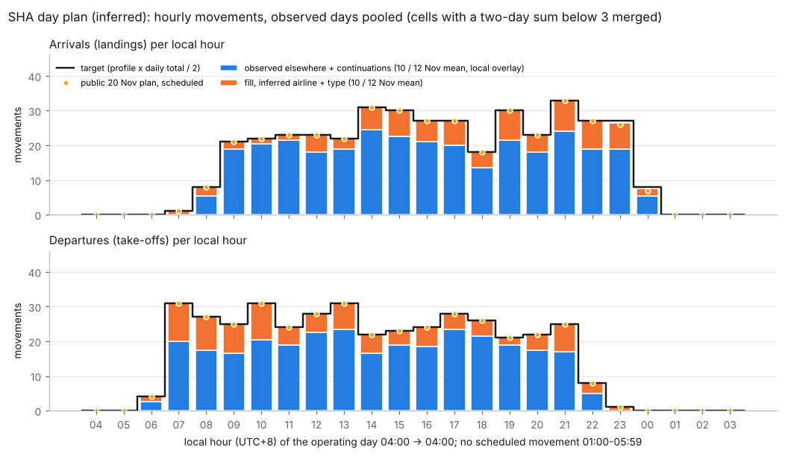
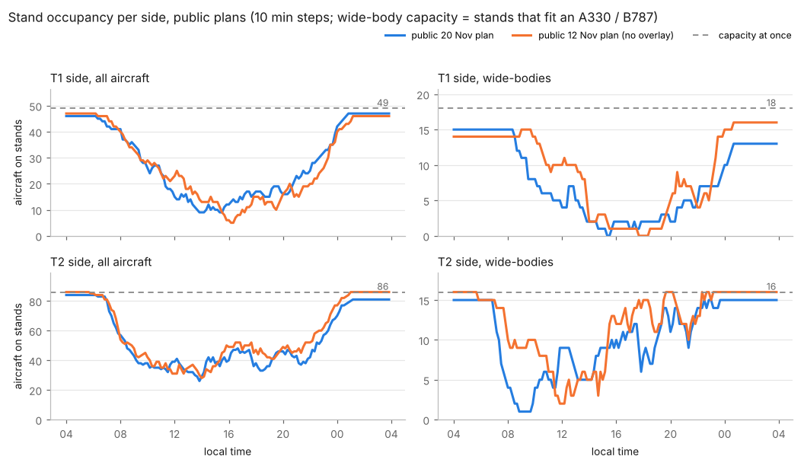
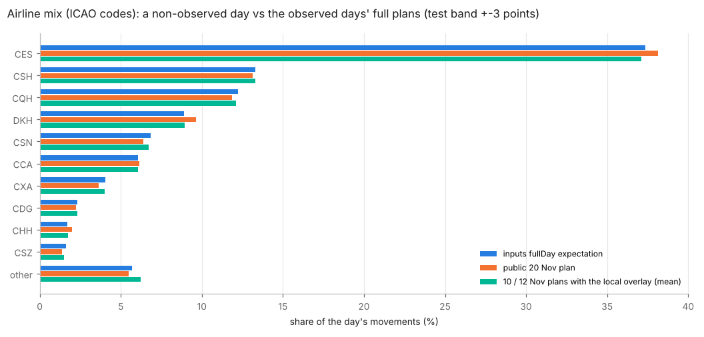

# Phase 3 package P3-A: day plan, identity, inputs

Package P3-A of `docs/phase3/design.md` (§2, §3, §2.6, §5 A rows, §7.1, §7.2 P3-A, §8, §9.1 risk 1), built 2026-11-27.
Owner decisions in force: OD4 (identities observed elsewhere are shown only locally and never written into a committable
file), Q0 kinematic simulator, Q1 flight numbers on non-observed days OFF (the switch exists), Q1b published HKG / TSA
flight numbers on their own date only, labelled "published schedule", no registration, Q2 no rolling scan.

**Labels.** [obs] read in a source or measured here; [inf] a design choice or inferred value; [sec] secondary source;
**AIP (mirror)** a short cited fact from the unofficial mirror (OD3). **No per-flight data in this file:** counts, shares
and quantiles only; label examples use placeholders (`MUnnnn`, `CESnnnn`, `B-nnnn`). The local overlay results below are
aggregates of an in-memory run; nothing from the overlay was written to disk outside `out/` (gitignored).

---

## 1. What was built

| File | Role |
|---|---|
| `tools/sim/build_sim_inputs.py` | builds `data/sha_sim_inputs.js/.json` (`window.SHA_SIM_INPUTS`) and `data/SOURCES_sim.json`; deterministic (`--check` rebuilds in memory and compares: identical) |
| `js/sim/rng.js` | FNV-1a / splitmix32 integer draws, `daySeed(day)`, `draw(seed, key, purpose)` (order-independent), largest-remainder `apportion`, canonical-JSON `hashOf` (2 × 32-bit FNV) |
| `js/sim/inputs.js` | `simInputs(win = globalThis)` (reads the global only when called), operating-day window, local hour, totals, NOTAM queries (`noLandingAt`, `closedStands`) |
| `js/sim/plan.js` | `buildDayPlan({day, inputs, stands, overlay = null, notams, gateTimes, prevEnd = null, opts}) -> DayPlan` exactly as §7.1 (fields added, none renamed), `typeInfo`, `endState` |
| `js/sim/alloc.js` | stand allocation §2.4 (`allocate`, `standTable` with the per-side capacities, `closureWindows`) |
| `js/sim/identity.js` | `checkOverlay(obj)`, `labelFor(movement, overlay, opts)` with the §6.1 texts, `dayLine`, `modelNote`, `repCandidates` (Q1, local only) |
| `tools/sim/observed_overlay.py` | LOCAL: the overlay of one day from `refs/cache/observed_elsewhere/sha_observed_<day>.json`, allow-listed fields only, stdout only |
| `sha_live_server.py` | `GET /api/observed_elsewhere?day=` (loopback only unless `--identity-lan`, Host header named localhost / loopback IP and no cross-site browser request (round 1, F4); `--no-identity`; malformed day 400; `{available: false}` without a file), `/api/ping` `features.identity`, banner line; METAR look-back `WX_HOURS` 12 → 26 h (§1.4) |
| `tools/sim/test_observed_overlay.py`, `tools/live/test_relay.py` (+5) | overlay and endpoint tests (synthetic data only, plus counts on the real local tables) |
| `tools/sim/audit_identity.py` | the exact-match audit of §9.1 (counts, masked paths and line numbers only; exit 1 on a hit, a forbidden `refs/cache` path, any read / git failure (ERROR, round 3) or an incomplete identity set (round 4), exit 2 on a file it could not read completely (REVIEW, round 2; repository-wide since round 3); `--selftest`; `--install-hooks` puts it into the pre-commit and commit-msg hooks (round 4)) |
| `tools/sim/test_plan.mjs` | every P3-A acceptance criterion of §7.2 plus the fill-turn distribution, the night-stop cap, the inputs' freshness, the warm-start identity, Q1 repeat flights and the plot sources (103 checks with the local overlay, 104 with `PLOTS=1`; 8 of them **known failures** that are reported but do not set the exit code: D2 and D8; round 3) |
| `tools/live/build_snapshot.py` (+ `data/sha_snapshot.js/.json`) | `SHA_SNAPSHOT.days[]` for 10 / 12 / 13 / 14 / 20 Nov, `traffic: {kind: 'sim', day, planVersion}`, one-off AWC pull `--fetch-days` |

```bash
python3 -I tools/sim/build_sim_inputs.py             # inputs (needs the local refs/cache aggregates source)
node tools/sim/test_plan.mjs                         # plan tests (PLOTS=1 also writes out/phase3/plan/aggregates.json; with the
                                                     #   local overlay also out/phase3/local/fingerprints.json for the audit)
python3 -I tools/sim/test_observed_overlay.py        # overlay tool + endpoint (4 tests)
python3 -I tools/live/test_relay.py                  # relay (12 tests: 7 old + 5 identity)
python3 -I tools/sim/audit_identity.py --files ...   # or --staged / --diff / --docs; --selftest; --install-hooks (lead, once per clone)
python3 -I tools/live/build_snapshot.py              # snapshot + replay days from the cache (deterministic)
```

---

## 2. Inputs (`data/sha_sim_inputs.js`) and parameters

Every input file is listed in `data/SOURCES_sim.json` with URL, retrieval date, sha256 and licence quote; the inputs
file carries `inputs_sha256_16` (including `data/sha_routes.json`, so a P3-B route-table rebuild needs a rebuild here;
`test_plan.mjs` fails while it is stale, round 2, F18). The local observed-elsewhere tables are listed as "local, hash
withheld" (no fingerprint of a local identity table in a committable file; round 2, F20).
Aggregates only: every per-airline × type count below 3 is merged into `other`, which draws from the pool of merged cells
of its airline group (mainland / foreign); pooled cells still below 3 are folded into the group's most common type of
the same family. The `published` section is the only place where flight numbers occur (§3 allow-list).

| Parameter | Value | src | Basis |
|---|---|---|---|
| Daily total | 783.4 (to 24 Oct), **802** (winter season from 25 Oct) | obs / sec | CAAC Jan-Sep 2026; winter 2026/27 plan (secondary) |
| Hourly shape | identified observed-elsewhere movements per local hour, mean of 10 / 12 Nov; each role scaled to total / 2 | inf | `docs/phase1/sources_sim_hourly.json` (design §2.2 step 1) |
| Airline weights `complement` | ∝ route-DB SHA callsigns − identified distinct callsigns, per observed day (+ the mean) | inf | `observed_elsewhere_stats.json` (review M9) |
| Airline weights `fullDay` | expected shares of a whole observed-day plan = identified + continuations + complement × fill, mean of two days | inf | review M9 |
| Type mix | per airline, cells < 3 merged; wide-bodies × 0.5 only in `complement` | inf | observed_elsewhere.md §5.4 |
| Turnaround | P10 / P50 / P90 **82 / 109 / 152 min** (317 same-airframe pairs ≤ 6 h) as **runway-time gaps** (round 1, F5); minimum 35 min narrow, 60 min wide as ground time (on-block to off-block), i.e. a minimum runway gap of taxi-in + minimum + taxi-out; pairing ≤ 6 h | inf | local aggregate; design 81 / 106 / 134 counted the pairs differently |
| Rotation pairing | the ready airframe whose gap is nearest its drawn gap (`pairPick` nearest); without one at most **50 ‰** of the fill departures take the airframe with the smallest shortfall that has the minimum turn (`rushCapPermille`, counted `stats.counters.rushed`); otherwise a night-stopper | inf | design §2.2 step 6 ("nearest a drawn turnaround"); round 1, F5 |
| International / HMT | carriers based outside the mainland 100 %; MU, FM, CA a common **5.45 %** so that the full-day expectation is 6.3 % | inf | CAAC 2025: 6,978 international + 10,905 HMT of 282,692 |
| Terminal rule | T1 = 9C, NS, MF and every international / HMT flight; T2 = other domestic | inf | SAA airline directory (field.md §2.2) |
| Taxi estimates | T1 in 263 s / out 748 s; T2 in 757 s / out 692 s; business apron in 309 s / out 724 s | inf | route-table medians per side (P3-B) / 7 m/s + 60 s (arrival) or 390 s (push 120 + start-up 90 + queue 180) |
| Delays (tiers 3 and 4 only) | 80 % ±10 min, 15 % +15-60 min, 5 % +60-120 min | inf | design §2.2 step 8; never tier 2 or continuations (M10) |
| Night | no scheduled movement 01:00-05:59 local; an arrival delayed into a no-landing window (F4551 + AD 2.20 2.1.6) is diverted to Pudong (counted, not drawn) | inf / AIP (mirror) | design §2.5 |
| Stand buffer | [on − 10 min, off + 10 min] free: consecutive occupants of a stand or exclusive pair at least **10 min** apart (round 1, F6: 20 min before) | inf | design §2.4 |
| Night-stop cap | at most 0.85 × usable(side) night-stoppers parked on a side (T1 41, T2 73); the rest go to the other side, counted | inf | design §2.2 step 7 (see deviation D2) |
| Remote-first share | **50 ‰** of ground visits try their side's remote stands first (round 1: 110 before), and every visit occupying more than **4 h** of the active day 06:00-01:00 (`longRemoteS`) | inf | calibrated to the caacnews 2023 bridge rate of about 72 % (76.5 % in a peak week, field.md §3.1); see D3 |
| Business jets | 4 movements a day (2 airframes), types CL60 / C68A / CL35 / G280 (span ≤ 22.04 m) | inf | the business stands' `span_max` is 22.4-26.1 m (design §2.3 default 4 a day) |
| Stand-ins | C919 → A320 model (span 35.8 m, length 38.9 m for the stand fit), AJ27 / C909 → CRJ900 model | sec / inf | design §2.3; the card note "3D model: Airbus A320 stand-in (no C919 model until Phase 4)" |
| Published rows | HKG 13 Nov: 12 rows (6 arrivals, 6 departures); TSA 14 Nov: 8 rows (4 + 4); 14 with a published actual time; TSA type for all 8 (first listed type) | obs (far end) / inf (SHA time) | DATA.GOV.HK, OGDL v1.0; 1 HKG row whose SHA time falls on the 12 Nov operating day is not used (Q1b: own date only) |
| SHA time of a published row | far-end off-block + far taxi-out (HKG 15, TSA 10 min) + air time (HKG 6,639 s, TSA 4,207 s); departures the reverse (far taxi-in 8 / 5 min) | inf | air time = 1,195 s + 4.42 s/km × great-circle km (observed-elsewhere calibration, aggregate) |
| NOTAM records | F4548-F4552, F4313, F4301, F4275 / F4276: ids, kinds, targets, expanded windows | obs (OD3 facts) | eAIP NOTAM Summary in force 2026-11-02 07:06Z; later NOTAMs not known |

Licences (§8): the aggregates are ODbL 1.0 ("Contains information from ADSB.lol (https://adsb.lol), made available under
the ODbL"), the HKG rows DATA.GOV.HK terms ("Flight information: Airport Authority Hong Kong, via DATA.GOV.HK"), the TSA
rows OGDL v1.0 ("Taipei Songshan Airport, CAA Taiwan, OGDL v1.0"); the attribution lines are in the file.

---

## 3. The plan as built (`js/sim/plan.js`, `alloc.js`)

1. **Targets.** `N = round(total)`; arrivals ⌊N/2⌋, departures the rest; hourly targets by largest remainder of the shape.
2. **Tier 2** (overlay only; `?identity=0` ≡ overlay null ≡ the public plan): every allow-listed record in the operating
   day becomes `oe:<uid>`, runway time = `t_sha`, delay 0; grouped into airframes **in memory** by registration.
3. **Continuations** (tier `cont`, airline + type only): an unseen arrival before an observed departure unless that
   departure is before 11:00 local (then parked from t0); an unseen departure after an observed arrival unless it is after
   19:00 (then stays to t1); one unseen movement between two observed ones of the same role (skipped when the gap is too
   short: 0 on both days). Turnaround drawn from the quantiles as a runway-time gap (round 1), never below the type minimum
   (taxi-in + minimum ground time + taxi-out).
4. **Tier 3** on its own date (Q1b; `opts.published = false` removes it: the one switch).
5. **Fill** per hour and role = target − tiers 2/3/continuations/business; times uniform in the hour (seeded); airline
   and type by deterministic quotas (largest remainder of `complement` on observed days, `fullDay` otherwise) in a seeded
   order, international flag at the airline's share.
6. **Rotations, rotation-first** (D1; rewritten in round 1, F5): every pool arrival draws its own runway-time gap from the
   turnaround quantiles (at least the type minimum); its airframe is ready for a departure scheduled at or after arrival +
   gap. Every departure, in time order, takes the ready airframe whose gap is nearest its drawn gap (at most 6 h) and
   inherits its airline / type / side; without one, while rushed turns are below 50 ‰ of the fill departures, the
   not-yet-ready airframe with the smallest shortfall that has the minimum turn (counted); otherwise it is a night-stopper
   whose airline and type come from the quota. Tier-3 departures take an arrival of their airline (and type when TSA
   published it) on their side; business jets pair with business jets and keep their type. Unpaired arrivals stay to t1.
7. **Delays** for tiers 3 / 4 only, then the knock-on (a paired departure never leaves before its airframe's on-block +
   minimum turn + taxi-out), then diversions.
8. **Stands** (`alloc.js`): wide-bodies first (most constrained), then the rest, each in rotation order; per visit the
   first free stand of: own side contact → own side remote (50 ‰ of the visits and every visit longer than 4 h of the
   active day the other way round) → the other side's remote → the other side's contact (counted `crossSide`) → unplaced
   (removed and counted). Smallest fitting class first ("keep E / EL for wide-bodies"), then the stand freed most
   recently. Fit = the gate objects' limits (`shaGates`); buffer: at least 10 min between occupants (round 1, F6);
   exclusive pairs; stand 267 closed by F4313 while closed; night-stoppers above 0.85 × usable of their side go to the
   other side while that side is below its own cap, then back to their own side, then the other side (both full).
   With a gate-times table (P3-E) a contact stand takes only the type keys the table has (stub table until it exists).
9. **Service windows** per stand entry: `turn` 30 min after on-block and 45 min before off-block, `cold` in between when the
   ground time exceeds 100 min; night-stoppers cold until off-block − 45 min; stays-to-t1 cold after on-block + 30 min.
10. **Hash and freeze.** `plan.hash` over the canonical JSON (rule, weight set and, since round 2, `identity` included);
    movements frozen.
11. **Warm start** (step 10): `endState(plan(D−1))` = `{v, day, hash, identity, entries}` → `prevEnd` of plan(D):
    night-stoppers prefer the stand their (airline, type), else (side, family) ended D−1 on. Since round 2 (F15) an end
    state whose `identity` is not `'none'` (a plan built with an overlay, or a bare array of unknown origin) is **ignored**
    unless `opts.localPrev`; when it is used, a plan without an overlay of its own reports `identity: 'derived'` (in the
    hash). The public plan of D therefore takes `endState(public plan(D−1))`; `stats.prevEnd` = `{identity, used,
    ignored, entries}`.

---

## 4. Results (aggregates)

Re-measured after verification fix round 1 (runway-gap turnarounds, nearest pairing, 10 min stand gap, long visits remote
first); the round-0 numbers are in the round-1 section below for comparison. Public plans (no overlay; identical with
`?identity=0` on the observed days), stub gate times:

| Day | Movements (target 802) | Tier 3 | Night-stoppers T1 / T2 (parked T1 / T2) | Flow bound (with min. turn) | Cross-side | Diverted | Contact T1 / T2 | Build |
|---|---|---|---|---|---|---|---|---|
| 10 Nov | 802 | 0 | 30 / 100 (48 / 82) | 91 (109) | 48 | 0 | 78.4 / 71.5 % | 72 ms |
| 12 Nov | 801 | 0 | 30 / 103 (47 / 86) | 91 (106) | 48 | 1 | 66.7 / 75.2 % | 57 ms |
| 13 Nov | 801 | 12 (HKG) | 33 / 101 (48 / 86) | 91 (105) | 29 | 1 | 65.8 / 73.6 % | 35 ms |
| 14 Nov | 801 | 8 (TSA) | 32 / 101 (47 / 86) | 90 (109) | 45 | 1 | 69.3 / 73.7 % | 40 ms |
| 20 Nov | 800 | 0 | 30 / 100 (46 / 84) | 93 (105) | 36 | 2 | 65.9 / 75.1 % | 46 ms |

(Build times measured while other agents loaded the 4 CPUs; the median of 5 warm builds is 26 ms.)

Fill rotations (scheduled runway-time gap arrival → departure of one airframe, input quantiles 82 / 110 / 152 min):

| Day | Fill turns | Runway gap P10 / P50 / P90 | Ground time P10 / P50 / P90 | Below input P10 | At the type minimum (±1 min) | Rushed |
|---|---|---|---|---|---|---|
| 10 Nov | 269 | 85 / 113 / 159 min | 49 / 94 / 158 min | 6.7 % | 9.3 % | 10 |
| 12 Nov | 266 | 84 / 114 / 165 | 46 / 89 / 153 | 8.6 % | 9.8 % | 12 |
| 13 Nov | 262 | 84 / 119 / 166 | 54 / 98 / 154 | 8.8 % | 8.4 % | 10 |
| 14 Nov | 264 | 80 / 115 / 153 | 52 / 93 / 161 | 10.2 % | 9.8 % | 10 |
| 20 Nov | 269 | 87 / 120 / 163 | 57 / 99 / 153 | 4.8 % | 7.4 % | 10 |

Turns at the minimum come from the capped rushes and from the knock-on of a delayed arrival (the departure keeps the
minimum turn). Peak occupancy against capacity (aircraft on the side's stands at once; usable at once = stands minus one
of each exclusive pair): T1 46-48 / 49 (A330 / B787-class 14-16 / 18, A350 / B77W-class 5-6 / 18); T2 84-86 / 86 (A330 /
B787-class 15-16 / 16, A350 / B77W-class 4-5 / 5). Both sides are (nearly) full at night: with turnarounds drawn from the
observed distribution the morning bank (118 departures by 10:59, 30 arrivals by 09:59) needs 130-134 night-stoppers;
the T2 excess parks on the T1 side (counted cross-side). Unplaced: **0** on every day.

Local overlay plans (identity on, counts only, never written to disk):

| Day | Movements | oe / cont / inf | Continuations T1 / T2 | Night-stoppers T1 / T2 (parked) | Cross-side | Contact T1 / T2 | All turns P10 / P50 / P90 | Unplaced |
|---|---|---|---|---|---|---|---|---|
| 10 Nov | 800 | 542 / 63 / 195 | 15 / 48 | 34 / 92 (43 / 83) | 21 | 71.6 / 74.6 % | 84 / 113 / 156 min (273) | 0 |
| 12 Nov | 803 | 550 / 72 / 181 | 15 / 57 | 35 / 90 (45 / 80) | 20 | 73.6 / 77.6 % | 79 / 113 / 159 min (274) | 0 |

Tier 2 = the identified count (542 / 550) minus 0 out of window; 0 tier-2 delays. The local fill is only the residual of
the observed day (45 / 43 turns: runway gap P50 120 / 133 min); since round 3 it is tested with the whole-day ±15 min band
and 12 Nov is a **known failure** (D8). Observed same-airframe pairs with a ground time below the type
minimum (t_sha kept, review M10): **9 / 9** (none ≤ 0), counted in `stats.counters.tier2ShortTurns`: the scheduler's
holds (C1) must stretch them.



*Hourly movements (local hours of the operating day): the observed days pooled - the mean of the 10 and 12 Nov local
overlay plans, split into observed elsewhere + continuations and the fill; an hour whose two-day identified sum is 1 or 2
is merged into the fill (2 cells; round 1, F7) - against the target, and the public 20 Nov plan's scheduled counts (dots).
Aggregates.*



*Aircraft on each side's stands every 10 min against the capacity at once, all aircraft and wide-bodies.*



*Airline shares: the `fullDay` expectation, the public 20 Nov plan and the mean of the two local overlay plans.*

Mix test (a non-observed day against the observed days' full plans, local): largest airline difference 0.81 / 1.43 /
1.01 points (13 / 14 / 20 Nov), largest type difference 1.36 / 0.86 / 1.32 points; band ±3.

Delayed (runway-time) counts against the profile convolved with the delay distribution (review L11; reported, not a
criterion): 5-11 of the 48 role-hours lie outside max(2, 10 %) + 1, mostly at the bank edges (07:00, 21:00-23:00).

---

## 5. Identity (OD4)

- **Overlay** (`tools/sim/observed_overlay.py`): 542 / 550 records on 10 / 12 Nov (= the consistent records with a
  `t_sha`); fields exactly `uid, role, airline, cs, flight, reg, type, operator, far, t_sha, sigma_s`; `type` from the
  source field `t`; the source `icao` (24-bit address) is never read; 0 values matching `^[0-9a-f]{6}$`. The 6-hex test is
  lower-case on purpose: a first case-insensitive version dropped 102 records whose IATA flight numbers are hex-like in
  upper case (`CAnnnn` style).
- **Relay** `GET /api/observed_elsewhere?day=`: answers only on loopback (host and client) unless `--identity-lan`, and
  only to requests whose Host header names `localhost` or a loopback IP literal (with `--identity-lan`: an IP literal,
  `localhost` or this host's name) and that a browser did not mark `Sec-Fetch-Site: cross-site` (DNS-rebinding guard,
  round 1, F4); `--no-identity` switches it off; `day` must match `^\d{4}-\d{2}-\d{2}$` (else 400) and have a local file (else
  `{available: false}`); `Cache-Control: no-store`; `refs/` stays unservable. `/api/ping` `features.identity` lists the
  local days (empty when not allowed). The tests use synthetic tables only (airline `XXX`, `ZZ-SIM*`).
- **Plan**: `?identity=0` ≡ overlay null **and no local warm start** (round 2, F15: a local `prevEnd` is ignored, or the
  plan says `identity: 'derived'`): the public 12 Nov plan has no `oe` / `rep` slot, `ident`, `sigmaS` and `flight`
  are null on every movement, no airframe has a `reg` (test). `labelFor` without an overlay never yields an identity.
- **Audit** (`tools/sim/audit_identity.py`, rewritten in round 1, F1-F3, F8; carriers, path names, more forms, `ftime` and
  fingerprints added in round 2, see its section): identity set (round 1) 91,118 values from 9 local
  files (callsigns 33,389, flight numbers 31,596, registrations 10,519 of which 2,454 without a digit, addresses 11,200,
  `t_sha` 2,174 as s and ms, uids 2,240); registrations, callsigns and flight numbers are compared squashed (windows of up
  to 3 alphanumeric runs joined by one of ` -_./`), `t_sha` also as ISO minute and UTC+8 local time; paths under
  `refs/cache/observed_elsewhere/` and non-redistributable `refs/cache` files are refused in every mode; the allow-list
  holds the 41 flight numbers of the SHA rows of the open schedules. `--selftest`: 52 cases (real values planted in 33
  forms and carriers, 8 clean controls, 3 allow-list cases, 8 `refs/cache` paths), all pass. The original package run
  found 13 hits, all in test constants and comments of mine (synthetic 24-bit addresses and example numbers that happen
  to be real values seen in East Asia); they were replaced by placeholders. Final run (round 1) on every file of the
  package plus `data/sha_snapshot.*`: **0 hits** (40 allowed published flight numbers inside `published`); `--diff`
  (61-67 changed files of all packages while they worked): 0 hits.

---

## 6. Snapshot replay days (`data/sha_snapshot.js`)

The local METAR cache ended 14 Nov 05:25Z and the snapshot list stopped at its instant (review L4). Two one-off AWC JSON
requests through the relay's own client and User-Agent (`tools/live/build_snapshot.py --fetch-days`, 10 min 1 s apart):
13 Nov 18:00Z-14 Nov 20:00Z (56 reports) and 19 Nov 18:00Z-20 Nov 20:00Z (53), cached in `refs/cache/metar/awc_days/`
with their SOURCES entries (URL, UTC time, sha256, User-Agent; redistributable per `refs/cache/metar/SOURCES.json`).

| Day | Reports (routine + SPECI) | With AWC receipt time | src | complete |
|---|---|---|---|---|
| 10 Nov | 53 + 0 | 0 (available at obsTime + 20 min) | awc | true |
| 12 Nov | 53 + 0 | 0 | awc | true |
| 13 Nov | 53 + 0 | 30 | awc | true |
| 14 Nov | 53 + 3 | 56 | awc | true |
| 20 Nov | 53 + 0 | 53 | awc | true |

Window = operating day + 2 h look-back; complete = routine reports every 30 min, no gap over 60 min. Every report
decodes with `js/env/wx/metar_zsss.js`. `traffic` is now `{kind: 'sim', day: '2026-11-20', planVersion: 1, ac: []}` (`ac`
kept for the Phase 2 reader in `entry.js`).

---

## 7. Acceptance (design §7.2 P3-A), measured

| Criterion | Status | Evidence |
|---|---|---|
| Day totals within ±2 % | pass | 800-802 of 802 on all 5 public and 2 local plans |
| Hourly within max(2, 10 %) (scheduled) | pass | all 48 role-hours on every plan |
| 0 slots 01:00-05:59 except delays; no night arrival while F4551 is in force | pass | 0 scheduled; 0-1 delayed departures, 0 arrivals; 0-2 diversions |
| Every type in `TYPE_MODELS` or with a stand-in | pass | 0 invalid; 50-54 movements per day drawn with a stand-in model (C919 as A320); business jets as `fit.js` BIZ generics |
| 0 overlap / excl / class / closure violations | pass | independent re-check of `plan.stands`; minimum gap between occupants 10.0 min (round 1, F6) |
| Occupancy per side × class within capacity or counted overflow | pass | maxima above; cross-side 29-48 movements counted |
| Unplaced 0 on 12 and 20 Nov | pass | 0 on every day, public and local |
| Contact share per side (60-85 %) | pass | T1 65.8-78.4 %, T2 71.5-75.2 % public; 71.6-73.6 / 74.6-77.6 % local |
| Fill turns follow the turnaround distribution (round 1, F5; band [inf]: P10 and P50 within ±15 min, < input P10 ≤ 15 %, at the minimum ≤ 12 %; the same band for the local fill since round 3, F17) | **partly** | public: runway gap P50 113-120 min (input 110), P10 80-87 (82); below P10 4.8-10.2 %; at the minimum 7.4-9.8 %: pass. Local fill (the residual, 45 / 43 turns): 10 Nov P50 120, P10 85: pass; **12 Nov P50 133 (+23 min), P10 93: FAIL (known, D8)** |
| Night-stoppers parked per side ≤ 0.85 × usable (design §2.2 step 7; checked since round 3) | **fail (known)** | parked T1 46-48 / 41, T2 82-86 / 73 public; T1 43 / 45, T2 83 / 80 local; unplaced 0; lead decision: the cap stays, D2 (data request) |
| Non-observed day mix within ±3 points of the observed full plans | pass | ≤ 1.43 points |
| 0 tier-2 delays | pass | local, both days |
| Identical hash on two builds | pass | public and local |
| Plan build ≤ 200 ms (node) | pass | median of 5 warm builds 26 ms, max 94 ms (machine loaded by other agents) |
| Public 12 Nov plan has no identity field; tier 2 = identified − out of window; continuations per side | pass | see §5 / §4 |
| `test_observed_overlay.py` (allow-list, type format, no 6-hex, unavailable, bad day, non-loopback) | pass | 4 tests |
| Relay tests still pass + new identity tests | pass | 12 / 12 (7 old + 5 identity, incl. the Host-header guard) |
| `audit_identity.py` 0 hits on the package | pass | §5, rounds 2 and 3: 0 hits, 0 REVIEW, 0 ERROR on every file of the package + `data/sha_snapshot.*`; 173 / 173 selftest cases (round 3) |
| `SHA_SNAPSHOT.days[]` 10 / 12 / 13 / 14 / 20 Nov complete | pass | §6 |

---

## 8. Deviations and open points

- **D1 Rotation-first pairing.** The design pairs fill departures with earlier fill arrivals of the same airline and
  type. That leaves many small airline × type groups without a partner and inflates the night-stoppers; here every
  fill departure takes an airframe on the ground (any airline and type of the fill) and inherits its airline and type.
  Since round 1 (F5) the airframe is the ready one whose runway gap is nearest its drawn gap, as the design's step 6
  says; rushed turns are capped at 50 ‰ (before: the earliest-ready airframe, rushed to the minimum whenever none was
  ready, which put 22-28 % of the fill turns at the minimum). The day mix still matches the observed full plans within
  1.43 points.
- **D2 Night-stop cap (not met).** The design's cumulative-flow bound (78; 90-93 measured on block times) ignores the
  turnaround: with taxi times and the minimum turn the morning bank needs 105-109 aircraft parked at 04:00, and with the
  turnarounds drawn from the observed distribution (round 1) the public plans have **130-134** night-stoppers (local
  overlay plans 126 / 126). The cap 0.85 × usable (T1 41, T2 73) is applied to where the night-stoppers PARK, a side above
  its cap sends the rest to the other side while that side is below its own cap; both sides end above it: parked T1 46-48,
  T2 82-86 public (T1 43-45, T2 80-83 local). Every aircraft is placed (unplaced 0); the excess is counted cross-side. The
  AIP combined positions (D4, data request) would relieve T2. **Lead decision (round 3, F16):** the cap is not relaxed; it is
  kept as an honestly reported failure (`test_plan.mjs` checks it on every plan and prints `FAIL (known: plan.md D2 ...)`)
  until the Phase 1 data owner places 216E / 220E / 281E / 413E (request below, D4).
- **D3 Remote-first share.** The design's preference (contact first) gave T1 80-90 % and overall 82-84 % with the
  round-0 turns, above the 60-85 % band and the published 72-76.5 % bridge rate. A seeded share of visits tries the remote
  stands first (handling, airline and bus-gate choices are not modelled): 110 ‰ in round 0; since round 1, 50 ‰ plus every
  visit occupying more than 4 h of the active day (no towing is modelled, so a long stay keeps a contact stand from the
  turns): T1 65.8-78.4 %, T2 71.5-75.2 % public, 71.6-73.6 / 74.6-77.6 % local.
- **D4 Overflow step 2 not used.** The 4 OSM positions without a ref have no route in the P3-B table and no gate object,
  so night-stoppers never go there (`params.refless` false). Overflow step 1 (AIP combined positions 216E, 220E, 281E,
  413E) is not possible either: **data request to `tools/airport/build_stands.py` (Phase 1 owner)** to place them.
- **D5 Wide-bodies first.** The allocator places wide-bodies before narrow-bodies (most constrained first); within each
  pass the order is the design's rotation order.
- **D6 Business jets.** The business stands' `span_max` (22.4-26.1 m) admits only small and mid-size business jets; the
  design's generic set is replaced by CL60 / C68A / CL35 / G280.
- **D7 Capacity count.** T2 usable at once is 86 here (88 non-B minus the two exclusive pairs with two non-B members),
  not 84: the pairs 259 / 259A and 604 / 604B include a class-B position (238 / 238A and 240 / 240A do not).
- **Turnaround quantiles** 82 / 109 / 152 min (pairs ≤ 6 h) instead of the design's 81 / 106 / 134 (another pair count).
- **Gate times**: a stub table (every bridge stand × every fitting type key) until P3-E's `data/sha_gate_times.js`
  exists; `test_plan.mjs` switches to the real table automatically.
- **Route table**: the taxi estimates read `data/sha_routes.json` (P3-B, still in its fix loop); rerun
  `build_sim_inputs.py` after a route-table rebuild (`inputs_sha256_16` shows the version used).
- **Q1** (`rep` slots): implemented behind `opts.repeatFlights` with `repCandidates` from the local overlays (432
  candidates on 10 / 12 Nov), OFF by default (owner default) and never in the public plan. Since round 3 (F22) a plan with
  `tiers.rep > 0` reports `identity: 'derived'` (`stats.identityFrom` lists why; in the hash, so its `endState` is
  ignored by a public plan of the next day), slot keys are unique (`rep:<flight>:<role>[:n]`) and the rotation pairing is
  re-keyed after the relabelling (the crash of round 3).
- **D8 Local fill-turn band (round 2, F17; corrected in round 3).** On an observed day the fill is the residual (target −
  observed − continuations per hour). Measured (verifier's `fill_hours.mjs`, re-run in round 3): the fill **arrivals**
  cluster late, 71 / 88 (10 Nov) and 68 / 83 (12 Nov) in 14-24 h local; the fill **departures** are spread over the day,
  32 / 103 and 29 / 94 in 04-10 h, 32 / 103 and 25 / 94 in 10-14 h, 39 / 103 and 40 / 94 in 14-24 h (round 2 wrongly said
  "mostly 07-10 h"). A late arrival has few fill departures left after it, so only 43-45 fill turns exist and the ones that
  pair are long: runway-gap P50 120 / 133 min (input 110; the verifier's own pair count gives 125 / 134 with 47 / 44 turns).
  The ±30 min residual band of round 2 was set after the fact so that the result passes; it is **withdrawn** (round 3):
  the local fill keeps the whole-day ±15 min band, 10 Nov passes, **12 Nov fails (+23 min) and is reported as a known
  failure**. A pairing tolerance (surplus ≤ 30-60 min) was tried in round 2 and brought 12 Nov only to 124-129 min at the
  cost of 7-9 turns and 3-6 more night-stoppers (D2), so it was not adopted.
- **Interface notes (round 2, for C1 / D):** `endState()` returns `{v, day, hash, identity, entries}` (was the bare
  array; `buildDayPlan` ignores a bare array or a non-public end state unless `opts.localPrev`); `plan.identity` can be
  `'derived'`; `stats.prevEnd`; movements of tier `oe` carry `reg` (local only) and `airframes[].regTiers = ['oe']`: D
  takes `UiTrack.info.reg` from the **active movement's** `reg`, never from the airframe while a `cont` leg is active
  (design §7.1: fields added, none renamed).
- **Scratch**: the plot script is `out/phase3/plan/plots.py` (gitignored) reading `out/phase3/plan/aggregates.json`
  (`PLOTS=1 node tools/sim/test_plan.mjs`; aggregates only).

---

## Verification fixes, round 1

An adversarial verifier refuted 8 claims (2 high, 3 medium, 3 low) and confirmed 5 (F9-F13). Each refuted claim is fixed in
this package's files; every number below was re-measured. Scratch evidence (gitignored, counts only):
`out/phase3/A_fix1/` (the verifier's own scripts re-run: `plant_audit_rerun.txt`, `plant_refs_skip_rerun.txt`,
`relay_probe_rerun.txt`, `check_turns_rerun.txt`, `check_plan_public_rerun.txt`, `check_plan_local_rerun.txt`,
`check_iface_rerun.txt`; plus `staged_tempindex.txt`, `audit_selftest.txt`, `test_plan_final.txt`).

| Id | Finding | Fix | Evidence after the fix |
|---|---|---|---|
| F1 (high) | the audit skipped every `refs/cache/` path, so a force-added observed-elsewhere table passed `--staged` | a path under `*/refs/cache/observed_elsewhere/**` or named `sha_observed_<day>.json/.csv` is **FORBIDDEN** (exit 1) in every mode whatever its content; a `refs/cache` file whose nearest `SOURCES.json` is not redistributable (true or a text starting with "yes") is FORBIDDEN too; the other cache files (e.g. `metar/awc_days`) are scanned like any file; `--staged` reads the staged `SOURCES.json` | selftest: 8 path cases pass; the verifier's `plant_refs_skip.py`: FORBIDDEN + exit 1; `--staged` with a temporary `GIT_INDEX_FILE` (the real index untouched): a synthetic file under `observed_elsewhere/` and one under `notam/` FORBIDDEN, one under `metar/awc_days/` scanned, exit 1 |
| F2 (high) | registrations without a digit (`B-lll`) were dropped from the identity set | kept in their own class (2,454 values, also `VH-lll` style from the scans); a hit when joined by `-` (any case) or written as one all-capitals run; `d.name`, `b_name`, lower-case words never hit | the verifier's `plant_audit.py`: `B-lll` in a `.md` and in a PNG tEXt chunk caught |
| F3 (medium) | spacing / prefix / time variants missed | squashed windows of up to 3 runs joined by one of ` -_./` (`Bnnnn`, `B nnnn`, `B_nnnn`, `CES nnnn`, `MU nnnn`); `0x` addresses; `t_sha` as ISO minute and as UTC+8 local time (zone as written, none = both), compact ISO; the source uid and the overlay uid. Guards against false hits: ` `, `.`, `/` never join two digits; space / dot joins need capitals, no decimal after, ≥ 3 digits (≥ 4 for callsigns); a 6-hex after `#` is a colour; a digits-only address needs quotes, `0x` or an address keyword; JPEG metadata segments, TIFF ASCII tags and gzip content instead of raw binary strings; every ICAO type of `data/lookup.js` excluded | `plant_audit.py`: **24 / 24 caught** (was 13 / 24); selftest 52 cases pass; `--diff` over all changed files of every package (61-67 during the round): 0 hits; the whole tracked `sha3d/` tree: 0 hits from the new forms, see the note below |
| F4 (medium) | DNS rebinding: a foreign `Host` on loopback got the overlay | without `--identity-lan` the Host name must be `localhost` or a loopback IP literal (not `127.0.0.1.x.example`); with it an IP literal, `localhost` or this host's name; `Sec-Fetch-Site: cross-site` refused; otherwise `{available: false}` and `features.identity: []` | new test `test_identity_host_header` (+ the LAN variant): 12 / 12 relay tests; the verifier's `relay_probe.py` on the real tables: foreign Host → `available: false`, ping identity `[]`; loopback, LAN and `--no-identity` results unchanged |
| F5 (medium) | fill rotations rushed: 22-28 % of turns at the minimum, 46 % below the input P10 | the quantiles are runway-time gaps (they were applied to the ground time); each arrival draws its gap; a departure takes the ready airframe nearest its drawn gap; rushes capped at 50 ‰ (`rushCapPermille`, counted); continuations use the same runway gaps; business jets keep their type through the pairing (found when re-running the verifier's `check_plan.mjs`: 1-2 business rotations changed type); `test_plan.mjs` asserts the distribution | runway gap P10 / P50 / P90 **80-87 / 113-120 / 153-166 min** (input 82 / 110 / 152) on the public days; below input P10 4.8-10.2 % (was 46-47 %); at the minimum 7.4-9.8 % (was 22-28 %); local all turns P50 113 / 113; `check_turns.mjs`: 9.8 / 7.4 / 11.2 % at the minimum, 8.6 / 4.8 / 10.8 % below P10 (12 / 20 / 27 Nov) |
| F6 (low) | the buffer was applied on both sides: 20 min between occupants | stored occupancies are the unbuffered visits, the candidate is tested with its buffer (design §2.4: 10 min) | `test_plan.mjs` asserts the gap: minimum **10.0 min** on every plan; `check_plan.mjs`: 0 gaps below 10 min |
| F7 (low) | `plan_hourly.png` showed one day's tier-2 counts per hour (cells of 1-2) | the plot shows the two observed days pooled (mean of the local plans) as observed elsewhere + continuations vs fill; a two-day identified cell of 1-2 is merged into the fill (2 cells); `aggregates.json` no longer keeps the per-day tier split | `docs/phase3/plan_hourly.png` |
| F8 (low) | the allow-list held 1,955 flight numbers of the whole HKG / TSA schedules | only the rows whose origin or destination is SHA (the filter of `build_sim_inputs.py`) and their codeshares: **41** | selftest: a non-SHA identity flight number inside `published` is a hit; 40 allowed occurrences in `data/sha_sim_inputs.*` |
| F9 (low, confirmed) | night-stop cap met on public days only | open item D2, larger now: with the observed turnaround distribution the public plans also park above the cap (T1 46-48 / 41, T2 82-86 / 73); unplaced 0 | §4, D2 |
| F10 (low, confirmed) | observed pairs below the type minimum | counted: `stats.counters.tier2ShortTurns` (and `tier2NoGround` for ≤ 0); `test_plan.mjs` prints them and checks that no stand occupancy is negative | **9 / 9** pairs per local day, 0 with no ground time; C1's holds must stretch them |
| F11 (low, confirmed) | `test_relay.py` left its state directories in `/tmp` | `Relay.stop()` removes the state directory it created (`keep_state` for the quota-restart test); the tests never delete anything they did not create | 40 `/tmp/sha_*` entries before and after three full runs of both test files; the existing ones (owners unknown) were left alone |
| F12 (low, confirmed) | snapshot days[] correct | none; `data/sha_snapshot.*` unchanged this round. For D: the 20 Nov day holds reports after the snapshot instant, gate them by receipt time or obsTime + 20 min (§1.4) | - |
| F13 (low, confirmed) | plan criteria, hashes, interfaces | re-run: `check_plan.mjs` 0 failures on 8 public days; local only the F10 short pairs (9 / 9); `check_iface.mjs`: no frozen name missing (added fields only: `stats.counters.rushed`, `tier2ShortTurns`, `tier2NoGround`); the plan hashes changed with the fixes (12 Nov public `33129c061a5757f9`, 20 Nov `1a9b3c59ebdc7c64`) | the headless-Chromium hash check was not re-run: another agent's browser was running (one browser at a time); the changes are integer arithmetic only |

**Consequences of F5 for the stands.** Realistic turnarounds need more aircraft on the ground: night-stoppers 109 → 130-134
(public), both sides (nearly) full at night, cross-side 29-48 (was 20-29). Unplaced stays 0. The contact share fell to
T1 55.8-71.1 % with the round-0 remote-first share (110 ‰), below the band on 13 Nov; recalibrated: 50 ‰ remote first plus
every visit longer than 4 h of the active day (`longRemoteS`), and a capped night-stopper goes to the other side only
while that side is below its own cap. Result: T1 65.8-78.4 %, T2 71.5-75.2 % public; 71.6-73.6 / 74.6-77.6 % local.

| Metric (public 10-20 Nov) | Round 0 | Round 1 |
|---|---|---|
| Fill-turn runway gap P10 / P50 / P90 | 59-60 / 85 / 131-136 min | 80-87 / 113-120 / 153-166 min |
| Fill turns at the type minimum / below input P10 | 22-28 % / 46-47 % | 7.4-9.8 % / 4.8-10.2 % |
| Night-stoppers (parked T1 / T2, cap 41 / 73) | 108-111 (35-38 / 73) | 130-134 (46-48 / 82-86) |
| Minimum gap between stand occupants | 20.0 min | 10.0 min |
| Contact share T1 / T2 | 73-84 / 74-77 % | 65.8-78.4 / 71.5-75.2 % |
| `test_plan.mjs` checks | 73 | 87 |

**Pre-existing audit hits outside this package (for the lead).** The new audit run over the whole tracked `sha3d/` tree
finds exact registrations, callsigns or flight numbers in 11 files committed in earlier phases: public facts that also
occur in the identity set because those aircraft flew in East Asia on 9-12 Nov (fleet lists in `docs/phase0/fleet.md` and
`tools/fleet/*.py`, Commons photo captions in `docs/phase1/photos_credits.md`, livery credits in `data/brands.js` and
`data/liveries/manifest.js`, a news quote in `docs/phase0/field.md`, the Phase 0 ADS-B survey callsigns in
`docs/PLAN.md`, the ICAO allocation bounds in `js/live/lookup.js`, the committed tier-1 ZSSS extract
`refs/cache/adsb/zsss_2026.11.08_prod.json.gz`, one airline name in `data/lookup.js`). None is observed-elsewhere data
and none is changed by this package; `--staged` / `--diff` scan only changed files, but `--docs` exits 1 on four of them.

---

## Verification fixes, round 2

A second adversarial verifier refuted 7 claims (F12 high; F13, F14, F15 medium; F17, F18, F20 low) and confirmed 2 (F16,
F19). Each is fixed in this package's files or answered below; every number was re-measured after the fixes. Scratch
evidence (gitignored, counts only): `out/phase3/A_fix2/` (`audit_selftest.txt`, `plant_audit2_rerun.txt` and
`plant_office_rerun.txt` = the verifier's own plant scripts re-run, `tree_audit_v2.txt`, `diff_audit_v2.txt`,
`prevend_local_rerun.txt`, `local_fill.mjs`, `test_plan_plots.txt`, `test_overlay.txt`, `test_relay.txt`,
`audit_package_final.txt`, `audit_diff_final.txt`).

| Id | Finding | Fix | Evidence after the fix |
|---|---|---|---|
| F12 (high) | the audit missed a zipped day table, an `.xlsx` cell, PDF text, a value in a file name and UTF-16 text; `--staged` exited 0 on them | **path names**: every path (directories and base name; an archive's member names) is scanned like text; **containers** recursively: zip (xlsx, docx, pptx, odt ...; XML also with its tags removed, so Word runs and SVG tspans join), tar, gzip, bz2, xz; **PDF**: FlateDecode / ASCII85 / ASCIIHex streams inflated, the text of every Tj / TJ / ' / " operator (TJ pieces joined, each BT block also joined) in raw, 2-byte and ToUnicode-map readings, object streams and metadata; **UTF-16 / UTF-32** by BOM and BOM-less UTF-16 by its NUL pattern (checked before UTF-8: ASCII in UTF-16 is valid UTF-8); **base64** runs decoded (a data-URI PNG is extracted like a file); an archive member named as a day table is FORBIDDEN; anything else (unknown binary, encrypted member, an undecodable PDF filter, > 1 GiB inflated) is **REVIEW: exit 2** (every `--files` path; under `sha3d/` in `--staged` / `--diff` / `--docs`) unless `--reviewed P` (or the `REVIEWED` path → sha256 table in the script) clears it | verifier's `plant_audit2.py` re-run: **28 / 28** `--files` variants caught (before 6 / 28), `--staged` **6 / 6** (before 2 / 6), the isolated set {file-name flight, slot uid, CSV date + time, zipped day table} **exit 1** (before 0); `plant_office.py`: xlsx, matplotlib PDF, SVG **3 / 3** (before 1 / 3); a staged unknown binary in a scratch `GIT_DIR`: REVIEW, exit 2, `--reviewed` → exit 0 (real index 0 entries before and after) |
| F13 (medium) | date / time forms, other per-flight times, the `oe:` uid, Unicode dashes / spaces / entities / escapes, table splits, 3-digit callsigns, a far CSV header | **normalisation** before matching: HTML entities, `\uXXXX` / `\xXX`, `%2D`-style, NFKC (full-width, no-break space), every Unicode dash → `-`, spaces → ` `, zero-width characters and soft hyphens removed; **date-times** in any case: ISO, compact ISO, `D Mon YYYY`, `Mon D, YYYY`, RFC 2822, `YYYY/MM/DD`, `DD/MM/YYYY` (both readings), with the time after ` `, `T`, `at`, or in the next table / CSV / JSON cell, zones Z / UTC / GMT / +08:00 / UTC+8 / local / Beijing; **class `ftime`**: every `est.*.t`, first / last / segment fix and `obs_far.t` of the day tables and the plan's tier-2 block times t_sha + inS / t_sha − outS of every side (current `params.taxi`), epoch s (floor and round) and ms and ISO to the second; a whole-minute value is left out (it equals public METAR obsTimes; residual 1 / 60); **uid** after any `word:` (`oe:<uid>`, `cont:<uid>:a0`); **cells**: `| B | nnnn |`, `B,nnnn`, tab join for registrations (prefix of 1-2 letters, ≥ 3 digits); **callsign** `CES nnn` (3 digits, space) unless it reads as a list of counts; **address** digits-only in the column of a CSV / TSV / markdown table whose header names an address, however far below | selftest **110 / 110** (52 before; 58 new: every form above, every carrier of F12, 4 file-name cases, REVIEW gate, zipped day table, fingerprint, 5 new clean controls incl. `| CES | nnn / 834 |`, `| B | 12 |`, a METAR-like whole-minute epoch and a date-time on a day without observations); the whole tracked `sha3d/` tree (624 files): the **same 11 pre-existing files** as round 1 (public facts, below), 0 new false-positive files, 0 time / uid / fingerprint hits, 0 REVIEW; `--diff` (75-78 files of every package during the round): 0 hits. Densities on 10 / 12 Nov: an epoch second has a 6 % chance of an `ftime` hit, a date-time to the minute a 30 % chance of a `t_sha` hit (by design: such text needs a look before a commit) |
| F14 (medium) | `plan_stands.png` drew the 12 Nov LOCAL plan's occupancy: single steps pointed to one observed flight's block time | the plot shows **public plans only** (20 Nov and 12 Nov, overlay null); `aggregates.json` keeps no local occupancy or hourly runway counts; `test_plan.mjs` (`PLOTS=1`) checks that every occupancy series comes from a plan with identity `none` and tier 2 = 0 | `PLOTS` check: 20 series, **0** stand entries bounded by an observed movement, 0 local days with occupancy; the new PNG looked at |
| F15 (medium) | a public plan warm-started from a LOCAL plan's end state reported identity `none` but placed 696 / 801 movements differently | `endState` returns `{identity, entries}`; `buildDayPlan` ignores an end state whose identity is not `none` (or a bare array) unless `opts.localPrev`, and then reports `identity: 'derived'`; `identity` is in the hash; `stats.prevEnd` | verifier's scenario re-run: local end state **ignored**, 13 Nov hash = the plan without a warm start (`c651deb4dc08858f`), identity `none`; with `localPrev`: identity `derived`, hash differs from the public warm start; 3 new tests |
| F16 (medium, confirmed) | night-stop cap 0.85 × usable not met | unchanged, D2: parked T1 46-48 / 41, T2 82-86 / 73 public; T1 43 / 45, T2 83 / 80 local; unplaced 0, the excess counted cross-side. Needs the AIP combined positions (data request to `tools/airport/build_stands.py`) or the owner's decision on the cap | §4 |
| F17 (low) | the local test used "all turns" (tautological); the local fill alone is 24 min off | the band is applied to the **local fill turns**; their P50 has a residual band ±30 min [inf] with its basis in D8; "all turns" is info only | 10 / 12 Nov local fill: 45 / 43 turns, P10 / P50 / P90 85 / 120 / 154 and 93 / 133 / 194 min, below P10 6.7 / 7.0 %: pass in the residual band (12 Nov would fail ±15) |
| F18 (low) | inputs stale after P3-B's route rebuild | rebuilt (route table of 17:39 UTC); `test_plan.mjs` now fails when any committed source in `inputs_sha256_16` no longer matches | `build_sim_inputs.py --check`: identical; "inputs current": 5 sources match. **The lead re-runs `build_sim_inputs.py`, `test_plan.mjs` and `PLOTS=1` + `out/phase3/plan/plots.py` after P3-B's final route table.** Hashes now (identity in the hash, taxi T1 out 747 s, T2 out 691 s): 12 Nov public `7e55ca232e02d0f4`, 20 Nov `641cede50130483c` |
| F19 (low, confirmed) | continuation legs share the airframe's `reg` | movements of tier `oe` carry `reg`; `airframes[].regTiers = ['oe']`; D handoff in §8 (interface notes) | test: 542 / 550 tier-2 movements with `reg`, 0 others, 0 continuations; every airframe with `reg` has `regTiers ['oe']` |
| F20 (low) | committed sha256 of the local day tables | written as "local, hash withheld" in `data/sha_sim_inputs.*` and `data/SOURCES_sim.json`; the audit has a `fingerprint` class (sha256 / sha1 / md5 of every local identity file, any prefix ≥ 12 hex) | before the rebuild the audit found 6 fingerprint hits in the 3 stale files, after it 0 |

Measured again after the fixes (public plans unchanged except the hashes; the stand and turn numbers in §4 hold):
`test_plan.mjs` **93 / 93** (94 / 94 with `PLOTS=1`), `test_observed_overlay.py` 4 / 4, `test_relay.py` 12 / 12,
`audit_identity.py --selftest` 110 / 110, audit of every package file + `data/sha_snapshot.*` (22 files): **0 hits,
0 REVIEW** (40 allowed published flight numbers inside `published`). The verifier's headless-Chromium hash check
(`chromium_hash2.mjs`, run while no other browser was open): the page and node give the same hash and JSON length on all
8 public days (10 / 12 / 13 / 14 / 20 / 27 Nov, 5 Dec, 20 Oct), 0 page errors (`out/phase3/A_fix2/chromium_hash_rerun.txt`).

**Residual limits of the audit (stated, not fixed):** text rendered into image pixels is not read (the harness's
identity-none assertion before committable shots covers renders, design §3 / H5); a value split over non-neighbouring
cells, a date and time in non-adjacent columns, encrypted or unusual encodings are not matched; whole-minute secondary
times are not in the `ftime` class. The 11 pre-existing files with public registrations, callsigns or flight numbers that
also occur in the identity set (fleet lists, Commons captions, livery credits, the Phase 0 survey, `js/live/lookup.js`,
the committed tier-1 ZSSS extract) are unchanged and not this package's; `--docs` and a whole-tree `--files` run exit 1
on them.

---

## Verification fixes, round 3

A third adversarial verifier refuted 7 claims (F12 high; F13, F22 medium; F17, F24, F26, F27, F28 low). Each is fixed in
this package's files; the lead decided F16 (night-stop cap: kept, reported). Every number below was re-measured after the
fixes. Scratch evidence (gitignored, counts and masked names only): `out/phase3/A_fix3/` (`plant_audit3_rerun.txt`,
`plant_audit3b_rerun.txt`, `plant_audit3c_rerun.txt`, `rep_taint_rerun.txt`, `fill_hours_rerun.txt`,
`check_plan_public.txt`, `check_plan_local.txt`, `check_iface.txt`, `prevend_rerun.txt`, `fp_hunt_rerun.txt`,
`small_cells_rerun.txt` = the verifier's own scripts re-run; `audit_selftest.txt`, `tree_audit_v3.txt`,
`diff_audit_v3.txt`, `staged_audit_v3.txt`, `test_plan_final.txt`, `test_plan_plots.txt`, `test_overlay.txt`,
`test_relay.txt`, `audit_package_final.txt`). Planted real values lived only under `sha3d/out/` and in temporary `GIT_DIR`s
outside the repository and were deleted (each script prints "scratch removed: True"); the real index was never touched.

| Id | Finding | Fix | Evidence after the fix |
|---|---|---|---|
| F12 (high) | the git modes failed open: a file staged under a non-ASCII name, a non-ASCII directory or a name with `"` scanned as empty (`git show :<quoted name>` exits 128, `check=False` made it a clean empty file); `--diff` scanned 0 files for those names; a symlink → file type change (status T) was dropped; REVIEW gated only under `sha3d/` | the git layer is one class `Git`: `git -c core.quotePath=false --literal-pathspecs`, NUL-separated `-z` lists; `--staged` reads `git diff --cached --raw -z --no-renames --no-abbrev --diff-filter=d` (every status except D: A C M R T U X B) and each **blob by its id** (`git cat-file blob`; a name like `1:x` is not read as a stage); a symlink's committed content (its target text) is scanned; **any** failure - a git command, a missing object, an unmerged or intent-to-add entry, a submodule, a listed work-tree path that is not a file - is **ERROR, exit 1**, never an empty file or an empty list; a staged `SOURCES.json` is read from the index; REVIEW gates every path (`REVIEW_EXEMPT` is empty); printed paths are masked where a component holds a value | selftest **20 / 20 git cases** in a scratch repository (work tree under `sha3d/out/`, `GIT_DIR` in a temporary directory): `--staged` with an ASCII name (control), a non-ASCII name, a non-ASCII directory, `"`, tab + backslash + newline, `1:x` → exit 1; a clean non-ASCII file → 0; an unknown binary at the top level → REVIEW 2; a symlink whose target text holds a registration → 1; a lost blob → ERROR 1; a `GIT_DIR` that is no repository → ERROR 1; T in `--diff` and `--staged` → 1; the value only in the index (`git add -p`) → 1; `--diff` of the three quoted names and of an untracked non-ASCII directory → 1; a deleted file and a clean tree → 0. The verifier's `plant_audit3.py` part 2: **9 / 9 caught** (was 2 / 9); `plant_audit3b.py` quoted path: exit 1 (was 0); `plant_audit3c.py` symlink → file (T): exit 1 (was 0); real index unchanged |
| F13 (medium) | missed forms: a hard line wrap inside a flight number / callsign, the time before the date, compact `YYYYMMDDhhmmss` / `YYYYMMDD_hhmmss` stamps (also file names), an airline name before a number, callsign / flight split over JSON fields or CSV cells, an address as `hh:hh:hh` or decimal | **second matching pass** on a copy where a single line break plus indentation and a comment / quote prefix (`#`, `//`, `*`, `>`, `--`, `;`) becomes one space (none after a hyphen); only hits that span a joint count (no double count; tables and objects are left to the first pass, which spans lines already); **time before the date** (`hh:mm[:ss] [zone] [on \| , \| of] date`); **compact stamps** `YYYYMMDD[_-]?hhmm[ss]` and `YYYY-MM-DD[T_-]hh[-.]mm[-.ss]`, in text and path names; **airline names** of `data/lookup.js` AIRLINES (6,434 names, also without a trailing "Airlines" / "Airways" / ... while two words remain, plus the inputs' short names) before a number (also "flight" / "no." between) → ICAO callsign and IATA flight; **joined fields**: an airline-code field / column and a flight-number field / column of one flat JSON / JS / Python object or of one CSV / TSV / markdown table (header-named, any distance); **addresses** in address-named fields and columns and after an address keyword as `hh:hh:hh` / `hh-hh-hh` and as a decimal integer (placeholders `000000` / `ffffff` dropped from the set); also (round-2 admitted limits) `{"day": D, "tod_s": n}` (UTC and UTC+8), an Excel serial in text / CSV, a date cell and a time cell any columns apart, and Cyrillic / Greek look-alike letters folded to Latin | selftest **22 new form cases + 6 clean controls** (a lone revision time, a name + verb + count, a carrier column with a count column, an 8-hex id of no local file, a wrapped clean paragraph, a decimal after a non-address word), all pass; the verifier's `plant_audit3.py` part 1: **42 / 42** variants caught or REVIEW (was 22 caught): every listed miss and the three admitted round-2 limits caught; sqlite, npy and a zlib `.bin` stay REVIEW (exit 2) by design; `plant_audit3b.py`: 5 / 5 (the file-name stamp is caught - the audit now masks a path component that holds a value, so that script's base-name parser cannot attribute the line; alone: exit 1) |
| F22 (medium) | `repeatFlights` with all 432 candidates threw at `plan.js:375` (the relabelled departure key was not in the pairing map); a plan with 156 `rep` flight numbers reported identity `none` and its end state warm-started the next day's public plan | relabelling gives unique slot keys `rep:<flight>:<role>[:n]` and **re-keys the pairing map**; a plan with `tiers.rep > 0` is **identity `derived`** (`stats.identityFrom: ['repeatFlights']`, in the hash), so `endState()` carries `derived` and a public plan of D+1 ignores it; the switch stays OFF by default (owner default Q1) | `test_plan.mjs` (local, 3 new checks): all 432 candidates and the 220 arrival candidates on 10 / 12 / 13 / 14 / 20 Nov → **10 builds, 0 errors**, 2,351 `rep` movements, unique slots, 0 stand violations, unplaced 0, deterministic; identity `derived` on all 10, every next-day public warm start ignores the end state (hash = no warm start); the public plans are unchanged (12 Nov `7e55ca232e02d0f4`, 20 Nov `641cede50130483c`, as in round 2). The verifier's `rep_taint.mjs`: no throw with 432 candidates; identity `derived` (307 / 156 rep); "accepted by 21 Nov public warm start: false" (was true) |
| F17 (low) | the local fill band ±30 min was widened after the fact; the D8 basis was partly wrong | the ±30 min residual band is withdrawn: the local fill keeps the whole-day ±15 min band; `test_plan.mjs` evaluates it and prints `FAIL (known: plan.md D8)` for 12 Nov (known failures are listed and do not set the exit code; any other failure does); D8 corrected with the measured hour bands | 10 Nov local fill 45 turns P10 / P50 / P90 85 / 120 / 154: pass; **12 Nov 43 turns 93 / 133 / 194: FAIL (known)**; verifier's count 47 / 44 turns, P50 125 / 134. `fill_hours.mjs` re-run: arrivals 71 / 88 and 68 / 83 in 14-24 h; departures 32 / 103 and 29 / 94 in 04-10 h, 39 / 103 and 40 / 94 in 14-24 h (D8) |
| F24 (low) | a value in a private PNG chunk, a zlib private chunk or after IEND was read nowhere and flagged nowhere; an opaque binary outside `sha3d/` was only a note in `--staged` / `--diff` | PNG: tEXt / zTXt / iTXt / eXIf / **iCCP** read; sPLT / pCAL / sCAL / gIFx as strings; **every unknown chunk** as strings and zlib-inflated strings **and REVIEW**; **bytes after IEND** likewise; a truncated chunk REVIEW; REVIEW gates every path in every mode (`REVIEW_EXEMPT = ()`, the lead clears by `--reviewed` / `REVIEWED`) | verifier: `prVt`, zlib `zzZz` and after-IEND plants caught; selftest: 4 PNG text cases, a clean private chunk → exit 2, clean bytes after IEND → exit 2, standard chunks only → exit 0; the 350 PNGs of the tree hold only standard chunks and no trailing bytes: **0 new REVIEW** |
| F26 (low) | missed fingerprints: sha256[:16] of an overlay output, the git blob id and the SRI base64 digest of a day table, sha256[:10] | fingerprint set: hex prefixes **≥ 8** (was 12) of sha256 / sha1 / md5 / sha512 and the **git blob id** of every local file; the same of every observed day's **overlay** as printed and as canonical JSON (sorted compact, ASCII and UTF-8, `JSON.stringify` order, indent 2); **base64** (standard and URL-safe, SRI `sha256-...`) of sha1 / sha256 / sha384 / sha512, prefixes ≥ 16; the **local plan hashes** that `test_plan.mjs` computes (local overlay plans with the test and null gate times, the `localPrev` plan, the 10 repeat-flight plans, `hashOf` of each overlay: 19 hashes) are recorded in the gitignored `out/phase3/local/fingerprints.json` and loaded by the audit | verifier's `plant_audit3.py`: overlay sha256[:16], git blob id, SRI base64, sha256[:10] **all caught** (were missed); selftest 7 fingerprint cases (incl. sha1[:8] and a recorded local plan hash) + a clean 8-hex control; the verifier's `fp_hunt.py` over the 651 committable files: 0 files with a fingerprint |
| F27 (low) | the round-2 claim "the same 11 files" was wrong: 12 files, the new one an ISO Wikipedia revision time equal to t_sha ± a taxi offset (`ftime`) | an `ftime` value (the weakest class) counts only in a **per-flight context** within 160 characters: a per-flight field name (`"t":`, `"tBlock":`, `"est":`, `"cs":` ...), a word such as landed / on-block / flight / stand / first fix, or an airline designator followed by a number; `t_sha` stays context-free | the whole tracked `sha3d/` tree (651 files): **the same 11 pre-existing files** as rounds 1-2 (142 hits: public fleet / livery / photo facts), 0 new false-positive files, 0 `t_sha` / `ftime` / uid / fingerprint hits, 0 REVIEW; the selftest's per-flight `ftime` cases still hit, the lone revision-time control does not |
| F28 (low) | the inputs' `what` said "cells < 3 merged" for the airline weights, which hold cells of 1-2 callsigns a day | reworded in `data/sha_sim_inputs.*` and `data/SOURCES_sim.json`: the weights mirror the per-airline counts already committed in Phase 1 (`docs/phase1/observed_elsewhere_stats.json`), not merged; the type mix is merged (cells < 3) | rebuilt, `--check` identical; only the text changed (plan hashes unchanged); `small_cells.py` re-run: typeMix non-other cells with a true count < 3: 0 |
| F16 (lead decision) | night-stop cap 0.85 × usable not met | kept as an honestly reported failure: `test_plan.mjs` checks it on all 7 plans (`FAIL (known: plan.md D2 ...)`); data request to the Phase 1 owner for the AIP combined positions 216E / 220E / 281E / 413E (D2, D4) | parked T1 46-48 / 41, T2 82-86 / 73 public; T1 43 / 45, T2 83 / 80 local; unplaced 0 |

Measured again after the fixes: `test_plan.mjs` **95 / 103 pass, 8 known failures** (the night-stop cap on 7 plans, the
12 Nov local residual fill), 0 other failures, exit 0 (`PLOTS=1`: 96 / 104, the F14 plot-source check passes);
`test_observed_overlay.py` 4 / 4; `test_relay.py` 12 / 12; `audit_identity.py --selftest` **173 / 173** (110 of round 2 +
39 round-3 cases: 22 forms, 6 clean controls, 4 PNG chunks, 7 fingerprints; + 1 file-name stamp, 3 PNG REVIEW exits, 20
git cases); the verifier's `check_plan2.mjs`: public 0 failures, local only the known 12 Nov fill; `check_iface2.mjs`: no
frozen name missing (fields added: `stats.identityFrom`, `stats.counters.repRelabelled` with the switch on);
`prevend3.mjs`: 0 failures; `--diff` on the checkout (9-17 changed files of all packages during the round, after the lead's checkpoint) 0 hits; `--staged`
(empty real index) 0 files, exit 0; audit of every file of the package (below) **0 hits, 0 REVIEW, 0 ERROR**. The audit
takes about 6 s to load the identity set and 26 s for the whole tree.

**Remaining limits of the audit (round 3, admitted):**
- text rendered into image pixels (PNG IDAT, JPEG scan data, video frames) is not read (the harness's identity-`none`
  assertion before committable shots covers renders, design §3 / H5);
- opaque formats (SQLite, NumPy, an unknown or zlib binary, an encrypted member, an undecodable PDF filter, a text encoding
  other than UTF-8 / 16 / 32 with non-ASCII bytes) are not read but always REVIEW (exit 2): a person must look;
- a value split further than the joined forms: separators of more than one character (`B - nnnn`, `MU / nnnn`), parts in
  different sentences, rows or objects, a line wrap inside a token without a hyphen or with another continuation (Python
  implicit string concatenation `"MU"\n"nnnn"`, a TeX `%`), numbers written in words;
- times: a date and a time further apart than one table row, one flat object or one line; relative times, other epoch
  units (minutes, hours, µs), day fractions other than Excel serials; a lone per-flight time without a flight context
  within 160 characters (by design, F27); a time of day without its date;
- fingerprints: hex prefixes shorter than 8 characters (git's default 7-character short id), other algorithms (SHA-3,
  BLAKE2, CRC-32), digests of a transformed copy (a re-serialised or filtered table, a CSV export), local plan hashes that
  `test_plan.mjs` did not compute (other days or options);
- airline names: only the English names of `data/lookup.js` AIRLINES and the inputs' short names (no Chinese names,
  abbreviations or misspellings); look-alike letters only from Cyrillic and Greek;
- `--diff` reads the work tree, not index-only changes (`--staged` does, and is the commit gate); the identity set holds
  only what the local tables contain, without values shorter than 4 characters or equal to ICAO type designators.

**Interface notes (round 3, for C1 / D):** `plan.identity` is `'derived'` also when `tiers.rep > 0` (Q1 on);
`stats.identityFrom` lists `'overlay'`, `'prevEnd'`, `'repeatFlights'`; `rep` slots are `rep:<flight>:<role>[:n]`; the D
in-page assertion `identity === 'none'` therefore also refuses a plan with repeat flights. `test_plan.mjs` writes
`out/phase3/local/fingerprints.json` (local, gitignored) when the local tables exist; run it before the audit when the
plan code changed, so the audit knows the current local plan hashes.
